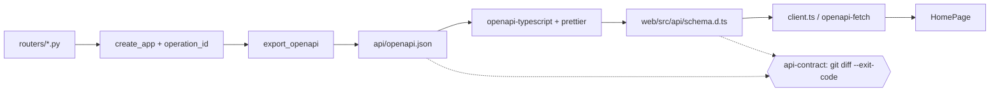

# 0001 — API contract pipeline: operation IDs, schema export, generated client

Status: Accepted (tech lead, 2026-10-14) · Date: 2026-10-14 · Step: 0.4

## Context
The 0.4 rule is "no hand-written API types". The web app has to get its types from FastAPI's OpenAPI schema, and
CI has to fail when the committed client drifts from the API. The constraints:
- there is no module-level `app`, only `create_app(settings)`;
- `Settings` reads env and `.env`, and `settings.version` currently becomes the OpenAPI `info.version`;
- `.gitattributes` is `* text=auto eol=lf`, and developers use both Windows and Linux;
- operation IDs come only from a custom `generate_unique_id_function` (carry-forward from 0.2);
- the 0.3 client behaviour (4 s per-attempt timeout, caller abort, `ApiError` kinds `http`/`network`/`invalid`)
  must not change. UX 0.3 §4 says "invalid" covers a body that is "not JSON, or fails the runtime shape check, or
  `status` ≠ "ok"".

## Decision
1. **Operation IDs.** `operation_id(route)` turns the handler's snake_case function name into camelCase
   (`parse_route` → `parseRoute`). A name must match `^[a-z][a-z0-9]*(_[a-z0-9]+)+$`, which means verb_noun with at
   least two words. A route must have exactly one HTTP method. Anything else raises `OperationIdError`.
   `create_app` then calls `check_operation_ids(app)`. That check raises on any duplicate ID, any hand-set
   `operation_id=`, and any `name=` that differs from `endpoint.__name__`. IDs never get a silent suffix. On a
   collision, rename the handler.
   **`/health`:** the handler is renamed `health` → `get_health`, so its operation ID is **`getHealth`**.
2. **Export.** Run `uv run --frozen --directory api python -m app.export_openapi [OUT]`. It writes to
   **`api/openapi.json`** by default, and that file **is committed**. The script calls
   `create_app(Settings(_env_file=None, version=SCHEMA_VERSION)).openapi()`, with `SCHEMA_VERSION = "0.0.0-contract"`.
   No server, no TestClient, no socket. `version` is the only setting that reaches the schema, and it is pinned,
   so `VERSION`, `GIT_SHA` and `ENV` in the shell cannot change the output. `.env` is ignored. The output is
   `json.dumps(schema, indent=2, sort_keys=True, ensure_ascii=False) + "\n"`, written with
   `encoding="utf-8", newline="\n"`. The `newline` argument matters: without it, Windows text mode writes CRLF.
   Sorting keys means reordering routes in code does not churn the diff. The live `/openapi.json` keeps showing
   the build version; only the committed copy is pinned.
3. **Generation.** `web/package.json` gets this script:
   `"gen:api": "uv run --frozen --directory ../api python -m app.export_openapi && openapi-typescript ../api/openapi.json -o src/api/schema.d.ts && prettier --write src/api/schema.d.ts"`.
   It uses openapi-typescript with default flags (no `--root-types`, no `--enum`). The Prettier step means the file
   passes `format:check`, `end-of-file-fixer` and `trailing-whitespace` without any exemption, and the output only
   changes when the pinned Prettier changes. ESLint ignores `src/api/schema.d.ts`. `tsc` includes it, but
   `skipLibCheck` skips its body while still checking every use. `just gen-api` = `pnpm --filter web gen:api`.
   `.gitattributes` gets `api/openapi.json linguist-generated=true` and
   `web/src/api/schema.d.ts linguist-generated=true`. Dependencies: `openapi-fetch` goes in `dependencies` and
   `openapi-typescript` in `devDependencies`.
4. **Client.** The public surface and behaviour of `client.ts` stay the same. Only the transport and the types
   change:
   - **Client:** a new `createClient<paths>` is built per call, inside each request function, from
     `getApiBaseUrl()`. That call happens before any try block, so a config error is never classified as
     `network`. Building per call also means env stubs and MSW keep working.
   - **Network errors:** classified by a custom `fetch` option. It calls `globalThis.fetch(request)` at call time.
     If that rejects and `request.signal` is not aborted, it throws `ApiError('network')`. This mirrors 0.3, where
     the classification sat on the `fetch` call itself.
   - **Timeout and caller abort:** these stay in a `withTimeout` wrapper, which is the 0.3 logic lifted out
     unchanged. It passes `signal` into `client.GET`.
   - **JSON errors:** openapi-fetch does not catch errors from JSON parsing (verified in 0.17.0 source). A
     `SyntaxError` from `client.GET` becomes `ApiError('invalid', 'not JSON')`.
   - **HTTP errors:** `!response.ok` becomes `ApiError('http', …, status)`.
   - **Shape guard:** `isHealth` becomes a field-guard map checked with
     `satisfies FieldGuards<components['schemas']['HealthResponse']>`. UX 0.3 §4 requires the guard, and so do
     three 0.3 tests. It also protects against version skew once web and API deploy separately in 0.5. Because the
     map is typed from the generated schema, adding, removing, renaming or retyping a field breaks `tsc`. Extra
     fields stay allowed. The `Health` interface goes, and no local aliases of API types are allowed: write
     `components['schemas'][…]` inline.
5. **ESLint guard.** Applies to `src/**/*.{ts,tsx}` except `src/api/**`. `no-restricted-syntax` bans
   `CallExpression[callee.name='fetch']` and
   `CallExpression[callee.property.name='fetch'][callee.object.name=/^(window|globalThis|self)$/]`, with the
   message "Call the API through src/api/client.ts". This bans every raw `fetch`, not only calls to the API: a
   selector can't see URLs, and any network call belongs in `src/api/` anyway.
6. **CI `api-contract`.** The job checks out the repo, sets up uv (Python 3.12) and pnpm (Node 24), then runs
   `uv sync --frozen --directory api`, `pnpm install --frozen-lockfile` and `pnpm --filter web gen:api`. Last, it
   runs `git diff --exit-code`. On failure it prints "run `just gen-api` and commit".

## Interface
```python
# api/app/operation_ids.py
class OperationIdError(RuntimeError): ...
def operation_id(route: APIRoute) -> str: ...          # FastAPI(generate_unique_id_function=operation_id)
def check_operation_ids(app: FastAPI) -> None: ...     # called at the end of create_app

# api/app/export_openapi.py
SCHEMA_VERSION: Final = "0.0.0-contract"
DEFAULT_OUTPUT: Final[Path]                             # <api>/openapi.json, from __file__
def build_schema() -> dict[str, Any]: ...               # Any: FastAPI.openapi() returns dict[str, Any]
def render_schema(schema: Mapping[str, Any]) -> str: ...  # Any: arbitrary JSON values
def main(argv: Sequence[str] | None = None) -> int: ...
```
```ts
// web/src/api/client.ts (exports unchanged except the return type)
export function getApiBaseUrl(): string
export type ApiErrorKind = 'http' | 'network' | 'invalid'   // client error taxonomy, not an API type
export class ApiError extends Error { readonly kind: ApiErrorKind; readonly status?: number }
export const HEALTH_TIMEOUT_MS = 4000
export function fetchHealth(signal?: AbortSignal): Promise<components['schemas']['HealthResponse']>
// internal
function createApiClient(baseUrl: string): Client<paths>      // fetch: classifyingFetch
function classifyingFetch(request: Request): Promise<Response>
function withTimeout<T>(ms: number, signal: AbortSignal | undefined, run: (s: AbortSignal) => Promise<T>): Promise<T>
type FieldGuards<T> = { [K in keyof T]-?: (v: unknown) => v is T[K] }
function hasShape<T>(value: unknown, guards: FieldGuards<T>): value is T
```


## Options considered
- **orval** — rejected: it generates runtime code, with its own TanStack hooks and mocks, that duplicates our query layer. That means bigger diffs and a bigger bundle (size-limit). The phase-0 checklist names openapi-typescript/openapi-fetch.
- **@hey-api/openapi-ts** (recommended in FastAPI docs) — rejected: not in the roadmap, and it also generates a runtime SDK.
- **openapi-generator** — rejected: needs a JVM in CI.
- **Generate from a running server** — rejected: needs a port and a process, which is flaky on Windows (orphaned uvicorn).
- **`openapi.json` as an uncommitted temp file** — rejected: loses the reviewable contract diff, and Phase 4 Expo would need Python to get the schema.
- **Default IDs (`health_health_get`) / tag-prefixed IDs (FastAPI docs example)** — rejected: not clean camelCase method names.
- **Suffix on collision** — rejected: hides the clash; the brief requires loud failure.
- **Drop the shape guard** — rejected: UX 0.3 §4 and three 0.3 tests require it.
- **zod** — rejected: not in the stack, and the brief puts it out of scope.
- **openapi-fetch `onError` middleware for network errors** — rejected: a custom `fetch` does the same job without depending on middleware ordering semantics.
- **Prettier-ignore `schema.d.ts`** — rejected: the end-of-file and whitespace hooks would still touch it and make the diff flap.
- **`openapi-typescript --check`** — rejected: covers only the TypeScript step, not `openapi.json`.
- **Fixed version in `create_app`** — rejected: release-please (0.6) bumps would fail `api-contract`.

## Consequences
- Easier: one command regenerates everything. API changes show up in PRs as a readable `openapi.json` diff. Expo (Phase 4) can generate from the committed JSON, and openapi-fetch runs on React Native unchanged.
- Easier: an operation-ID mistake fails at `create_app`, so it shows up in tests, the export and CI.
- Harder later: handler names are now part of the public contract. Renaming a handler renames the client method.
- Harder later: the field-guard pattern does not scale to nested Phase 1 responses. Runtime validation for those needs its own ADR, not copies of this pattern.
- Harder later: `openapi-fetch` is 0.x, so minor bumps may break things; Dependabot PRs rely on tests to catch that.
- Harder later: `gen:api` needs `uv` on the PATH, so frontend-only developers must have the API toolchain installed.

## How it is tested
- **pytest (unit, no socket):**
  - `operation_id`: name-to-camelCase conversion, bad names, multi-method routes.
  - `check_operation_ids`: duplicates, hand-set `operation_id=`, `name=` override.
  - Every schema operation is camelCase and unique, and `/health` maps to `getHealth`.
  - `main(tmp_path)`: writes valid JSON with `openapi` starting `3.`, ends with exactly one `\n`, contains no `\r`.
  - Output bytes are identical across two runs and with `VERSION`/`GIT_SHA`/`ENV` monkeypatched.
- **tsc:** `__typecheck__.ts` calls every path. It is not executed, so it should be excluded from Vitest coverage; the tech lead decides.
- **Vitest (unchanged assertions):** base URL, timeout, abort and the three error kinds. The timeout test's `fetch` stub must read `signal` from the `Request` argument, because openapi-fetch calls `fetch(request)`.
- **ESLint:** fixture check that the rule bites outside `src/api/` and passes inside it.
- **Contract:** the CI `api-contract` job, plus the deliberate-break run.

## References
- FastAPI, Generating SDKs: https://fastapi.tiangolo.com/advanced/generate-clients/ (the `APIRoute -> str` signature; customising the function means "you will have to ensure that each operation ID is unique")
- openapi-typescript CLI (v7): https://openapi-ts.dev/cli
- openapi-fetch API and middleware: https://openapi-ts.dev/openapi-fetch/api, https://openapi-ts.dev/openapi-fetch/middleware-auth
- openapi-fetch 0.17.0 source (`dist/index.mjs`, unpkg): calls `fetch(request, init)`, captures `globalThis.fetch` when `createClient` runs, no try/catch around JSON parsing, and returns `data: undefined` for 204 / Content-Length 0 / empty body
- npm registry: openapi-typescript 7.13.0 (peer `typescript ^5.x`), openapi-fetch 0.17.0
- docs/ux/0.3-home.md §4; docs/steps/0.4.md; docs/roadmap/phase-0.md §0.4
