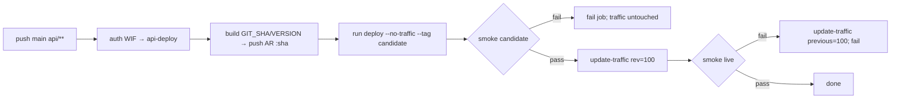

# 0002 — Deployment: WIF identities, candidate → traffic, Firebase Hosting, CORS, settings prefix

Status: Accepted (tech lead, 2026-10-14; `firebase-tools` CI use pending manager approval; max instances amended 3 → 1 on 2026-10-18, ADR 0003) · Date: 2026-10-14 · Step: 0.5

## Context
Step 0.5 puts the API on Cloud Run and the web app on Firebase Hosting. Both deploy from `main` through GitHub
Actions with Workload Identity Federation (WIF), so no keys exist anywhere. A candidate revision gets traffic only
after its smoke test passes, every PR gets a preview URL, and production config comes from env only.
The constraints:
- The API deploy SA keeps **exactly** `run.admin`, `artifactregistry.writer` and `iam.serviceAccountUser`.
- Fork PRs and Dependabot PRs must never get credentials.
- `ENV`/`VERSION` collide with shell vars (carry-forward from 0.2).
- `export_openapi` must stay deterministic (ADR 0001).
- The repo is public: `YoavIsaacs/hiking_app`.

The manager still has to decide the project ID and region, so this ADR uses placeholders: `<PROJECT_ID>`,
`<PROJECT_NUMBER>` and `<REGION>` (recommended: `me-west1`). `<REPO_ID>`/`<OWNER_ID>` are GitHub's numeric IDs
(`gh api repos/YoavIsaacs/hiking_app --jq '.id, .owner.id'`). Names fixed here are constants in workflows, not
config: Cloud Run service `hike-api`, Artifact Registry repo `hike`, image `api`, WIF pool `github`, provider
`hiking-app`.

## Decision

**1. Identity: one pool, one provider, separate subjects.** Pool `github`, OIDC provider `hiking-app`, issuer
`https://token.actions.githubusercontent.com`.
- Mapping: `google.subject=assertion.sub, attribute.repository_id=assertion.repository_id,
  attribute.repository_owner_id=assertion.repository_owner_id, attribute.ref=assertion.ref,
  attribute.event_name=assertion.event_name`.
- Condition:
  ```
  assertion.repository_id == '<REPO_ID>' && assertion.repository_owner_id == '<OWNER_ID>' &&
  (assertion.ref == 'refs/heads/main' ||
   (assertion.event_name == 'pull_request' && assertion.base_ref == 'main'))
  ```
  The condition uses numeric IDs because a deleted name can be re-registered by someone else. Note what it does
  *not* do: it cannot tell a fork apart. A fork PR's `pull_request` run executes in the base repo's context, so
  `repository_id` matches.
- **Forks are excluded by GitHub itself.** Fork and Dependabot PR runs get a read-only `GITHUB_TOKEN`, and
  `id-token` can only be `write` or `none`, so these runs cannot request an OIDC token at all. Keep the setting
  "send write tokens to workflows from pull requests" off. On top of that, the preview job carries
  `if: github.event.pull_request.head.repo.full_name == github.repository && github.event.pull_request.user.login != 'dependabot[bot]'`.
  That condition is a skip, not a security control; without it the job would just fail red on those PRs.
  **Never use `pull_request_target`.**
- **Which SA a run can impersonate is decided by subject, not by the condition.** The bindings are
  `roles/iam.workloadIdentityUser` on each SA, granted to
  `principal://iam.googleapis.com/projects/<PROJECT_NUMBER>/locations/global/workloadIdentityPools/github/subject/<SUB>`:

  | SA | `<SUB>` |
  | --- | --- |
  | `api-deploy` | `repo:YoavIsaacs/hiking_app:environment:production` |
  | `web-deploy` | `repo:YoavIsaacs/hiking_app:environment:production` **and** `repo:YoavIsaacs/hiking_app:pull_request` |

  GitHub issues the `environment:production` subject only to jobs that declare `environment: production`, and the
  environment only admits `main`. So a PR job can never impersonate `api-deploy`, even if the PR edits a workflow.

**2. Service accounts and roles.** There are three SAs, and each role is bound at the narrowest resource that
supports it:

| SA | Role | Bound on |
| --- | --- | --- |
| `api-deploy` | `roles/run.admin` | project (the service has to be creatable and updatable; this also covers `--no-invoker-iam-check`) |
| | `roles/artifactregistry.writer` | **repository** `hike` only |
| | `roles/iam.serviceAccountUser` | **SA** `api-runtime` only (actAs for `--service-account`) |
| `api-runtime` | `roles/secretmanager.secretAccessor` | project (no secrets exist yet) |
| `web-deploy` | `roles/firebasehosting.admin` | project |
| | `roles/serviceusage.apiKeysViewer` | project (Firebase says CLI deploys need it) |

`web-deploy` does not get `firebaseauth.admin` or `serviceUsageConsumer`. Those roles exist only so the CLI can add
preview domains to Firebase Auth, which we don't use. We pass `--no-authorized-domains` instead. No SA gets any
other role, and the Cloud Run default compute SA (Editor) is never used.

**3. Web deploys use the Firebase CLI after `google-github-actions/auth`.** `FirebaseExtended/action-hosting-deploy`
requires `firebaseServiceAccount`, which is a JSON key, so we don't use it. Instead each job runs:
1. `auth` with `workload_identity_provider` and `service_account: web-deploy`. `create_credentials_file: true` is
   the default and exports `GOOGLE_APPLICATION_CREDENTIALS`. Checkout must run before this step.
2. `npx --yes firebase-tools@<exact version>`, with the version pinned once per workflow in
   `env.FIREBASE_TOOLS_VERSION`. Production runs `deploy --only hosting --project <PROJECT_ID> --non-interactive`.
   Previews run
   `hosting:channel:deploy pr-<N> --expires 7d --no-authorized-domains --project <PROJECT_ID> --json`, and the
   URL and `expireTime` come from the JSON result.

`firebase-tools` is a **new CI-only dependency** and needs manager approval (see "Why not the stack?").

`preview.yml` triggers on `pull_request` (opened, synchronize, reopened) with concurrency `preview-<N>` and
cancel-in-progress. It has two jobs:
- **`deploy`**: `contents: read, id-token: write`. Builds `web` and deploys channel `pr-<N>`.
- **`comment`**: `pull-requests: write` only, no checkout. Runs
  `gh pr comment <N> --repo $GITHUB_REPOSITORY --edit-last --create-if-none --body-file <file>` with
  `GH_TOKEN: ${{ github.token }}`.

Splitting the jobs keeps PR code from ever running in a job that holds a write token. Channels expire after 7 days
(the default; the maximum is 30), and a redeploy resets the TTL.

**4. API deploy flow (`deploy-api.yml`).** Triggers: push to `main` on `api/**` or the workflow file, plus
`workflow_dispatch`. The job declares `environment: production` and `permissions: {contents: read, id-token: write}`,
with `concurrency: {group: deploy-api, cancel-in-progress: false}`. The default `queue: single` means a newer push
replaces a pending run, but a running deploy is never cut off midway.

Steps:
1. Auth as `api-deploy`, then `setup-gcloud`.
2. `VERSION=$(python -m tools.deploy version)` reads `[project].version` from `api/pyproject.toml`, which
   release-please will own from 0.6.
3. Describe the service and save the result to `before.json`. Run `tools.deploy serving` to get
   `previous_revision`. If the service does not exist, fail with "run the runbook bootstrap step".
4. Build and push. Run `gcloud auth configure-docker <REGION>-docker.pkg.dev`, then `docker build api` with
   `--build-arg GIT_SHA=$GITHUB_SHA` and `--build-arg VERSION=$VERSION`, then `docker push`. The image is
   `<REGION>-docker.pkg.dev/<PROJECT_ID>/hike/api:<full 40-char SHA>`. There is no `latest` tag.
5. Deploy:
   `gcloud run deploy hike-api --image=<image> --region=<REGION> --service-account=<API_RUNTIME_SA> --no-traffic --tag=candidate --min-instances=0 --max-instances=1 --memory=512Mi --cpu=1 --concurrency=80 --cpu-boost --no-invoker-iam-check --set-env-vars=HIKE_ENV=production,HIKE_LOG_LEVEL=INFO,HIKE_CORS_ORIGINS=[],HIKE_CORS_FIREBASE_SITE=<PROJECT_ID> --quiet`.
   *Amended 2026-10-18:* `--max-instances` 3 → 1. This is a manager-approved deviation (brief 0.5, "Decisions and
   deviations"); see ADR 0003.
   `--set-env-vars` replaces every env var on each deploy, so the config stays declarative. `GIT_SHA` and
   `VERSION` live in the image, so the smoke test proves which image is running.
6. Describe again and save to `after.json`. `tools.deploy tagged --tag candidate` returns `candidate_url` and
   `candidate_revision`, read from `status.traffic[]`. We never build the URL by hand.
7. **Smoke the candidate:** `tools.deploy smoke --url <candidate_url> --expected-sha $GITHUB_SHA --origin https://<PROJECT_ID>.web.app`.
   It checks for 200, valid JSON, `status == "ok"`, `git_sha == expected`, and `access-control-allow-origin == origin`.
   The origin check catches CORS env mistakes that a plain `/health` would miss. It retries 6×, 5 s apart, with a
   10 s timeout per attempt, to ride out cold starts.
8. **Promote:** `gcloud run services update-traffic hike-api --to-revisions=<candidate_revision>=100`. We name the
   revision explicitly rather than using `--to-latest`. "Latest" could be a revision that nobody smoked, for example
   one from a manual deploy, whereas the explicit name is exactly the revision that passed step 7.
9. **Live check:** run the same smoke against the service URL (`status.url`).
10. `if: failure() && steps.promote.outcome == 'success'` →
    `update-traffic --to-revisions=<previous_revision>=100`, and the job stays failed.
11. `if: always()`: print the traffic table (`services describe --format`) as evidence for the checkpoint.

When the candidate smoke fails, traffic is never touched, the job fails, and the failed revision **keeps its
`candidate` tag**. It holds no traffic and costs nothing at min 0. The tag lets us curl it while debugging, and the
next deploy moves the tag on. **Public access:** the API is public, so we disable the invoker IAM check
(`--no-invoker-iam-check`). That is Google's recommended way to do it, and it works the same as an `allUsers`
`run.invoker` binding.

**First deploy (bootstrap).** The runbook creates the service once from Google's sample image (step 9 in the
console steps below). After that, every workflow run goes through the same no-traffic → smoke → promote path, and
the URL is known before merge, so `web/.env.production` can be committed. Handling "create" inside the workflow
would mean a branch that runs exactly once, and gcloud may reject `--no-traffic` on a service that doesn't exist yet.

**5. Smoke logic is code: `api/tools/deploy.py`.** It is stdlib only and is not copied into the image (the
Dockerfile copies only `app`).
- It runs as `uv run --frozen --directory api python -m tools.deploy <cmd>`.
- Each `<cmd>` prints `key=value` lines for `$GITHUB_OUTPUT`.
- Tests live in `api/tests/tools/`. `pyproject` gains `--cov=tools`, and mypy targets `app tools tests` in CI and
  pre-commit.
- Owners: devops (script and config lines), QA (tests, red first). The tech lead confirms ownership, since the files
  sit in `api/`.

**6. `VITE_API_URL` stays in the committed `web/.env.production`.** This is the 0.3 decision and it holds. The
value is public and lands in the bundle anyway, it gets reviewed in PRs, and a local `pnpm build` produces the same
bundle CI deploys. Cloud Run's deterministic URL (`https://hike-api-<PROJECT_NUMBER>.<REGION>.run.app`) is stable
once bootstrap has run. Preview builds use the same production build, so they talk to the production API.
`deploy-web` refuses to deploy while the file still contains `.invalid`. That is a one-line grep step, and it goes
dead once the URL is set.

**7. CORS.** Two settings feed a pure function. The preview regex is built in code, not typed into config:
- `HIKE_CORS_ORIGINS` is a JSON list of exact origins. The default is `["http://localhost:5173"]`, and production
  sets `[]`. Every entry must be `scheme://host[:port]`, with no path, no trailing slash and no `*`.
- `HIKE_CORS_FIREBASE_SITE` is optional, and production sets it to `<PROJECT_ID>`; Firebase says the default site ID
  is the project ID. The site must match `^[a-z][a-z0-9-]{4,28}[a-z0-9]$` with no `--` (the separator for channel
  URLs). When it is set, the function adds `https://<site>.web.app` and `https://<site>.firebaseapp.com` as exact
  origins, plus the regex `https://<re.escape(site)>--pr-[0-9]+-[a-z0-9]+\.web\.app` for preview channels.
- Starlette `fullmatch`es the regex, and the `pr-` prefix matches our channel naming only.
- **Must reject** (QA, with `S` = the site):
  - `https://S.web.app.evil.com`
  - `https://evilS.web.app` and `https://x-S--pr-1-abc123.web.app`
  - `http://S.web.app`
  - `https://S.web.app:8443`
  - `https://S.web.app/`
  - `https://S--pr-1-abc123.firebaseapp.com`
  - `https://S--feature-abc123.web.app`
  - `https://S--pr-1-abc123.web.app.evil.com`
  - `https://S--pr-1-ABC123.web.app`
  - `https://S--pr-1-abc123.web.app\n`
  - `null`
  - `http://localhost:5173` under production settings
  - another project's `https://T--pr-1-abc123.web.app`
- **Must accept:** `https://S.web.app`, `https://S.firebaseapp.com`, `https://S--pr-7-a1b2c3d4.web.app`, and
  localhost in dev.

**8. Settings prefix `HIKE_`.** `SettingsConfigDict(env_prefix="HIKE_", env_file=".env", extra="ignore")`.
- Env names: `HIKE_ENV`, `HIKE_VERSION`, `HIKE_GIT_SHA`, `HIKE_CORS_ORIGINS`, `HIKE_CORS_FIREBASE_SITE`,
  `HIKE_OPEN_METEO_BASE_URL`, `HIKE_LOG_LEVEL`. Unprefixed names are ignored, and so are unprefixed keys in `.env`.
- Dockerfile: the build args keep their names (`GIT_SHA`, `VERSION`; they are explicit, so nothing collides) and map
  to `ENV HIKE_GIT_SHA=${GIT_SHA} HIKE_VERSION=${VERSION}`. The header comment shows both `--build-arg`s.
- Cloud Run's `PORT` is not a setting and stays as it is.
- `just dev-api`, the Playwright `webServer` and CI e2e set no settings env, so they are unchanged.
- `export_openapi` already uses `Settings(_env_file=None, version=SCHEMA_VERSION)`, and no new setting reaches the
  schema, so it stays deterministic. Its test monkeypatches both `HIKE_*` and the old names.
- `test_settings.py` moves to prefixed names, and adds a test that `ENV=staging` no longer has any effect.

**9. GitHub configuration.** **No secrets.** Every value here is an identifier, not a credential; the protection
comes from the WIF condition and the subject bindings. They are stored as **variables**, so they show up unmasked in
logs, which helps debugging.
- **Repository variables** (used by previews too): `GCP_PROJECT_ID`, `GCP_REGION`, `GCP_WIF_PROVIDER`
  (`projects/<PROJECT_NUMBER>/locations/global/workloadIdentityPools/github/providers/hiking-app`), `WEB_DEPLOY_SA`.
- **Environment `production` variables:** `API_DEPLOY_SA`, `API_RUNTIME_SA`.
- **Protection:** deployment branches = selected, `main` only. No required reviewers and no wait timer, because they
  would block the automatic deploy.
- `deploy-api` and `deploy-web` both use `environment: production`; preview does not.

**10. Rollback semantics.** A candidate that fails its smoke test never takes traffic, which is the substance of
"traffic is routed back automatically". Step 10 above meets the literal wording too: if the live check fails after
promotion, traffic goes back to the revision that was serving before, with no manual step. A failure in
`deploy-web` or its Playwright run **does not** roll back the API. The two deploys are independent, each has its own
smoke test, and the web smoke test does not assert a particular API SHA. A web failure fails the job, and the web
fix goes forward or is rolled back in the console (no automatic web rollback in 0.5; see follow-ups).

**11. Firebase Hosting config.**
- `firebase.json` at the repo root: `hosting.public: "web/dist"`, `ignore: ["firebase.json", "**/.*",
  "**/node_modules/**"]`, `rewrites: [{"source": "**", "destination": "/index.html"}]`.
- `headers`, in this order:
  1. `{"source": "**", Cache-Control: "no-cache"}`
  2. `{"source": "/assets/**", Cache-Control: "public, max-age=31536000, immutable"}`

  Header rules match the *request* path before rewrites run, so a rule on `/index.html` alone would miss `/` and
  the SPA routes. Rules apply in order. The docs say nothing on overlaps, and a firebase-tools issue reports
  "last rule wins". **QA verifies this once** with `curl -sI` against the PR's preview channel (`/`, a deep route,
  one `/assets/*.js`) and records the result.
- **No `.firebaserc`.** CI always passes `--project ${{ vars.GCP_PROJECT_ID }}`, which keeps one source for the
  project ID, and a PR cannot quietly retarget it. For local use, the runbook passes `--project` too.
- `deploy-web.yml`: push to `main` on `web/**`, `firebase.json`, root `package.json`/`pnpm-lock.yaml`/
  `pnpm-workspace.yaml` or the workflow file, plus `workflow_dispatch`. Concurrency `deploy-web`.
- Steps: guard `.invalid` → `pnpm --filter web build` → auth → firebase deploy → Playwright smoke against
  `https://<PROJECT_ID>.web.app`.

## Interface
```python
# api/app/config.py
class Settings(BaseSettings):
    model_config = SettingsConfigDict(env_prefix="HIKE_", env_file=".env", extra="ignore")
    env: str = "local"
    cors_origins: list[str] = ["http://localhost:5173"]   # validated: exact origins, no '*', no path
    cors_firebase_site: str | None = None                 # validated against FIREBASE_SITE_RE, no '--'
    version: str = "0.0.0-dev"
    git_sha: str = "unknown"
    open_meteo_base_url: str = "https://api.open-meteo.com"
    log_level: LogLevel = "INFO"

# api/app/cors.py  (pure; create_app passes the result to CORSMiddleware)
FIREBASE_SITE_RE: Final[re.Pattern[str]]
@dataclass(frozen=True)
class CorsPolicy:
    allow_origins: tuple[str, ...]
    allow_origin_regex: str | None
def cors_policy(origins: Sequence[str], firebase_site: str | None) -> CorsPolicy: ...
```
```python
# api/tools/deploy.py  (CI only, stdlib only; not in the image)
class DeployCheckError(RuntimeError): ...
@dataclass(frozen=True)
class HttpResult:
    status: int
    headers: Mapping[str, str]    # lower-cased names
    body: bytes
Fetch = Callable[[str, Mapping[str, str], float], HttpResult]       # (url, request headers, timeout_s)
def read_version(pyproject: Path) -> str: ...
def serving_revision(service: Mapping[str, object]) -> str: ...       # the one revision at 100 %, else error
def tagged_revision(service: Mapping[str, object], tag: str) -> tuple[str, str]: ...  # (revision, url)
def check_health(result: HttpResult, expected_sha: str, origin: str | None) -> None: ...
def smoke(url: str, expected_sha: str, *, origin: str | None, fetch: Fetch,
          sleep: Callable[[float], None], attempts: int = 6, delay_s: float = 5.0) -> None: ...
def urllib_fetch(url: str, headers: Mapping[str, str], timeout_s: float) -> HttpResult: ...  # the only I/O
def main(argv: Sequence[str] | None = None) -> int: ...
# CLI: version | serving --service-json F | tagged --service-json F --tag T
#      | smoke --url U --expected-sha S [--origin O]
```


### Why not the stack? (`firebase-tools`, CI only, needs manager approval)
Nothing in the stack can deploy to Firebase Hosting. The only official alternative, `action-hosting-deploy`, needs a
key, and keys are forbidden. Running it with `npx firebase-tools@<pinned>` in CI keeps it out of the workspace, so
nobody's `pnpm install` gets heavier. The trade-offs:
- There is no lockfile integrity hash and no Dependabot bump; the exact version pin only partly makes up for that.
  Revisit with SHA pinning in 0.6.
- It runs with the `web-deploy` credential.

The new actions `google-github-actions/auth` and `setup-gcloud` are the same kind of thing as
`astral-sh/setup-uv`; they are listed for approval for completeness.

## Options considered
- **`action-hosting-deploy`** — rejected: needs a JSON key.
- **`firebase-tools` as a root devDependency** — rejected: adds weight to every install for one CI use.
- **Separate provider for PRs** — rejected: GitHub already excludes forks, so it adds resources without adding
  security.
- **`preview` environment** — rejected: same reason.
- **`pull_request_target`** — rejected: it runs base-repo credentials next to PR code (the "pwn request").
- **Direct WIF, no SA** — rejected: Docker login to Artifact Registry and the Firebase CLI need an access token for
  an SA, and the roadmap names a deploy SA.
- **One SA for API and web** — rejected: it breaks "exactly three roles".
- **Custom OIDC `sub` per workflow** to keep `deploy-web` off `api-deploy` — rejected for now: it needs extra GitHub
  config, and both workflows are reviewed code on `main`.
- **`--to-latest`** — rejected: it can route to a revision nobody smoked.
- **Create the service inside the workflow** — rejected: a branch that runs once, and possible `--no-traffic` errors
  on create.
- **Delete or untag a failed candidate** — rejected: it loses debugging access, and the next deploy moves the tag
  anyway.
- **Roll back the API on a web failure** — rejected: it couples two independent deploys.
- **`deploy-cloudrun` action, Cloud Build** — rejected: they hide the commands, and Cloud Build needs extra
  APIs/roles.
- **`VITE_API_URL` as a GitHub variable** — rejected: CI and local builds would differ, the change history would
  leave git, and the value is public anyway.
- **CORS regex or JSON list in Cloud Run env** — rejected: commas break `--set-env-vars`, and the production regex
  would go untested.
- **`allow_origins=["*"]`** — rejected: hygiene, and it would hide config mistakes.
- **Prefix `APP_`/`API_`** — rejected: too generic, so collisions are more likely.
- **Inline curl/jq smoke** — rejected: it can't be unit-tested.
- **httpx/respx in the tool** — rejected: needs no dependency; an injected `fetch` is the seam.
- **Committed `.firebaserc`** — rejected: a second source for the project ID.
- **Separate Spark-plan Firebase project** — rejected: the checklist links Firebase to the same project.
- **Immutable AR tags** — rejected: a rerun of the same SHA would fail to push.

## Consequences
- Easier: no keys exist anywhere. A PR cannot touch Cloud Run at all.
- Easier: every deploy runs one path, from bootstrap onwards. A broken image never takes traffic.
- Easier: the CORS rules for production and previews are code, under unit test.
- Easier: config is identical locally and in CI, and Expo (Phase 4) can use the same API URL.
- Harder later: a same-repo PR **can** deploy the live Hosting site, because Firebase has no role scoped to channels
  and a PR may edit `preview.yml`. Today only the owner has write access, so we accept this. Revisit if collaborators
  join.
- Harder later: the subject bindings contain the repo name, so renaming the repo breaks deploys (it fails closed).
- Harder later: a custom domain or any other non-Firebase origin has to go into `HIKE_CORS_ORIGINS` as JSON with
  commas, which means `--env-vars-file` or gcloud's `^@^` delimiter.
- Harder later: Dependabot and fork PRs get no preview. If 1.11 makes the preview job required, skipped jobs report
  success, which is fine.
- Harder later: `--edit-last` edits the bot's last comment. When Lighthouse (1.11) comments too, switch to a
  marker-based upsert.
- Harder later: previews hit the production API, so a preview that misbehaves generates real load (max 1 instance
  caps it; amended 2026-10-18, ADR 0003).
- **Cost:**
  - Linking billing auto-upgrades Firebase to **Blaze**. The brief assumed Spark. Hosting keeps a no-cost quota.
  - Cloud Run is request-billed at min 0, well within the free tier (180k vCPU-s / 360k GiB-s / 2M req per month;
    `me-west1` may be a pricing tier with smaller allowances — confirm on the pricing page).
  - Artifact Registry: 0.5 GB free, about $0.10/GB-month after that. With a cleanup policy keeping 10 versions,
    that is under $0.10/month.
  - WIF, Secret Manager (no secrets) and Actions minutes (public repo) cost $0.
  - The $5/month budget alert stays.

## How it is tested
- **pytest, no socket (QA red first):**
  - `cors_policy` table: every accept/reject in §7, invalid site IDs (`--`, uppercase, too short, trailing `-`),
    `*` and paths in `cors_origins`.
  - Through `create_app` with production-like settings: simple and preflight requests for the allowed origins and
    for each lookalike. This is the real-wiring rule.
  - Settings: `HIKE_*` are read, unprefixed names are ignored.
  - `export_openapi` bytes are unchanged with `HIKE_*` and unprefixed vars set.
  - `tools.deploy`:
    - `serving_revision`/`tagged_revision` on fixture JSON: no 100 %, a split, a missing tag.
    - `check_health`: wrong SHA, `status ≠ ok`, non-JSON, 500, missing or mismatched ACAO.
    - `smoke`: retries, then gives up, using fake `fetch`/`sleep`.
    - `read_version`.
    - CLI output format.
    - `urllib_fetch` against a loopback `http.server`, which `--allow-hosts=127.0.0.1` permits.
- **Docker (QA):** `HIKE_GIT_SHA`/`HIKE_VERSION` come from the build args, and `/health` reflects them.
- **Live (workflow):**
  - The candidate and live smoke runs in `deploy-api`.
  - Playwright in `deploy-web`. QA adds the seam: `E2E_BASE_URL` (when set, there is no `webServer`) and
    `E2E_API_URL` (instead of `constants.ts`).
  - The preview URL comment.
  - The one-time `curl -sI` cache-header check.
- **Checkpoint:** a deliberately wrong SHA on `main` makes `deploy-api` fail at the candidate smoke. The traffic table
  in the log shows the old revision still at 100 %. Then fix forward.

## Manager console steps (in order; devops turns these into the runbook)
1. Create project `<PROJECT_ID>`, link billing, and set a **$5/month budget alert** at 50/90/100 %. Note the
   `<PROJECT_NUMBER>`.
2. Enable these APIs: `run`, `artifactregistry`, `secretmanager`, `iamcredentials`, `iam`, `sts`,
   `cloudresourcemanager`. The checklist lists four of them; IAM and STS are needed for WIF.
3. Add Firebase to the existing project (it becomes Blaze), then click Hosting → Get started. Confirm the default
   site ID == `<PROJECT_ID>`; if not, stop and tell the tech lead. **Do not** run `firebase init hosting:github`,
   because it creates a key.
4. Create the Artifact Registry Docker repo `hike` in `<REGION>`. Optionally add a cleanup policy that keeps the 10
   most recent versions.
5. Create the SAs `api-deploy`, `api-runtime` and `web-deploy`.
6. Grant the roles exactly as in the §2 table, each on its stated resource.
7. Create the WIF pool `github` and provider `hiking-app` with the §1 mapping and condition, filling in
   `<REPO_ID>`/`<OWNER_ID>`.
8. Grant `roles/iam.workloadIdentityUser` with the §1 subject bindings: one on `api-deploy`, two on `web-deploy`.
9. Bootstrap the service with your own credentials:
   `gcloud run deploy hike-api --image=us-docker.pkg.dev/cloudrun/container/hello --region=<REGION> --service-account=api-runtime@<PROJECT_ID>.iam.gserviceaccount.com --no-invoker-iam-check --min-instances=0 --max-instances=1 --memory=512Mi --concurrency=80`.
   (*Amended 2026-10-18:* max instances 3 → 1; see ADR 0003.) Send `status.url` to the tech lead, who has frontend put it in `web/.env.production`.
10. GitHub: add the repository variables and the environment `production` (branch rule `main`, plus its two
    variables) as listed in §9.
11. After merge, watch `deploy-api` and `deploy-web`, then do the phone timing checks.

## References
- GitHub OIDC claims and `sub` formats: https://docs.github.com/en/actions/reference/security/oidc
- Fork/Dependabot read-only tokens and `id-token: write|none`; `concurrency` `queue`:
  https://docs.github.com/en/actions/reference/workflows-and-actions/workflow-syntax ;
  https://docs.github.com/en/actions/reference/workflows-and-actions/events-that-trigger-workflows
- Google WIF for deployment pipelines (condition required, use `*_id` claims, `principal://…/subject/…`, 127-char
  subject, required APIs): https://docs.cloud.google.com/iam/docs/workload-identity-federation-with-deployment-pipelines
- `google-github-actions/auth` (impersonation needs `service_account` for access tokens; credentials file;
  checkout first): https://github.com/google-github-actions/auth
- Cloud Run: tags and `update-traffic` https://docs.cloud.google.com/run/docs/rollouts-rollbacks-traffic-migration ;
  `gcloud run deploy` flags https://docs.cloud.google.com/sdk/gcloud/reference/run/deploy ; deploy roles
  https://docs.cloud.google.com/run/docs/deploying ; public access / `--no-invoker-iam-check`
  https://docs.cloud.google.com/run/docs/authenticating/public ; deterministic URLs
  https://docs.cloud.google.com/run/docs/triggering/https-request
- Artifact Registry cleanup policies: https://docs.cloud.google.com/artifact-registry/docs/repositories/cleanup-policy
- Firebase: preview channels https://firebase.google.com/docs/hosting/test-preview-deploy ; expiry (default 7 d,
  max 30 d), default site ID = project ID https://firebase.google.com/docs/hosting/manage-hosting-resources ;
  `firebase.json` (rewrites, headers match before rewrites, applied in order) https://firebase.google.com/docs/hosting/full-config ;
  Hosting roles and the API Keys Viewer note https://firebase.google.com/docs/projects/iam/roles-predefined-product ;
  billing link → Blaze https://firebase.google.com/docs/projects/billing/firebase-pricing-plans
- `action-hosting-deploy` (requires a JSON key): https://github.com/FirebaseExtended/action-hosting-deploy
- firebase-tools source: `src/commands/hosting-channel-deploy.ts` (`--no-authorized-domains`, `--expires` max 30 d,
  needs `firebasehosting.sites.update`); `src/init/features/hosting/github.ts` (role list and reasons);
  header overlap "last rule wins" report: https://github.com/firebase/firebase-tools/issues/9467
- Starlette CORS (`fullmatch`, origins OR regex, `Vary: Origin`): `starlette/middleware/cors.py`
- GitHub CLI `gh pr comment --edit-last --create-if-none`: https://cli.github.com/manual/gh_pr_comment
