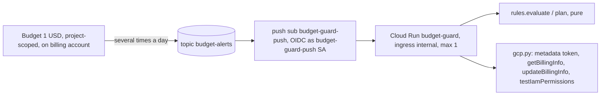

# 0003 — Billing kill switch: $1 budget → Pub/Sub → guard detaches billing

Status: **Deferred** (manager, 2026-10-19) · Date: 2026-10-18 · Step: 0.5

## Status history
- 2026-10-18 — Accepted by the tech lead (manager acknowledgements and `ops/` ownership were pending).
- 2026-10-19 — **Deferred by the manager** (brief 0.5, "Decisions and deviations", 2026-10-19). The kill switch is
  overkill at this scope, and the roadmap only requires a budget alert. Nothing below was built or deployed:
  - No `ops/` folder exists, and there is no `ops-test` CI job. The `ops/` ownership rows in `CLAUDE.md` were
    withdrawn.
  - The guard today is the budget alert plus the Cloud Run instance cap:
    - a **5 ILS/month** budget (the billing account's currency is ILS), alerting by email at 50/90/100 % of
      actual spend;
    - Cloud Run `hike-api` at `--max-instances=1` and `--min-instances=0` (ADR 0002 §4 step 5 and console step 9;
      the §6 instance cap stays in force on its own).
  - Nothing stateful lives in the project.
  - **Budget amount:** the actual budget is 5 ILS (about $1.35 at roughly 3.7 ILS/USD), not the $1 this body
    assumes. Where the body says $1, read 5 ILS.
  - **Revisit before Phase 3.** Public accounts and the community feed raise the cost risk from abuse traffic. The
    body below is kept intact as the design to pick up then; re-check its references and the native spend-cap
    option first, since both may have changed.

## Context
The manager approved a deviation in step 0.5 (brief, "Decisions and deviations", 2026-10-18). A GCP budget only
sends alerts, so the step adds a **hard stop**: a $1/month budget (alerts at 50/90/100 %) publishes to Pub/Sub, and a
small service detaches billing from the project. The manager has accepted two limits:
- Billing data lags, so spend can pass $1 before the stop fires.
- Detaching billing stops the paid services until billing is linked again.

The same deviation sets Cloud Run `--max-instances=1` (ADR 0002 is amended to match).

Constraints:
- Running cost stays $0.
- Stay in the stack (Python 3.12, uv, pytest).
- Keep the logic pure, with I/O at the edges.
- No keys anywhere.
- Agents never run cloud commands.
- Region `me-west1`, project `<PROJECT_ID>` (planned `hike-prep`).

**Budget amount.** This ADR uses the $1 budget from brief decision 1. That replaces the $5 in ADR 0002 "Cost" and
console step 1. Budget amounts are in the billing account's currency. If the account is not in USD, set the amount
to about $1 in that currency.

Placeholders follow ADR 0002. `<BUDGET_ID>` is the last path segment of the budget's `name`.

## Decision
**1. Hosting: a Cloud Run service built from source, triggered by a Pub/Sub push subscription.** No Cloud Run
functions and no Eventarc.

| Thing | Value |
| --- | --- |
| Topic | `budget-alerts` |
| Budget | the project-scoped budget, connected to the topic |
| Push subscription | `budget-guard-push` |
| Service | `budget-guard` in `me-west1` |

Service settings:
- `--ingress=internal`. Pub/Sub subscriptions in the same project count as internal sources.
- `--no-allow-unauthenticated`: the invoker IAM check stays on.
- `--min-instances=0 --max-instances=1 --concurrency=1 --timeout=60`. Concurrency 1 serialises the
  check-then-detach steps.

The build runs on Cloud Build (Google buildpacks, Python 3.12 from `.python-version`). A `Procfile` starts
`python -m budget_guard`, which serves stdlib `http.server` on `$PORT`. The image goes to the existing Artifact
Registry repo `hike` as `budget-guard`, so the repo's cleanup policy covers it too.

New APIs: `pubsub`, `cloudbilling`, `billingbudgets`, `cloudbuild`, `storage` (source upload). `run`,
`artifactregistry`, `cloudresourcemanager` and `iam` are already enabled by ADR 0002.

Cost at this scale is about $0:
- **Invocations:** a few a day, well inside the Cloud Run free tier.
- **Pub/Sub:** a few KB a month, against a free tier of 10 GiB/month.
- **Cloud Build:** one build of 1–2 minutes per redeploy, against 2,500 free build-minutes/month on e2-standard-2.
- **Storage:** one more image in `hike`, plus a few KB of source zips in a regional bucket. Fractions of a cent.

**2. No new runtime dependencies.** The guard needs exactly three HTTP calls:
- the metadata-server token: `GET http://metadata.google.internal/computeMetadata/v1/instance/service-accounts/default/token`
  with `Metadata-Flavor: Google`;
- Cloud Billing `projects.getBillingInfo` (GET) and `projects.updateBillingInfo` (PUT
  `{"billingAccountName": ""}`, which disables billing);
- Resource Manager `projects.testIamPermissions`, used by dry-run only.

That is `urllib.request` + `json`, the same pattern as `api/tools/deploy.py`. `requirements.txt` exists only so
the buildpack detects Python, and it is empty. Dev tools are the stack's: pytest, pytest-cov, pytest-socket,
Hypothesis, mypy, ruff. **No manager approval needed.**

**3. Identity: three dedicated SAs, no keys.** The default compute SA and the legacy Cloud Build SA are never used.

| SA | Role | Bound on | Why |
| --- | --- | --- | --- |
| `budget-guard` (runtime) | `roles/billing.projectManager` | project | `resourcemanager.projects.deleteBillingAssignment` lets it unlink. It cannot re-link: linking also needs `billing.user` on the account. |
| | `roles/browser` | project | `resourcemanager.projects.get`, which `getBillingInfo` requires |
| `budget-guard-push` | `roles/run.invoker` | **service** `budget-guard` only | the OIDC identity of the push subscription |
| `budget-guard-build` | `roles/run.builder` | project | the documented role for source-deploy builds (AR upload, log write, source read) |

- The guard SA gets **no** role on the billing account. Google's sample grants `billing.admin` on the account, which
  is far broader than needed.
- **Publishing to `budget-alerts`:** Cloud Billing adds its own publisher binding when the budget is connected. That
  is why the person connecting it needs `pubsub.topics.setIamPolicy`. The docs don't name the principal, so check
  `get-iam-policy` after connecting and leave that binding alone. The project owner (the manager) can also publish,
  which is how tests are done. Nobody else gets publisher rights.
- **Pub/Sub service agent:** the project was created after 2021-04-08, so the service agent needs no
  `serviceAccountTokenCreator` grant to mint push tokens.

**4. Message logic is pure.** `rules.evaluate(body, config, now) -> Decision` takes no clock, env or I/O; `now` is
passed in. The push body is Pub/Sub's wrapped format: `message.data` holds the base64 budget JSON,
`message.attributes.budgetId` names the budget, and `message.publishTime` says when it was sent. `evaluate` applies
these rules in order:
1. **Malformed → IGNORE (log ERROR, ack).** This covers a body that is not JSON, a missing `message` or `data`,
   bad base64, data that is not JSON, a missing or non-numeric `costAmount`/`budgetAmount`, `NaN`/`Infinity`, or a
   missing `budgetId`/`publishTime`. Numbers are parsed as `Decimal`. Retrying a malformed message never fixes it.
2. **`budgetId` ≠ `GUARD_BUDGET_ID` → IGNORE (WARNING, log the received ID).** If another budget is ever connected
   to the topic, it can't trigger a detach.
3. **Stale: `now − publishTime > 1 h` → IGNORE.** The subscription retains messages for 1 h. Redeliveries after
   an outage (including the backlog released when billing is re-linked) can't act on an old `budgetAmount`. Fresh
   notifications arrive several times a day, so nothing is lost.
4. **Budget misconfigured: `budgetAmountType` ≠ `SPECIFIED_AMOUNT`, or `budgetAmount` ≤ 0 → IGNORE (ERROR).** A
   zero "last month's cost" budget must not kill billing.
5. **`costAmount ≥ budgetAmount` → DETACH**; otherwise **WITHIN_BUDGET**.

**It acts on actual cost, not on the forecast.** Early in the month the forecast extrapolates a few cents into a false
"over budget", and `forecastThresholdExceeded` only exists if a forecast rule is configured. `alertThresholdExceeded`
is logged but not used, because it is absent below the first threshold and `costAmount`/`budgetAmount` are the direct
facts. Notifications arrive several times a day even at zero cost, and the first one can take hours. That is what
the verification steps below rely on.

`rules.plan(decision, billing_enabled, mode) -> Effect` is pure too:

| Decision | Billing | Mode | Effect |
| --- | --- | --- | --- |
| not DETACH | any | any | NONE (the edge makes no billing calls) |
| DETACH | already off | any | ALREADY_DETACHED (idempotent no-op) |
| DETACH | on | `dry-run` | WOULD_DETACH (the edge runs `testIamPermissions` for `deleteBillingAssignment` and logs the result) |
| DETACH | on | `enforce` | DETACH (the edge sends the PUT and logs CRITICAL) |

**The edge, `handler.handle`, returns 204 (ack)** for every outcome except an I/O failure (token, HTTP error,
timeout), which returns 500 (nack). Pub/Sub then retries with backoff, and rule 3 bounds the retries.

**Config comes from env and has no defaults:**
- `GUARD_MODE` = `dry-run` | `enforce`
- `GUARD_PROJECT_ID`, set explicitly rather than inferred
- `GUARD_BUDGET_ID`

`load_config` raises on a missing or invalid value, so the process exits, the revision fails to start, and
`gcloud run deploy` fails visibly. A typo can never leave a silently disarmed or silently armed guard. Logs are
one JSON line per event on stdout, with `severity`, `message_id`, `action`, `effect`, `mode`, `cost`, `budget`,
`currency` and `cost_interval_start`. Cloud Run maps `severity` into Cloud Logging.

**5. Code location and ownership: `ops/budget_guard/`, its own uv project, outside the API image.** The directory
is the deploy unit (`gcloud run deploy --source ops/budget_guard`). In tests and at runtime alike, `budget_guard` is
a top-level package.

| Path | Owner |
| --- | --- |
| `budget_guard/` (`rules.py`, `gcp.py`, `handler.py`, `server.py`, `__main__.py`), `Procfile`, `.python-version`, `requirements.txt`, `.gcloudignore` (ships only the package and those three files), `pyproject.toml`/`uv.lock` (dev group only) | backend-expert |
| `tests/` acceptance tests (red first) | qa |
| CI job, pre-commit hooks, `justfile` targets, Dependabot `uv` entry for `/ops/budget_guard`, runbook section | devops |

The tech lead confirms this, and `CLAUDE.md`'s Layout and Team tables need an `ops/` row.

**CI:** devops adds a new `ci.yml` job, `ops-test`, which runs `uv sync --frozen`, `ruff check`, `ruff format --check`,
`mypy budget_guard tests` (strict) and `pytest` (`--disable-socket --allow-hosts=127.0.0.1`, `--cov=budget_guard`,
gate 85 like `api`).
- **No workflow `paths` filter.** A required check skipped by a path filter never reports, and that blocks merges.
  The job takes about 15 s.
- Pre-commit gets ruff and mypy hooks with `files: ^ops/budget_guard/`.
- `ops-test` is listed for the manager to mark **required**.
- Deploying stays manual and rare. There is no deploy workflow.

**6. Cloud Run `--max-instances=1` complements the guard; it is not a substitute.** It caps the *rate* at which a
flood can spend (one instance, concurrency 80). A busy instance can still cost tens of dollars a month at list price,
and the cap covers neither Hosting egress nor Artifact Registry. ADR 0002 §4 step 5, console step 9 and the
consequences are amended.

## Interface
```python
# ops/budget_guard/budget_guard/rules.py — pure: no I/O, no clock, no env
MAX_MESSAGE_AGE: Final[timedelta]            # 1 hour
class Mode(StrEnum): DRY_RUN = "dry-run"; ENFORCE = "enforce"
class Action(StrEnum): IGNORE = "ignore"; WITHIN_BUDGET = "within-budget"; DETACH = "detach"
class Effect(StrEnum): NONE = "none"; ALREADY_DETACHED = "already-detached"; WOULD_DETACH = "would-detach"; DETACH = "detach"
class MalformedMessage(ValueError): ...
@dataclass(frozen=True)
class GuardConfig:
    project_id: str
    budget_id: str
    mode: Mode
@dataclass(frozen=True)
class BudgetNotification:
    message_id: str
    budget_id: str
    publish_time: datetime                   # aware UTC; accepts 'Z' and 9-digit fractions
    cost_amount: Decimal
    budget_amount: Decimal
    budget_amount_type: str
    currency_code: str
    cost_interval_start: str | None          # logged only
    alert_threshold_exceeded: Decimal | None # logged only
@dataclass(frozen=True)
class Decision:
    action: Action
    reason: str
    notification: BudgetNotification | None  # None when malformed
def load_config(env: Mapping[str, str]) -> GuardConfig: ...            # ValueError on missing/invalid
def parse_push(body: bytes) -> BudgetNotification: ...                 # raises MalformedMessage only
def decide(n: BudgetNotification, config: GuardConfig, now: datetime) -> Decision: ...
def evaluate(body: bytes, config: GuardConfig, now: datetime) -> Decision: ...  # parse + decide; malformed → IGNORE
def plan(decision: Decision, billing_enabled: bool, mode: Mode) -> Effect: ...
```
```python
# ops/budget_guard/budget_guard/gcp.py — the only network I/O
@dataclass(frozen=True)
class HttpResult:
    status: int
    body: bytes
Fetch = Callable[[str, str, Mapping[str, str], bytes | None, float], HttpResult]  # (method, url, headers, body, timeout_s)
class GcpError(RuntimeError): ...                                       # non-2xx, bad JSON, OSError wrapped
def metadata_token(fetch: Fetch) -> str: ...
def billing_enabled(project_id: str, token: str, fetch: Fetch) -> bool: ...       # GET .../projects/{id}/billingInfo
def detach_billing(project_id: str, token: str, fetch: Fetch) -> None: ...        # PUT {"billingAccountName": ""}
def can_detach(project_id: str, token: str, fetch: Fetch) -> bool: ...            # v3 projects:testIamPermissions
def urllib_fetch(method: str, url: str, headers: Mapping[str, str], body: bytes | None, timeout_s: float) -> HttpResult: ...

# ops/budget_guard/budget_guard/handler.py
Log = Callable[[str, str, Mapping[str, object]], None]                  # (severity, message, fields)
def handle(body: bytes, config: GuardConfig, now: datetime, fetch: Fetch, log: Log) -> int: ...  # 204 ack | 500 nack
def json_log(severity: str, message: str, fields: Mapping[str, object]) -> None: ...  # one JSON line to stdout

# ops/budget_guard/budget_guard/server.py (+ __main__.py)
def make_server(port: int, config: GuardConfig, fetch: Fetch, log: Log,
                clock: Callable[[], datetime]) -> HTTPServer: ...       # POST / → handle; anything else → 405
def main(env: Mapping[str, str] | None = None) -> int: ...              # load_config → serve on $PORT; bad config → exit 1
```

Module dependencies: `__main__ → server → handler → {rules, gcp}`. `rules` imports nothing from the package.

## What detaching billing does (official docs)
- **Cloud Run (API and guard) and Artifact Registry stop.** "All billable services stop", and Free Tier usage stops
  too. The live API goes down, and `deploy-api` fails until billing is re-linked.
- **Firebase drops from Blaze to Spark.** Hosting has the same no-cost quota on both plans (10 GB storage,
  360 MB/day transfer), and the docs only describe product shut-off when Spark quota is exceeded. So the web site
  should keep serving within quota and show the API error state. The docs don't state Hosting's downgrade
  behaviour explicitly; the optional real-path test (step 8b) confirms it.
- **Deletion:** Google warns that "some resources might be deleted and might not be fully recoverable" while billing
  is off, and **publishes no timeline** for Cloud Run, Artifact Registry or Pub/Sub. Today everything in the project
  can be rebuilt from git and the runbook: images, the bootstrap service, the topic and the guard. No data lives
  there. Re-link promptly.
- **Re-enabling:** link the billing account again (console Billing → My projects → Change billing, or
  `gcloud billing projects link`). Resources can take **up to 24 h** to restart, and some services need a manual
  restart. Usage from before the detach is still billed, and reporting can take up to 2 days.
- **Re-linking in the same month without raising the budget detaches again** at the next notification. That is the
  hard stop working. To resume this month, raise the budget first. Budgets live on the billing account, so they can
  be edited while project billing is off.

## Manager console steps (in order; devops turns these into the runbook, PowerShell)
Use the runbook's session variables. These steps run after runbook step 4 (repo `hike` exists).
1. **APIs:** `gcloud services enable pubsub.googleapis.com cloudbilling.googleapis.com billingbudgets.googleapis.com cloudbuild.googleapis.com storage.googleapis.com --project=$PROJECT_ID`.
2. **Topic:** `gcloud pubsub topics create budget-alerts --project=$PROJECT_ID`.
3. **Budget connected to the topic.** First check the currency with
   `gcloud billing accounts describe $BILLING --format="value(currencyCode)"`. Then:
   - New budget: runbook step 1's command with `--display-name="hike-prep-1-per-month" --budget-amount=1` plus
     `--notifications-rule-pubsub-topic=projects/$PROJECT_ID/topics/budget-alerts`. Keep the default email
     recipients; they are required when threshold rules exist.
   - Existing budget: `gcloud billing budgets update <BUDGET_ID> --billing-account=$BILLING --budget-amount=1 --notifications-rule-pubsub-topic=projects/$PROJECT_ID/topics/budget-alerts`.
   - Console fallback: Budgets & alerts → budget → Manage notifications → Connect a Pub/Sub topic.

   Then record `$BUDGET_ID` (the last segment of `gcloud billing budgets list --billing-account=$BILLING --format="value(name)"`)
   and check `gcloud pubsub topics get-iam-policy budget-alerts` shows a Cloud Billing publisher binding.
4. **SAs:** create `budget-guard`, `budget-guard-push` and `budget-guard-build`.
5. **Roles** (§3): `billing.projectManager` and `browser` for `budget-guard` on the project, and `run.builder` for
   `budget-guard-build` on the project. `run.invoker` is granted after step 6, on the service.
6. **Deploy, in dry-run**, from the repo root:
   `gcloud run deploy budget-guard --source=ops/budget_guard --image=$REGION-docker.pkg.dev/$PROJECT_ID/hike/budget-guard --build-service-account=projects/$PROJECT_ID/serviceAccounts/budget-guard-build@$PROJECT_ID.iam.gserviceaccount.com --service-account=budget-guard@$PROJECT_ID.iam.gserviceaccount.com --region=$REGION --ingress=internal --no-allow-unauthenticated --min-instances=0 --max-instances=1 --concurrency=1 --cpu=1 --memory=512Mi --timeout=60 --set-env-vars=GUARD_MODE=dry-run,GUARD_PROJECT_ID=$PROJECT_ID,GUARD_BUDGET_ID=$BUDGET_ID --project=$PROJECT_ID --quiet`.
   Then `gcloud run services add-iam-policy-binding budget-guard --region=$REGION --member=serviceAccount:budget-guard-push@$PROJECT_ID.iam.gserviceaccount.com --role=roles/run.invoker`.
7. **Subscription:** `gcloud pubsub subscriptions create budget-guard-push --topic=budget-alerts --push-endpoint=<status.url>/ --push-auth-service-account=budget-guard-push@$PROJECT_ID.iam.gserviceaccount.com --ack-deadline=60 --message-retention-duration=1h --expiration-period=never --min-retry-delay=30s --max-retry-delay=600s --project=$PROJECT_ID`.
   The OIDC audience defaults to the endpoint.
8. **Verify:**
   - **a. Not public:** `curl.exe -s -o NUL -w "%{http_code}" <status.url>` returns 404 or 403.
   - **b. Dry-run end to end.** Write `over.json` with a here-string:
     `{"budgetDisplayName":"guard-test","costAmount":1.50,"costIntervalStart":"2026-10-01T07:00:00Z","budgetAmount":1.00,"budgetAmountType":"SPECIFIED_AMOUNT","alertThresholdExceeded":1.0,"currencyCode":"USD"}`.
     Then run `gcloud pubsub topics publish budget-alerts --message="$(Get-Content over.json -Raw)" --attribute="budgetId=$BUDGET_ID,schemaVersion=1.0" --project=$PROJECT_ID`.
     This needs PowerShell 7+; Windows PowerShell 5.1 strips the inner quotes, so devops should verify the quoting.
     Within about a minute, `gcloud logging read 'resource.type="cloud_run_revision" AND resource.labels.service_name="budget-guard"' --freshness=10m --limit=5`
     shows `effect=would-detach`, `can_detach=true`, `mode=dry-run`. `gcloud billing projects describe $PROJECT_ID`
     still says `billingEnabled: true`.
   - **c. Real budget wiring:** within a day, a real notification logs `action=within-budget`. A
     `foreign budget` warning here means `$BUDGET_ID` is wrong.
   - **d. Arm:** `gcloud run services update budget-guard --region=$REGION --update-env-vars=GUARD_MODE=enforce`.
     Republish with `costAmount` 0 and confirm `mode=enforce action=within-budget`. **While armed, an over-budget
     test message really detaches billing.**
   - **e. Optional real path (recommended once, now, while the project holds no data):** publish `over.json` while
     armed. `billingEnabled` becomes `False`. Check that the web site still loads and the API is down. Re-link with
     `gcloud billing projects link $PROJECT_ID --billing-account=$BILLING` and wait for `/health` to return 200
     again (allow up to 24 h). Real notifications report cost under $1, so the guard does not fire again.
9. **Disarm or undo:**
   - Disarm: set `GUARD_MODE=dry-run` with the step 8d command, or delete the subscription (the fastest stop).
   - Full undo: delete the subscription, the service, the three SAs (which removes their bindings) and the topic,
     then disconnect the topic from the budget in the console (gcloud has no clear flag).

## Options considered
- **Alerts only** (the $1 email) — rejected: the manager asked for a hard stop, and an email stops nothing.
- **`max-instances` only** — rejected as the sole guard: it caps the spend rate on Cloud Run only. It is kept as a
  complement (§6).
- **Native spend-cap budget** — not chosen for 0.5:
  - It covers one service per budget (Cloud Run, Cloud Run functions, Gemini, Vertex), not Hosting egress, Artifact
    Registry or Cloud Build.
  - The docs give no launch stage.
  - A Cloud Run cap would also pause this guard. See the follow-ups.
- **Cloud Run functions + Eventarc** (Google's sample) — rejected:
  - The Python runtime needs `functions-framework` (Flask, gunicorn), which is outside the stack.
  - It adds the `cloudfunctions` and `eventarc` APIs and a trigger SA, with the same build and storage footprint.
- **`google-cloud-billing` / `google-auth` client libraries** — rejected: they add grpc and protobuf (outside the
  stack) for three REST calls.
- **Deploy without build (`--no-build`)** — rejected: it is Preview (pre-GA terms). Revisit at GA; it would drop
  Cloud Build, the build SA and the image.
- **Eventarc trigger to a Cloud Run service** — rejected: it adds an API and a trigger, and gains nothing over a push
  subscription for one topic.
- **Pull subscriber** — rejected: it needs an always-on worker, which is not min-0.
- **Disable services or delete Cloud Run instead of detaching** — rejected:
  - It only covers the services it knows about.
  - The guard SA would need `run.admin` or `serviceusage.admin`.
  - Nothing stateful lives in GCP yet.
- **Act on the forecast** — rejected: the early-month forecast trips falsely.
- **Code in `api/` (`api/tools/`)** — rejected: the deploy unit must be a self-contained directory. Package paths at
  test time and at runtime would differ, and tests would pull in FastAPI's env.
- **Build and deploy from GitHub Actions** — rejected: a new deploy identity and workflow for a component that
  rarely changes.
- **Guard in a separate admin project** (Google suggests a FinOps project for billing topics) — rejected for now: a
  second project and cross-project IAM for one tiny service.
- **Dry-run as the default when `GUARD_MODE` is unset** — rejected: a forgotten flag would leave the stop silently
  disarmed. Required config fails visibly instead.
- **`billing.admin` on the billing account** (Google's sample) — rejected: unlinking needs only the project-level
  permission.

## Consequences
- Easier: total project spend has a stop near $1, whatever service misbehaves. Zero runtime dependencies. The rules
  are pure and table-tested. The deploy is two commands, plus a subscription.
- Easier: dry-run verifies the token, roles, API enablement and wiring without touching billing.
- Harder: **this is not a guaranteed cap.** Reporting lag (hours, sometimes more than 24 h), plus the gap between
  notifications, lets spend overshoot.
- Harder: a detach takes the API down, makes `deploy-api` fail, and may delete resources if billing stays off
  (no published timeline). Re-enabling can take up to 24 h.
- Harder: a second uv project to maintain (lockfile, Dependabot, CI job), a new top-level `ops/`, three more SAs,
  and one more image in `hike`.
- Harder later: from Phase 3 the project holds Firebase Auth users. A detach drops Firebase to Spark. Before 3.1
  ships, check what Spark keeps for Auth and whether 3.1's data host is inside this project (follow-ups).
- Harder later: a native Cloud Run spend cap can't be added in this project without also pausing the guard.
- `max-instances=1`: a burst above 80 concurrent requests queues or gets 429s, and previews share that single
  instance.

## How it is tested
- **Unit (pytest, no network, QA red first; backend adds internals):**
  - **`rules`:**
    - `parse_push`: every malformed form, including 9-digit `publishTime`.
    - `decide`: a foreign budget; staleness at exactly 1 h and at 1 h + 1 s; type ≠ `SPECIFIED_AMOUNT`; a budget
      of 0 or below; cost == budget → DETACH; cost one cent under → WITHIN; `Decimal` exactness.
    - `plan`: the full table.
    - `load_config`: missing or invalid values.
    - Hypothesis properties: `parse_push` on arbitrary bytes raises only `MalformedMessage`; `decide` never returns
      DETACH when cost < budget.
  - **`gcp`, with a fake `Fetch`:** exact URLs, methods, the `Metadata-Flavor` and `Authorization` headers, the PUT
    body exactly `{"billingAccountName": ""}`, and non-2xx or bad JSON → `GcpError`. `urllib_fetch` runs against a
    loopback `http.server`.
  - **`handler`, with a fake `Fetch` and a captured `Log`:**
    - enforce + enabled → one PUT, 204;
    - already detached → no PUT;
    - dry-run → no PUT, permission check made;
    - malformed, foreign or stale → no fetch at all;
    - `GcpError` → 500;
    - log lines are valid JSON with `severity`.
  - **`server`, loopback:** POST → handler status; GET → 405; bad env → `main` returns 1.
- **Live (manager, step 8):** dry-run publish, a real notification, the armed under-budget publish, and the optional
  real detach plus re-link. The evidence (log lines, `billingEnabled`) goes into `PROGRESS.md`.

## References
- Disable billing with notifications (sample, `SIMULATE_DEACTIVATION`, warnings, lag):
  https://docs.cloud.google.com/billing/docs/how-to/disable-billing-with-notifications
- Programmatic notifications (format, "multiple times per day", at-least-once delivery, `setIamPolicy`):
  https://docs.cloud.google.com/billing/docs/how-to/budgets-programmatic-notifications
- Budget API (`pubsubTopic`, `schemaVersion` 1.0, `spendCap`):
  https://docs.cloud.google.com/billing/docs/reference/budget/rest/v1/billingAccounts.budgets
- Spend caps: https://docs.cloud.google.com/billing/docs/how-to/budgets-spend-caps ;
  https://docs.cloud.google.com/billing/docs/how-to/budget-api-spend-cap
- `gcloud billing budgets create|update`: https://docs.cloud.google.com/sdk/gcloud/reference/billing/budgets/create ;
  https://docs.cloud.google.com/sdk/gcloud/reference/billing/budgets/update
- Disable or re-enable billing, effect on Firebase, permissions:
  https://docs.cloud.google.com/billing/docs/how-to/modify-project ;
  restart after re-enabling: https://docs.cloud.google.com/billing/docs/how-to/restart-services
- `projects.updateBillingInfo` / `getBillingInfo`:
  https://docs.cloud.google.com/billing/docs/reference/rest/v1/projects/updateBillingInfo ;
  https://docs.cloud.google.com/billing/docs/reference/rest/v1/projects/getBillingInfo
- Project Billing Manager permissions: https://docs.cloud.google.com/billing/docs/how-to/billing-access
- Firebase plans and downgrade: https://firebase.google.com/docs/projects/billing/firebase-pricing-plans ; Hosting
  quotas: https://firebase.google.com/pricing
- Cloud Run: Pub/Sub push https://docs.cloud.google.com/run/docs/triggering/pubsub-push ; ingress
  https://docs.cloud.google.com/run/docs/securing/ingress ; source deploys and `--no-build` Preview
  https://docs.cloud.google.com/run/docs/deploying-source-code ; build SA
  https://docs.cloud.google.com/run/docs/configuring/services/build-service-account ; flags
  https://docs.cloud.google.com/sdk/gcloud/reference/run/deploy
- Python buildpacks (`.python-version`, `requirements.txt`, `Procfile`): https://docs.cloud.google.com/docs/buildpacks/python
- Pub/Sub push body and ack codes: https://docs.cloud.google.com/pubsub/docs/push ; subscription flags
  https://docs.cloud.google.com/sdk/gcloud/reference/pubsub/subscriptions/create ; pricing
  https://cloud.google.com/pubsub/pricing
- Cloud Build pricing (2,500 free build-minutes/month): https://cloud.google.com/build/pricing
- Cloud Run functions build SA (not used, for comparison): https://docs.cloud.google.com/functions/docs/securing/build-custom-sa
