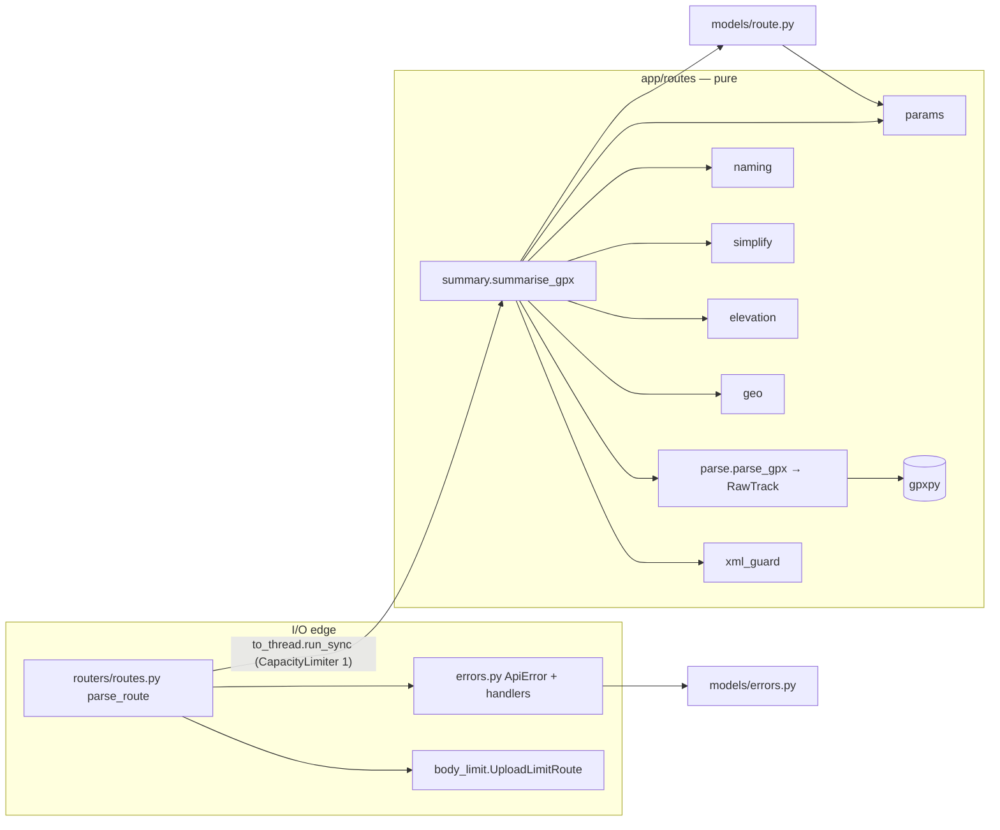

# 0004 — GPX parser: module boundary, RouteSummary/ErrorResponse contract, algorithms, upload limits, benchmark

Status: accepted · Date: 2026-10-19 · Amended: 2026-10-19 (two rounds) · Step: 1.2

## Amendments
**2026-10-19.** These record decisions already taken in step 1.2: review round 1, QA verify and the devops
benchmark deviation (see `docs/steps/1.2.md`, "Decisions and deviations"). The sections they touch have been
rewritten in place, so the body of the ADR is current.
1. **Hostile-input bounds.** The reviewer showed that hostile uploads were unbounded: RDP was O(n²) on
   near-collinear or zigzag input, and a 300k-point file peaked at about 239 MiB. Three bounds fix this.
   - **Point cap.** A file with more than 100,000 `<trkpt>`/`<rtept>` start tags gets 422 `too_many_points`.
     The tags are counted with a byte scan before gpxpy runs (§3.1 step 3, §3.12). The manager approved this
     cap.
   - **Pre-thinning.** A track with more than 2,000 points is thinned in O(n) before ranked RDP runs (§3.5).
   - **Concurrency.** At most 1 parse runs at a time per instance (§3.10). It was 2; item 7 changed it.
2. **Elevation plausibility.** An `<ele>` outside [−1000, 10000] m is treated as missing (§2, §3.1 step 8).
3. **XML encoding.** An unsupported declared encoding (expat `LookupError`/`ValueError`) is now `invalid_gpx`
   (§3.11). Before this, it escaped as a 500.
4. **Benchmark.** §5 now describes what is implemented: a base entry seeded into the data file, one comparison
   run on the head, and the name-intersection rule. The original two-run A/B could never alert.
5. **RDP ties.** The split rule now uses a near-tie tolerance of 1e-6 m and splits nearest the midpoint (§3.5).
   Item 10 narrows what the tolerance is for.
6. **Follow-up for 1.3.** `summarise_gpx` should be split so the elevation lookup has a seam (Follow-ups).

**2026-10-19, second round.** These record QA's red tests and measurements on the amended code, and the tech lead's
decisions on them (`docs/steps/1.2.md`, the entry committed in 26c1e97). The sections they touch have been rewritten
in place.

7. **One parse at a time.** `MAX_CONCURRENT_PARSES` is **1**, not 2 (§3.10). QA measured the `tracemalloc` peak of
   one parse: 296 MiB for 10 MiB of `<trkseg/>`, 238 MiB for 10 MiB of `<a/>`, and 127 MiB for a real-shaped
   100k-point file, against my estimate of 80. On a 512 MiB instance, one worst-case parse fits and two don't.
   Running one parse at a time bounds memory without a new limit, so the **element-count cap is rejected as not
   needed**. It is no longer a pending manager decision (Options considered).
8. **NUL bytes.** Any `\x00` byte → `invalid_gpx` "file must be UTF-8". The order is now empty → prolog guard →
   NUL → point cap → decode → gpxpy (§3.1 step 3). The reason: BOM-less UTF-16 passes the strict UTF-8 decode,
   because NUL is valid UTF-8. gpxpy then re-encodes the text, expat auto-detects UTF-16, and the ASCII byte scan
   never sees the tags. QA parsed a 150k-point UTF-16 file past the cap. §3.12's premise ("every file that reaches
   gpxpy has ASCII tags") was false, and is corrected there.
9. **`Content-Length` hardening** (§3.10). Only ASCII digits are parsed. More than 19 digits ⇒ 413 before `int()`
   is called. Non-ASCII digits (e.g. `²`) ⇒ 400 `bad_request`.
10. **Pre-thinning is the only worst-case bound for RDP** (§3.5). Backend measured about 9.4M distance calls for raw
    `rdp_significance` on a 20k-point diagonal with 6-dp coordinates. The 1e-6 m tolerance does nothing against
    about 5 cm of coordinate rounding.
11. **Measured results** (§3.5, §3.10, §5). The largest fixture has a min of 187 ms. A 100k-point adversarial zigzag
    takes 2.8–3.5 s end to end, mostly in gpxpy.
12. **Open: Cloud Run `--concurrency`.** This is not decided here (Follow-ups). The tech lead has asked the manager to
    lower it from 80 to 8.

## Context
Step 1.2 adds `POST /v1/routes/parse`. It turns an uploaded GPX file into a typed `RouteSummary`, rejects bad input
with a typed `ErrorResponse`, never returns 500, and parses the largest fixture in < 2 s. A CI benchmark guards
against regressions. The forces at play:
- **Gates:** distance within 2 % and gain within 10 % of the AllTrails reference on every valid 1.1 fixture. Raw
  gain is far above the references: Modiin 245/198, Ben Shemen 375/200, Tel Hadid 236/103 m.
- **Fixtures:** the three AllTrails files are *planned routes*, and their elevations are DEM samples. The values
  have 2 decimals and repeat over runs of consecutive points, the staircase of DEM cells. They show single-cell
  artefacts of 2–6 m and bumps of about 10 m that AllTrails does not count. Point spacing is about 8 m (Tel
  Hadid), 14 m (Ben Shemen) and 23 m (Modiin). The > 10k fixture is Ben Shemen linearly densified 14×, so any
  point-count window or threshold behaves differently on it. Method parameters therefore have to be in metres
  along the track, not in points.
- **Code rules (CLAUDE.md):** rule logic is pure (no I/O, clock or randomness), mypy strict, no `Any` without a
  reason, no network in unit tests, coverage gate 85 %, and new dependencies need an ADR plus manager approval.
- **API contract (ADR 0001):** handler names become operation IDs (`parse_route` → `parseRoute`), and
  `api-contract` fails on a stale `openapi.json`/`schema.d.ts`. The OpenAPI must be fully typed, error responses
  included, because 1.10 (PWA) and later Expo generate their clients from it.
- **Existing error shape:** `RequestIdMiddleware` turns unhandled exceptions into
  `500 {"detail": "Internal Server Error"}`, and `tests/test_errors.py` asserts exactly that body. FastAPI's own
  422 is `{"detail": [...]}`, and Starlette's 404/405 is `{"detail": "Not Found"}`. Neither is `ErrorResponse`.
- **Runtime:** Cloud Run with 512 MiB of memory, concurrency 80 (lowering it is open; Follow-ups) and max 1
  instance (ADR 0002/0003). The
  filesystem is in memory, and Cloud Run caps HTTP/1 requests at 32 MiB. Starlette spools uploads to a
  `SpooledTemporaryFile` (1 MiB in memory, then "disk", which is RAM here) and has **no total file-size limit**.
- **Path:** `overview.md` says `/routes/parse`, but the phase-1 checklist path `/v1/routes/parse` is used. The
  manager confirmed it on 2026-10-19 and is correcting the master doc.

## Decision

### 1. Module boundary
| Module | Role | Imports |
| --- | --- | --- |
| `app/models/route.py` | `LatLonElev`, `TrackPoint`, `RouteSummary` (Pydantic, response-only) | pydantic, `app.routes.params` (the 500 cap) |
| `app/models/errors.py` | `ErrorCode`, `FieldError`, `ErrorResponse` | pydantic |
| `app/routes/` | **pure** pipeline: bytes in, `RouteSummary` or a `RouteParseError` out | stdlib, gpxpy (in `parse.py` only), `app.models.route` |
| `app/routers/routes.py` | the I/O edge: multipart upload, size limit, worker thread under the parse limiter, error mapping | fastapi, anyio, `app.routes`, `app.errors`, `app.body_limit`, `app.dependencies` |
| `app/errors.py` | `ApiError`, global exception handlers, `ERROR_RESPONSES` for OpenAPI | fastapi/starlette, `app.models.errors` |
| `app/body_limit.py` | `UploadLimitRoute`: streaming request-body cap | fastapi/starlette, `app.routes.params`, `app.errors` |

`ErrorResponse` goes in `app/models/errors.py`, not in `route.py`, because every endpoint shares it. This is a
deliberate deviation from the checklist's "Models (`app/models/route.py`)" heading, and the tech lead records it in
the brief.

**Purity.** Nothing in `app/routes/` reads files, the environment, the clock or randomness, and nothing logs.
`summarise_gpx(data, filename, params)` is the whole pipeline and is what the benchmark measures. gpxpy parsing
bytes in memory counts as pure: it does no I/O.

**One place for parameters: `app/routes/params.py`.** It holds the frozen `ParseParams` dataclass plus `Final`
constants: the upload limit, the raw-point cap, the 500-point cap, the plausible-elevation range, the parse
concurrency, Earth's radius and the name limits. Each pure function takes its
parameters as keyword arguments whose defaults come from `DEFAULT_PARAMS`. Parameters are **not** `Settings`/env:
the accuracy gates are tuned against these exact values, and env overrides would let environments drift away from
what was tested. `ParseParams.__post_init__` raises `ValueError` on nonsense values (a programming error, never
user input).

### 2. Contract
All fields are **required**. Nullable fields are `T | None` with no default, so they are always present in the JSON
and openapi-typescript emits `x: T | null`, never `x?: T`. Units are metres and WGS84 degrees. Floats are finite
(`allow_inf_nan=False`) and are not rounded (see follow-ups for payload size).

**`LatLonElev`**
| Field | Type | Meaning |
| --- | --- | --- |
| `lat` | float, −90..90 | degrees |
| `lon` | float, −180..180 | degrees |
| `elev_m` | float \| null | elevation from the file, metres; null when `has_elevation` is false |

**`TrackPoint`**: `lat`, `lon` and `elev_m` as above, plus `dist_m: float ≥ 0`. `dist_m` is the cumulative 2-D
distance from the start along the **full-resolution** de-duplicated track, not along the simplified line. It never
decreases along `points`, the first value is 0, and the last equals `distance_m`.

**`RouteSummary`**
| Field | Type | Meaning / when no elevation |
| --- | --- | --- |
| `name` | str, 1..200 chars | §3.9 |
| `distance_m` | float ≥ 0 | 2-D haversine length, segment jumps included (§3.2) |
| `gain_m`, `loss_m` | float ≥ 0 \| null | smoothed and thresholded (§3.4); **null** when `has_elevation` is false |
| `min_elev_m`, `max_elev_m` | float \| null | raw file values over all de-duplicated points; **null** when there is no elevation |
| `high_point` | `LatLonElev` \| null | first point with the maximum raw elevation; **null** when there is no elevation |
| `start`, `end` | `LatLonElev` | first and last de-duplicated point (`elev_m` null when there is no elevation) |
| `is_loop` | bool | §3.8 |
| `points` | list[`TrackPoint`], 2..500 items | §3.5; always includes start, end and the high point |
| `has_elevation` | bool | true iff **every** de-duplicated point has a *plausible* `<ele>`: present, finite and within [−1000, 10000] m inclusive (§3.1 step 8) |
| `elevation_source` | `"file"` \| `"lookup"` \| `"none"` | 1.2 emits only `file`/`none`; `lookup` is reserved for 1.3 and is in the enum now so 1.3 doesn't change the type |
| `source_format` | `"trk"` \| `"rte"` | §3.1 |
| `point_count_original` | int ≥ 2 | points in the chosen source as the file has them (all segments, before de-duplication). It can be lower than the §3.12 tag count, which counts both kinds |

No elevation means **null, not 0**. Zero gain is a real value (a flat route), and the Phase 2 rules must not mistake
"unknown" for "flat". A file where only some points have a plausible `<ele>` counts as having no elevation, and every
`elev_m` is null. One point at 1e300 m or −5000 m is enough. This keeps clients from ever drawing a profile with
holes. 1.3's lookup then supplies elevation, so **1.3's backfill must cover the implausible-value case as well as
the missing one**.

**`ErrorResponse`, shared by every error the app returns:**
```json
{"code": "invalid_gpx", "message": "The file is not well-formed XML (line 12, column 5).", "detail": null}
```
- `code`: `ErrorCode`, the stable, machine-readable value clients branch on.
- `message`: an English sentence for developers and logs. **UX copy maps `code` to user text.** Clients never show
  `message` as product copy.
- `detail`: `list[FieldError] | null`. It is non-null only for `validation_error`. `FieldError` is
  `{loc: list[str | int], msg: str, type: str}`, FastAPI's error list with `input`, `ctx` and `url` **dropped**, so
  uploaded content is never echoed back.

| Status | `code` | Raised by |
| --- | --- | --- |
| 413 | `file_too_large` | the `Content-Length` pre-check, the streaming body cap, or the file-length check (§3.10) |
| 422 | `invalid_gpx` | empty file, unsupported declared XML encoding, a NUL byte or not UTF-8, not well-formed, DTD/entity present, root not `<gpx>`, any gpxpy failure, coordinates out of range or not finite |
| 422 | `too_many_points` | more than `MAX_RAW_POINTS` (100,000) `<trkpt>`/`<rtept>` start tags in the raw bytes, decided before gpxpy runs (§3.12) |
| 422 | `too_few_points` | fewer than 2 points after merging and de-duplication (this includes waypoint-only files) |
| 422 | `validation_error` | FastAPI `RequestValidationError`, e.g. the `file` field is missing, or `file` is a text field |
| 400 | `bad_request` | Starlette multipart errors (FastAPI turns form-parsing failures into `HTTPException(400)`); a `Content-Length` made of non-ASCII digits (§3.10) |
| 404 / 405 | `not_found` / `method_not_allowed` | Starlette routing; the `Allow` header is kept |
| other 4xx | `http_error` | any other `HTTPException` |
| 500 | `internal_error` | `RequestIdMiddleware`'s catch-all (a bug; the fuzz test exists so this never happens) |

**Reconciling with the existing 500.** `RequestIdMiddleware` keeps its role: it logs with the request ID and
responds when nothing has started. Its body becomes
`{"code": "internal_error", "message": "Internal Server Error", "detail": null}`, built from `ErrorResponse`.
`test_errors.py`'s body assertion changes to match (QA). The test that the secret detail never leaks stays as it
is. Every error response, the 500 included, still carries `X-Request-ID`.

**Handlers (`install_error_handlers`, called in `create_app`):**
- `StarletteHTTPException` → `ErrorResponse`. For an `ApiError` the code comes from `exc.code`; for any other
  `HTTPException` it comes from the status table above. `exc.headers` is kept.
- `RequestValidationError` → 422 `validation_error`.

`ApiError` **subclasses Starlette's `HTTPException`** on purpose. FastAPI's body reader re-raises `HTTPException`
unchanged but wraps any other exception into a 400, and the streaming body cap raises from inside
`request.form()`.

**OpenAPI.** The handler `async def parse_route(...) -> RouteSummary` (operation ID `parseRoute`) declares
`responses=ERROR_RESPONSES`, which maps 400, 413, 422 and 500 to `{"model": ErrorResponse}`. Declaring 422
explicitly stops FastAPI from adding its default `HTTPValidationError` schema, which would be a lie, since our 422 is
`ErrorResponse`. The request body is `multipart/form-data` with `file: binary`; FastAPI names its schema
`Body_parseRoute`. `/health`'s OpenAPI stays unchanged in 1.2: its errors use the shape at runtime, and its
undocumented 500 isn't worth the schema churn.

**Clients must treat an unknown `code` as a generic error.** New codes will be added, and an installed Expo build
can't be updated in lock-step.

### 3. Algorithms

**3.1 Parse (`parse_gpx`).** The input bytes go through these steps, in order:
1. **Empty input** → `invalid_gpx`.
2. **XML prolog guard** (`check_gpx_prolog`, §3.11) on the raw bytes.
3. **Byte checks** on the raw bytes. They run before decoding, so they never pay for a decoded copy.
   - **NUL:** any `\x00` byte → `invalid_gpx` "file must be UTF-8". XML 1.0 forbids U+0000, so no valid UTF-8
     GPX contains that byte. UTF-16 and UTF-32 put a NUL beside every ASCII character, and BOM-less UTF-16 would
     otherwise pass step 4 and hide its tags from the point cap (§3.12).
   - **Point cap** (`exceeds_point_cap`, §3.12) → `too_many_points`.
   - Errors take precedence in this order: a prolog error, then a NUL, then `too_many_points`, then "not UTF-8",
     then a gpxpy failure.
4. **Decode** as `utf-8-sig`, strict, which strips a BOM. Failure → `invalid_gpx` "file must be UTF-8".
5. **Parse:** `gpxpy.parse(text)`. **Every** exception from that one call (`GPXXMLSyntaxException`, `GPXException`,
   `ValueError`, …) → `invalid_gpx`, chained with `from`. This catch-all is justified because gpxpy is a
   third-party parser of untrusted input. It wraps **only** the gpxpy call. Our own bugs still surface as 500, and
   the fuzz test hunts for them.
6. **Choose a source.** `trk` if all `<trk>` together hold ≥ 2 points. Otherwise `rte` if all `<rte>` together hold
   ≥ 2. Otherwise whichever has more points (`trk` on a tie); the later < 2 check then raises `too_few_points`.
7. **Merge:** within the chosen kind, every track (or route) and every segment, in document order.
8. **Validate:** every chosen point must have a finite lat in −90..90 and a finite lon in −180..180, else
   `invalid_gpx`. An `<ele>` that is missing, non-finite, or outside **[`MIN_PLAUSIBLE_ELEV_M`,
   `MAX_PLAUSIBLE_ELEV_M`] = [−1000, 10000] m, inclusive**, becomes `None`.
   - The range covers the Dead Sea shore (−430 m) and Everest (8 849 m) with a margin. Anything outside it is a
     unit or encoding error, not terrain.
   - It also keeps the downstream arithmetic and the finite-float response model safe. Extreme values produced a
     500 in QA verify.
   - Following §2, one such point makes `has_elevation` false for the whole file.

`RawTrack` carries the names: `metadata_name` from `<metadata><name>`, and `track_name` from the first non-blank
`<trk><name>` (or `<rte><name>` when the source is `rte`).

**3.2 Segments and duplicates.**
- **Jumps between segments are counted.** The merged points form one polyline, so the straight jump from the end of
  segment *k* to the start of *k+1* adds to `distance_m`. Its elevation change also feeds gain/loss.
  - Reasons: `points[]` is one line on the map, and `dist_m` stays continuous along it. A pause/resume gap is
    ground the hiker really covers. Smoothing and RDP need no segment-boundary bookkeeping.
  - On the fixture, multi-segment distance ≈ parent − 0.3 m (the 34.1 m dropped path versus the 33.8 m straight
    jump), against ≈ parent − 34 m if the jump were skipped.
- **Consecutive duplicates:** points with exactly equal `(lat, lon)` floats, after merging and so across segment
  boundaries too. The first is kept, with its elevation. Near-duplicates stay; they add ≈ 0 m, and smoothing is
  distance-based, so they don't bias anything.

**3.3 Distance: haversine, 2-D, R = 6 371 008.8 m (IUGG mean radius). No geographiclib.**
- **Error against the WGS84 ellipsoid:** at Israel's latitude (32° N) the meridian radius is 6 353 355 m and the
  prime-vertical radius is 6 384 144 m. A sphere is therefore +0.28 % north–south and −0.21 % east–west, and the
  worst case anywhere on Earth is +0.56 % (meridional, at the equator).
- **Budget:** a loop mixes directions, so the error stays ≤ 0.3 % here. That fits inside the 2 % gate together with
  the references' ±50 m rounding (≤ 0.8 % on Tel Hadid).
- **Conditioning:** haversine stays well-conditioned for metre-scale steps, unlike the spherical law of cosines.
- **2-D, not 3-D:** slope adds only √(1+g²)−1, which is 0.5 % at a 10 % grade. Source apps report horizontal
  length.
- **Accumulation:** the cumulative distance is a running float sum, and `distance_m` is its last element.

**3.4 Elevation: resample by distance → centred moving average in metres → hysteresis threshold.** This only
runs when `has_elevation` is true. The input is the de-duplicated profile `(dist_m[i], elev_m[i])`, with raw
elevations.
1. **Resample.** Let L = total distance and n = min(max(1, ⌈L / `resample_step_m`⌉), `max_resample_points`). Sample
   the piecewise-linear profile at t_k = k·L/n for k = 0..n. Both ends are exact, and the grid is
   mirror-symmetric, which the reversal property needs.
   - Interpolation must be well-defined for repeated distances (use the later point) and for L = 0 (return the two
     endpoint elevations).
   - `max_resample_points` (100 000) bounds memory against hostile, globe-spanning files.
   - Resampling is what makes the method **density-independent**. The > 10k fixture lies on the same
     piecewise-linear profile as its parent, so it resamples to the same series, up to 6-dp/2-dp rounding.
2. **Smooth (`smooth_elevation`).** A centred moving average over ±h samples, with h = ⌊`smoothing_window_m` /
   (2·Δ)⌋ and Δ = L/n. **The window shrinks symmetrically at the ends** (h_k = min(h, k, n−k)), so the endpoints
   keep their raw values and any linear profile passes through unchanged. A window of 0 is the identity.
3. **Gain/loss (`gain_loss`), Schmitt-trigger hysteresis with threshold T.** It is defined so that it is exactly
   symmetric under reversal:
   - **Undetermined phase.** Track the running max and min from the first sample. The first time a sample is ≥
     min + T, the direction becomes *up*. The first extreme is that min, and the leg first sample → min counts as
     loss (it is < T). Down is symmetric.
   - **Up phase.** Follow a new max. A fall of ≥ T below the current max confirms the max: count gain = max − last
     extreme, switch to down, and follow the min. Down is symmetric.
   - **End of the series.** Count the open leg (last extreme → current candidate), then the trailing leg (candidate
     → last sample). If the series never leaves the T band, the only leg is first → last.
   - **Summing.** Collect the legs and sum each sign with `math.fsum`, so the result does not depend on summation
     order.
   - **Consequences:** gain − loss = last − first (they telescope), and `gain_loss(reversed(y)) == (loss, gain)`
     holds exactly.

**Defaults and tuning.** `resample_step_m = 5.0` is fixed. `smoothing_window_m` and `gain_threshold_m` are tuned.
- **Starting values:** window **30 m**, threshold **10 m**. The checklist's "5 points" and "3 m" are examples that
  don't fit this data:
  - a point count isn't density-independent;
  - 3 m is GPS-jitter scale, and these are DEM artefacts.
- **My hand estimate** reads the extremes off the three raw profiles, with no smoothing and this exact hysteresis.
  It is accurate to about ±3 m per file. It is evidence that a feasible region exists; it does not replace tuning:

  | T (raw, no smoothing) | Modiin (ref 198) | Ben Shemen (ref 200) | Tel Hadid (ref 103) |
  | --- | --- | --- | --- |
  | 8 m | ≈ 204 (+3 %) | ≈ 257 (+28 %) ✗ | ≈ 110 (+7 %) |
  | 10 m | ≈ 204 (+3 %) | ≈ 219 (+9.5 %) | ≈ 102 (−1 %) |
  | 11 m | ≈ 204 (+3 %) | ≈ 198 (−1 %) | ≈ 102 (−1 %) |
  | 12 m | ≈ 193 (−3 %) | ≈ 186 (−7 %) | ≈ 94 (−9 %) |

  Tel Hadid's reference counts its 11–13 m bumps, and Ben Shemen's does not count its 10–11 m ones. The feasible
  band is therefore narrow: about 10.5–12 m on raw data, a little lower once smoothing shaves the peaks. Ten
  percent on Tel Hadid **is** reachable with a principled method. The risk is a thin margin, not infeasibility.
- **Tuning procedure (backend; not committed as code).**
  - **Grid:** window ∈ {20, 30, 40, 60, 80} m × T ∈ {3.0, 3.5, …, 15.0} m.
  - **Score:** for each point, the gain % error on **every** valid fixture with elevation. Today that is 6 files:
    the 3 AllTrails files plus the `rte`, > 10k and multi-segment ones.
  - **Pick:** among the points where every file is within ±10 %, choose the one that maximises the *minimum*
    margin (10 % − |error|). Break ties by the smaller window, then the smaller T.
  - **Record:** the chosen values go into `params.py` with a comment pointing here. The grid table (or its
    best-row summary plus the neighbours) goes into the backend report, and QA's per-fixture table into
    `PROGRESS.md`.
  - **Leaving the grid** (a value outside it, or a different method) is an ADR amendment.
  - **Result (backend, 2026-10-19):** window **20 m**, threshold **9.5 m**. 23 of the 125 grid points are feasible;
    the worst-case margin is 6.67 % (Tel Hadid −3.3 %), and T is a plateau from 9.5 to 10.5 m.
- **Forbidden:**
  - per-file or per-`creator` parameters;
  - excluding a fixture;
  - loosening the 10 % gate.
- **If no grid point is feasible:** stop and escalate to the manager with the grid table. The options to present:
  1. a median pre-filter, which kills single-cell DEM spikes without lowering broad peaks (an ADR amendment);
  2. a per-elevation-source threshold, once more sources exist;
  3. a gate the manager accepts for DEM-elevation routes.

**3.5 Simplify: O(n) pre-thinning to ≤ `prethin_max_points` (2,000), then ranked Ramer–Douglas–Peucker to
`max_points` (500).**
- **Input up to 500 points:** returned unchanged. The cap is a payload cap, and dropping collinear points under it
  gains nothing.
- **Pre-thinning (`prethin`), only when n > 2,000.** It works on the full-resolution `dist_m` (§3.3) and returns
  sorted candidate indices. Let F = {0, n−1} ∪ keep (the high point), M = `max_points` and P =
  `prethin_max_points`.
  - **Index stride, M picks:** i_j = 1 + ⌊j·(n−2)/M⌋ for j = 0..M−1. These are distinct interior indices
    because n − 2 ≥ P − 1 ≥ M. They guarantee at least M + 2 candidates, so RDP can always fill its budget and
    `simplify()` still returns exactly min(n, M).
  - **Distance stride, the rest of the budget:** r_d = P − |F| − M picks. Targets are t_j = j·L/(r_d+1) for
    j = 1..r_d, with L = `dist_m[-1]`. For each target, one forward sweep picks the first index with
    `dist_m[i] ≥ t_j`. Targets that land on the same index give one candidate. If L = 0 there are no distance
    picks.
  - **Result:** F ∪ index picks ∪ distance picks, sorted. Its size is between M + 2 and P. It is deterministic
    and costs O(n + P).
  - **Why both strides:** the distance stride keeps sparse stretches. An index stride alone would keep about
    1 point of a 50-point, 10 km planned stretch inside a 100k-point recording. The index stride guarantees the
    count, which the distance stride alone does not: it collapses when most of the points sit in a few
    metres.
  - **Preconditions:** `ParseParams` enforces P ≥ 2M. `simplify` already raises `ValueError` if |F| > M. Together
    these give r_d ≥ 0.
  - **What stays at full resolution:** distance, gain/loss, min/max, the high point, `point_count_original` and
    every returned `dist_m`. Pre-thinning only chooses which indices RDP may rank.
- **Distance space:** a local equirectangular projection in metres, x = R·cos φ₀·Δλ and y = R·Δφ.
  - φ₀ is the midpoint of the latitude range of the points RDP sees (the candidates).
  - Δλ is unwrapped relative to the first point into (−180°, 180°], so tracks across the antimeridian work.
  - Distances are horizontal only; elevation is not part of the RDP metric.
  - Each point's distance is measured to the *segment*, not the infinite line, so the degenerate chord of a loop
    (start == end) gives the distance to that point.
- **Strategy:** compute the **RDP significance** of every candidate once, over the candidate subsequence (the
  thinned track, or the whole track when n ≤ 2,000). It uses an iterative explicit stack and **no recursion**,
  because deep recursion would hit Python's recursion limit and produce a 500.
  - sig(endpoints) = ∞.
  - **Split rule.** For a split (a, b), let d_i be each interior point's distance to the segment and d_max their
    maximum. The split point is the i with d_i ≥ d_max − `RDP_TIE_TOLERANCE_M` (1e-6 m) that is nearest the
    midpoint (a+b)/2. When two indices are equally near the midpoint, the smaller one wins. Then
    sig(i) = min(d_i, sig(parent split)).
    - Why a tolerance: exact ties were already split at the midpoint, but projection float noise (about 1e-9 m)
      turns exact collinearity into strict inequalities, so the exact rule rarely fired. The tolerance restores
      O(m log m) on collinear runs.
    - The tolerance is **kept as a performance nicety for exactly collinear input, and it is not a bound**. It
      does not absorb coordinate quantisation: 6-dp rounding is about 5 cm, some 50,000 times larger.
      Backend measured about 9.4M distance calls for raw `rdp_significance` on a 20k-point diagonal with 6-dp
      coordinates. Balanced splits would need about n·log₂ n ≈ 0.3M.
    - **Pre-thinning is the only worst-case bound.** RDP never sees more than 2,000 points, so it makes at most
      about 2,000² / 2 = 2M distance calls, whatever the input's shape.
  - The clamp makes {i : sig(i) > ε} exactly the output of RDP(ε) with this split rule, for every ε. So on the
    candidates this *is* RDP, with the ε that lands on the budget found implicitly. There is no binary search and
    no "≤ 500 but which ε" ambiguity. RDP is **no longer applied to the full track** when n > 2,000.
- **Selection:** the forced indices {0, n−1, high point} plus the top `max_points − |forced|` remaining candidates
  by (significance descending, index ascending), returned as full-track indices sorted ascending. The output is
  exactly min(n, max_points) points.
- **Cost:** O(n) to thin plus O(m log m) RDP on real tracks, where m ≤ 2,000. The pathological worst case is
  **O(n) + O(2000²)**, and n is capped at 100k by §3.12.
  - For scale, raw RDP on an adversarial zigzag (QA) took 1.6 s at 2k points, 6.3 s at 4k and 27 s at 8k, so
    2,000² is the ceiling.
  - **Measured with thinning:** a 100k-point adversarial zigzag takes 2.8–3.5 s end to end, mostly in gpxpy. The
    largest fixture has a min of 187 ms (§5).

**3.6 High point.** The first index of the maximum raw elevation, which keeps it deterministic on plateaus. It is
in `points` because simplify forces it, so `max(p.elev_m for p in points) == max_elev_m` holds.

**3.7 Too few points.** After merging and de-duplication, fewer than 2 points → `too_few_points`. ≥ 2 distinct
points then gives L > 0, except for the degenerate case of the same pole at different longitudes, which §3.4 step 1
handles.

**3.8 `is_loop`:** `geodesic_distance(start, end) ≤ loop_threshold_m` (200 m, inclusive). An out-and-back returns
to its start, so it is a loop; the brief requires `true`. A one-way route is `false`.

**3.9 Name.** The first non-blank of: metadata name → track/route name → filename stem → `"Untitled route"`.
- **Filename stem:** keep the text after the last `/` or `\` (some browsers send full paths), drop the last
  `.ext`, then turn `_` into a space (AllTrails filenames use underscores).
- **Every candidate is normalised the same way:** strip control characters (Unicode `Cc`), collapse whitespace runs
  to one space, trim, and cut to 200 code points.
- The router passes `UploadFile.filename`, which may be `None`.

**3.10 Upload size and parse concurrency.** The size check has three layers, all before any GPX parsing, and
none of them reads an unbounded body.
- `MAX_UPLOAD_BYTES = 10 * 1024 * 1024` (10 MiB; the user-facing copy says "10 MB"). A file of exactly
  `MAX_UPLOAD_BYTES` is accepted, and one byte more is rejected.
- **Layer 1: `Content-Length` pre-check.** `UploadLimitRoute` is the router's `route_class`, the FastAPI "custom
  APIRoute" pattern. Its handler wrapper raises `ApiError(413, "file_too_large")` before reading anything if the
  header says more than `MAX_UPLOAD_BYTES + MULTIPART_OVERHEAD_BYTES` (64 KiB for the boundary and part headers).
  Browsers' `FormData` uploads always send `Content-Length`.
  - **Header hardening (amendment).** Only ASCII digits are parsed. More than 19 digits ⇒ 413 without calling
    `int()`: no 64-bit length is longer, and a header of thousands of digits would otherwise hit Python's int/str
    conversion limit and become a 500. Non-ASCII digits (e.g. `²`, which `str.isdigit()` accepts and `int()`
    rejects) ⇒ 400 `bad_request`. Any other non-numeric value is left to layer 2.
- **Layer 2: streaming cap.** The wrapper hands FastAPI a `BodyLimitRequest`, whose `stream()` (the public method
  Starlette's form parser consumes) counts bytes and raises the same `ApiError` once the body passes that limit.
  This covers chunked bodies and lying headers. The multipart spool is therefore bounded at about 10 MiB + 64 KiB.
- **Layer 3: exact file length.** The handler reads `await file.read(MAX_UPLOAD_BYTES + 1)`. If it gets more than
  `MAX_UPLOAD_BYTES`, the answer is 413. This holds no matter what `UploadFile.size` says.
- **Rejected:**
  - a FastAPI dependency, because the body is parsed before dependencies run;
  - an app-wide ASGI middleware, which would give JSON endpoints a "file" error code;
  - reading `Request` by hand, which loses the OpenAPI multipart schema the generated client needs.
- **Worker thread with a concurrency cap.** The handler is `async def`. It awaits the read, then runs
  `summarise_gpx` in a worker thread with `anyio.to_thread.run_sync(summarise_gpx, data, filename,
  limiter=parse_limiter)`. Starlette's `run_in_threadpool` is that same call with the default limiter, so the
  parse never blocks the event loop (or `/health`).
  - **The limiter.** `parse_limiter` is an `anyio.CapacityLimiter(MAX_CONCURRENT_PARSES)` with
    `MAX_CONCURRENT_PARSES = 1`. `create_app` creates it and stores it on `app.state.parse_limiter`. That gives one
    limiter per instance in production and a fresh one per app in tests. The handler receives it through the
    dependency `get_parse_limiter`, the same pattern as `get_settings`.
  - **Why `CapacityLimiter` and not a semaphore around `run_in_threadpool`:** the two behave the same, but the
    limiter is one call and anyio's purpose-built primitive for capping worker threads. The token is held
    exactly while the worker thread runs. This holds even when the awaiting request is cancelled, because
    `run_sync` does not abandon its thread by default (`abandon_on_cancel=False`). A second request waits in the
    event loop and holds no thread while it waits.
  - **Why not a stdlib `asyncio.Semaphore`:** it binds to the first event loop that contends on it, and
    `TestClient` without a context manager runs each request on a new loop, so tests could fail with
    `RuntimeError`.
  - **Dependency:** anyio is already in `uv.lock` (4.15.1) as FastAPI/Starlette's own concurrency layer, and the
    tests already use its pytest plugin. Backend declares it explicitly in `pyproject` `dependencies`, since app
    code now imports it. No new package enters the lock (§4).
  - **What a waiting request sees:** a slower 200 or 422. There is no new error code, no queue limit and no 503.
    If the total time exceeds Cloud Run's request timeout (the default 300 s; `deploy-api.yml` doesn't set
    `--timeout`), Cloud Run's front end returns 504. That 504 does not come from the app, so it doesn't break
    "0 × 500".
  - **Worst case:** at Cloud Run's concurrency of 80, with every request a 100k-point zigzag at about 3.5 s,
    the last request waits about 80 × 3.5 ≈ 280 s, just under the 300 s timeout. Real files take about 0.2 s. At
    a concurrency of 8 (Follow-ups) the worst case is about 28 s.
  - **Why 1 (amended from 2).** It is a memory budget, and these are the peaks QA measured (`tracemalloc`, current
    code):

    | Input | Peak |
    | --- | --- |
    | 10 MiB of `<trkseg/>` | 296 MiB |
    | 10 MiB of `<a/>` | 238 MiB |
    | real-shaped 100k points (`ele` + `time`) | 127 MiB (my estimate was 80) |

    - One worst-case parse plus the process baseline fits in a 512 MiB instance, and two do not.
    - One slot bounds memory **without an element-count cap**, which would have been a new product limit
      (Options considered).
    - CPU loses nothing: the instance has 1 vCPU and the parse holds the GIL. The cost is that a small file can
      wait behind a large one, for up to about 3.5 s per parse ahead of it.
    - This bounds *parse* memory only. Uploads waiting for the slot still hold their bytes (Follow-ups).
  - The limiter is acquired *after* the upload is read and size-checked, so a slow uploader never holds the slot.

**3.11 XML safety: stdlib only, no defusedxml; we forbid DTDs ourselves.**
- **Which parser gpxpy uses:** it parses with `lxml` if that is importable, otherwise `xml.etree.ElementTree`
  (expat). lxml is not in our tree, so it is ElementTree.
- **Python docs, per ElementTree vulnerability:**
  - external entities: safe (`ParseError`);
  - billion laughs and quadratic blowup: safe with expat ≥ 2.4.1;
  - large tokens: safe with expat ≥ 2.6.0.
- **The guard: `check_gpx_prolog(data)`.** Before gpxpy runs, it drives `xml.parsers.expat` over the raw bytes with
  three handlers:
  - `StartDoctypeDeclHandler` → `invalid_gpx` "DTDs are not allowed";
  - `EntityDeclHandler` → the same;
  - `StartElementHandler` records the root's local name, then **stops the scan** by raising a private sentinel. A
    DOCTYPE can only precede the root, so the scan costs only the prolog.
- **What the guard rejects:**
  - an `ExpatError` before the root (`invalid_gpx` with line/column);
  - an **unsupported declared encoding**. expat raises `LookupError` for an unknown encoding name and
    `ValueError` for encodings it can't handle (utf-32, utf-7, shift_jis, …). Both → `invalid_gpx` "unsupported
    XML encoding", chained with `from`. Before this, they escaped as a 500 (QA verify). The catch is safe because
    our handlers raise neither exception;
  - no root at all;
  - a root whose local name is not `gpx`. This check is how the KML fixture fails: gpxpy doesn't check the root
    element and would return an empty GPX.
- **Why this is enough:** GPX is defined by an XSD and never needs a DTD. Every entity attack needs a DTD, so
  rejecting DTDs removes XXE, billion laughs, quadratic blowup and DTD retrieval no matter which expat version or
  parser gpxpy picks. Large-token quadratic parsing is bounded by the 10 MiB cap and fixed in expat ≥ 2.6. A test
  asserts `pyexpat.EXPAT_VERSION ≥ 2.6.0`; see the follow-ups for the Docker image.
- **defusedxml is rejected:** a new dependency, and gpxpy calls ElementTree internally, so it would need
  monkey-patching (`defuse_stdlib`) for no protection beyond the guard.

**3.12 Point cap: a byte scan, before gpxpy builds its tree.**
- **Why before gpxpy:** gpxpy calls `ElementTree.XML(text)` on the whole document and then builds one Python
  object per point. Memory and time are spent before any count is known, so the count must come from the raw
  bytes.
- **`exceeds_point_cap(data, max_points=MAX_RAW_POINTS)`** counts the matches of one compiled bytes regex and
  stops at `max_points + 1` (`itertools.islice` over `finditer`):
  ```
  rb"<(?:[^\s<>/]*:)?(?:trkpt|rtept)[\s/>]"
  ```
  - More than `MAX_RAW_POINTS = 100_000` matches → `TooManyPoints`. Exactly 100,000 is accepted.
- **What is counted:** `<trkpt` and `<rtept` start tags **together**, across all tracks, routes and segments,
  before de-duplication.
  - This is conservative. The cap protects gpxpy's object tree, and gpxpy builds both kinds whichever source
    §3.1 later chooses.
  - A file with 60k of each kind is therefore rejected, even though its chosen source has 60k points.
- **Namespaces and prefixes:**
  - The optional `prefix:` group counts `<gpx:trkpt>` and `<a:b:trkpt>` too. That is more than gpxpy uses: it
    matches `child.tag == "trkpt"` exactly, after stripping only the first default `xmlns`, so it ignores
    prefixed points.
  - Over-counting is the safe direction, and it stays correct if the parser is ever replaced by one that
    resolves namespaces.
  - Matching is case-sensitive, like XML and gpxpy.
- **It can only over-count:**
  - Tags inside comments, CDATA or processing instructions also match. A real file never has 100k of those.
  - `</trkpt>` does not match.
  - No real point can be missed:
    - DTDs are rejected (§3.11), so no element can come from entity expansion;
    - the scan assumes the tags are spelled in ASCII bytes. §3.1 step 3 rejects any NUL byte before the scan,
      which closes UTF-16 and UTF-32, since both put a NUL beside every ASCII character. Step 4 then requires
      UTF-8;
    - XML allows no whitespace between `<` and the name.
  - **Correction (amendment).** The first version claimed that step 4's UTF-8 requirement alone meant every file
    reaching gpxpy had ASCII tags. That was false. BOM-less UTF-16 decodes as valid UTF-8, because NUL is valid
    UTF-8. gpxpy then re-encodes the text, expat auto-detects UTF-16, and the scan never saw the tags. QA parsed a
    150k-point UTF-16 file past the cap that way.
- **Cost:** a C-speed scan, linear time, constant memory.
  - The pattern starts with the literal `<`, so `re` skips quickly to each candidate.
  - The prefix class excludes `<`, so backtracking is bounded by the run up to the next `<`.
  - Total work is O(bytes): tens of milliseconds on 10 MiB.

### 4. Dependencies
| Package | Where | Why | License | Maintenance | Types (mypy strict) | Approval |
| --- | --- | --- | --- | --- | --- | --- |
| **gpxpy** | runtime | the roadmap's parser | Apache-2.0 | 1.6.2 (2023-11); slow cadence, but a stable format and no deps | ships `py.typed` (inline hints; the project requires mypy-clean code) | in stack |
| **python-multipart** | runtime | FastAPI/Starlette need it for any `File()`/`Form()` ("To receive uploaded files, first install python-multipart"); without it the route fails at import | Apache-2.0 | 0.0.32 (2026-06), maintained by Kludex (Starlette's maintainer) | not imported by our code | **approved by the manager 2026-10-19** (not in the CLAUDE.md list; it is FastAPI's own optional dependency) |
| **anyio** (amendment) | runtime, declared explicitly | `CapacityLimiter` for the parse cap (§3.10) | MIT | 4.15.1 already locked; FastAPI/Starlette require it | ships `py.typed` | no new package in `uv.lock`; tech lead to confirm with the manager that declaring an already-locked transitive dependency needs no separate approval |
| **Hypothesis** | dev | property and fuzz tests | MPL-2.0 | active | ships `py.typed` | in stack |
| **pytest-benchmark** | dev | named by the roadmap for the benchmark | BSD-2-Clause | 5.3.0 (2026-08), supports pytest 9 | "minimal typing" since 5.2. If mypy reports no `py.typed`, type the fixture parameter with a local `Protocol` in the test (no `ignore_missing_imports`) | **approved by the manager 2026-10-19** (named by the roadmap, not in the CLAUDE.md list) |
| **benchmark-action/github-action-benchmark** | CI action, pinned by SHA like the others | named by the roadmap: stores the baseline and alerts | MIT | active, `@v1` line (v1.22.2 pinned) | n/a | **approved by the manager 2026-10-19** (new third-party action) |
| geographiclib | — | rejected (§3.3) | | | | — |
| defusedxml | — | rejected (§3.11) | | | | — |
| lxml | — | must **not** be added: gpxpy would switch parsers silently, changing behaviour and benchmark numbers (the guard keeps it safe either way) | | | | — |

`pyproject` changes: add `gpxpy` and `python-multipart` to `dependencies`, add `hypothesis` and `pytest-benchmark` to
`dev`, and add `--benchmark-disable` to `addopts`. Benchmark tests then run once, as plain tests, inside `api-test`
under coverage, and only the benchmark job times them.

**Why not the stack?**
- **python-multipart:** nothing in the stack parses `multipart/form-data`. Starlette delegates to this package, and
  writing our own multipart parser would be a worse risk.
- **pytest-benchmark:** the stack has no benchmarking tool. Hand-rolled `perf_counter` loops wouldn't produce the
  JSON that github-action-benchmark consumes.
- **github-action-benchmark:** the roadmap names it. The alternative, a hand-written comparison script, would be
  new code to maintain and test, with no charting or history.

### 5. Benchmark (devops implements; QA writes the test)
**What is measured.** The test is `tests/routes/test_benchmark.py::test_parse_largest_fixture`.
- **Call:** `benchmark.pedantic(summarise_gpx, args=(bytes, name), rounds=10, warmup_rounds=1, iterations=1)`. The
  fixture is `derived-ben-shemen-over-10k-points.gpx`, and its bytes are read *outside* the timed call. This is
  the full pure pipeline, not HTTP: transport noise is excluded, and the HTTP timing is the checkpoint's
  `TestClient`/deployed-URL measurement.
- **Correctness:** the test also asserts the result (distance within 2 %), so a "fast because broken" change fails.

**Statistic: `min`, not `mean`/`ops`.**
- For deterministic CPU-bound code, noise only ever adds time, so `min` is the most stable estimator.
- github-action-benchmark's built-in `tool: pytest` compares `ops` (1/mean), which is outlier-sensitive.
- So the job converts pytest-benchmark's JSON with `jq` into `customSmallerIsBetter`:
  - `value` = `stats.min` in seconds;
  - `name` = the test name;
  - `range` = the IQR;
  - `extra` = median and rounds.

**Run options.** `uv run --frozen pytest tests/routes/test_benchmark.py --benchmark-enable --benchmark-only --no-cov
--benchmark-json=…`. `--no-cov` matters: coverage tracing distorts timing, and a subset run would trip
`--cov-fail-under`.

**Regression rule: within one job, on one runner (A/B), not against a stored number from another machine.**
- **Why A/B:** shared GitHub runners vary by CPU model and neighbours, and cross-run differences of 10–30 % are
  common. A required 20 % gate against a cross-machine baseline would flake.
- **Why one action run, not two (amended).** github-action-benchmark v1.22.2 finds "previous" by commit id, and on
  `pull_request` it records the head SHA for every run. Feeding base and head through the action in turn makes
  both entries the same commit, so it never alerts. The base result is therefore seeded into the data file by
  `.github/scripts/bench.sh` and only the head goes through the action.
- **On a PR:**
  1. Check out base and head side by side, each with its own `uv sync --frozen` environment.
  2. **Base present?** If `base/api/tests/routes/test_benchmark.py` is missing (this step's own PR), skip steps
     3, 5 and 6 with a `::notice::`. The absolute check still runs.
  3. **Base run:** `bench.sh run base bench/base.json`.
  4. **Head run:** `bench.sh run head bench/head.json`, then `bench.sh check bench/head.json 2.0`. The job fails
     if any head `min ≥ 2.0 s`, the absolute checkpoint ceiling.
  5. **Name rule (`bench.sh names`):**
     - fail if the head produced no benchmarks, or if base ∩ head is empty, since the gate would then be a
       silent no-op;
     - otherwise rewrite both files to the intersection, sorted by name, and `::warning::` about names on one
       side only;
     - a rename therefore takes two PRs: add the new name and keep the old, then remove the old. Requiring equal
       name sets would deadlock any PR that adds or renames a benchmark under a no-bypass ruleset.
  6. **Seed and compare.** `bench.sh seed bench/base.json bench/ab.json <base SHA>` writes a data file whose only
     entry is the base result under the base SHA. One action run then feeds `bench/head.json` with
     `external-data-json-path: bench/ab.json`, `save-data-file: false`, `alert-threshold: "120%"`,
     `fail-threshold: "120%"`, `fail-on-alert: true` and `summary-always: true`. `bench.sh ratio` logs
     head/base for humans.
  7. Permissions: `contents: read` only.
- **Proven red in CI** on the throwaway PR #28: run 39288735236 failed at 1.43× head/base.
- **Measured (amendment):** the largest fixture has a min of 187 ms, about a tenth of the 2.0 s ceiling.
- **On push to `main`:** run the head only and append to the history with the action's `external-data-json-path`,
  persisted with `actions/cache`.
  - Key `benchmark-${{ github.sha }}` with restore-keys `benchmark-`; cache keys are immutable, so each run saves
    a new one.
  - `fail-on-alert: false`. The PR already gated, and a post-merge failure can't block anything.
  - Skip the job for the nightly/`fresh-deps` `workflow_call`, so other dependency versions don't pollute the
    history.
- **Path filter:** the job follows `changes.api` like `api-test`. A change under `.github/workflows/**` or
  `.github/scripts/**` (which includes `bench.sh`) runs every job, so it runs the benchmark too. A skip counts as
  passing. Its name, `benchmark`, is a required-check contract.

**Baseline storage options** (for the main-branch history; the PR gate needs none):
- **`actions/cache` (chosen):**
  - no write token, no new branch and **no manager action**;
  - PRs can read caches created on `main`;
  - risk: the cache is evicted after 7 days without access, and the next run then starts a fresh history. That
    is harmless, because the gate is A/B.
- **gh-pages branch:**
  - gives a chart;
  - needs `contents: write` in a job that runs repo code, plus a manager action: create the `gh-pages` branch and
    optionally enable Pages;
  - rejected for now, and can be adopted later without touching the gate.
- **Artifacts:** rejected. Reading another run's artifact needs `actions: read`, run-ID lookup and retention
  management.

### 6. How it is tested
See "How it is tested" below; it is part of the decision.

## Interface
```python
# app/routes/params.py — the only home for parameters and limits
MAX_UPLOAD_BYTES: Final = 10 * 1024 * 1024
MULTIPART_OVERHEAD_BYTES: Final = 64 * 1024
MAX_SUMMARY_POINTS: Final = 500
EARTH_RADIUS_M: Final = 6_371_008.8
MAX_NAME_LENGTH: Final = 200
UNTITLED_ROUTE_NAME: Final = "Untitled route"
MIN_PLAUSIBLE_ELEV_M: Final = -1000.0     # §3.1 step 8, inclusive
MAX_PLAUSIBLE_ELEV_M: Final = 10000.0     # §3.1 step 8, inclusive
MAX_RAW_POINTS: Final = 100_000           # §3.12; > this → too_many_points (manager-approved)
PRETHIN_MAX_POINTS: Final = 2_000         # §3.5
RDP_TIE_TOLERANCE_M: Final = 1e-6         # §3.5 split rule
MAX_CONCURRENT_PARSES: Final = 1          # §3.10 (amended from 2)

@dataclass(frozen=True, slots=True)
class ParseParams:
    resample_step_m: float = 5.0
    max_resample_points: int = 100_000
    smoothing_window_m: float = 20.0      # tuned per §3.4 (backend, 2026-10-19)
    gain_threshold_m: float = 9.5         # tuned per §3.4 (backend, 2026-10-19)
    loop_threshold_m: float = 200.0
    max_points: int = MAX_SUMMARY_POINTS  # 3 <= max_points <= MAX_SUMMARY_POINTS
    prethin_max_points: int = PRETHIN_MAX_POINTS  # >= 2 * max_points; small values let tests hit the path cheaply
    def __post_init__(self) -> None: ...  # ValueError on out-of-range values

DEFAULT_PARAMS: Final = ParseParams()
```
```python
# app/routes/errors.py
class RouteParseError(Exception):
    code: ClassVar[Literal["invalid_gpx", "too_many_points", "too_few_points"]]
    def __init__(self, message: str) -> None: ...
    @property
    def message(self) -> str: ...
class InvalidGpx(RouteParseError): ...        # code = "invalid_gpx"
class TooManyPoints(RouteParseError): ...     # code = "too_many_points"
class TooFewPoints(RouteParseError): ...      # code = "too_few_points"

# app/routes/track.py
@dataclass(frozen=True, slots=True)
class RawPoint:
    lat: float
    lon: float
    elev_m: float | None                      # None: missing, non-finite or outside [-1000, 10000] m

@dataclass(frozen=True, slots=True)
class RawTrack:
    points: tuple[RawPoint, ...]              # chosen source, merged in document order, validated, NOT de-duplicated
    source_format: SourceFormat               # from app.models.route
    metadata_name: str | None
    track_name: str | None                    # first non-blank <trk><name> (or <rte><name>), raw

# app/routes/xml_guard.py
def check_gpx_prolog(data: bytes) -> None: ...   # raises InvalidGpx (DTD/entity, malformed prolog, unsupported
                                                 # encoding, no root, root != gpx)
def exceeds_point_cap(data: bytes, *, max_points: int = MAX_RAW_POINTS) -> bool: ...
    # §3.12: > max_points <trkpt/<rtept start tags (prefix-tolerant byte regex, stops at max_points + 1); pure

# app/routes/parse.py — the only module that imports gpxpy
def parse_gpx(data: bytes) -> RawTrack: ...      # raises InvalidGpx or TooManyPoints; order per §3.1 (NUL before cap)
def drop_consecutive_duplicates(points: Sequence[RawPoint]) -> tuple[RawPoint, ...]: ...

# app/routes/geo.py
def geodesic_distance(a: RawPoint, b: RawPoint) -> float: ...                # haversine, metres, 2-D
def cumulative_distance(points: Sequence[RawPoint]) -> tuple[float, ...]: ...  # [0.0, ...], len == len(points)
def is_loop(start: RawPoint, end: RawPoint, *,
            threshold_m: float = DEFAULT_PARAMS.loop_threshold_m) -> bool: ...

# app/routes/elevation.py
def smooth_elevation(dist_m: Sequence[float], elev_m: Sequence[float], *,
                     window_m: float = DEFAULT_PARAMS.smoothing_window_m,
                     step_m: float = DEFAULT_PARAMS.resample_step_m,
                     max_samples: int = DEFAULT_PARAMS.max_resample_points) -> tuple[float, ...]: ...
    # resampled uniform grid (both ends included), centred moving average with symmetric shrinking ends
def gain_loss(elev_m: Sequence[float], *,
              threshold_m: float = DEFAULT_PARAMS.gain_threshold_m) -> tuple[float, float]: ...  # (gain, loss)
def high_point_index(elev_m: Sequence[float]) -> int: ...    # first index of the maximum; ValueError if empty

# app/routes/simplify.py
def prethin(dist_m: Sequence[float], *, keep: Collection[int] = (),
            min_points: int = DEFAULT_PARAMS.max_points,
            max_points: int = DEFAULT_PARAMS.prethin_max_points) -> tuple[int, ...]: ...
    # §3.5: n <= max_points → range(n); else sorted indices ⊇ {0, n-1} ∪ keep,
    # min_points + 2 <= len <= max_points; ValueError unless 2*min_points <= max_points and |forced| <= min_points
def rdp_significance(points: Sequence[RawPoint], *,
                     tie_tolerance_m: float = RDP_TIE_TOLERANCE_M) -> tuple[float, ...]: ...  # inf at both ends; iterative
def simplify(points: Sequence[RawPoint], *, keep: Collection[int] = (),
             max_points: int = DEFAULT_PARAMS.max_points,
             prethin_max_points: int = DEFAULT_PARAMS.prethin_max_points,
             dist_m: Sequence[float] | None = None) -> tuple[int, ...]: ...
    # sorted full-track indices, len == min(n, max_points); dist_m = full-resolution cumulative distance
    # (computed with geo.cumulative_distance when None); RDP runs on prethin's candidates when n > prethin_max_points

# app/routes/naming.py
def route_name(metadata_name: str | None, track_name: str | None, filename: str | None) -> str: ...

# app/routes/summary.py — the whole pipeline; the benchmark target
def summarise_gpx(data: bytes, filename: str | None,
                  params: ParseParams = DEFAULT_PARAMS) -> RouteSummary: ...   # raises RouteParseError only
    # calls simplify(points, keep=[high], max_points=params.max_points,
    #                prethin_max_points=params.prethin_max_points, dist_m=dist)  — reuses the full-resolution dist
```
```python
# app/models/route.py
Latitude = Annotated[float, Field(ge=-90, le=90)]
Longitude = Annotated[float, Field(ge=-180, le=180)]
NonNegMetres = Annotated[float, Field(ge=0)]
SourceFormat = Literal["trk", "rte"]
ElevationSource = Literal["file", "lookup", "none"]

class LatLonElev(BaseModel):          # model_config = ConfigDict(frozen=True, extra="forbid", allow_inf_nan=False)
    lat: Latitude
    lon: Longitude
    elev_m: float | None

class TrackPoint(BaseModel):          # same config
    lat: Latitude
    lon: Longitude
    elev_m: float | None
    dist_m: NonNegMetres

class RouteSummary(BaseModel):        # same config
    name: Annotated[str, Field(min_length=1, max_length=MAX_NAME_LENGTH)]
    distance_m: NonNegMetres
    gain_m: NonNegMetres | None
    loss_m: NonNegMetres | None
    min_elev_m: float | None
    max_elev_m: float | None
    high_point: LatLonElev | None
    start: LatLonElev
    end: LatLonElev
    is_loop: bool
    points: Annotated[list[TrackPoint], Field(min_length=2, max_length=MAX_SUMMARY_POINTS)]
    has_elevation: bool
    elevation_source: ElevationSource
    source_format: SourceFormat
    point_count_original: Annotated[int, Field(ge=2)]

# app/models/errors.py
ErrorCode = Literal["bad_request", "not_found", "method_not_allowed", "file_too_large", "invalid_gpx",
                    "too_many_points", "too_few_points", "validation_error", "http_error", "internal_error"]
# → openapi.json ErrorResponse.code enum and the generated schema.d.ts gain "too_many_points" (pnpm gen:api)

class FieldError(BaseModel):
    loc: list[str | int]
    msg: str
    type: str

class ErrorResponse(BaseModel):
    code: ErrorCode
    message: str
    detail: list[FieldError] | None
```
```python
# app/errors.py
class ApiError(StarletteHTTPException):        # Starlette's HTTPException so FastAPI's body reader re-raises it
    code: ErrorCode
    def __init__(self, status_code: int, code: ErrorCode, message: str) -> None: ...
def error_body(code: ErrorCode, message: str, detail: list[FieldError] | None = None) -> dict[str, object]: ...
def install_error_handlers(app: FastAPI) -> None: ...  # StarletteHTTPException + RequestValidationError
ERROR_RESPONSES: Final[dict[int | str, dict[str, Any]]]  # Any: FastAPI's `responses=` parameter type

# app/body_limit.py
class BodyLimitRequest(Request):
    def __init__(self, scope: Scope, receive: Receive, *, max_body_bytes: int) -> None: ...
    async def stream(self) -> AsyncGenerator[bytes, None]: ...  # raises ApiError(413, "file_too_large")
# UploadLimitRoute's handler: ASCII-digit Content-Length only; > 19 digits → 413 before int(); non-ASCII digits → 400
class UploadLimitRoute(APIRoute):
    max_body_bytes: ClassVar[int] = MAX_UPLOAD_BYTES + MULTIPART_OVERHEAD_BYTES
    def get_route_handler(self) -> Callable[[Request], Coroutine[Any, Any, Response]]: ...  # Any: FastAPI's signature

# app/routers/routes.py
router = APIRouter(prefix="/v1/routes", tags=["routes"], route_class=UploadLimitRoute)

@router.post("/parse", responses=ERROR_RESPONSES, summary="Parse a GPX file into a route summary")
async def parse_route(
    file: Annotated[UploadFile, File(description="GPX 1.0/1.1 file, at most 10 MB")],
    limiter: Annotated[anyio.CapacityLimiter, Depends(get_parse_limiter)],   # not in OpenAPI
) -> RouteSummary: ...
    # read(MAX_UPLOAD_BYTES + 1) → 413
    # | await anyio.to_thread.run_sync(summarise_gpx, data, file.filename, limiter=limiter)
    # RouteParseError → ApiError(422, e.code, e.message)

# app/dependencies.py
def get_parse_limiter(request: Request) -> anyio.CapacityLimiter: ...  # request.app.state.parse_limiter

# app/middleware.py — RequestIdMiddleware's 500 body becomes error_body("internal_error", "Internal Server Error")
# app/main.py — create_app: app.state.parse_limiter = anyio.CapacityLimiter(MAX_CONCURRENT_PARSES);
#               install_error_handlers(app); app.include_router(routes.router)
```

Imports point one way: `routers → routes → models`. `app/routes/*` never imports fastapi/starlette, and
`app/models/*` never imports from `app/routes/` except `params`. `params` imports nothing from the app.
`app/routes/__init__.py` stays **empty**, with no re-exports; otherwise `models.route → routes.params` would run
`routes/__init__` → `summary` → `models.route`, a circular import. Callers import `app.routes.summary` directly.

## Options considered
- **geographiclib (Karney)** — rejected: a new dependency, about 10–30× slower per pair, and its ≤ 0.56 % gain in
  accuracy is invisible inside a 2 % gate.
- **3-D distance** — rejected: source apps report horizontal length, and it would add up to about 0.5 % on steep
  routes.
- **Not counting segment jumps** — rejected: `dist_m` would be discontinuous on one drawn line, segment boundaries
  would have to run through smoothing and RDP, and the jump is distance the hiker walks.
- **Point-count moving average (checklist "5 points")** — rejected: not density-independent, so the > 10k fixture
  would barely be smoothed.
- **Distance window evaluated at the raw points (no resampling)** — rejected: mixed spacing within one file still
  weights dense stretches more, and the result isn't exactly reversal-symmetric.
- **Step accumulation ("add the change once |Δ| ≥ T, then reset the reference")** — rejected: it isn't symmetric
  under reversal (it fails the roadmap's property test) and under-counts every climb by up to T.
- **A median filter instead of a moving average** — not chosen: the checklist names a moving average. It is kept as
  the first escalation option (§3.4).
- **Smoothed elevations in `points[]` / smoothed min/max** — rejected for 1.2: raw values are what the file says,
  and they keep `max(points.elev_m) == max_elev_m` exact.
- **Partial elevation counted as `has_elevation: true` with gaps** — rejected: clients would draw holes, and gain
  would be computed over interpolated gaps. The lookup in 1.3 is the fix.
- **`0` instead of `null` for missing elevation** — rejected: it is indistinguishable from a flat route.
- **RDP binary search on ε** — rejected: about 30 full RDP runs, and it lands at "≤ 500" with an ε tolerance.
  Ranked significance gives exactly the budget in one pass.
- **Recursive RDP** — rejected: the recursion limit on long or pathological tracks would cause a 500.
- **Point count with a streaming expat pass** (amendment) — rejected: it is exact, but it makes a Python callback
  per element and so roughly doubles XML cost on large files. Exactness isn't needed, because over-counting is
  safe.
- **Point count with `bytes.count(b"<trkpt")`** (amendment) — rejected: it misses prefixed tags, so it is only
  correct while gpxpy stays blind to prefixes.
- **Counting the points after `gpxpy.parse`** (amendment) — rejected: the memory and CPU are already spent.
- **Counting only the chosen source** (amendment) — rejected: the choice needs the parse, and gpxpy builds both
  kinds anyway.
- **Index-stride-only or distance-stride-only pre-thinning** (amendment) — rejected: index-only drops sparse
  stretches inside dense recordings, and distance-only can't guarantee ≥ 500 candidates.
- **Radial-distance pre-filter** (amendment) — rejected: a second projected-distance pass, and like the
  distance stride it can't guarantee the count.
- **No RDP tie tolerance** (amendment) — rejected, though only narrowly: float noise makes collinear runs
  quadratic again, which costs up to about 1.5 s on 2,000 points. Keeping the tolerance is cheap.
- **A tie tolerance at map scale (≈ 0.1 m) to absorb coordinate rounding** (amendment) — rejected: it blurs RDP
  semantics for a gain the pre-thinning bound already covers. The 9.4M-call measurement (§3.5) confirms that only
  pre-thinning bounds rounded input.
- **`asyncio.Semaphore` around `run_in_threadpool`** (amendment) — rejected: it is loop-bound on contention,
  which breaks `TestClient`'s per-request loops (§3.10).
- **Rejecting with 503 when the slot is busy** (amendment) — rejected: it adds a new error state for clients and
  UX, while waiting fits inside Cloud Run's timeout.
- **`MAX_CONCURRENT_PARSES = 2`** (second amendment) — rejected: the measured worst single parse is about 300 MiB,
  so two don't fit in 512 MiB.
- **An element-count cap** (count every start tag in the byte scan, reject above about 1M) (second amendment) —
  rejected as not needed: one parse at a time already keeps the measured worst case (296 MiB) inside the instance,
  and the cap would be a new product limit.
- **Detecting and decoding UTF-16 so the point cap can scan it** (second amendment) — rejected: the contract is
  UTF-8 only (Consequences), and rejecting NUL is one C-speed `in` test.
- **Simplifying inputs of ≤ 500 points** — rejected: nothing gained under the cap.
- **Size check via a dependency, app-wide middleware, or reading the raw `Request`** — rejected: §3.10.
- **Reading the whole body and then checking its length** — rejected: unbounded memory on an in-memory filesystem.
- **defusedxml** — rejected: §3.11.
- **Trusting expat versions alone** — rejected: the Docker image's expat comes from Debian, not from us, and the
  guard is cheap.
- **`code: str` in `ErrorResponse`** — rejected: a typed union gives exhaustiveness checks in TypeScript. Forward
  compatibility comes from the "unknown code ⇒ generic error" client rule.
- **FastAPI's default `{"detail": …}` errors** — rejected: three shapes for clients to parse, and no stable codes.
- **Algorithm parameters in `Settings`/env** — rejected: environments could drift from the tuned, tested values.
- **github-action-benchmark `tool: pytest` (ops = 1/mean)** — rejected: the mean is outlier-sensitive on shared
  runners.
- **A gate against a stored baseline from another runner** — rejected: cross-machine noise is of the same order as
  the 20 % threshold, so a required check would flake.
- **Feeding base and head through the action in turn** (amendment) — rejected: v1.22.2 records the head SHA for
  both runs on `pull_request`, so the gate never alerts (§5).
- **Failing unless base and head have identical benchmark names** (amendment) — rejected: under a no-bypass
  ruleset, any PR that adds or renames a benchmark could never merge.
- **gh-pages storage** — deferred: it needs a write token and a manager action, and the gate doesn't need it.
- **Artifact storage** — rejected: cross-run artifact plumbing.
- **Benchmarking through `TestClient`** — rejected for the regression gate: it adds HTTP and multipart noise. HTTP
  timing stays a checkpoint measurement.

## Consequences
- **Easier:**
  - One pure entry point, `summarise_gpx`, is what endpoint tests, property tests, the fuzz test and the benchmark
    all hit.
  - gpxpy is confined to one module, so replacing it later (e.g. with a streaming ElementTree parser for speed)
    touches only `parse.py`.
  - Every error the API returns has one shape and a stable code, and the client generated for 1.10/Expo is fully
    typed, errors included.
  - The gain method is density-independent and exactly reversal-symmetric, and its parameters are in metres.
  - XML attack surface: no DTDs, whatever expat or parser is present.
  - The benchmark gate is robust to runner variance, and it needs no manager console work.
- **Harder later:**
  - **Gain defaults are tuned on 3 AllTrails DEM routes in the low hills of central Israel.** When the Komoot,
    Strava and watch fixtures land (1.1 follow-ups), the tuning must be re-run across the whole corpus. A single
    threshold may then conflict across elevation sources (GPS/barometric vs DEM), which is a manager decision
    (§3.4 escalation options).
  - **A file with one missing or implausible `<ele>` loses its whole profile** until 1.3 supplies elevation. 1.3's
    backfill must handle both cases. It may revisit this, for example by filling short gaps.
  - **UTF-8 only.** A GPX file declared in Latin-1 with non-ASCII bytes, or saved as UTF-16 (with or without a
    BOM), gets `invalid_gpx`. Supporting UTF-16 later means decoding before the point cap, which costs a copy.
  - **Disjoint multi-segment files** (e.g. two days with a car shuttle between them) get a straight-line jump added
    to their distance.
  - **Changing the 500-point cap** changes the OpenAPI (`maxItems`), which is a visible contract diff, as intended.
  - **The 500 body change** breaks anything that parsed `{"detail": "Internal Server Error"}`. Nothing does today;
    the web client classifies errors by status.
  - **The benchmark compares PR against base.** A PR that changes the benchmark itself compares two different
    workloads, and reviewers must read the summary. Renaming a benchmark takes two PRs.
  - **Real files above 100,000 points are refused.** That is about 28 h of 1 Hz recording. Raising the cap is a
    manager decision, and it moves the memory budget behind `MAX_CONCURRENT_PARSES`.
  - **Both kinds are counted** for the cap, so a file carrying a large `<trk>` and a large `<rte>` can be refused
    even though its chosen source fits.
  - **Above 2,000 points, `points[]` is RDP over the thinned candidates, not over the full track.** A feature
    narrower than the stride, about L/1,500 (≈ 13 m on a 20 km route), can be missed. That doesn't matter at
    500-point map scale.
  - **Parses run one at a time per instance.** Throughput on one instance is bounded by design, and a small file
    can wait behind a large one. Scaling means more instances (ADR 0002/0003, a cost decision), not a bigger
    limiter. Raising the upload size or the point cap means re-measuring the per-parse peak first.
  - **Hostile worst case is now bounded:** at most 100k points through gpxpy, O(n) statistics and thinning, and
    O(2000²) RDP. That is seconds, not hours (2.8–3.5 s measured). Element counts are not capped. Memory is bounded
    by running one parse at a time (296 MiB measured), not by a limit on the file.

## How it is tested
All tests run with no network (`--disable-socket`). QA writes the acceptance, property, endpoint, fuzz and benchmark
tests red-first in `tests/routes/`. Backend adds unit tests for internals it introduces.

- **Pure units, fast and table-driven:**
  - **`geodesic_distance`:**
    - known pairs: one degree of latitude at the equator ≈ 111 195 m, and a few points around Tel Aviv against
      precomputed values;
    - symmetric; zero for equal points; antimeridian pairs.
  - **`drop_consecutive_duplicates`:** keeps the first; removes duplicates across a segment boundary; leaves
    non-consecutive repeats alone.
  - **`smooth_elevation`:**
    - constant → constant; a linear profile is returned unchanged, endpoints included;
    - window 0 → plain resample; endpoints equal raw;
    - L = 0 and repeated distances don't raise;
    - the sample count respects `max_samples`;
    - **density independence:** the series from a track and from its 14× linear densification agree within 0.05 m.
  - **`gain_loss`:**
    - monotone climb → (Δ, 0);
    - oscillations below T inside a climb add nothing;
    - T = 0 → total positive and negative variation;
    - band-only series → first-to-last leg;
    - the worked examples from §3.4 (`0, 5, −10` with T = 8 → (5, 15); reversed → (15, 5)).
  - **`is_loop`:**
    - **synthetic tracks, no fixtures:**
      - out-and-back: 2 km out along a bearing, back on a 10 m offset → `true`;
      - one-way: 2 km straight → `false`;
    - boundary: ends 199 m apart → `true`, 201 m → `false` (positions computed with `geodesic_distance`).
  - **`simplify` / `rdp_significance`:**
    - n ≤ 500 → identity;
    - n > 500 → exactly 500, sorted, containing 0, n−1 and the high point even when RDP alone would drop it (a
      spike on a straight line);
    - a loop with start == end works;
    - a 20 000-point straight line and a spiral don't hit the recursion limit;
    - `{i : sig(i) > ε}` equals a naive recursive reference RDP(ε), written in the test with **the same split
      rule** (near-tie tolerance, nearest the midpoint, then the smaller index);
    - **near-tie rule:** on a line whose interior distances differ only by < 1e-6 m, the first split is the
      midpoint; a point 1e-5 m farther than the rest wins wherever it is;
    - **the thinning seam:** n = 2,000 never calls `prethin`. For n = 2,001 and n = 100,000 (a zigzag and a
      straight line), `rdp_significance` is called with ≤ 2,000 points (spy via monkeypatch), and the output is
      still exactly 500, contains 0, n−1 and the high point, and every returned index refers to the full track.
  - **`prethin`:**
    - n ≤ max_points → identity;
    - otherwise sorted, distinct, ⊇ {0, n−1} ∪ keep, and `min_points + 2 ≤ len ≤ max_points`;
    - deterministic (same input, same output);
    - a sparse stretch survives: 50 points over 10 km after 100k points over 1 km keep ≥ 40 of the 50;
    - all-but-one points within 1 m (the distance stride collapses) still give ≥ `min_points + 2`;
    - L = 0 doesn't raise;
    - `ValueError` when `2·min_points > max_points` or |forced| > `min_points`;
    - small parameters (e.g. min 3, max 10) are table-tested by hand.
  - **`exceeds_point_cap`** (small `max_points`, e.g. 3, plus one test at the real 100,000):
    - exactly `max_points` tags → `False`; one more → `True`;
    - `<trkpt>`, `<trkpt/>`, `<trkpt lat=…>`, a newline after the name, `<gpx:trkpt …>` and `<rtept` all count;
      `trk` and `rte` tags count together;
    - `</trkpt>`, `<trkptx>`, `<TRKPT` and `<trkseg` don't count;
    - tags inside a comment do count (pinned as the documented over-count);
    - **linear:** 10 MiB of `<` + `a`·k runs and 10 MiB of `<gpx:trkpt/>` each finish quickly. Use a generous
      wall bound (e.g. < 1 s) or `pytest-benchmark` in disabled mode; never a tight timing assert.
  - **`route_name`:** metadata → track → `C:\x\My_Hike.GPX` gives "My Hike" → `None` gives "Untitled route";
    whitespace-only names skipped; control characters stripped; the 200 code-point cut; Hebrew names kept.
  - **`check_gpx_prolog`:**
    - billion-laughs document, XXE (`SYSTEM "file:///…"` pointing at a temp file whose content must not appear in
      any output), external DTD reference, internal subset → `InvalidGpx`;
    - KML root → `InvalidGpx`; GPX 1.0, 1.1 and no-namespace roots pass;
    - a UTF-8 BOM passes;
    - a declared `encoding="x-unknown"` (`LookupError`), `"utf-32"` and `"shift_jis"` (`ValueError`) →
      `InvalidGpx`, and the same files through HTTP → 422 `invalid_gpx`;
    - `pyexpat.EXPAT_VERSION ≥ 2.6.0`.
  - **`parse_gpx`:**
    - `trk` preferred over `rte`; `rte` fallback;
    - multiple tracks and segments merged in order;
    - lat 91, lon NaN or missing lat → `InvalidGpx`;
    - `<ele>nan</ele>` → `None`; non-UTF-8 bytes → `InvalidGpx`;
    - **elevation bounds:** −1000 and 10000 are kept, while −1000.001, 10000.001, 1e308, `inf` and `-inf` →
      `None`; through `summarise_gpx`, one such point gives `has_elevation` false and every `elev_m` null;
    - **cap before gpxpy:** a 100,001-point file raises `TooManyPoints` with `gpxpy.parse` monkeypatched to fail
      the test if called; a 100,000-point file parses;
    - **precedence:** a DOCTYPE plus 100,001 tags → `InvalidGpx`; 100,001 tags plus a non-UTF-8 byte →
      `TooManyPoints`; 100,001 tags plus a NUL → `InvalidGpx`;
    - **NUL:** any `\x00` → `InvalidGpx` without calling gpxpy. This includes a BOM-less UTF-16 file of more
      than 100,000 points, which must not reach gpxpy;
    - waypoint-only → empty points (and then `too_few_points` from the pipeline).
  - **`ParseParams`:** invalid values raise, including `prethin_max_points < 2·max_points`.
- **Fixture acceptance (parametrised with `tests.fixtures.loader`):**
  - **Distance:** within 2 % on every `valid_fixtures()`.
  - **Gain:** within 10 % on every valid fixture with `has_elevation`. QA's report prints the per-fixture % error
    table for `PROGRESS.md`.
  - **Invalid fixtures:** every `invalid_fixtures()` raises `RouteParseError` with `code == expected.expected_error`.
  - **Fixture fields:**
    - `has_elevation` and `is_loop` match `expected.json`;
    - the `rte` fixture has `source_format == "rte"`;
    - the no-elevation fixture has `gain_m`, `loss_m`, `min/max_elev_m` and `high_point` all `None`, every
      `elev_m` `None`, and `elevation_source == "none"`.
  - **Multi-segment jump counted:** `parent.distance_m − multi.distance_m < 5 m`; the alternative would be ≈ 34 m.
    Plus a synthetic two-segment track where distance == seg₁ + straight jump + seg₂.
  - **Invariants on every valid fixture:**
    - `len(points) ≤ 500`; `points[0]` == start and `points[-1]` == end;
    - `high_point` is in `points`, and `max(points.elev_m) == max_elev_m`;
    - `dist_m` never decreases, starts at 0 and ends at `distance_m`;
    - `point_count_original` ≥ `len(points)`.
- **Hypothesis properties (strategy: random tracks):**
  - The strategy draws 2–200 points: a start point anywhere, including near ±89.9° and the antimeridian, then
    steps of 0–500 m on random bearings, with random duplicates, finite elevations from −400 to 8 848 m, and
    optional missing `<ele>`.
  - The tracks are written to GPX by a test helper (gpxpy can write GPX) as `trk`, `rte` or multi-segment.
  - **Sign:** `distance_m ≥ 0`, `gain_m ≥ 0`, `loss_m ≥ 0` (or `None` without elevation).
  - **Reversal:** the reversed track has the same distance (rel 1e-9), and gain and loss swap (abs 1e-6 m). At the
    unit level, `gain_loss(reversed(y)) == (loss, gain)` **exactly**, for arbitrary finite floats and T ≥ 0.
  - **Telescoping:** `gain − loss ≈ smoothed[-1] − smoothed[0]`.
  - **Robustness:** `summarise_gpx` on any generated track either returns or raises `TooFewPoints`, never anything
    else.
  - Use `deadline=None` for pipeline-level properties (they run under coverage in CI).
- **Fuzz, "never 500":**
  - **Pure layer:** `summarise_gpx(st.binary(max_size=64 KiB))` and mutated fixtures (truncation at a random
    offset, byte flips, inserted XML fragments such as `<!DOCTYPE`, `<trkpt lat="x">` and deep nesting) raise only
    `RouteParseError`.
  - **HTTP layer:** a smaller set of the same inputs POSTed through `TestClient` with
    `raise_server_exceptions=True` must give a status in {200, 413, 422}. Any exception fails the test with its
    traceback.
- **Endpoint (`TestClient`):**
  - 200 for every valid fixture, with the body validating as `RouteSummary`;
  - 422 `invalid_gpx` (truncated, KML, empty file), 422 `too_few_points` (1-point file, and two identical points);
  - 422 `too_many_points` for 100,001 minimal `<trkpt lat="0" lon="0"/>` (about 2.6 MB, under the size cap);
  - **concurrency cap:** in an anyio test with `httpx.AsyncClient(transport=ASGITransport(app))`, patch
    `app.routers.routes.summarise_gpx` with a stub that records how many calls are in flight and blocks on a
    `threading.Event`. Fire 4 requests, then assert that exactly `MAX_CONCURRENT_PARSES` (1) is in flight while
    the others wait. Release the event, and all 4 must return 200. Also, a fresh `create_app()` has its own limiter (no state leaks
    between apps);
  - 422 `validation_error` with a missing `file` field, with `detail[0].loc == ["body", "file"]` and no `input` key;
  - **Size limits:**
    - 413 `file_too_large` for an 11 MB file (`Content-Length` path);
    - 413 for a chunked/streamed body with no `Content-Length` (generator body);
    - a valid GPX padded to exactly `MAX_UPLOAD_BYTES` → 200, and `MAX_UPLOAD_BYTES + 1` → 413;
    - malformed `Content-Length`, sent byte-exactly: 20 digits and thousands of digits → 413, `²` → 400
      `bad_request`, never 500;
  - 404/405 have the `ErrorResponse` shape, and 405 keeps `Allow`;
  - `X-Request-ID` is present on errors;
  - the updated `test_errors.py` asserts the `internal_error` body.
- **Contract:** `api-contract` regenerates `openapi.json`/`schema.d.ts`. A QA schema test asserts:
  - `parseRoute` exists;
  - the 200 schema is `RouteSummary`;
  - 400/413/422/500 reference `ErrorResponse`;
  - the `ErrorResponse.code` enum includes `too_many_points`;
  - no `HTTPValidationError` component exists;
  - the `parseRoute` operation has no parameter coming from the limiter dependency;
  - `points.maxItems == 500`;
  - the nullable fields are required with a `null` branch.
- **Benchmark:** §5, in the `benchmark` job. Under `api-test` the same test runs once with benchmarking disabled, as
  a correctness test.
- **Checkpoint (QA, recorded in `PROGRESS.md`):** the per-fixture table; `TestClient` timing of the > 10k fixture;
  the post-merge timing against the deployed URL (curl/httpx, outside unit tests); fuzz runs with 0 × 500.
- **Hostile-input measurements (QA verify, recorded in `PROGRESS.md`, not CI gates).** Each case below records the
  `tracemalloc` peak and the wall time of `summarise_gpx`. Results on the amended code:
  1. a 100,000-point real-shaped file (`ele` + `time`): 127 MiB;
  2. a 100,000-point zigzag, the RDP worst case: 2.8–3.5 s end to end, mostly in gpxpy (raw RDP before thinning:
     1.6 / 6.3 / 27 s at 2k / 4k / 8k points);
  3. a 10 MiB file of `<trkseg/>`: 296 MiB; a 10 MiB file of unknown empty elements (`<a/>`) inside one `<trk>`:
     238 MiB. Together these set `MAX_CONCURRENT_PARSES = 1` (§3.10).

  Re-run these whenever the upload size, the point cap, the parser or `MAX_CONCURRENT_PARSES` changes.
- **No e2e in 1.2:** there is no screen. 1.10 adds the UI path.

## Manager decisions needed
1. *(Done 2026-10-19.)* **Approve the new dependencies:**
   - `python-multipart` (runtime);
   - `pytest-benchmark` (dev);
   - `benchmark-action/github-action-benchmark` (CI action, SHA-pinned).
2. *(Done 2026-10-19.)* **Confirm the path `/v1/routes/parse`.**
3. **Mark `benchmark` required** after merge (already in the brief).
4. *(Amendment, done.)* `too_many_points` above 100,000 raw points was approved on 2026-10-19.
5. *(Amendment, for the tech lead to confirm.)* Declaring `anyio` explicitly in `pyproject` adds no new package to
   the lock (§4).
6. *(Second amendment, open; the tech lead has asked.)* Lower Cloud Run `--concurrency` from 80 to 8. See
   Follow-ups for both outcomes. The element-count cap is **not** a decision any more (rejected, §3.10).

Conditional, and not triggered: escalation was needed **only if** no parameter point in §3.4's grid met 10 % on
every fixture. 23 points did (§3.4).

## Follow-ups (out of scope for this ADR)
- **CORS:** `create_app` allows only `GET, OPTIONS`. The 1.10 web upload needs `POST` in `allow_methods`; add it
  with 1.10, or in 1.2 if the tech lead prefers, since the checkpoint's deployed timing uses curl and needs no CORS.
- **Docker image expat:** `python:3.12-slim` builds against Debian's system expat. Devops could add a build-time
  `python -c "import pyexpat; print(pyexpat.EXPAT_VERSION)"` check. The DTD guard makes this defence-in-depth only.
- **1.3: give the elevation lookup a seam.** Split `summarise_gpx` into three stages:
  1. `parse_gpx(data) → RawTrack`, which is pure;
  2. at the I/O edge (router or service), detect when elevation is missing **or implausible** (§3.1 step 8) and
     backfill it through the lookup adapter;
  3. a pure `summarise_track(track: RawTrack, filename: str | None, params: ParseParams = DEFAULT_PARAMS,
     *, elevation_source: ElevationSource) -> RouteSummary`.

  `summarise_gpx` then stays as a thin pure composition of 1 and 3, so the benchmark target doesn't move. This
  belongs to 1.3's ADR, not to this amendment.
- **Open: memory held by waiting requests (Cloud Run `--concurrency`).** This is not decided by this ADR. The
  parse limiter bounds parse memory, not buffered uploads. At `--concurrency=80`, about 80 requests can each hold
  a 10 MiB upload, spooled to the in-memory "disk", plus the bytes read from it. That is far beyond 512 MiB before
  any parse runs. The tech lead has asked the manager to lower it to 8. The two outcomes:
  - **Lowered in 1.2.** Devops sets `--concurrency=8` in `deploy-api.yml`, and the brief records it. The
    worst-case wait drops to about 28 s (§3.10). Check the arithmetic: 8 × (about 10 MiB spool + 10 MiB bytes),
    plus one parse of about 300 MiB, plus the baseline, is close to 512 MiB. Closing the upload right after
    `file.read` would roughly halve each request's share. That is a backend change, unmeasured so far; weigh it
    if a concurrent-upload measurement shows the margin is thin.
  - **Not lowered in 1.2.** It becomes a hardening follow-up before public launch: lower the concurrency, or add
    the rate limiting ADR 0003 already flags before Phase 3. Until then, 1.2's memory bound covers parses only, and
    a flood of large uploads can still OOM the instance. Cloud Run restarts it, and the client sees 5xx from the
    platform.
- **UX copy (1.10):** `too_many_points` needs a user-facing string, for example "This file has too many points
  (more than 100,000)". It falls under the unknown-code rule until then.
- **Payload size:** about 500 × 4 unrounded floats ≈ 50 KB of JSON. Consider rounding at the edge (lat/lon 6 dp,
  metres 1 dp) or `GZipMiddleware` when 1.10/1.11 set the performance budget.
- **Elevation chart (1.10):** RDP is horizontal only, so a 500-point profile can lose small elevation features.
  The high point is kept. If UX wants a faithful profile, add a separate distance–elevation simplification.
- **Re-tune gain** when the deferred Komoot/Strava/watch fixtures land (see "Harder later").

## References
- gpxpy source, `gpxpy/parser.py`:
  - it uses lxml if importable, else `xml.etree` (c)ElementTree;
  - bytes are decoded with `.decode()`; XML errors → `GPXXMLSyntaxException`; there is no root-name check;
  - it builds the whole tree with `mod_etree.XML(self.xml)` and strips only the first default `xmlns`.

  https://github.com/tkrajina/gpxpy/blob/master/gpxpy/parser.py
- gpxpy `gpxfield.py`: list children are matched with `child.tag == self.tag`, case-sensitive, and prefixes are
  not stripped on read. https://github.com/tkrajina/gpxpy/blob/master/gpxpy/gpxfield.py
- Cloud Run request timeout: the default is 300 s and the maximum 3600 s; when it is exceeded the client gets 504
  and the instance keeps running. https://docs.cloud.google.com/run/docs/configuring/request-timeout
- anyio `to_thread.run_sync(..., limiter=)`, `CapacityLimiter`, `abandon_on_cancel`:
  https://anyio.readthedocs.io/en/stable/threads.html
- gpxpy `py.typed` and `package_data={"gpxpy": ["py.typed"]}`: https://github.com/tkrajina/gpxpy/tree/master/gpxpy ,
  https://github.com/tkrajina/gpxpy/blob/master/setup.py ; PyPI 1.6.2 (Apache-2.0): https://pypi.org/project/gpxpy/
- Python XML vulnerabilities table and expat footnotes (2.4.1 billion laughs/quadratic, 2.6.0 large tokens; etree
  external entities → `ParseError`): https://docs.python.org/3.12/library/xml.html
- FastAPI request files (python-multipart required; `SpooledTemporaryFile`): https://fastapi.tiangolo.com/tutorial/request-files/
- FastAPI custom Request and APIRoute class (`route_class`, Request subclass): https://fastapi.tiangolo.com/how-to/custom-request-and-route/
- FastAPI `fastapi/routing.py`: `from starlette.exceptions import HTTPException`; the body reader re-raises
  `HTTPException` and turns other exceptions into 400 "There was an error parsing the body"; default 422 added only
  when no 422/4XX/default response is declared. https://github.com/fastapi/fastapi/blob/master/fastapi/routing.py
- Starlette `requests.py` (`form()` parses from `self.stream()`; `max_files`/`max_fields`/`max_part_size` defaults)
  and `formparsers.py` (`spool_max_size = 1 MiB`; no total file-size limit; `MultiPartException` messages):
  https://github.com/encode/starlette/blob/master/starlette/requests.py , https://github.com/encode/starlette/blob/master/starlette/formparsers.py
- Cloud Run quotas (HTTP/1 request max 32 MiB; in-memory filesystem limited by instance memory): https://docs.cloud.google.com/run/quotas
- python-multipart 0.0.32 (Apache-2.0, maintainer Kludex): https://pypi.org/project/python-multipart/
- pytest-benchmark 5.3.0 (BSD-2-Clause) and its CLI options (`--benchmark-disable`/`--benchmark-enable`/`--benchmark-only`/`--benchmark-json`):
  https://pypi.org/project/pytest-benchmark/ , https://pytest-benchmark.readthedocs.io/en/latest/usage.html
- github-action-benchmark README (`alert-threshold`, `fail-on-alert`, `fail-threshold`, `external-data-json-path`
  with `actions/cache`, `save-data-file`, gh-pages permissions, advice against pushing from PRs; MIT):
  https://github.com/benchmark-action/github-action-benchmark ; `src/extract.ts` (`tool: pytest` uses `stats.ops`):
  https://github.com/benchmark-action/github-action-benchmark/blob/master/src/extract.ts
- WGS84 radii of curvature (a = 6 378 137 m, e² = 0.00669438) and the IUGG mean radius of 6 371 008.8 m; the
  sphere-error figures in §3.3 are computed from these.
- Repo: `docs/steps/1.2.md`, `docs/steps/1.1.md` ("Follow-ups for 1.2"), `api/tests/fixtures/gpx/expected.json`,
  `api/tests/fixtures/loader.py`, `api/app/main.py`, `api/app/middleware.py`, `api/tests/test_errors.py`,
  `.github/workflows/ci.yml`, ADRs 0001–0003.
