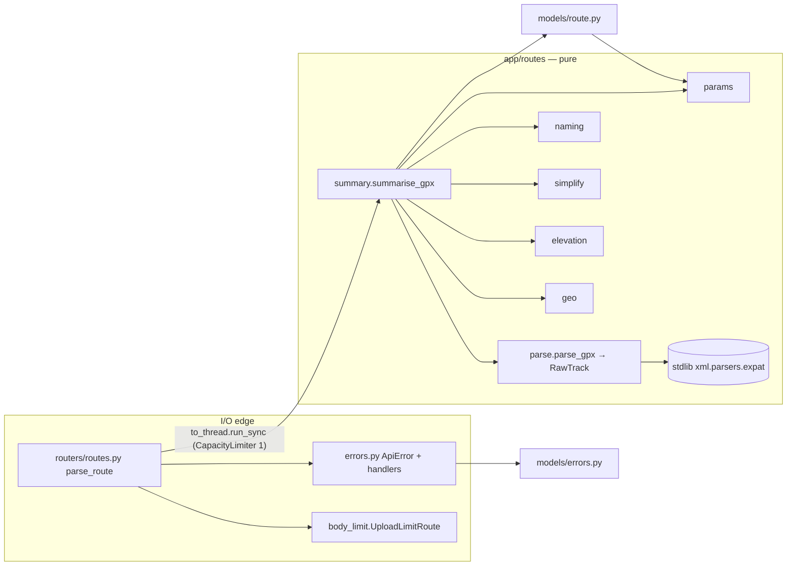

# 0004 — GPX parser: module boundary, RouteSummary/ErrorResponse contract, algorithms, upload limits, benchmark

Status: accepted; post-build corrections accepted (tech lead, 2026-10-20); round-3 amendment (items 28–36) accepted (tech lead, 2026-10-20); round-3 measured values and the namespace URI cap (items 37–44) accepted (tech lead, 2026-10-20); **round-4 amendment (items 45–51) proposed** (architect, 2026-10-20) · Date: 2026-10-19 · Amended: 2026-10-19 (three rounds), 2026-10-20 (post-build corrections; round-3 decision; round-3 measured values and URI cap; URI cap measured on the capped build; round 4: URI cap tightened to ASCII ≤ 256, S pending re-measurement) · Step: 1.2

## Amendments
**2026-10-19.** These record decisions already taken in step 1.2: review round 1, QA verify and the devops
benchmark deviation (see `docs/steps/1.2.md`, "Decisions and deviations"). The sections they touch have been
rewritten in place, so the body of the ADR is current.
1. **Hostile-input bounds.** The reviewer showed that hostile uploads were unbounded: RDP was O(n²) on
   near-collinear or zigzag input, and a 300k-point file peaked at about 239 MiB. Three bounds fix this.
   - **Point cap.** A file with more than 100,000 `<trkpt>`/`<rtept>` start tags gets 422 `too_many_points`.
     The tags are counted with a byte scan before gpxpy runs (§3.1 step 3, §3.12). The manager approved this
     cap. *The cap stays; item 14 replaces the byte scan.*
   - **Pre-thinning.** A track with more than 2,000 points is thinned in O(n) before ranked RDP runs (§3.5).
   - **Concurrency.** At most 1 parse runs at a time per instance (§3.10). It was 2; item 7 changed it.
2. **Elevation plausibility.** An `<ele>` outside [−1000, 10000] m is treated as missing (§2, §3.1 step 8).
3. **XML encoding.** An unsupported declared encoding (expat `LookupError`/`ValueError`) is now `invalid_gpx`
   (§3.11). Before this, it escaped as a 500.
4. **Benchmark.** §5 now describes what is implemented: a base entry seeded into the data file, one comparison
   run on the head, and the name-intersection rule. The original two-run A/B could never alert.
5. **RDP ties.** The split rule now uses a near-tie tolerance of 1e-6 m and splits nearest the midpoint (§3.5).
   Item 10 narrows what the tolerance is for.
6. **Follow-up for 1.3.** `summarise_gpx` should be split so the elevation lookup has a seam (Follow-ups).

**2026-10-19, second round.** These record QA's red tests and measurements on the amended code, and the tech lead's
decisions on them (`docs/steps/1.2.md`, the entry committed in 26c1e97). The sections they touch have been rewritten
in place.

7. **One parse at a time.** `MAX_CONCURRENT_PARSES` is **1**, not 2 (§3.10). QA measured the `tracemalloc` peak of
   one parse: 296 MiB for 10 MiB of `<trkseg/>`, 238 MiB for 10 MiB of `<a/>`, and 127 MiB for a real-shaped
   100k-point file, against my estimate of 80. On a 512 MiB instance, one worst-case parse fits and two don't.
   Running one parse at a time bounds memory without a new limit, so the **element-count cap is rejected as not
   needed**. It is no longer a pending manager decision (Options considered).
8. **NUL bytes.** Any `\x00` byte → `invalid_gpx` "file must be UTF-8". The order is now empty → prolog guard →
   NUL → point cap → decode → gpxpy (§3.1 step 3). The reason: BOM-less UTF-16 passes the strict UTF-8 decode,
   because NUL is valid UTF-8. gpxpy then re-encodes the text, expat auto-detects UTF-16, and the ASCII byte scan
   never sees the tags. QA parsed a 150k-point UTF-16 file past the cap. §3.12's premise ("every file that reaches
   gpxpy has ASCII tags") was false, and is corrected there. *The NUL rule stays; item 16 supersedes the order.*
9. **`Content-Length` hardening** (§3.10). Only ASCII digits are parsed. More than 19 digits ⇒ 413 before `int()`
   is called. Non-ASCII digits (e.g. `²`) ⇒ 400 `bad_request`.
10. **Pre-thinning is the only worst-case bound for RDP** (§3.5). Backend measured about 9.4M distance calls for raw
    `rdp_significance` on a 20k-point diagonal with 6-dp coordinates. The 1e-6 m tolerance does nothing against
    about 5 cm of coordinate rounding.
11. **Measured results** (§3.5, §3.10, §5). The largest fixture has a min of 187 ms. A 100k-point adversarial zigzag
    takes 2.8–3.5 s end to end, mostly in gpxpy.
12. **Open: Cloud Run `--concurrency`.** This is not decided here (Follow-ups). The tech lead has asked the manager to
    lower it from 80 to 8. *Item 20 adds the arithmetic.*

**2026-10-19, third round (accepted by tech lead 2026-10-19; Cloud Run concurrency pending the manager).** Review round 2 failed the hostile-input finding a second time. The manager
chose option A: replace gpxpy with our own streaming parser on stdlib expat (`docs/steps/1.2.md`, 60c6cdc). This
deviates from the roadmap's "Parse with gpxpy". The sections it touches are rewritten in place. Where an earlier item
above is superseded, the body says so.

13. **Own reader on `xml.parsers.expat`** (§3.1). One pass over the bytes. Handlers build only what `RawTrack`
    needs, and every other element is skipped with a counter. gpxpy is **removed** (§4; reasons in Options
    considered).
14. **Guard, cap and parse are one pass** (§3.11, §3.12). `app/routes/xml_guard.py` is deleted, with
    `check_gpx_prolog` and `exceeds_point_cap`. DTD rejection and the root check become handlers. The cap counts the
    points the pass reads and aborts at the 100,001st. This supersedes the byte scan in items 1 and 8.
15. **Nesting-depth cap 64 → `invalid_gpx`** (§3.11). Expat is iterative, but it keeps a record per open element.
16. **Encoding: same rule, new mechanism** (§3.1). Expat reads the content as UTF-8 (`ParserCreate(encoding="UTF-8")`)
    and validates it. Our `XmlDeclHandler` applies the declared-encoding test that pyexpat applied before. NUL is still
    rejected first. Inside the pass, errors are reported in document order.
17. **Resource bounds as numbers** (§3.13). About 180 B per kept point (≈ 17 MiB at 100k). Expat's own tables grow
    with distinct names and with the largest single element. The estimated worst single parse is ≈ 250 MiB; QA
    measures it. *Measured in item 24: 183.7 MiB. Item 33: that was not the worst case; item 28 bounds it.*
18. **`MAX_CONCURRENT_PARSES` stays 1**, re-derived (§3.10).
19. **The upload is closed right after `read()`** (§3.10). A waiting request then holds ≈ 10 MiB, not 20.
20. **Cloud Run `--concurrency=8` recommended to the manager**, with the arithmetic (§3.10; Manager decisions 6).
    *Item 25 re-derives it from measurements.*
21. **`parse_gpx(data, *, max_points=MAX_RAW_POINTS)`.** The new keyword lets tests hit the cap cheaply. Positional
    calls are unchanged.

**2026-10-20, post-build corrections.** These match the ADR to the reader as built (f78910a, 899f132) and as QA
verified it (5070469, 935d37d), with the tech lead's decisions (`docs/steps/1.2.md`, 2026-10-20). The sections they
touch are corrected in place.

22. **Chunked feed** (§3.1 step 4, §3.13). I was wrong that pyexpat does not copy the input: one `Parse(data, True)`
    made the `tracemalloc` peak grow with the input (1.06 MB at 1 MiB, 3.16 MB at 4 MiB). The reader feeds 64 KiB
    `memoryview` slices with `Parse(slice, False)`, then `Parse(b"", True)`, and the peak is flat at ≈ 270 KB. It is
    still one pass with one parser.
23. **Nested point tags** (§3.1 table, §3.12). A point start tag inside a point of the same kind counts toward the
    100k cap but is never read. This errs toward rejection. QA pins both "a bare `<trkpt>` counts" and "a nested
    point is not a point".
24. **Measured bounds** (§3.13). Every row is within its bound except distinct element names: 160.35 MiB against
    160 (my estimate was ≈ 100). Tech-lead decision: re-base that bound to **192 MiB**, with no new cap. The
    measured table replaces the estimates. *Item 33: the generators were not worst-case; the table is kept as
    history.*
25. **Concurrency from measured numbers** (§3.10). The max safe `--concurrency` is **12** under the pessimistic
    assumption (22 in steady state). **8 stays the recommendation**, with ≥ 88 MiB to spare beyond the margin.
    *Item 34: P was under-measured; the table is re-derived from the tracker bound.*
26. **Malformed `Content-Length` under uvicorn** (§2, §3.10). uvicorn answers these itself, with a plain-text 400,
    before the app runs. The `ErrorResponse` and `X-Request-ID` guarantee holds for requests that reach the app.
27. **Stale items closed.** gpxpy is gone from the code and the lock. The production image's expat is 2.8.5
    (verified by the tech lead), so the Docker-expat follow-up is done.

**2026-10-20, round-3 decision (accepted by tech lead 2026-10-20).** Review round 3 failed the hostile-input finding a third time. One
`<gpx>` start tag can bind a prefix to a long namespace URI and then carry about 1M distinct prefixed attributes,
all in 10 MiB. Expat builds `uri|local` for every attribute before any handler runs. The tech lead reproduced an
OOM kill (exit 137) in the production image under `--memory=512m`. QA's §3.13 generators were not worst-case:
with shortest-first names, attributes alone reach 267 MiB and `xmlns:pN` 236 MiB. The manager chose **option 1**:
bound the parser's memory with expat's allocation tracker. The 10 MiB upload cap stays; option 2, a lower cap, was
rejected (`docs/steps/1.2.md`, 2026-10-20). The sections these items touch are rewritten in place.

28. **Expat allocation tracker on every parser** (§3.1 step 3, §3.13). The one function that creates parsers,
    `_new_parser`, calls `SetAllocTrackerActivationThreshold(EXPAT_ALLOC_ACTIVATION_BYTES)` (32 MiB) and
    `SetAllocTrackerMaximumAmplification(EXPAT_ALLOC_MAX_AMPLIFICATION)` (4.0) before the first `Parse`. Expat's
    own memory is then at most max(32 MiB, 4 × bytes read), which is ≤ 40 MiB at the 10 MiB cap. **The values are
    provisional** until QA's measurement (§3.13) shows two things: every legitimate file stays ≤ 8 MiB of tracked
    expat memory (a quarter of the threshold), and the worst hostile shape stays ≤ 160 MiB RSS in the image.
    *Item 38: measured; the values are final.*
29. **No tracker, no app** (§3.11). `parse.py` calls `require_alloc_tracker()` at import. It raises `RuntimeError`
    unless pyexpat has both methods and expat is ≥ 2.7.2. The app then cannot start, so it never parses unbounded
    in silence. A test pins that the API exists.
30. **Tracker error → 422 `invalid_gpx` "The file is too complex to parse."** (§2, §3.1 step 5). It is detected by
    `ExpatError.code` against `errors.codes[XML_ERROR_NO_MEMORY]` and, defensively,
    `errors.codes[XML_ERROR_AMPLIFICATION_LIMIT_BREACH]`. It is never a 500 and never a 413.
31. **Captured text capped at `MAX_CAPTURED_TEXT_CHARS` = 65,536 characters** (§3.1, text capture). Above the cap,
    a `<name>` keeps its first 65,536 characters and an `<ele>` counts as missing. Nothing is rejected. This
    matches the existing rule that an unusable `<ele>` becomes `None`.
32. **The namespace rule versus gpxpy, stated exactly** (§3.1 Namespaces, Consequences). Six input shapes behave
    differently. Three of them gpxpy read and we skip; QA pins all six.
33. **§3.13 is re-measured with worst-case generators.** Names are generated shortest-first, and the namespace URI
    length is an axis. The shape list, the metric (peak RSS in the production image under `--memory=512m`, plus
    wall time) and the pass/fail bounds are fixed in §3.13 before anyone measures. The post-build table is kept as
    history.
34. **`MAX_CONCURRENT_PARSES` stays 1, re-derived** (§3.10). The formula for the largest safe value is given, and
    the number is filled in from QA's P. Raising the value above 1 needs the tech lead to bring those numbers to
    the manager. The `--concurrency` arithmetic is re-derived with the same P, and 8 stays recommended. 8 is safe
    for any P ≤ 280 MiB. *Item 42: with the measured B of 55 MiB, P ≤ 266 MiB; K_max = 5.*
35. **Stale follow-up closed.** The "expat ≥ 2.7.2 allocation tracker … not now" follow-up is done by item 28. The
    §3.13 escalation list now names what comes after the tracker.
36. **Test seams.** `parse_gpx(data, *, max_points=…, alloc_threshold_bytes=…, alloc_max_amplification=…)` lets QA
    bisect the tracker values on real files. The defaults are the constants. `_GpxReader` takes `max_text_chars`.

**2026-10-20, round-3 measured values; namespace URI cap (accepted by the tech lead, 2026-10-20).** QA measured
§3.13 on the round-3 build (8d6bfc8) in the rebuilt image `hike-api:qa-r3` under `--memory=512m` (9b655cf). Every
memory bar passed. One new finding was about time, not memory, and the tech lead decided it (`docs/steps/1.2.md`,
2026-10-20, "Build … + verify …"). The cap was then built (ffd0c7b), pinned and re-measured by QA (ad0f45a,
ee059c3), and the tech lead set S from it (`docs/steps/1.2.md`, 2026-10-20, "URI cap built …"). The sections
these items touch are rewritten in place.

37. **Namespace URI cap: `MAX_NAMESPACE_URI_CHARS = 1024`** (§3.1 step 4, §3.11; tech-lead decision). A
    `StartNamespaceDeclHandler` refuses any declared URI longer than 1,024 decoded characters with `invalid_gpx`
    `TOO_COMPLEX_MESSAGE`. There is no new error code and no OpenAPI change.
    - The reason is time. Every event of a namespaced element carries `uri|local`, so each prefixed element costs
      O(URI length). The tracker bounds memory, not time, and refuses only after ≈ 262k such elements.
    - Measured in the image: 10 MiB of H4 prefixed elements took 4.1 s at U = 64 KiB and 119 s at U = 1 MiB.
      Natively the tech lead measured 0.79 s at 1 KiB, 1.71 s at 4 KiB and 19 s at 64 KiB.
    - The longest URI in the corpus and in `docs/maps/` is 53 characters, and Garmin's extension URIs are about
      55. The cap refuses no plausible GPX.
    - *Item 45 supersedes the value and the character count: a declared URI must now be ASCII and at most 256
      characters. The 1,024-character cap admitted a 17.1 s file.*
38. **Tracker values final: 32 MiB / 4×** (§3.1 step 3, §3.13). Measured: worst P 64.5 MiB (bar 120); worst RSS
    99.2 MiB in the child and 119.6 MiB over HTTP on the capped build (120.1 before it; bar 160); no OOM kill and
    no restart in any run. Legitimate
    files: M_legit ≤ 64 KiB (the bisection resolution) and F_legit = 1.0. The "provisional" marks are removed.
39. **F method corrected** (§3.13). Expat rejects any factor below 1.0, so 1.0 is the floor and "bisect to 0.05"
    could not be done. F_legit is a pass/fail run at 1.0, with an upward bisection only if that fails.
40. **Correction: expat's defaults already refuse the 1 MiB round-3 shape** (§3.11, How it is tested). On expat
    2.8.5, its built-in 64 MiB / 100× refuse it, so the 1 MiB wiring test is not red without our values. Our
    tighter values are still what bound memory at 10 MiB on 512 MiB, where the defaults allow 1 GiB.
41. **One hostile time bar, ≤ 3.5 s, derived from the queue** (§3.10, §3.13). The real constraint is the queue
    behind one parse slot against Cloud Run's 300 s request timeout. At C = 8 the queue drains in 8 × 3.5 = 28 s.
    H7's `<trk/>` and `<a/>` floods take 2.0–2.5 s: that is Python's per-element handler overhead, and it is inside
    the bar. The earlier "≤ 2 s" was an estimate, not a gate.
    - *Superseded by item 47:* the tech lead set S = 2.6 s from H4 at U = 1,024 four-byte characters
      (2.24–2.64 s on a quiet host, up to 5.5 s with about 45 % ambient host load), taking H4 for the worst
      admitted row. It was not. A repeated-name flood under the same URI was admitted and took 17.1 s in the image.
      **S is pending re-measurement ⟨QA⟩**, and so are the queue figures derived from it (8 × 5.5 = 44 s,
      80 × 2.6 = 208 s). Bars are still judged on a quiet host, like the benchmark job.
42. **§3.10 from measured numbers.** B is 55 MiB, the idle uvicorn process in this image, not 40.5. With
    P = 64.5 MiB: K_max = 5 in both columns at C = 8, and C_max at K = 1 is 34 (steady) and 18 (pessimistic).
    `--concurrency=8` is safe for any P ≤ 266 MiB. `MAX_CONCURRENT_PARSES` stays 1.
43. **Rows re-measured after the cap** (§3.13). The cap moves three rows:
    - H4 at the largest admitted URI, 1,024 characters, both ASCII (1 KiB) and 4-byte characters (4 KiB of
      UTF-8);
    - H3's time, because the handler adds one Python call per admitted declaration;
    - H9, redefined at U = 1,024 characters, because a 64 KiB URI on the root is now refused before the first point.
      It is trimmed to 10 MiB total. The literal form (100,001 points plus 9 MiB of H4, 11.3 MiB) is a 413 over
      HTTP and never reaches the parser.

    Measured (QA, `hike-api:qa-r3`, ee059c3): every row within its bars on a quiet host; the figures are in §3.13.
    H3's expected outcome is corrected to "200 or 422".
    - *Item 48: the rows were not worst-case. None of them repeats one name under a long URI. The largest admitted
      URI is now 256 ASCII characters, and the whole table is re-run in a rebuilt image.*
44. **Tests for the cap** (How it is tested): 1,024 accepted and 1,025 refused, default and prefixed, counted in
    characters; precedence in document order; the H4 shape at U = 64 KiB refused in < 1 s.
    - *Correction:* pyexpat clears its handlers itself after a callback raises (§3.1 step 4, "How the exception
      leaves `Parse`", step 1). So `detach()` after a refusal is belt-and-braces, and the after-return test is the
      one that proves `detach`.
    - *Item 49 moves the boundary to 256 / 257 and adds the ASCII cases. "1,024 × U+10000 accepted" becomes
      refused.*

**2026-10-20, round-4 amendment (proposed).** Review round 4 found one blocking problem in this round's own URI cap
(`docs/steps/1.2.md`, 2026-10-20, "Review round 4 …"). The 1,024-character cap does not meet the 3.5 s bar. Two
facts combine. First, each element's cost grows with the *decoded* URI, and pyexpat holds that as UCS-4 when the URI
has a character above U+FFFF. Second, the allocation tracker never stops *repeated* names. So the worst admitted file
was never H4: H4 uses distinct names, and the tracker refuses it. The worst was `<gpx xmlns="1,024 × U+10000">` plus
9.9 MiB of `<a/>`, which returned 200 in 17.1 s in the image. The tech lead decided the fix. This is not an
escalation: the round-3 finding (memory) is resolved, and this is the cap's first failure. The sections these
items touch are rewritten in place.

45. **Namespace URI cap: ASCII and at most `MAX_NAMESPACE_URI_CHARS = 256`** (§2, §3.1 step 4, §3.11; tech-lead
    decision). The handler is still `on_namespace_decl`. A declared URI, default or prefixed, on any element, is
    refused with `InvalidGpx(TOO_COMPLEX_MESSAGE)` unless `uri.isascii()` and `len(uri) <= 256`. An ASCII string
    of at most 256 characters is at most 256 bytes. `xmlns=""` (uri `None`) is still accepted. There is no new
    error code and no OpenAPI change. This supersedes item 37's value of 1,024 and its rule of counting decoded
    characters of any script.
46. **Why: repeated names, measured** (§3.11, §3.13).
    - Every start and end event of a namespaced element carries `uri|local`, and pyexpat decodes it into a new
      `str` for each event. The cost of each event grows with the URI's decoded size. A URI with one character
      above U+FFFF makes every such `str` UCS-4, 4 bytes per character. A URI with any non-ASCII character also
      leaves CPython's ASCII fast path.
    - The tracker bounds what accumulates: distinct names and the largest element. One name repeated 2.6M times
      accumulates nothing, so the tracker never refuses it.
    - Natively, 10 MiB of `<a/>` (tech lead): control with no namespace 1.64 s; ASCII 256 characters 2.42 s; ASCII
      1,024 characters 4.5 s; 64 four-byte characters 4.6 s; 1,024 four-byte characters 25.4 s. In the image, the
      last shape took 17.1 s and returned 200.
    - So the bar needs both a length limit and an ASCII rule. 1,024 ASCII characters is already over the bar
      natively, and so are 64 non-ASCII characters (256 bytes). 256 ASCII characters is 0.78 s over the control and
      inside the bar.
    - Real namespace URIs are ASCII: RFC 3986 builds a URI from "a very limited set" of characters, and Namespaces
      in XML 1.0 requires a URI reference. The longest one we have seen is 53 characters, so 256 leaves about 5×
      headroom.
47. **Correction: "worst admitted row" and S** (§3.10, §3.13, Manager decisions 6). H4 at U = 1,024 four-byte
    characters was not the worst admitted row, so S = 2.6 s rested on the wrong worst case. **S is pending
    re-measurement ⟨QA⟩**: it is the slowest admitted row of the re-run §3.13 table, measured in a rebuilt image.
    The queue formula (C × S < 300 s, so S < 300 s / C) and the 3.5 s bar stay. Every figure computed from
    S = 2.6 s or 5.5 s is marked pending.
48. **New §3.13 rows: repeated names at the largest admitted URI** (§3.13).
    - **H11:** each of three shapes, 10 MiB, at U = 256 ASCII characters: a default-namespace `<a/>` flood; a
      prefixed `<p:a/>` flood; and repeated `<a p:a="" … p:h=""/>`, which puts prefixed attributes on skipped
      elements. Each has a bar of ≤ 3.5 s on a quiet host.
    - **H12:** the same shapes at U = 257 ASCII characters and at U = 1 non-ASCII character, plus the 17.1 s
      round-4 file. All are refused at the declaration.
    - **The method's lesson:** the worst-case search covers repeated names as well as distinct ones, because the
      tracker bounds only distinct names. Any axis that grows the cost of each event (URI length, URI encoding)
      is measured both ways.
    - The whole table is re-run in an image rebuilt from the round-4 build. `hike-api:qa-r3` predates the URI cap,
      and the post-cap figures so far were taken by mounting HEAD code into it.
49. **Tests for the tightened cap** (How it is tested).
    - The boundary moves: 256 is accepted and 257 refused.
    - New ASCII cases: one non-ASCII character is refused, whether written literally or as a character reference.
    - A regression test with a time ceiling: the 17.1 s round-4 file is refused in < 1 s.
    - Existing tests with a 1,024-character URI that expect anything other than the cap's refusal move to
      256-character ASCII URIs and are re-sized where the tracker must still refuse them.
    - The pin becomes `MAX_NAMESPACE_URI_CHARS == 256`.
50. **Options re-weighed** (Options considered). These are now rejected, each because a measurement puts it over
    the bar: a 1,024-byte cap, a 256-character cap of any script, and a 256-byte cap of any script. Item 37's
    "a lower URI cap (for example 256) — not chosen" is reversed.
51. **Consequences.** A document that declares a non-ASCII namespace name (an IRI) or a URI longer than 256
    characters is refused. No known exporter does either. Loosening the rule is an amendment that re-measures H11.

## Context
Step 1.2 adds `POST /v1/routes/parse`. It turns an uploaded GPX file into a typed `RouteSummary`, rejects bad input
with a typed `ErrorResponse`, never returns 500, and parses the largest fixture in < 2 s. A CI benchmark guards
against regressions. The forces at play:
- **Gates:** distance within 2 % and gain within 10 % of the AllTrails reference on every valid 1.1 fixture. Raw
  gain is far above the references: Modiin 245/198, Ben Shemen 375/200, Tel Hadid 236/103 m.
- **Fixtures:** the three AllTrails files are *planned routes*, and their elevations are DEM samples. The values
  have 2 decimals and repeat over runs of consecutive points, the staircase of DEM cells. They show single-cell
  artefacts of 2–6 m and bumps of about 10 m that AllTrails does not count. Point spacing is about 8 m (Tel
  Hadid), 14 m (Ben Shemen) and 23 m (Modiin). The > 10k fixture is Ben Shemen linearly densified 14×, so any
  point-count window or threshold behaves differently on it. Method parameters therefore have to be in metres
  along the track, not in points.
- **Code rules (CLAUDE.md):** rule logic is pure (no I/O, clock or randomness), mypy strict, no `Any` without a
  reason, no network in unit tests, coverage gate 85 %, and new dependencies need an ADR plus manager approval.
- **API contract (ADR 0001):** handler names become operation IDs (`parse_route` → `parseRoute`), and
  `api-contract` fails on a stale `openapi.json`/`schema.d.ts`. The OpenAPI must be fully typed, error responses
  included, because 1.10 (PWA) and later Expo generate their clients from it.
- **Existing error shape:** `RequestIdMiddleware` turns unhandled exceptions into
  `500 {"detail": "Internal Server Error"}`, and `tests/test_errors.py` asserts exactly that body. FastAPI's own
  422 is `{"detail": [...]}`, and Starlette's 404/405 is `{"detail": "Not Found"}`. Neither is `ErrorResponse`.
- **Runtime:** Cloud Run with 512 MiB of memory, 1 vCPU, concurrency 80 (8 recommended; Manager decisions 6) and
  max 1 instance (ADR 0002/0003). The
  filesystem is in memory, and Cloud Run caps HTTP/1 requests at 32 MiB. Starlette spools uploads to a
  `SpooledTemporaryFile` (1 MiB in memory, then "disk", which is RAM here) and has **no total file-size limit**.
- **Path:** `overview.md` says `/routes/parse`, but the phase-1 checklist path `/v1/routes/parse` is used. The
  manager confirmed it on 2026-10-19 and is correcting the master doc.

## Decision

### 1. Module boundary
| Module | Role | Imports |
| --- | --- | --- |
| `app/models/route.py` | `LatLonElev`, `TrackPoint`, `RouteSummary` (Pydantic, response-only) | pydantic, `app.routes.params` (the 500 cap) |
| `app/models/errors.py` | `ErrorCode`, `FieldError`, `ErrorResponse` | pydantic |
| `app/routes/` | **pure** pipeline: bytes in, `RouteSummary` or a `RouteParseError` out | stdlib only (`xml.parsers.expat` and `codecs` in `parse.py`), `app.models.route` |
| `app/routers/routes.py` | the I/O edge: multipart upload, size limit, worker thread under the parse limiter, error mapping | fastapi, anyio, `app.routes`, `app.errors`, `app.body_limit`, `app.dependencies` |
| `app/errors.py` | `ApiError`, global exception handlers, `ERROR_RESPONSES` for OpenAPI | fastapi/starlette, `app.models.errors` |
| `app/body_limit.py` | `UploadLimitRoute`: streaming request-body cap | fastapi/starlette, `app.routes.params`, `app.errors` |

`ErrorResponse` goes in `app/models/errors.py`, not in `route.py`, because every endpoint shares it. This is a
deliberate deviation from the checklist's "Models (`app/models/route.py`)" heading, and the tech lead records it in
the brief.

**Purity.** Nothing in `app/routes/` reads files, the environment, the clock or randomness, and nothing logs.
`summarise_gpx(data, filename, params)` is the whole pipeline and is what the benchmark measures. Expat parsing
bytes in memory counts as pure: it does no I/O, and each call creates its own parser, so no state is shared.

**One place for parameters: `app/routes/params.py`.** It holds the frozen `ParseParams` dataclass plus `Final`
constants: the upload limit, the raw-point cap, the XML depth cap, the 500-point cap, the plausible-elevation range,
the parse concurrency, Earth's radius and the name limits. Each pure function takes its
parameters as keyword arguments whose defaults come from `DEFAULT_PARAMS`. Parameters are **not** `Settings`/env:
the accuracy gates are tuned against these exact values, and env overrides would let environments drift away from
what was tested. `ParseParams.__post_init__` raises `ValueError` on nonsense values (a programming error, never
user input).

### 2. Contract
All fields are **required**. Nullable fields are `T | None` with no default, so they are always present in the JSON
and openapi-typescript emits `x: T | null`, never `x?: T`. Units are metres and WGS84 degrees. Floats are finite
(`allow_inf_nan=False`) and are not rounded (see follow-ups for payload size).

**`LatLonElev`**
| Field | Type | Meaning |
| --- | --- | --- |
| `lat` | float, −90..90 | degrees |
| `lon` | float, −180..180 | degrees |
| `elev_m` | float \| null | elevation from the file, metres; null when `has_elevation` is false |

**`TrackPoint`**: `lat`, `lon` and `elev_m` as above, plus `dist_m: float ≥ 0`. `dist_m` is the cumulative 2-D
distance from the start along the **full-resolution** de-duplicated track, not along the simplified line. It never
decreases along `points`, the first value is 0, and the last equals `distance_m`.

**`RouteSummary`**
| Field | Type | Meaning / when no elevation |
| --- | --- | --- |
| `name` | str, 1..200 chars | §3.9 |
| `distance_m` | float ≥ 0 | 2-D haversine length, segment jumps included (§3.2) |
| `gain_m`, `loss_m` | float ≥ 0 \| null | smoothed and thresholded (§3.4); **null** when `has_elevation` is false |
| `min_elev_m`, `max_elev_m` | float \| null | raw file values over all de-duplicated points; **null** when there is no elevation |
| `high_point` | `LatLonElev` \| null | first point with the maximum raw elevation; **null** when there is no elevation |
| `start`, `end` | `LatLonElev` | first and last de-duplicated point (`elev_m` null when there is no elevation) |
| `is_loop` | bool | §3.8 |
| `points` | list[`TrackPoint`], 2..500 items | §3.5; always includes start, end and the high point |
| `has_elevation` | bool | true iff **every** de-duplicated point has a *plausible* `<ele>`: present, finite and within [−1000, 10000] m inclusive (§3.1 step 8) |
| `elevation_source` | `"file"` \| `"lookup"` \| `"none"` | 1.2 emits only `file`/`none`; `lookup` is reserved for 1.3 and is in the enum now so 1.3 doesn't change the type |
| `source_format` | `"trk"` \| `"rte"` | §3.1 |
| `point_count_original` | int ≥ 2 | points in the chosen source as the file has them (all segments, before de-duplication). It can be lower than the §3.12 count, which counts both kinds |

No elevation means **null, not 0**. Zero gain is a real value (a flat route), and the Phase 2 rules must not mistake
"unknown" for "flat". A file where only some points have a plausible `<ele>` counts as having no elevation, and every
`elev_m` is null. One point at 1e300 m or −5000 m is enough. This keeps clients from ever drawing a profile with
holes. 1.3's lookup then supplies elevation, so **1.3's backfill must cover the implausible-value case as well as
the missing one**.

**`ErrorResponse`, shared by every error the app returns:**
```json
{"code": "invalid_gpx", "message": "The file is not well-formed XML (line 12, column 5).", "detail": null}
```
- `code`: `ErrorCode`, the stable, machine-readable value clients branch on.
- `message`: an English sentence for developers and logs. **UX copy maps `code` to user text.** Clients never show
  `message` as product copy.
- `detail`: `list[FieldError] | null`. It is non-null only for `validation_error`. `FieldError` is
  `{loc: list[str | int], msg: str, type: str}`, FastAPI's error list with `input`, `ctx` and `url` **dropped**, so
  uploaded content is never echoed back.

| Status | `code` | Raised by |
| --- | --- | --- |
| 413 | `file_too_large` | the `Content-Length` pre-check, the streaming body cap, or the file-length check (§3.10) |
| 422 | `invalid_gpx` | empty file, unsupported declared XML encoding, a NUL byte or not UTF-8, not well-formed (unbound prefix included), DTD/entity present, root not `<gpx>`, nested deeper than 64 elements, **too complex to parse: expat's allocation tracker refused it, or a declared namespace URI is not ASCII or is longer than 256 characters** (one message for both, "The file is too complex to parse.", §3.1 steps 4–5, round-3 amendment, items 37 and 45), a chosen-source point with missing, unparseable, non-finite or out-of-range coordinates (§3.1) |
| 422 | `too_many_points` | more than `MAX_RAW_POINTS` (100,000) track and route points together; the pass stops at the 100,001st (§3.12) |
| 422 | `too_few_points` | fewer than 2 points after merging and de-duplication (this includes waypoint-only files) |
| 422 | `validation_error` | FastAPI `RequestValidationError`, e.g. the `file` field is missing, or `file` is a text field |
| 400 | `bad_request` | Starlette multipart errors (FastAPI turns form-parsing failures into `HTTPException(400)`); a `Content-Length` made of non-ASCII digits, when the server passes it through (uvicorn answers it itself, §3.10) |
| 404 / 405 | `not_found` / `method_not_allowed` | Starlette routing; the `Allow` header is kept |
| other 4xx | `http_error` | any other `HTTPException` |
| 500 | `internal_error` | `RequestIdMiddleware`'s catch-all (a bug; the fuzz test exists so this never happens) |

**Reconciling with the existing 500.** `RequestIdMiddleware` keeps its role: it logs with the request ID and
responds when nothing has started. Its body becomes
`{"code": "internal_error", "message": "Internal Server Error", "detail": null}`, built from `ErrorResponse`.
`test_errors.py`'s body assertion changes to match (QA). The test that the secret detail never leaks stays as it
is. Every error response the app produces, the 500 included, is an `ErrorResponse` and carries `X-Request-ID`. This
guarantee covers requests that reach the app. It does not cover responses made before the app runs (uvicorn's
plain-text 400 for a malformed `Content-Length`, §3.10) or by the platform (Cloud Run's 429 and 504).

**Handlers (`install_error_handlers`, called in `create_app`):**
- `StarletteHTTPException` → `ErrorResponse`. For an `ApiError` the code comes from `exc.code`; for any other
  `HTTPException` it comes from the status table above. `exc.headers` is kept.
- `RequestValidationError` → 422 `validation_error`.

`ApiError` **subclasses Starlette's `HTTPException`** on purpose. FastAPI's body reader re-raises `HTTPException`
unchanged but wraps any other exception into a 400, and the streaming body cap raises from inside
`request.form()`.

**OpenAPI.** The handler `async def parse_route(...) -> RouteSummary` (operation ID `parseRoute`) declares
`responses=ERROR_RESPONSES`, which maps 400, 413, 422 and 500 to `{"model": ErrorResponse}`. Declaring 422
explicitly stops FastAPI from adding its default `HTTPValidationError` schema, which would be a lie, since our 422 is
`ErrorResponse`. The request body is `multipart/form-data` with `file: binary`; FastAPI names its schema
`Body_parseRoute`. `/health`'s OpenAPI stays unchanged in 1.2: its errors use the shape at runtime, and its
undocumented 500 isn't worth the schema churn.

**Clients must treat an unknown `code` as a generic error.** New codes will be added, and an installed Expo build
can't be updated in lock-step.

### 3. Algorithms

**3.1 Parse (`parse_gpx`): one expat pass with our own handlers; no third-party parser** (third amendment). The
input bytes go through these steps, in order:
1. **Empty input** → `invalid_gpx`.
2. **NUL:** any `\x00` byte → `invalid_gpx` "file must be UTF-8". This is one C-speed `in` test, run before expat.
   - XML 1.0 forbids U+0000.
   - Every UTF-16/UTF-32 document has a NUL beside each ASCII character, `<` included. So this rejects them all
     before expat could auto-detect them from a BOM or from the first bytes.
3. **Parser:** `expat.ParserCreate(encoding="UTF-8", namespace_separator="|", intern=None)`, with
   `ordered_attributes = True` and `buffer_text = True`.
   - `encoding="UTF-8"` overrides the declared encoding, so the content is always read, and validated, as UTF-8.
     That is what gpxpy did: it decoded first and handed expat a `str`. A UTF-8 BOM is skipped.
   - `intern=None` turns off pyexpat's per-name dictionary, which would grow with every distinct name (§3.13).
   - `ordered_attributes` gives a flat `[name, value, …]` list. It is cheaper than a dict, and expat already rejects
     duplicate attributes.
   - **Allocation tracker (round-3 amendment).** `parser.SetAllocTrackerActivationThreshold(EXPAT_ALLOC_ACTIVATION_BYTES)`
     (32 MiB) and `parser.SetAllocTrackerMaximumAmplification(EXPAT_ALLOC_MAX_AMPLIFICATION)` (4.0) are set on the
     parser before the first `Parse`.
     - Expat counts every byte it allocates for the parser (its input buffer, name tables, `uri|local` names,
       attribute arrays, open-element records) against the bytes of the document it has parsed so far ("direct").
       Below the activation threshold anything is allowed. Above it, an allocation that would push
       allocated / direct past the factor fails, and expat stops with `XML_ERROR_NO_MEMORY`.
     - So expat's own memory never exceeds **max(32 MiB, 4 × direct) ≤ 40 MiB** at the 10 MiB cap, whatever the
       document's shape. This is the bound §3.13 was missing: the round-3 file needed more than the ≈ 470 MiB left above the idle
       process, and was OOM-killed.
     - **`_new_parser` is the only place in `app/` that calls `ParserCreate`.** It applies the four settings above
       and the two tracker calls, in that order, and returns the parser. `parse_gpx` calls it **outside** the
       `try` that maps `ExpatError`. A bad value (a factor < 1.0 or NaN) is a programming error, and pyexpat's
       `ExpatError` from the setter must not be reported as bad input. Only tests pass non-default values.
     - Both calls apply to a root parser, and ours is one: no `ExternalEntityRefHandler` is set, so no child
       parser ever exists.
     - The values are **final** (item 38). QA's §3.13 measurement confirmed both legitimate margins and every
       memory bar. Changing them is an ADR amendment, like the gain grid.
4. **One pass, fed in slices** (corrected 2026-10-20). Over `view = memoryview(data)`, call
   `parser.Parse(view[i : i + 64 KiB], False)` for each slice, then `parser.Parse(b"", True)`.
   - A single `Parse(data, True)` measurably copies the input: the `tracemalloc` peak grew with it (1.06 MB at
     1 MiB, 3.16 MB at 4 MiB). With 64 KiB slices it is flat at ≈ 270 KB. My earlier "pyexpat does not copy" was
     wrong. `memoryview` slices copy nothing on our side.
   - It is still one pass with one parser. Expat keeps its state across slices, so a token split between slices
     parses as if contiguous. Line and column numbers in errors are unchanged.
   - The handlers in the table below raise `InvalidGpx` or `TooManyPoints`, which stops the parse at once. The
     exception propagates out of the current `Parse` call, and no later slice is fed.
   - **`XmlDeclHandler`, declared encoding.** It keeps today's rule. The name is accepted if it is UTF-8
     (case-insensitive) or a Python codec that maps all 256 byte values to 256 characters: `codecs.lookup` succeeds,
     and `len(bytes(range(256)).decode(name, "replace")) == 256`. That is exactly the check pyexpat's unknown-encoding
     handler made, and it is how utf-32, utf-7, shift_jis and big5 were refused. Anything else (including
     `LookupError`) → `invalid_gpx` "unsupported XML encoding". Because the override means pyexpat never consults
     the declaration, the old `LookupError`/`ValueError` catch around the parse is **removed**. A `ValueError`
     escaping now is a bug (500), which the fuzz test hunts for.
   - **`StartNamespaceDeclHandler`: the namespace URI must be ASCII and short** (items 37 and 45; the reason is
     in §3.11). `_GpxReader.__init__` installs `parser.StartNamespaceDeclHandler = self.on_namespace_decl` with its
     other handlers, and `detach()` sets it back to `None`. `_new_parser` is unchanged, because it configures the
     parser and the reader owns the handlers.
     - **The rule (item 45):** if `uri is not None and (not uri.isascii() or len(uri) >
       self._max_namespace_uri_chars)` (default `MAX_NAMESPACE_URI_CHARS` = 256), then
       `raise InvalidGpx(TOO_COMPLEX_MESSAGE)`. An ASCII URI of exactly 256 characters is accepted. A URI with any
       non-ASCII character is refused at any length, including 1.
     - **Checked on the decoded URI:** the `str` that pyexpat passes. Expat has already expanded character and
       entity references and normalised the attribute value, and pyexpat has decoded it from UTF-8. This is the
       form whose size each later event pays for (§3.11).
       - `&#x75;` is 1 ASCII character, so 256 of them (1,536 bytes in the file) are accepted.
       - `&#xE9;` is ASCII in the file but decodes to `é`, so it is refused.
       - A percent-encoded `%C3%A9` is 6 ASCII characters, and is accepted under the length limit.
     - **So characters equal bytes:** an admitted URI is at most 256 characters and at most 256 bytes, in the
       file's UTF-8 and in expat's buffer alike, and pyexpat stores it as a 1-byte-per-character `str`. Item 37's
       count of decoded characters of any script, under which 1,024 four-byte characters (4 KiB) were admitted, is
       superseded.
     - **Cost of the check:** in CPython `str.isascii()` reads a flag that the string already carries, and `len()`
       is stored, so the handler does constant work per declaration.
     - **Both kinds of declaration:** default (`xmlns="…"`, which arrives with `prefix=None`) and prefixed
       (`xmlns:p="…"`). This applies on any element, including inside subtrees the reader skips, because expat
       binds every declaration whatever our handlers do with the element.
     - **Undeclaration:** for `xmlns=""`, expat passes a NULL URI (`addBinding`: `prefix->binding ? uri : 0`), and
       pyexpat turns it into `None`. That is length 0, so it is accepted, and §3.1 Namespaces case 3 is unchanged.
       `xmlns:p=""` never reaches the handler: expat refuses it first as `XML_ERROR_UNDECLARING_PREFIX`, which gets
       the not-well-formed message.
     - **When it runs:** expat calls it once per declaration of a start tag, in attribute order. That happens
       inside `storeAtts`, before expat expands that tag's prefixed names and before the `StartElementHandler` of
       the element (pyexpat docs: "Namespace declarations are processed before the `StartElementHandler` is called
       for the element on which declarations are placed").
     - **How the exception leaves `Parse`.** It takes the path `_reject_dtd`, `on_xml_decl` and the root and
       depth checks already take, step by step:
       1. pyexpat's `call_with_frame` calls `XML_StopParser(parser, XML_FALSE)`. `flag_error` then clears every
          handler on the C parser, so no other Python handler runs in this parse.
       2. Expat finishes `storeAtts` for the current start tag, still under the tracker. It skips the cleared
          start-element callback, sees the parser stopped (`XML_FINISHED`) at the bottom of `doContent`'s loop,
          and returns `XML_ERROR_ABORTED`.
       3. pyexpat's `get_parse_result` checks `PyErr_Occurred()` before it looks at expat's error. It returns
          NULL, so the **`InvalidGpx` itself** propagates out of the current
          `parser.Parse(view[i : i + 64 KiB], False)`, not an `ExpatError`. This holds even when expat also
          failed on the same tag, for example with a tracker refusal while expanding its attributes: the pending
          Python exception wins.
       4. In `parse_gpx` (`api/app/routes/parse.py`, the `try` around the slice loop), `except ExpatError` does not
          match. `finally: reader.detach()` runs, and the `InvalidGpx` leaves `parse_gpx` unchanged, with
          `__cause__` `None`.
       - **`detach()` after a refusal is belt-and-braces** (item 44). pyexpat has already cleared every handler
         in step 1, so the handlers are `None` after a refusal even without `detach()`. It is after a normal
         return that `detach()` does the work, so the after-return test is the one that proves it.
       - **So `parse_gpx` needs no change.** The handler must raise `InvalidGpx` directly. It must not raise or
         build an `ExpatError`, go through `_invalid_gpx_from`, or gain its own `except` clause. The `__cause__`
         is how a test tells a URI-cap refusal (`None`) from a tracker refusal (`ExpatError` with
         `XML_ERROR_NO_MEMORY`).
   - **DTD, root and depth handlers:** §3.11. **Point cap:** §3.12.
5. **Errors:** `expat.ExpatError` → `invalid_gpx`, chained with `from`. One helper,
   `_invalid_gpx_from(exc: ExpatError) -> InvalidGpx`, picks the message from `exc.code`:
   - **Tracker refusal** (round-3 amendment): `exc.code` is in `_RESOURCE_ERROR_CODES` = {
     `errors.codes[errors.XML_ERROR_NO_MEMORY]`, `errors.codes[errors.XML_ERROR_AMPLIFICATION_LIMIT_BREACH]` }
     (`from xml.parsers.expat import errors`). The message is **`TOO_COMPLEX_MESSAGE` = "The file is too complex
     to parse."**, with no line or column, because they point inside an over-long token and help nobody.
     - pyexpat reports a failed `XML_Parse` as `ExpatError` with expat's code, not as `MemoryError`
       (`get_parse_result` → `set_error`). Expat reports a tracker refusal as an out-of-memory error. QA's red
       test pins the code that the round-3 shape actually produces.
     - `XML_ERROR_AMPLIFICATION_LIMIT_BREACH` is expat's billion-laughs limit. It is unreachable, because a DTD is
       refused before any entity exists (§3.11). It is mapped anyway, so a future change can't turn it into a
       "not well-formed" message.
     - The code stays `invalid_gpx`, as the manager decided. A new `ErrorCode` would change the OpenAPI enum and
       need UX copy for a case no real user meets. Clients branch on `code`; the distinct `message` is for logs.
   - **Anything else:** "The file is not well-formed XML (line L, column C)." This covers malformed or truncated
     XML, invalid UTF-8 (including bytes declared as Latin-1), unbound prefixes, junk after the root and a missing
     root. Handlers catch `ValueError` from `float()` themselves.
   - A real `MemoryError` (the process itself out of memory) is not caught. Under the tracker, one parse can't get
     there; if it ever did, the cgroup would kill the process before Python saw it.
   - **Precedence:** empty → NUL → the first problem the pass meets, in document order (declared encoding, DTD,
     root, malformed or non-UTF-8 bytes, depth, a tracker refusal, a namespace URI that is non-ASCII or over 256
     characters, the 100,001st point)
     → an invalid chosen-source coordinate (step 8). A tracker refusal stops the pass where expat's allocation
     failed. It can therefore win over a later malformation or over a later 100,001st point, and a malformation
     met first wins over it.
     - **The URI cap** (items 37 and 45; both of its conditions) is met at the declarations of its start tag, like the others in document order.
       A declaration on an earlier element wins over a later 100,001st point, a later depth-65 element or a later
       malformation. A 100,001st point, a malformation or a DTD earlier in the document wins over it.
     - **On one start tag**, expat tokenises the whole tag before `storeAtts` runs. So a malformation inside the
       tag (a missing quote, invalid UTF-8) wins over the cap. Then the declarations run, before anything else
       about that element. So the cap wins over that element's root-name check, depth check and point count, and
       over an unbound prefix or a tracker refusal arising from the same tag (step 4: the pending Python exception
       wins). A duplicate attribute is reported where expat meets it, in attribute order; this is not pinned.
   - **Changes from the gpxpy version:** NUL now comes before prolog errors (both are `invalid_gpx`). A
     malformation *before* the 100,001st point now wins over `too_many_points`. Every precedence test QA has today
     puts the malformation in the prolog or after the points, so they all still hold.
6. **Choose a source** (rule unchanged). `trk` if all tracks and segments together hold ≥ 2 points. Otherwise `rte`
   if all routes together hold ≥ 2. Otherwise whichever has more (`trk` on a tie); the later < 2 check then raises
   `too_few_points`. Counts include invalid points.
7. **Merge:** within the chosen kind, every track (or route) and every segment, in document order. Segment
   boundaries are not recorded, because §3.2 counts the jumps.
8. **Validate the chosen kind only.** If any of its points had a missing, unparseable or non-finite lat/lon, a lat
   outside −90..90 or a lon outside −180..180 → `invalid_gpx`. Points of the other kind are never validated. An
   `<ele>` that is missing, empty, unparseable, non-finite, or outside **[`MIN_PLAUSIBLE_ELEV_M`,
   `MAX_PLAUSIBLE_ELEV_M`] = [−1000, 10000] m, inclusive**, becomes `None`.
   - The range covers the Dead Sea shore (−430 m) and Everest (8 849 m) with a margin. Anything outside it is a
     unit or encoding error, not terrain.
   - It also keeps the downstream arithmetic and the finite-float response model safe. Extreme values produced a
     500 in QA verify.
   - Following §2, one such point makes `has_elevation` false for the whole file.

**What the handlers read.** With namespace processing, names arrive as `uri|local` or `local`; split on the last
`|`, since local names can't contain it. Let N be the root's namespace, whatever it is, including none. Only
elements in N, at these paths, are read. Depth starts at 1 for the root.

| Path (local names, all in N) | Action |
| --- | --- |
| `gpx` (depth 1) | the local name must be `gpx` (case-sensitive), else `invalid_gpx` "not GPX"; N := its namespace |
| `gpx/metadata/name` (1.1), `gpx/name` (1.0) | `metadata_name` = the text of the first one met, raw |
| `gpx/trk/name`, `gpx/rte/name` | the first non-blank (`str.strip()`) per kind; `track_name` is the chosen kind's |
| `gpx/trk/trkseg/trkpt`, `gpx/rte/rtept` | a point. It is counted at its start tag (§3.12); `lat`/`lon` come from its attributes |
| `…/trkpt/trkpt…`, `…/rtept/rtept…` (a point start tag inside a point of the same kind, at any depth of such nesting) | **not a point, but counted** toward the cap (§3.12). Nothing is read from it or its subtree (corrected 2026-10-20) |
| `…/trkpt/ele`, `…/rtept/ele` | the text of the point's **first** `<ele>`; later ones are ignored |
| anything else, with its whole subtree: `wpt`, `time`, `extensions`, unknown or foreign-namespace elements | skipped. The subtree only moves a skip counter: no strings kept, no text handler |

- **Namespaces.** The GPX 1.1, GPX 1.0 and namespace-free roots that QA pins
  (`test_gpx_1_0_1_1_and_namespace_free_roots_are_accepted`) all work.
  - A prefixed document (`<g:gpx xmlns:g="…/GPX/1/1"><g:trk>…`) now yields its points. gpxpy silently ignored
    them.
  - A `gpx` root in any other namespace is still accepted, as gpxpy accepted it. An allow-list would be a new
    rejection.
  - `xmlns` attributes never reach the start handler's attribute list, and nothing is registered globally. Since
    item 37 each declaration reaches `on_namespace_decl`, which only checks that the URI is ASCII and at most 256
    characters (item 45, §3.1 step 4).
  - **The rule, and how it differs from gpxpy (round-3 amendment).**
    - **Ours:** an element is read iff its namespace, as expat resolves it, is N, the root's namespace, and its
      path is in the table. Every other element is skipped with its subtree, and its points are not counted.
    - **gpxpy's** (`gpxpy/parser.py`): it deleted the **first** textual match of `\sxmlns=(['"])[^'"]+\1`
      anywhere in the file (`re.sub(…, count=1)`), parsed the rest with ElementTree, and matched children by
      plain local name (`child.tag == "trk"`). So it read exactly the elements that were in **no** namespace once
      that one declaration was gone. That was usually, but not always, the root's.
    - **Gpxpy read these and we skip them.** The usual result is 422 `too_few_points`, or a shorter route when
      only part of the track is affected:
      1. a root in no namespace whose GPX elements sit under a descendant that declares a default namespace, when
         that declaration is the first in the text (`<gpx><trk xmlns="http://www.topografix.com/GPX/1/1">…`);
      2. a prefixed root with unprefixed, namespace-free children
         (`<g:gpx xmlns:g="http://www.topografix.com/GPX/1/1"><trk>…`);
      3. a default-namespace root with a descendant that undeclares it (`<trkseg xmlns="">…`).
    - **We read these and gpxpy didn't:**
      4. a default-namespace root with a descendant that re-declares the **same** default
         (`<trk xmlns="http://www.topografix.com/GPX/1/1">` under a 1.1 root): gpxpy deleted only the root's
         declaration, so that subtree stayed namespaced and was ignored;
      5. a file whose first textual `xmlns="…"` match is not the root's declaration (inside a comment or a PI
         before the root, or inside an attribute value written before the root's `xmlns`): gpxpy deleted the wrong
         text and read nothing, or produced broken XML;
      6. GPX elements in N written with a prefix (`<g:trk>`, under either a prefixed or a default root), as above.
    - **Why we keep our rule.** It is the namespace-correct reading, and it doesn't depend on attribute order or
      comment content. Every real exporter we know puts the GPX default namespace on the root and uses it
      throughout, and those files read identically under both rules (all fixtures do). Copying gpxpy's rule would
      mean re-implementing a textual hack that also mis-reads cases 4 and 5. Accepting namespace-free elements
      under a namespaced root as well would make `<x:trkpt>` in one vocabulary and `<trkpt>` in another
      indistinguishable again (Options considered).
- **Text capture** (names and `ele`). The `CharacterDataHandler` is installed when a captured element starts and
  removed when it ends. pyexpat flushes its text buffer on that change. So skipped text never calls Python.
  - The captured text is all character data directly inside the element. CDATA sections and entity/character
    references (`&amp;`, `&#x5D0;`) are included; text inside child elements is not.
  - Chunks go into a list, joined at the end of the element.
  - Names stay raw. `route_name` (§3.9) normalises them, unchanged.
  - **Cap: `MAX_CAPTURED_TEXT_CHARS = 65_536` characters per captured element** (round-3 amendment). The reader
    counts `len(data)` per chunk, so the count is in decoded characters, references included.
    - **At or under the cap:** unchanged. Exactly 65,536 characters are kept whole.
    - **Over the cap:** the element's capture **overflows**. The reader keeps the chunks up to exactly 65,536
      characters, cutting the last one, and ignores every later chunk of that element. It neither appends nor
      joins them.
      - **`<name>`** (metadata, trk or rte): the first 65,536 characters are the name. `route_name` cuts to 200
        anyway, so the response differs only when those characters are all whitespace or control characters. Then
        the name counts as blank: a blank trk/rte name lets the next `<name>` of that kind be captured, as today,
        and a blank metadata name falls through to the next candidate in §3.9.
      - **`<ele>`**: an overflowed `<ele>` counts as **missing** (`None`), like an empty or unparseable one
        (§3.1 step 8). It is still the point's first `<ele>`, so later ones stay ignored. No plausible elevation
        needs 65,536 characters, so this refuses no real value.
      - Not rejected: an over-long name is not malformed GPX, and rejecting it would be a new product rejection.
        Treating a bad `<ele>` as missing is the rule that is already there.
    - **Mechanism.** `on_text` never replaces the handler. Replacing it from inside the callback makes pyexpat
      flush its buffer through the old handler while that handler is still running. A flag is enough: after an
      overflow each further chunk costs one call, with no allocation kept. A chunk is at most one 64 KiB feed slice
      (usually pyexpat's 8 KiB `buffer_size`), so a 10 MiB text node costs at most a few thousand calls. The flag
      also stops `on_end` from re-installing capture after a skipped child.
    - **Why 65,536:** about 300× the 200-character name limit, and far beyond any number. It bounds what one
      parse keeps for text at 4 × 65,536 characters, ≤ 1 MiB even at 4 bytes per character. Before the cap, a
      10 MiB `<name>` added 160 MiB and 2.1 s (review round 3).
- **Numbers.** `lat`, `lon` and `ele` are read with `float(text.strip())`. A `ValueError` means unparseable. Python's
  `float` accepts exponent forms such as `1e-05`, which the test builders' `repr` writes.
- **Storage.** A valid point is appended as a `RawPoint` to its kind's list. An invalid point stores nothing except
  its kind's first error message, which step 8 uses. Once the trk count reaches 2, `rte` can no longer be chosen,
  so the rte list is dropped and rte points are only counted.

`RawTrack` carries the names: `metadata_name` (above), and `track_name`, the chosen kind's first non-blank name.

**3.2 Segments and duplicates.**
- **Jumps between segments are counted.** The merged points form one polyline, so the straight jump from the end of
  segment *k* to the start of *k+1* adds to `distance_m`. Its elevation change also feeds gain/loss.
  - Reasons: `points[]` is one line on the map, and `dist_m` stays continuous along it. A pause/resume gap is
    ground the hiker really covers. Smoothing and RDP need no segment-boundary bookkeeping.
  - On the fixture, multi-segment distance ≈ parent − 0.3 m (the 34.1 m dropped path versus the 33.8 m straight
    jump), against ≈ parent − 34 m if the jump were skipped.
- **Consecutive duplicates:** points with exactly equal `(lat, lon)` floats, after merging and so across segment
  boundaries too. The first is kept, with its elevation. Near-duplicates stay; they add ≈ 0 m, and smoothing is
  distance-based, so they don't bias anything.

**3.3 Distance: haversine, 2-D, R = 6 371 008.8 m (IUGG mean radius). No geographiclib.**
- **Error against the WGS84 ellipsoid:** at Israel's latitude (32° N) the meridian radius is 6 353 355 m and the
  prime-vertical radius is 6 384 144 m. A sphere is therefore +0.28 % north–south and −0.21 % east–west, and the
  worst case anywhere on Earth is +0.56 % (meridional, at the equator).
- **Budget:** a loop mixes directions, so the error stays ≤ 0.3 % here. That fits inside the 2 % gate together with
  the references' ±50 m rounding (≤ 0.8 % on Tel Hadid).
- **Conditioning:** haversine stays well-conditioned for metre-scale steps, unlike the spherical law of cosines.
- **2-D, not 3-D:** slope adds only √(1+g²)−1, which is 0.5 % at a 10 % grade. Source apps report horizontal
  length.
- **Accumulation:** the cumulative distance is a running float sum, and `distance_m` is its last element.

**3.4 Elevation: resample by distance → centred moving average in metres → hysteresis threshold.** This only
runs when `has_elevation` is true. The input is the de-duplicated profile `(dist_m[i], elev_m[i])`, with raw
elevations.
1. **Resample.** Let L = total distance and n = min(max(1, ⌈L / `resample_step_m`⌉), `max_resample_points`). Sample
   the piecewise-linear profile at t_k = k·L/n for k = 0..n. Both ends are exact, and the grid is
   mirror-symmetric, which the reversal property needs.
   - Interpolation must be well-defined for repeated distances (use the later point) and for L = 0 (return the two
     endpoint elevations).
   - `max_resample_points` (100 000) bounds memory against hostile, globe-spanning files.
   - Resampling is what makes the method **density-independent**. The > 10k fixture lies on the same
     piecewise-linear profile as its parent, so it resamples to the same series, up to 6-dp/2-dp rounding.
2. **Smooth (`smooth_elevation`).** A centred moving average over ±h samples, with h = ⌊`smoothing_window_m` /
   (2·Δ)⌋ and Δ = L/n. **The window shrinks symmetrically at the ends** (h_k = min(h, k, n−k)), so the endpoints
   keep their raw values and any linear profile passes through unchanged. A window of 0 is the identity.
3. **Gain/loss (`gain_loss`), Schmitt-trigger hysteresis with threshold T.** It is defined so that it is exactly
   symmetric under reversal:
   - **Undetermined phase.** Track the running max and min from the first sample. The first time a sample is ≥
     min + T, the direction becomes *up*. The first extreme is that min, and the leg first sample → min counts as
     loss (it is < T). Down is symmetric.
   - **Up phase.** Follow a new max. A fall of ≥ T below the current max confirms the max: count gain = max − last
     extreme, switch to down, and follow the min. Down is symmetric.
   - **End of the series.** Count the open leg (last extreme → current candidate), then the trailing leg (candidate
     → last sample). If the series never leaves the T band, the only leg is first → last.
   - **Summing.** Collect the legs and sum each sign with `math.fsum`, so the result does not depend on summation
     order.
   - **Consequences:** gain − loss = last − first (they telescope), and `gain_loss(reversed(y)) == (loss, gain)`
     holds exactly.

**Defaults and tuning.** `resample_step_m = 5.0` is fixed. `smoothing_window_m` and `gain_threshold_m` are tuned.
- **Starting values:** window **30 m**, threshold **10 m**. The checklist's "5 points" and "3 m" are examples that
  don't fit this data:
  - a point count isn't density-independent;
  - 3 m is GPS-jitter scale, and these are DEM artefacts.
- **My hand estimate** reads the extremes off the three raw profiles, with no smoothing and this exact hysteresis.
  It is accurate to about ±3 m per file. It is evidence that a feasible region exists; it does not replace tuning:

  | T (raw, no smoothing) | Modiin (ref 198) | Ben Shemen (ref 200) | Tel Hadid (ref 103) |
  | --- | --- | --- | --- |
  | 8 m | ≈ 204 (+3 %) | ≈ 257 (+28 %) ✗ | ≈ 110 (+7 %) |
  | 10 m | ≈ 204 (+3 %) | ≈ 219 (+9.5 %) | ≈ 102 (−1 %) |
  | 11 m | ≈ 204 (+3 %) | ≈ 198 (−1 %) | ≈ 102 (−1 %) |
  | 12 m | ≈ 193 (−3 %) | ≈ 186 (−7 %) | ≈ 94 (−9 %) |

  Tel Hadid's reference counts its 11–13 m bumps, and Ben Shemen's does not count its 10–11 m ones. The feasible
  band is therefore narrow: about 10.5–12 m on raw data, a little lower once smoothing shaves the peaks. Ten
  percent on Tel Hadid **is** reachable with a principled method. The risk is a thin margin, not infeasibility.
- **Tuning procedure (backend; not committed as code).**
  - **Grid:** window ∈ {20, 30, 40, 60, 80} m × T ∈ {3.0, 3.5, …, 15.0} m.
  - **Score:** for each point, the gain % error on **every** valid fixture with elevation. Today that is 6 files:
    the 3 AllTrails files plus the `rte`, > 10k and multi-segment ones.
  - **Pick:** among the points where every file is within ±10 %, choose the one that maximises the *minimum*
    margin (10 % − |error|). Break ties by the smaller window, then the smaller T.
  - **Record:** the chosen values go into `params.py` with a comment pointing here. The grid table (or its
    best-row summary plus the neighbours) goes into the backend report, and QA's per-fixture table into
    `PROGRESS.md`.
  - **Leaving the grid** (a value outside it, or a different method) is an ADR amendment.
  - **Result (backend, 2026-10-19):** window **20 m**, threshold **9.5 m**. 23 of the 125 grid points are feasible;
    the worst-case margin is 6.67 % (Tel Hadid −3.3 %), and T is a plateau from 9.5 to 10.5 m.
- **Forbidden:**
  - per-file or per-`creator` parameters;
  - excluding a fixture;
  - loosening the 10 % gate.
- **If no grid point is feasible:** stop and escalate to the manager with the grid table. The options to present:
  1. a median pre-filter, which kills single-cell DEM spikes without lowering broad peaks (an ADR amendment);
  2. a per-elevation-source threshold, once more sources exist;
  3. a gate the manager accepts for DEM-elevation routes.

**3.5 Simplify: O(n) pre-thinning to ≤ `prethin_max_points` (2,000), then ranked Ramer–Douglas–Peucker to
`max_points` (500).**
- **Input up to 500 points:** returned unchanged. The cap is a payload cap, and dropping collinear points under it
  gains nothing.
- **Pre-thinning (`prethin`), only when n > 2,000.** It works on the full-resolution `dist_m` (§3.3) and returns
  sorted candidate indices. Let F = {0, n−1} ∪ keep (the high point), M = `max_points` and P =
  `prethin_max_points`.
  - **Index stride, M picks:** i_j = 1 + ⌊j·(n−2)/M⌋ for j = 0..M−1. These are distinct interior indices
    because n − 2 ≥ P − 1 ≥ M. They guarantee at least M + 2 candidates, so RDP can always fill its budget and
    `simplify()` still returns exactly min(n, M).
  - **Distance stride, the rest of the budget:** r_d = P − |F| − M picks. Targets are t_j = j·L/(r_d+1) for
    j = 1..r_d, with L = `dist_m[-1]`. For each target, one forward sweep picks the first index with
    `dist_m[i] ≥ t_j`. Targets that land on the same index give one candidate. If L = 0 there are no distance
    picks.
  - **Result:** F ∪ index picks ∪ distance picks, sorted. Its size is between M + 2 and P. It is deterministic
    and costs O(n + P).
  - **Why both strides:** the distance stride keeps sparse stretches. An index stride alone would keep about
    1 point of a 50-point, 10 km planned stretch inside a 100k-point recording. The index stride guarantees the
    count, which the distance stride alone does not: it collapses when most of the points sit in a few
    metres.
  - **Preconditions:** `ParseParams` enforces P ≥ 2M. `simplify` already raises `ValueError` if |F| > M. Together
    these give r_d ≥ 0.
  - **What stays at full resolution:** distance, gain/loss, min/max, the high point, `point_count_original` and
    every returned `dist_m`. Pre-thinning only chooses which indices RDP may rank.
- **Distance space:** a local equirectangular projection in metres, x = R·cos φ₀·Δλ and y = R·Δφ.
  - φ₀ is the midpoint of the latitude range of the points RDP sees (the candidates).
  - Δλ is unwrapped relative to the first point into (−180°, 180°], so tracks across the antimeridian work.
  - Distances are horizontal only; elevation is not part of the RDP metric.
  - Each point's distance is measured to the *segment*, not the infinite line, so the degenerate chord of a loop
    (start == end) gives the distance to that point.
- **Strategy:** compute the **RDP significance** of every candidate once, over the candidate subsequence (the
  thinned track, or the whole track when n ≤ 2,000). It uses an iterative explicit stack and **no recursion**,
  because deep recursion would hit Python's recursion limit and produce a 500.
  - sig(endpoints) = ∞.
  - **Split rule.** For a split (a, b), let d_i be each interior point's distance to the segment and d_max their
    maximum. The split point is the i with d_i ≥ d_max − `RDP_TIE_TOLERANCE_M` (1e-6 m) that is nearest the
    midpoint (a+b)/2. When two indices are equally near the midpoint, the smaller one wins. Then
    sig(i) = min(d_i, sig(parent split)).
    - Why a tolerance: exact ties were already split at the midpoint, but projection float noise (about 1e-9 m)
      turns exact collinearity into strict inequalities, so the exact rule rarely fired. The tolerance restores
      O(m log m) on collinear runs.
    - The tolerance is **kept as a performance nicety for exactly collinear input, and it is not a bound**. It
      does not absorb coordinate quantisation: 6-dp rounding is about 5 cm, some 50,000 times larger.
      Backend measured about 9.4M distance calls for raw `rdp_significance` on a 20k-point diagonal with 6-dp
      coordinates. Balanced splits would need about n·log₂ n ≈ 0.3M.
    - **Pre-thinning is the only worst-case bound.** RDP never sees more than 2,000 points, so it makes at most
      about 2,000² / 2 = 2M distance calls, whatever the input's shape.
  - The clamp makes {i : sig(i) > ε} exactly the output of RDP(ε) with this split rule, for every ε. So on the
    candidates this *is* RDP, with the ε that lands on the budget found implicitly. There is no binary search and
    no "≤ 500 but which ε" ambiguity. RDP is **no longer applied to the full track** when n > 2,000.
- **Selection:** the forced indices {0, n−1, high point} plus the top `max_points − |forced|` remaining candidates
  by (significance descending, index ascending), returned as full-track indices sorted ascending. The output is
  exactly min(n, max_points) points.
- **Cost:** O(n) to thin plus O(m log m) RDP on real tracks, where m ≤ 2,000. The pathological worst case is
  **O(n) + O(2000²)**, and n is capped at 100k by §3.12.
  - For scale, raw RDP on an adversarial zigzag (QA) took 1.6 s at 2k points, 6.3 s at 4k and 27 s at 8k, so
    2,000² is the ceiling.
  - **Measured with thinning:** a 100k-point adversarial zigzag takes 0.75–0.87 s end to end on the own reader
    (2.8–3.5 s with gpxpy), and the largest fixture has a min of 89 ms (187 ms with gpxpy) (§3.13, §5).

**3.6 High point.** The first index of the maximum raw elevation, which keeps it deterministic on plateaus. It is
in `points` because simplify forces it, so `max(p.elev_m for p in points) == max_elev_m` holds.

**3.7 Too few points.** After merging and de-duplication, fewer than 2 points → `too_few_points`. ≥ 2 distinct
points then gives L > 0, except for the degenerate case of the same pole at different longitudes, which §3.4 step 1
handles.

**3.8 `is_loop`:** `geodesic_distance(start, end) ≤ loop_threshold_m` (200 m, inclusive). An out-and-back returns
to its start, so it is a loop; the brief requires `true`. A one-way route is `false`.

**3.9 Name.** The first non-blank of: metadata name → track/route name → filename stem → `"Untitled route"`.
- **Filename stem:** keep the text after the last `/` or `\` (some browsers send full paths), drop the last
  `.ext`, then turn `_` into a space (AllTrails filenames use underscores).
- **Every candidate is normalised the same way:** strip control characters (Unicode `Cc`), collapse whitespace runs
  to one space, trim, and cut to 200 code points.
- The router passes `UploadFile.filename`, which may be `None`.

**3.10 Upload size and parse concurrency.** The size check has three layers, all before any GPX parsing, and
none of them reads an unbounded body.
- `MAX_UPLOAD_BYTES = 10 * 1024 * 1024` (10 MiB; the user-facing copy says "10 MB"). A file of exactly
  `MAX_UPLOAD_BYTES` is accepted, and one byte more is rejected.
- **Layer 1: `Content-Length` pre-check.** `UploadLimitRoute` is the router's `route_class`, the FastAPI "custom
  APIRoute" pattern. Its handler wrapper raises `ApiError(413, "file_too_large")` before reading anything if the
  header says more than `MAX_UPLOAD_BYTES + MULTIPART_OVERHEAD_BYTES` (64 KiB for the boundary and part headers).
  Browsers' `FormData` uploads always send `Content-Length`.
  - **Header hardening (amendment).** Only ASCII digits are parsed. More than 19 digits ⇒ 413 without calling
    `int()`: no 64-bit length is longer, and a header of thousands of digits would otherwise hit Python's int/str
    conversion limit and become a 500. Non-ASCII digits (e.g. `²`, which `str.isdigit()` accepts and `int()`
    rejects) ⇒ 400 `bad_request`. Any other non-numeric value is left to layer 2.
  - **Under uvicorn (post-build, 2026-10-20).** uvicorn itself rejects a `Content-Length` of more than 19 digits,
    of non-ASCII digits, `abc` or `-5`, with a plain-text 400, before the ASGI app runs. Those responses have no
    `X-Request-ID` and no `ErrorResponse` body. The hardening above therefore applies only behind servers that pass
    such headers through, and under `TestClient`, where QA's tests exercise it. It stays, because it is cheap and
    keeps the app correct whatever server fronts it. The §2 guarantee holds for requests that reach the app.
- **Layer 2: streaming cap.** The wrapper hands FastAPI a `BodyLimitRequest`, whose `stream()` (the public method
  Starlette's form parser consumes) counts bytes and raises the same `ApiError` once the body passes that limit.
  This covers chunked bodies and lying headers. The multipart spool is therefore bounded at about 10 MiB + 64 KiB.
- **Layer 3: exact file length.** The handler reads `await file.read(MAX_UPLOAD_BYTES + 1)`. If it gets more than
  `MAX_UPLOAD_BYTES`, the answer is 413. This holds no matter what `UploadFile.size` says.
- **Rejected:**
  - a FastAPI dependency, because the body is parsed before dependencies run;
  - an app-wide ASGI middleware, which would give JSON endpoints a "file" error code;
  - reading `Request` by hand, which loses the OpenAPI multipart schema the generated client needs.
- **Worker thread with a concurrency cap.** The handler is `async def`. It awaits the read, then runs
  `summarise_gpx` in a worker thread with `anyio.to_thread.run_sync(summarise_gpx, data, filename,
  limiter=parse_limiter)`. Starlette's `run_in_threadpool` is that same call with the default limiter, so the
  parse never blocks the event loop (or `/health`).
  - **The limiter.** `parse_limiter` is an `anyio.CapacityLimiter(MAX_CONCURRENT_PARSES)` with
    `MAX_CONCURRENT_PARSES = 1`. `create_app` creates it and stores it on `app.state.parse_limiter`. That gives one
    limiter per instance in production and a fresh one per app in tests. The handler receives it through the
    dependency `get_parse_limiter`, the same pattern as `get_settings`.
  - **Why `CapacityLimiter` and not a semaphore around `run_in_threadpool`:** the two behave the same, but the
    limiter is one call and anyio's purpose-built primitive for capping worker threads. The token is held
    exactly while the worker thread runs. This holds even when the awaiting request is cancelled, because
    `run_sync` does not abandon its thread by default (`abandon_on_cancel=False`). A second request waits in the
    event loop and holds no thread while it waits.
  - **Why not a stdlib `asyncio.Semaphore`:** it binds to the first event loop that contends on it, and
    `TestClient` without a context manager runs each request on a new loop, so tests could fail with
    `RuntimeError`.
  - **Dependency:** anyio is already in `uv.lock` (4.15.1) as FastAPI/Starlette's own concurrency layer, and the
    tests already use its pytest plugin. Backend declares it explicitly in `pyproject` `dependencies`, since app
    code now imports it. No new package enters the lock (§4).
  - **What a waiting request sees:** a slower 200 or 422. There is no new error code, no queue limit and no 503.
    If the total time exceeds Cloud Run's request timeout (the default 300 s; `deploy-api.yml` doesn't set
    `--timeout`), Cloud Run's front end returns 504. That 504 does not come from the app, so it doesn't break
    "0 × 500".
  - **Worst case: the time bar comes from the queue** (item 41). The constraint is the queue in front of the one
    parse slot, against Cloud Run's 300 s request timeout. Let S be the slowest admitted parse, which is the
    slowest row of §3.13, hostile or legitimate. Suppose C requests are admitted and all of them have that shape.
    The last one then finishes after about C × S of parse time: (C − 1) × S waiting, plus its own parse. Its
    upload comes on top. So C × S must stay well under 300 s, which means S < 300 s / C:

    | C | the most S may be (300 s / C) | C × S at the bar, S = 3.5 s | C × S measured: **pending ⟨QA⟩** (item 47) | C × S before the URI cap (H4, U = 1 MiB, S = 119 s) | C × S under the 1,024-character cap (round-4 file, S = 17.1 s) |
    | --- | --- | --- | --- | --- | --- |
    | **8** (recommended) | 37.5 s | **28 s** | 8 × S ⟨QA⟩ | 952 s ✗: the 3rd request in the queue already passes 300 s | 137 s: inside, but about 5× the bar's 28 s |
    | 18 (pessimistic C_max, below) | 16.7 s | 63 s | 18 × S ⟨QA⟩ | ✗ | 308 s ✗ |
    | 80 (today) | 3.75 s | 280 s, just inside, with nothing left for uploads | 80 × S ⟨QA⟩ | ✗ | 1,368 s ✗ |

    *The column "S = 2.6 s quiet / 5.5 s loaded" (21 s / 44 s at 8; 208 s / 440 s at 80) is withdrawn (item 47).
    It was computed from H4, which was not the slowest admitted row.*

    - **The bar: S ≤ 3.5 s wall time in the image, one number for every hostile row** (§3.13). It is the bar H10
      already had. At the recommended 8 the queue drains in 28 s, under a tenth of the timeout. That leaves room
      for upload transfer and for the event loop sharing the one vCPU. It is also the largest round bar that keeps
      even today's 80 inside 300 s, though with no room for uploads there. That is one more reason for 8.
    - **It replaces the flat "≤ 2 s" estimate.** H7's 10 MiB floods of `<trk/>` and `<a/>` take 2.0–2.5 s in the
      image (Docker Desktop). That is Python's start and end handler overhead for about 2.5M elements. It is a
      floor of a reader on pyexpat, it is inside the bar, and lowering it would mean moving parsing to C, not
      adding a bound.
    - **The bar is why the URI cap exists** (§3.11). Before it, one 10 MiB file of prefixed elements under a
      1 MiB URI parsed for 119 s, so at C = 8 the third request in the queue would get the platform's 504. Under
      the 1,024-character cap a repeated-name flood still took 17.1 s in the image, about 5× the bar. That is why
      the cap is now ASCII and ≤ 256 (item 45).
    - Legitimate files keep the checkpoint's < 2 s (the §3.13 L rows), and real files take about 0.1 s.
    - **S is pending re-measurement ⟨QA⟩** (item 47). S is the slowest admitted row of the re-run §3.13 table, in
      an image rebuilt from the round-4 build, on a quiet host. The candidate is H11, the repeated-name flood at
      256 ASCII characters, which took 2.42 s natively against a 1.64 s control. If S is over 3.5 s, §3.13
      escalation 4 applies.
      - *Withdrawn:* "Measured S = 2.6 s" (tech-lead decision on QA's re-measure, `hike-api:qa-r3`, ee059c3). It
        took H4 at U = 1,024 four-byte characters (2.24–2.64 s quiet, up to 5.5 s loaded) for the slowest admitted
        row. H4 uses distinct names, which the tracker refuses, so it never was the slowest. The round-4 file
        under the same URI ran 17.1 s.
    - **Bars are judged on a quiet host**, as the benchmark job's are. A loaded-host figure is recorded, not
      judged.
    - **The queue at the recommended 8: pending ⟨QA⟩.** At the bar it drains in 8 × 3.5 = 28 s, and at today's 80
      in 280 s, with nothing left for uploads. The measured figures, 8 × S and 80 × S on the quiet host and on any
      loaded host, are filled in from the re-measured S. Already from the bar alone, 80 has no room, which is the
      time case for the `--concurrency=8` recommendation (Manager decisions 6).
  - **Why 1 (round-3 amendment: re-derived from the tracker bound).** It is a memory budget and a CPU fact.
    - **The per-parse bound P** is the worst RSS high-water of one parse above the idle process. The
      post-build value, P ≈ 192 MiB, was under-measured: the round-3 shape needed more than the whole 512 MiB.
      Under the tracker, §3.13 bounds P analytically at ≈ 93 MiB and sets the QA bound at P ≤ 120 MiB (RSS ≤ 160
      MiB). **QA measured P = 64.5 MiB** (item 38). Over HTTP the worst RSS was 119.6 MiB on the capped build
      (120.1 before it), and 119.6 − B (55) = 64.6 MiB agrees with P to within 1 MiB.
    - **The formula.** With K = `MAX_CONCURRENT_PARSES` parse slots and C = Cloud Run `--concurrency` admitted
      requests, every request that isn't parsing holds R and the parsing ones hold P:

      512 MiB ≥ B + margin + K × P + (C − K) × R + T, so **K_max(C) = ⌊(512 − B − margin − T − C × R) / (P − R)⌋**,
      capped at C.

      B = 55 MiB, margin = 51 MiB, and R and T are as in the table below. B is the idle uvicorn process in
      `hike-api:qa-r3`, measured by QA (item 42). The 40.5 MiB used before was not that process. In the
      pessimistic column (R = 20, T = 0) at C = 8, K_max = ⌊(512 − 55 − 51 − 0 − 160) / (P − 20)⌋ =
      ⌊246 / (P − 20)⌋. In the steady column (R = 10, T = 10), K_max = ⌊(512 − 55 − 51 − 10 − 80) / (P − 10)⌋ =
      ⌊316 / (P − 10)⌋.
    - **The number: K_max = 5 in both columns**, from QA's P = 64.5 MiB: ⌊246 / 44.5⌋ = ⌊5.53⌋ = 5 (pessimistic)
      and ⌊316 / 54.5⌋ = ⌊5.80⌋ = 5 (steady).
    - **Decision: `MAX_CONCURRENT_PARSES` stays 1 in 1.2, although K_max is 5.** Memory would allow more
      under the tracker, but a second slot buys no throughput. The instance has 1 vCPU, and the parse holds the
      GIL, because pyexpat calls back into Python for every element. The only gain would be latency fairness: a
      small file interleaving with a large one instead of waiting up to S behind it.
    - **Raising it above 1** needs the tech lead to bring QA's measured P, the K_max table at the chosen C, and
      the latency case to the manager. It is an ADR amendment, and the test that pins `MAX_CONCURRENT_PARSES == 1`
      changes with it. Raising it on a second vCPU is the same process.
    - One slot still bounds memory **without an element-count or attribute-count cap**, either of which would be
      a new product limit (Options considered). Under the tracker no such cap is needed for any K ≤ K_max.
  - The limiter is acquired *after* the upload is read and size-checked, so a slow uploader never holds the slot.
  - **Close the upload right after `read()`** (third amendment; built in 899f132). The handler calls `await file.close()` in a
    `finally` around the read, before the size check and before it waits for the limiter.
    - Until then, a request waiting for the slot holds both Starlette's spool (≤ 10 MiB + 64 KiB, in a
      `SpooledTemporaryFile` that moves to Cloud Run's in-memory disk after 1 MiB) **and** the `bytes` it read
      (≤ 10 MiB).
    - Closing deletes the spool, so a waiting request holds R ≈ 10 MiB instead of 20. Starlette's own close after
      the response then does nothing.
  - **Waiting uploads vs Cloud Run `--concurrency` (Manager decisions 6; re-derived for the tracker bound,
    round-3 amendment).** The parse limiter bounds parse memory only. Every admitted request holds its upload.
    - **What one request holds.** While uploading: Starlette's spool, ≤ 10 MiB + 64 KiB. Between `read()` and the
      close: the spool and the `bytes`, ≤ 20 MiB, for the length of one in-memory copy. From the close until its
      own parse finishes: the `bytes` only, R ≈ 10 MiB. The parsing request's `bytes` is already inside P, because
      QA's subprocess RSS included the input.
    - **Budget** (K = 1): 512 MiB ≥ B + margin + P + (C − 1) × R + T, so **C_max = ⌊(512 − B − margin − P − T) / R⌋
      + 1**.
      - B = 55 MiB, the measured idle RSS of the uvicorn process in `hike-api:qa-r3` (item 42; 40.5 before).
      - The margin is 10 %, ≈ 51 MiB, because freed pymalloc arenas are not always returned to the OS.
      - P = 64.5 MiB, the worst single parse above idle, from §3.13's re-measurement under the tracker (item 38).
        The post-build P ≈ 192 MiB is void: the round-3 shape exceeded 512 MiB on its own.
      - Steady column: R = 10 MiB, plus T = 10 MiB for one request caught between read and close. Pessimistic
        column: R = 20 MiB for *every* waiting request (all mid-read at once), and T = 0.

    | `--concurrency` C | steady (R = 10, T = 10) | pessimistic (R = 20) |
    | --- | --- | --- |
    | 80 (today) | 906 + P MiB ✗ for any P | 1 686 + P MiB ✗ for any P |
    | **8** | **186 + P = 250.5 MiB** ✓; safe iff P ≤ 326 MiB | **246 + P = 310.5 MiB** ✓; safe iff P ≤ 266 MiB |
    | C_max | ⌊(396 − P) / 10⌋ + 1 = ⌊33.15⌋ + 1 = **34** | ⌊(406 − P) / 20⌋ + 1 = ⌊17.08⌋ + 1 = **18** |

    - **Recommendation unchanged: `--concurrency=8`, with the close.** It is safe for any P ≤ 266 MiB, about 4× the
      measured 64.5. That headroom covers what a fresh-subprocess measurement can't show (allocator drift in a
      long-lived process) and 1.3's elevation-lookup client. 8 is also Cloud Run's documented starting point.
      Going up to the pessimistic C_max of 18 is safe by arithmetic if platform 429s show up in practice, and its
      queue is 18 × 3.5 = 63 s at the time bar. Going above the post-build limit of 12 still needs a
      concurrent-load measurement first (Follow-ups).
    - *Superseded (post-build, P ≈ 192 MiB):* max safe 12 pessimistic and 22 steady; 8 needed 424/364 MiB. Those
      numbers rested on the under-measured P and are kept only as history.
    - QA's container check (worst-case shapes POSTed to the image under `--memory=512m`: no OOM, no restart)
      confirms the single-parse term. Unless that run also held C uploads in flight, the (C − 1) × R term is
      arithmetic only.
    - Above C simultaneous requests, Cloud Run (max 1 instance) can answer **429 "no available instance"** itself.
      Like the 504 above, it comes from the platform, not the app. Clients treat it as a generic, retryable error
      (Follow-ups, UX).

**3.11 XML safety: stdlib expat only, no defusedxml; we forbid DTDs and deep nesting ourselves** (rewritten, third
amendment).
- **Python docs, expat vulnerabilities:**
  - external entities are safe;
  - billion laughs and quadratic blowup are safe with expat ≥ 2.4.1;
  - large tokens are safe with expat ≥ 2.6.0. A test asserts `pyexpat.EXPAT_VERSION ≥ 2.6.0`. The production image
    has expat 2.8.5 (verified by the tech lead, 2026-10-20).
  - disproportionate dynamic memory is refusable with expat ≥ 2.7.2 (CVE-2025-59375), which pyexpat exposes as
    `SetAllocTrackerActivationThreshold` / `SetAllocTrackerMaximumAmplification` since CPython 3.12.13. Expat's
    defaults (64 MiB, 100×) would allow 1 GiB at 10 MiB, so they bound nothing here; §3.1 step 3 sets 32 MiB and 4×.
    - *Corrected (item 40):* the defaults do refuse small amplifying files. On expat 2.8.5 they already refuse the
      1 MiB round-3 shape (about 100 MiB of expanded names, over the 64 MiB threshold and over 100× its size). At
      the 10 MiB cap they allow up to 1 GiB, which is why the round-3 file OOM-killed the image on its defaults.
      Our values are what bound memory at 10 MiB on 512 MiB.
- **No tracker, no app (round-3 amendment).** The tracker is the only memory bound on expat (§3.13), so running
  without it must be impossible, not merely logged.
  - CPython compiles both methods only when built against expat ≥ 2.7.2 (`#if XML_COMBINED_VERSION >= 20702` in
    `Modules/pyexpat.c`). A 3.12 build older than 3.12.13, or one linked to an older system expat, has neither.
  - `app/routes/parse.py` defines `require_alloc_tracker(parser_type=XMLParserType, expat_version=version_info)`
    and calls it as a **module-level statement**, right after the definition. It raises `RuntimeError("pyexpat lacks
    the expat allocation tracker (needs expat >= 2.7.2 and CPython >= 3.12.13); refusing to parse GPX unbounded")`
    unless `parser_type` has both methods **and** `expat_version >= (2, 7, 2)`.
  - It is a `raise`, not an `assert`, because `python -O` strips asserts.
  - Effect: `app.main` imports the router, which imports `summary` and then `parse`, so uvicorn exits at startup
    and Cloud Run never routes traffic to that revision. The previous revision keeps serving, and the failed
    deploy is the loud signal. In CI every test module that imports the app fails at collection.
  - Typing: if mypy's typeshed lacks the two methods on `XMLParserType`, `_new_parser` declares a private
    `Protocol` with their signatures and `cast`s the parser to it, with a one-line reason. No `type: ignore`.
- **Handlers in the one pass (§3.1 step 4):**
  - `StartDoctypeDeclHandler` and `EntityDeclHandler` → `invalid_gpx` "DTDs are not allowed". A DOCTYPE can only
    come before the root, so this fires before any element is read. No `ExternalEntityRefHandler` is set, and
    pyexpat never fetches anything.
  - **Root.** The first element's local name must be `gpx`; otherwise `invalid_gpx` "not GPX". This is how the KML
    fixture fails. With no root at all, expat itself raises "no element found".
  - **Depth cap.** `MAX_XML_DEPTH = 64`. The start of an element at depth 65 (the root is depth 1) →
    `invalid_gpx` "nested too deeply", so the pass stops there.
  - **Namespace URI cap** (items 37 and 45). A `StartNamespaceDeclHandler` refuses any declared URI, default or
    prefixed, that is not ASCII or is longer than `MAX_NAMESPACE_URI_CHARS = 256` characters, with `invalid_gpx`
    `TOO_COMPLEX_MESSAGE`. The rule, what is checked, the undeclaration case and how the exception leaves `Parse`
    are in §3.1 step 4.
- **Why a URI cap, when the tracker bounds memory** (item 37; rewritten for item 45).
  - **The cost is per event, and it grows with the decoded URI.** With namespace processing, every start and end
    event of an element in a namespace carries the name `uri|local`. So does every prefixed attribute name in the
    start event's attribute list. Expat builds each name, and pyexpat decodes it into a new `str` for our
    handler. So 10 MiB of short namespaced names under a URI costs O(names × the URI's decoded size).
  - **The decoded size depends on the script, not only the length.** CPython stores a `str` at 1, 2 or 4 bytes
    per character, by its widest character. A URI with one character above U+FFFF makes every `uri|local` built
    from it 4 bytes per character. A URI with any non-ASCII character also leaves the ASCII fast path, both when
    UTF-8 is decoded and when strings are compared and hashed.
  - **The tracker doesn't stop it, and with repeated names it never does.** Those strings are short-lived, and the
    tracker counts only what expat keeps. With *distinct* names (H4) expat's name table grows, and the tracker
    refuses after ≈ 262k elements. With *one* name repeated (H11) nothing grows, and the tracker never refuses. It
    bounds memory, not time.
  - **Measured.**
    - Distinct names (H4 prefixed elements, 10 MiB): in the image (QA), 4.1 s at U = 64 KiB and 119 s at
      U = 1 MiB. Natively (tech lead), 0.79 s at 1 KiB, 1.71 s at 4 KiB and 19 s at 64 KiB.
    - Repeated names (10 MiB of `<a/>` under a default namespace; review round 4, tech lead natively): no
      namespace 1.64 s (control); 256 ASCII characters 2.42 s; 1,024 ASCII characters 4.5 s; 64 four-byte
      characters 4.6 s; 1,024 four-byte characters 25.4 s. In the image the last took **17.1 s and returned 200**:
      it was admitted by the 1,024-character cap.
    - One such parse holds the one parse slot, and the queue behind it runs into Cloud Run's 300 s timeout
      (§3.10).
  - **Why ASCII.** 64 four-byte characters, only 256 bytes, already cost 4.6 s natively, over the bar. A length
    limit alone can't keep non-ASCII URIs inside the bar unless it is very short. Real namespace URIs are ASCII:
    RFC 3986 builds a URI from "a very limited set" of characters and percent-encodes everything else, and
    Namespaces in XML 1.0 requires a declaration's value to be "a URI reference … or an empty string". The
    namespace URIs in real GPX are ASCII (tech lead, round 4; the longest seen is 53 characters).
  - **Why 256.** The longest URI in the fixture corpus and in `docs/maps/` is 53 characters, and Garmin's extension
    URIs are about 55, so 256 is about 5× the longest real one. Measured natively, 256 ASCII characters cost
    2.42 s on the repeated-name flood, 0.78 s over the control and inside the 3.5 s bar. 1,024 ASCII characters
    cost 4.5 s, over it. QA re-measures 256 in the rebuilt image (§3.13 H11).
  - **Not a product limit.** Like the depth cap and the NUL rule, it bounds hostile input and refuses no real file.
    It is the tech lead's decision, not the manager's (Manager decisions 12).
- **Why a depth cap, when expat is iterative.**
  - Expat does not recurse on nesting, but it keeps a record for every *open* element: the tag's name buffer and
    its namespace bindings. That is O(depth) memory inside expat, ≈ 100 B per level.
  - 10 MiB of `<a>` is ≈ 3.5M levels, ≈ 350 MiB. Our skip counter is O(1); expat's stack is not.
  - The cap makes the stack constant, and it also bounds any per-level work a future handler might add.
  - Real GPX needs about 7 levels (`gpx/trk/trkseg/trkpt/extensions/gpxtpx:TrackPointExtension/gpxtpx:hr`), so
    64 is about 9×.
  - It is a malformed-input rule under the existing code, not a product limit: no real file is refused. The tech
    lead may still confirm it with the manager.
- **Why this is enough:**
  - GPX is defined by an XSD and never needs a DTD. Every entity attack needs a DTD, so rejecting DTDs removes
    XXE, billion laughs, quadratic blowup and DTD retrieval.
  - Large tokens are fixed in expat ≥ 2.6 and bounded by the 10 MiB cap.
  - With gpxpy gone, so are its three defects (review round 2):
    - the `copy.deepcopy` recursion on deep `<extensions>`;
    - the quadratic `xmlns` regex over the whole text;
    - `ET.register_namespace` writing into a process-global map.
  - Nothing here uses a regex over the document, ElementTree, or global state.
- **What still grows with the input:** expat's own name tables and the attribute array of the largest element,
  plus pyexpat's Python objects for the element being reported. Since the round-3 amendment the tracker caps
  expat's part at max(32 MiB, 4 × bytes read); §3.13 bounds the rest. Time grows with the bytes and, per
  namespaced name, with the decoded URI, which item 45 caps at 256 ASCII characters.
- **defusedxml is rejected:** it is a new dependency that wraps the same expat with the same two forbids we set
  ourselves, and it bounds neither names nor attributes.
- **lxml is rejected:** it is a native libxml2 dependency outside the stack. It brings more attack surface and
  nothing we need.

**3.12 Point cap: counted during the pass, which stops at once** (rewritten, third amendment).
- **The count.** More than `MAX_RAW_POINTS = 100_000` points → `TooManyPoints`; exactly 100,000 is accepted.
  - The pass counts every point element it reads, at its start tag: `gpx/trk/trkseg/trkpt` and `gpx/rte/rtept` in
    N, valid or not.
  - Both kinds are counted together, across all tracks, routes and segments, before de-duplication.
  - The 100,001st raises inside the start handler, so nothing after it is read, and at most 100,000 `RawPoint`s
    ever exist.
- **Both kinds together, as before.** The cap bounds what the pass stores. Rte points come first in schema order,
  and they are stored until the trk count reaches 2. A file with 60k points of each kind is therefore still
  rejected.
- **Exact, with one deliberate over-count.** These are not counted, because they are not points:
  - tags inside comments, CDATA or processing instructions;
  - `trkpt` elements inside `<extensions>`, `<wpt>` or a foreign namespace;
  - points directly under `<trk>` without a `<trkseg>`.

  A prefixed point in N is counted, and parsed.
- **Nested point tags (corrected 2026-10-20).** A `trkpt` start tag inside a `trkpt` (or `rtept` inside `rtept`),
  at any nesting, is **counted but never read**. It stores nothing and does not change `point_count_original`.
  - Why: a file of bare, unclosed `<trkpt>` start tags nests each one inside the previous. Counting them keeps such
    a file hitting the cap, while reading them would turn malformed nesting into points. QA pins both rules ("a bare
    `<trkpt>` counts", "a nested point is not a point").
  - It errs toward rejection: only an already-odd file can be refused earlier. A chain of unclosed tags hits the
    depth limit (§3.11) after about 60 levels and gets `invalid_gpx`. The count matters for nested tags that are
    closed, such as many `<trkpt/>` inside one `<trkpt>`.
- **Why the byte scan is retired.** It existed because gpxpy built the whole tree before any count was known.
  - The pass now stops itself, so a second scan would only add cost and a second definition of "point".
  - Expat's events see the points whatever the bytes look like, so the scan's ASCII/UTF-16 caveat no longer
    matters to the cap. The NUL rule stays for the UTF-8-only contract.
- **Testability.** `parse_gpx(data, *, max_points=MAX_RAW_POINTS)`, so tests can use a cap of 3. The round-3
  amendment adds `alloc_threshold_bytes` and `alloc_max_amplification` the same way (§3.13 bisection).

**3.13 Resource bounds of the parse** (third amendment; rewritten for the round-3 amendment; **memory measured and
final, items 38–43; time re-measured for round 4, items 47–48, pending ⟨QA⟩**). The bound is the allocation
tracker. QA re-measured the shapes with worst-case generators in `hike-api:qa-r3` (9b655cf), and every memory bar
passed. The one time finding led to the URI cap (item 37). Review round 4 then found that the generators covered
distinct names only, and a repeated-name flood under the 1,024-character cap took 17.1 s. That led to item 45 and
to rows H11–H12. The
post-build measurements (QA verify, 5070469/935d37d) are kept at the end as history. Their generators were not
worst-case: base-36 names with a fixed first letter, and no namespace URIs. A measurement above its bound is an
escalation, not a tweak.
- **Input feed.** 64 KiB `memoryview` slices with `Parse(slice, False)`, then `Parse(b"", True)` (§3.1 step 4). A
  single `Parse(data, True)` made expat hold a copy that grew with the input (peak 1.06 MB at 1 MiB, 3.16 MB at
  4 MiB). With slices the feed's peak is flat at ≈ 270 KB. A token spread over many slices, such as the 10 MiB
  start tag below, stays linear (0.7 s), which matches expat ≥ 2.6.0's reparse deferral.
- **Time is O(bytes), plus O(decoded URI) per namespaced name** (corrected, items 37 and 45). The NUL scan is a C
  `memchr`, and expat tokenises and validates UTF-8 in C. Python runs one start call and one end call per element;
  a skipped element costs nothing else, and a point costs a few µs more. Each event of a namespaced element, and
  each prefixed attribute name in it, also carries `uri|local`. That costs O(the URI's decoded size), which is
  4 bytes per character once the URI has a character above U+FFFF. The URI cap keeps it at ≤ 256 ASCII
  characters, 1 byte each.
  - Measured post-build, before the tracker: distinct names 1.8 s, a real-shaped 100k-point file 1.1–1.35 s end
    to end, and the largest fixture 89 ms.
  - Measured under the tracker (QA, `hike-api:qa-r3`): the H7 floods take 2.0–2.5 s. That is Python's per-element
    handler overhead for about 2.5M elements.
  - *Corrected:* I wrote that under the tracker hostile shapes "get faster, not slower". That holds for memory-heavy
    shapes, which stop once expat passes 32 MiB. It is false for prefixed elements under a long URI, which allocate
    little and are refused only after ≈ 262k elements: 4.1 s at U = 64 KiB and 119 s at U = 1 MiB before the cap.
    *Item 46:* it is false, too, for one name repeated under a URI, which the tracker never refuses: 25.4 s
    natively and 17.1 s in the image at 1,024 four-byte characters, under the 1,024-character cap.
  - **The time bar is ≤ 3.5 s per hostile row**, derived from the queue in §3.10 (item 41).
- **Memory kept is O(points kept):** ≈ 170–180 B per point (`RawPoint`, its floats, a list slot). A real-shaped
  100k-point file peaks at 25 MiB end to end (estimate 45; gpxpy 127).
- **Nothing is kept per skipped element in Python.** The four skipped-element shapes peak at 0.2 MiB.
- **What grows with the input lives inside expat**, which allocates through `PyObject_Malloc`, so `tracemalloc`
  sees it. Before the tracker there were two such costs, both freed when the parse ends, and neither was bounded
  except by the upload size:
  - **Name tables:** one entry per *distinct* element name, attribute name and prefix, kept for the parser's life.
    `intern=None` keeps pyexpat from adding a second table.
  - **The largest single element:** expat's attribute array and the expanded `uri|local` name of every attribute,
    built before any handler runs, plus pyexpat's list for the element. A prefix bound to a long URI multiplies
    every attribute by the URI's length. That is the round-3 OOM.
- **The bound now (round-3 amendment).** One parse's memory above the idle process is the sum of these terms:

  | Term | Bound | Why |
  | --- | --- | --- |
  | expat, tracked | ≤ max(32 MiB, 4 × 10 MiB) = **40 MiB** | the allocation tracker (§3.1 step 3), whatever the shape |
  | pyexpat's objects for the element being reported (name, attribute list) | ≈ ≤ 25 MiB (estimate) | they exist only after expat stored that element inside its own bound, and cost about ≤ 2.5× the element's bytes |
  | the reader's kept state | ≤ 17 MiB points + ≤ 1 MiB text | `MAX_RAW_POINTS` × ≈ 180 B; four captures of ≤ 65,536 characters (§3.1) |
  | the input `bytes` | ≤ 10 MiB | the upload cap; RSS includes it |
  | **total, P** | **≈ 93 MiB**; QA bound **P ≤ 120 MiB**, i.e. RSS high-water ≤ 160 MiB; **measured 64.5 MiB** | the terms can't all peak together, so this is pessimistic |

  **Measured (QA, `hike-api:qa-r3`, item 38):** worst P 64.5 MiB against the bar of 120; worst RSS 99.2 MiB in the
  child and 119.6 MiB over HTTP on the capped build (120.1 before it), against the bar of 160; no OOM kill and no
  restart in any run. The reviewer's
  earlier probe (P ≈ 58 MiB, ≤ 98 MiB RSS) agrees.
- **Why 32 MiB and 4× (final, item 38).**
  - **Measured:** every L row parses at a threshold of 64 KiB with factor 1.0, so M_legit ≤ 64 KiB (the bisection
    resolution) against the 8 MiB margin. Every L row also parses at the factor floor of 1.0, so F_legit = 1.0.
    The threshold is ≥ 512× above any legitimate expat peak we measured.
  - **Legitimate files never reach the threshold.** On a real GPX, expat holds about one 64 KiB slice of input,
    a few dozen names and ≤ 64 open-element records, which is far under 1 MiB. Even a legitimate 10 MiB single
    token, which no real file has, is buffered once, ≤ 2× with reparse deferral, so ≈ 20 MiB. That is still under
    32 MiB, so the factor is never consulted for any file we expect to accept. The margin to confirm is
    "legitimate expat peak ≤ 8 MiB", a quarter of the threshold.
  - **The factor is the second line.** Above 32 MiB the factor caps expat at 4 × input: 40 MiB at the cap. 1.0
    would save only 8 MiB at the cap, and it would refuse any file whose expat use ever exceeded its own size
    above 32 MiB. 4× is 2× above the ≤ 2× that buffering one large token costs.
  - **Expat's defaults (64 MiB, 100×) bound nothing here:** 100 × 10 MiB is 1 GiB.
  - **Lower values** (for example 8 MiB) would save ≤ 24 MiB of the 512. QA's legitimate peaks show the room
    (≤ 64 KiB), but P passes its bar with 55 MiB to spare, so tightening buys nothing in 1.2. They are worth an
    amendment only if a later budget needs the memory.
- **Distinct-names bound** (post-build: re-based to 192 MiB by the tech lead). It is superseded by the tracker
  bound above, and that row is re-measured with shortest-first names (H4).
- **Escalation if a bound fails** (refreshed in the round-3 amendment; the tracker, formerly option 3, is now
  adopted). In the round-3 measurement no memory bound failed. The one time failure (H4) was handled under item 4,
  by the URI cap. Review round 4's time failure (repeated names under a long or non-ASCII URI, 17.1 s) was handled
  under item 4 too, by tightening the cap (item 45).
  1. **A legitimate file exceeds the 8 MiB margin, or is refused:** raise the threshold, not the factor, and
     re-measure every H row. If that breaks a hostile bound, escalate to the manager.
  2. **A hostile row exceeds P ≤ 120 MiB** (necessarily in pyexpat's objects or in the reader, since expat is
     capped): tighten the threshold if the legitimate margin allows. Otherwise the options are a byte-level cap on
     start-tag size or on attribute count (a new product limit, so a manager decision), or a lower `--concurrency`
     (§3.10).
  3. **Any 500, OOM kill or restart:** stop and report. That is a bug, not a bound.
  4. **A hostile row over the 3.5 s time bar** (item 41): find the input dimension the per-element cost grows
     with, as the URI length and then its encoding did, and bound that dimension as a hostile-input rule that
     refuses no real file. If the only cause is Python's per-element overhead, or the bound would refuse real
     files, escalate to the manager. Before declaring a bound sufficient, measure its largest admitted value with
     repeated names as well as distinct ones (method, below).

**Re-measurement method (round-3 amendment; QA, recorded in `PROGRESS.md`).** The shapes, generators, metric and
bounds are fixed here, before anyone measures.
- **Generators are worst-case.**
  - **Names are shortest-first:** every legal 1-character name, then every 2-character name, and so on. The first
    character is from `[A-Za-z_]` (53), the later ones from `[A-Za-z0-9_.-]` (65). Skip any name that starts with
    `xml` in any case: those are reserved, and `xmlns` would become a declaration. Separate with one space, and
    use empty values (`a=""`) unless the row says otherwise. Generate as many as fit in the row's size.
  - **Names are also repeated** (item 48). The worst-case search covers both repeated and distinct names, because
    the tracker bounds only what accumulates: distinct names and the largest element. A shape that repeats one
    short name never reaches the tracker, so its cost is the number of events times the cost of each event. So
    every axis that grows the cost of each event (URI length, URI encoding, the number of prefixed attributes per
    element) is measured with one name repeated, where the tracker never refuses, as well as with distinct names,
    where it does. Round 3's rows measured only distinct names, and missed the 17.1 s file.
  - **The namespace URI length U is an axis** for every prefixed row: U ∈ {1 B, 256 B, 4 KiB, 64 KiB, 1 MiB}.
    Report each U, and the worst as the row.
    - Since item 45, a U that is non-ASCII or longer than 256 characters is refused at its declaration. The
      largest admitted U is 256 ASCII characters (256 B, already on the axis), and it is the U of every admitted
      row's worst case. The refused side is measured at 257 ASCII characters and at 1 non-ASCII character
      (U+10000).
    - *Superseded (item 37):* the largest admitted U was 1,024 characters, measured in ASCII (1 KiB) and in
      U+10000 (4 KiB of UTF-8). Both are now refused.
  - Every hostile row is 10 MiB (exactly `MAX_UPLOAD_BYTES`, padded inside the root) unless noted, and is a
    well-formed document up to the point where it is refused.
- **The metric.**
  - **Primary, peak RSS in the production image:** build `hike-api` from the branch and run a fresh
    `python -c` subprocess per row inside it under `docker run --memory=512m --memory-swap=512m`. Record
    `ru_maxrss` after `summarise_gpx(data, …)` (the interpreter, the app imports and the input included), the wall
    time and the outcome (the `RouteParseError` code and message, or 200).
    - *Corrected (item 42):* P is the peak-RSS growth over the child's own post-import baseline, with the input
      included. That is what QA's runner measures (`api/tests/routes/hostile_shapes.py`, `MEASURED_PARSE_CHILD`).
      B is measured on its own, as the idle uvicorn process of the image: 55 MiB. The old "worst RSS − 40.5 MiB"
      mixed the two.
  - **Confirmation through HTTP:** POST each H row to a fresh container of the image under the same flags, then
    read `docker inspect` for `OOMKilled`, the restart count and the exit code. Record the status, `code` and
    `message`. Exit 137 or a restart fails the row.
  - **Secondary, `tracemalloc` peak**, on the dev machine as before, for comparison with the history table.
  - **Legitimate margins** (L rows), measured through the `parse_gpx` seams. Both are monotone, because a lower
    threshold or a lower factor only shrinks what expat may allocate, so bisection is exact to its resolution:
    - **M_legit**, the expat peak: the smallest `alloc_threshold_bytes` (bisected to 64 KiB) at which
      `parse_gpx(file, alloc_threshold_bytes=t, alloc_max_amplification=1.0)` does not raise
      `TOO_COMPLEX_MESSAGE`. **Pass: M_legit ≤ 8 MiB** for every L row. **Measured: ≤ 64 KiB**, the resolution.
    - **F_legit**, the factor margin (corrected, item 39). Expat rejects any factor below 1.0: the setter raises
      `ExpatError`, and `_new_parser` lets it out as a programming error. So 1.0 is the floor, and the earlier
      "bisect to 0.05" could not be done. The method:
      1. run each L row at `alloc_threshold_bytes = 1 MiB` and `alloc_max_amplification = 1.0`;
      2. if it passes, F_legit = 1.0;
      3. only if it fails, bisect upward on [1.0, 4.0] to 0.05.

      **Pass: F_legit ≤ 2.0**, half the production factor. **Measured: 1.0 for every L row**, the floor.
  - **Outcomes:** every L row returns exactly what it returned before the tracker (the per-fixture output is
    identical), and no H row returns 500.
- **The values are final** (item 38). Both L margins pass, and every H row is within its memory bar, so 32 MiB /
  4× stand and the "provisional" marks are removed. Before the cap, H4 failed only its time bar, and item 37
  answers that without touching the tracker values. Do not tune the code or the values to the measurement.
- **Re-measured after the cap** (item 43): H4 at U = 1,024 characters (ASCII and 4-byte), H3's time, and H9 as
  redefined below. The cap can only stop a parse earlier, so the other rows' measurements still bound them. H3 is
  the exception: there the handler adds one Python call per admitted declaration.
- **Re-measured for round 4** (items 47–48; pending ⟨QA⟩). The **whole table** is re-run, because "How it is
  tested" requires that whenever the namespace URI cap changes. It runs in an image **rebuilt** from the round-4
  build (for example `hike-api:qa-r4`), not in `hike-api:qa-r3`, which predates the URI cap. The post-cap
  figures so far mounted HEAD code into it. Record the image's build commit with the figures.
  - New rows H11 (admitted) and H12 (refused).
  - H2, H3, H4 and H9 at the new boundary: 256 ASCII characters admitted, 257 and non-ASCII refused.
  - H7's `<a/>` flood with no namespace, run in the same session as H11, as the control.
  - **S** is the slowest admitted row of the whole run, hostile or legitimate, on a quiet host. Report the row it
    comes from and any loaded-host figure beside it.

  On the existing rows the memory figures and the tracker values are not expected to move, because the tighter
  cap can only stop a parse earlier. H11 is new; repeated names keep expat's memory flat, so its risk is time.

"Pass" marks a row that QA's verify reports as within its bars: every memory bar passed, and only H4 and H7 were
flagged on time. "Pending ⟨QA⟩" marks a round-4 figure not yet measured. The brief records figures only for the extremes and for those two rows. QA's per-row figures go
into `PROGRESS.md` with the checkpoint.
The wall-time bar of every H row is now ≤ 3.5 s (item 41), replacing ≤ 2 s and, for H6, ≤ 1 s.
**Bars are judged on a quiet host**, like the benchmark job (tech-lead decision). During part of QA's post-cap
sweep the host carried about 45 % ambient CPU load, which inflated wall times up to about 2× (H7's control flood
rose from 2.0 to 4.0 s). Those runs are recorded beside the quiet ones, not judged against the bar.

| Row | Shape (10 MiB unless noted) | Bound (RSS high-water in the image / wall / outcome) | Measured |
| --- | --- | --- | --- |
| H1 | one `<gpx>` start tag of distinct **unprefixed** attributes, shortest-first | ≤ 160 MiB / ≤ 3.5 s / 422 | pass |
| H2 | **the round-3 shape:** `<gpx xmlns:p="U">` plus distinct `p:`-prefixed attributes, shortest-first local names, × U | ≤ 160 MiB / ≤ 3.5 s / 422 `invalid_gpx` `TOO_COMPLEX_MESSAGE` | pass at every U (the tracker refuses it). Since item 37, U > 1,024 characters is refused at the declaration with the same message, `__cause__` `None`. **Item 45:** U > 256 or non-ASCII is refused at the declaration; at U = 256 ASCII the tracker must still refuse it: ⟨QA⟩ |
| H3 | one element with distinct `xmlns:pN` declarations, shortest-first prefixes, × U; once with one shared URI and once with distinct URIs of length U | ≤ 160 MiB / ≤ 3.5 s / **200 or 422** (corrected): the cap admits ASCII U ≤ 256 characters (item 45; was ≤ 1,024 characters) and refuses anything else at the first declaration | **Round 4, pending ⟨QA⟩:** U = 256 ASCII is expected to stay 200; 1,024 characters and every non-ASCII U are now 422 at the first declaration. *Measured under item 37 (history):* memory: pass at every U; this row holds the table's worst figures, at U = 1 B with one shared URI (P 64.5 MiB, RSS 99.2 MiB in the child; 119.6 MiB over HTTP on the capped build). Outcomes: 422 `TOO_COMPLEX_MESSAGE` at U = 1 B (the tracker), 200 at 256 B and at 1,024 characters, 422 at the cap from 4 KiB up. Time with the namespace handler installed, over every run (loaded ones included): 0.21–0.40 s at U = 1 B (shared URI); at U = 1,024 characters 0.14–0.23 s in ASCII and 0.11–0.17 s in 4-byte characters, shared or distinct URIs: pass |
| H4 | distinct element names as `<gpx>`'s children (`<a/>`, `<b/>`, …), shortest-first; once unprefixed, once `p:`-prefixed with `xmlns:p="U"` on the root, × U | ≤ 160 MiB / ≤ 3.5 s / 200, 422 | memory: pass. **Time before the cap: 4.1 s at U = 64 KiB and 119 s at U = 1 MiB ✗** (natively, tech lead: 0.79 s at 1 KiB, 1.71 s at 4 KiB, 19 s at 64 KiB). After the 1,024-character cap, U > 1,024 characters was refused at the root's declaration. At U = 1,024 characters (422 `TOO_COMPLEX_MESSAGE` from the tracker, P 38.0 MiB): 0.68–0.98 s in ASCII (0.82 s over HTTP) and 2.24–2.64 s in 4-byte characters on a quiet host (up to 5.5 s at about 45 % ambient load, 3.1 s over HTTP). *Corrected (item 47):* this was **not** the worst admitted case, and S = 2.6 s does not rest on it: distinct names are refused by the tracker, while repeated names (H11) are not. Above 1,024 characters the root's declaration was refused in ≤ 0.013 s (U = 4 KiB to 1 MiB). **Round 4, pending ⟨QA⟩:** U = 256 ASCII (now the largest admitted); U = 1,024 characters, ASCII or 4-byte, is now refused at the declaration |
| H5 | nesting to the cap: 63 levels under the root, each start tag declaring distinct `xmlns:pN` with URIs of length U, sized to 10 MiB (the bindings stay alive while their elements are open); and 10 MiB of repeated 63-deep open/close cycles | ≤ 160 MiB / ≤ 3.5 s / 422 or 200; depth 65 still `invalid_gpx` "nested too deeply" | pass |
| H6 | long text: 10 MiB inside the first `metadata/name`, `trk/name`, `rte/name`, the first `trkpt/ele`, and a skipped `<desc>`; each as plain text, as one CDATA section, and as `&amp;` repeated | ≤ 160 MiB / ≤ 3.5 s; `tracemalloc` peak ≤ 2 MiB above the same file with a 1 KiB text; name truncated to 65,536 characters, `ele` → `None` | pass |
| H7 | skipped elements: the four post-build shapes (`<trk/>`, `<wpt lat="0" lon="0"/>`, `<trkseg/>`, `<a/>`) and one `trkpt`'s `<extensions>` holding distinct child names, shortest-first | ≤ 160 MiB / ≤ 3.5 s / 422 or `too_few_points` | memory: pass. Time: `<trk/>` and `<a/>` floods 2.0–2.5 s (Docker Desktop), over the old 2 s estimate and inside 3.5 s: pass. Re-run on the capped build: about 2.0 s on a quiet host (best runs: `<a/>` 1.96 s, `<trk/>` 2.12 s); up to 4.0 s at about 45 % ambient host load (recorded, not judged) |
| H8 | one attribute value of ≈ 10 MiB (a single large token) on `<gpx>`, and on a `<trkpt>` | ≤ 160 MiB / ≤ 3.5 s / 422 | pass |
| H9 | **Redefined (item 43): 100,001 points, then H4 (prefixed) at the largest admitted U, trimmed to 10 MiB total.** That U is 256 ASCII characters since item 45 (1,024 characters under item 37). The literal "100,001 points, then 9 MiB of H4" form is 11.3 MiB: over HTTP it is a 413 `file_too_large` and never reaches the parser. A U over the cap on the root is refused before the first point | ≤ 160 MiB / ≤ 3.5 s / `too_many_points` (the cap comes first in document order) | **Round 4, pending ⟨QA⟩:** at U = 256 ASCII. *History:* pass at U = 64 KiB, before the cap (that file was the 11.3 MiB form). At U = 1,024 characters, ASCII or 4-byte: pass, `too_many_points` in 0.44–0.86 s, P 22.8 MiB, RSS 57.6 MiB in the child; over HTTP 422 `too_many_points` in 1.1–1.37 s, peak RSS 78.5 MiB. The 11.3 MiB form: 413 over HTTP in ≤ 0.14 s; through the parse child alone, `too_many_points` in ≤ 0.63 s, P 24.0 MiB |
| H10 | the 100k-point adversarial zigzag, end to end | ≤ 160 MiB / ≤ 3.5 s / 200 | pass |
| H11 | **repeated names at the largest admitted URI** (item 48), U = 256 ASCII characters (`"urn:" + "u" × 252`), one name repeated to fill 10 MiB, in three shapes: **(a)** default namespace: `<gpx xmlns="U">` then `<a/>` × n (the round-4 file's shape; `a` is in N but not in the path table, so each is skipped); **(b)** prefixed elements: `<gpx xmlns:p="U">` then `<p:a/>` × n (skipped as foreign); **(c)** prefixed attributes on skipped elements: `<gpx xmlns:p="U">` then `<a p:a="" p:b="" p:c="" p:d="" p:e="" p:f="" p:g="" p:h=""/>` × n (8 prefixed attributes, each expanded to `U|x` on every element). Each shape ends with `<trk><trkseg>` holding two valid points in N, as the round-4 file did, so an admitted parse is a 200. Run H7's `<a/>` flood with no namespace in the same session as the control | ≤ 160 MiB / **≤ 3.5 s on a quiet host** / **200** (the tracker never refuses repeated names, so this is an admitted row and a candidate for S). Any 422 is recorded and explained; a 500 fails | **pending ⟨QA⟩**. Natively (tech lead, round 4): (a) at 256 ASCII 2.42 s against a 1.64 s control. Under the old cap, (a) at 1,024 ASCII 4.5 s, at 64 four-byte characters 4.6 s, at 1,024 four-byte characters 25.4 s natively and **17.1 s, 200, in the image** |
| H12 | **the H11 shapes over the cap** (item 48): (a), (b) and (c) at U = 257 ASCII characters, and at U = one non-ASCII character (U+10000); plus **the round-4 file itself**, `<gpx xmlns="1,024 × U+10000">` then `<a/>` to 10 MiB | ≤ 160 MiB / ≤ 3.5 s on a quiet host / 422 `invalid_gpx` `TOO_COMPLEX_MESSAGE`, refused at the root's declaration, with `__cause__` `None` | **pending ⟨QA⟩**; expected in about the time of the NUL scan, like H4 above the old cap (≤ 0.013 s) |
| L1 | every fixture | 200, output unchanged; M_legit ≤ 8 MiB; F_legit ≤ 2.0 | pass: 200, output byte-identical; M_legit ≤ 64 KiB; F_legit = 1.0 |
| L2 | real-shaped 100k points (`ele` + `time`, ≈ 10 MB) | ≤ 160 MiB / ≤ 2 s / 200; M_legit ≤ 8 MiB; F_legit ≤ 2.0 | pass: M_legit ≤ 64 KiB; F_legit = 1.0 |
| L3 | heavy but legitimate: a Garmin-style root (`xmlns`, `xmlns:xsi`, `xsi:schemaLocation`, `xmlns:gpxtpx`, `xmlns:gpxx`) and up to 100k points, each with `ele`, `time` and `gpxtpx:TrackPointExtension` (`hr`, `cad`, `atemp`), filled to just under 10 MiB | ≤ 160 MiB / ≤ 2 s / 200; M_legit ≤ 8 MiB; F_legit ≤ 2.0 | pass: M_legit ≤ 64 KiB; F_legit = 1.0. Its URIs are ASCII and far under 256 characters, so the cap doesn't touch it (item 45) |
| L4 | cap boundaries: a 65,536-character `metadata/name` and an `<ele>` of exactly 65,536 characters (`0…012.5`) | 200; the name is cut to 200 by `route_name`; the elevation is 12.5 | pass |

Also recorded (QA, `hike-api:qa-r3`):
- B = 55 MiB, the idle uvicorn process;
- P = 64.5 MiB;
- K_max = 5 in both columns, and C_max = 34 (steady) and 18 (pessimistic) (§3.10);
- worst RSS 99.2 MiB in the child and 119.6 MiB over HTTP on the capped build;
- **S: pending re-measurement ⟨QA⟩** (item 47), from the round-4 run in the rebuilt image, with the queue figures
  8 × S and 80 × S (§3.10).
  - *Withdrawn:* S = 2.6 s (tech-lead decision), taken from H4 at U = 1,024 four-byte characters (2.24–2.64 s on a
    quiet host, up to 5.5 s at about 45 % ambient load), and the queue figures 44 s and 208 s derived from it. H4
    was not the slowest admitted row; the round-4 file was admitted and took 17.1 s.

**History: post-build measurements (QA verify, 5070469/935d37d; before the tracker; generators not worst-case).**
Re-measured by the table above; nothing below is a current bound.

| Shape (10 MiB unless noted) | gpxpy (measured) | QA bound (`tracemalloc` peak / wall) | Own reader, measured (peak / wall / RSS high-water, Linux image) |
| --- | --- | --- | --- |
| `<trk/>` repeated | 649 MiB RSS | ≤ 32 MiB / ≤ 5 s | 0.2 MiB / within bound / 45 MiB |
| `<wpt lat="0" lon="0"/>` repeated | 394 MiB RSS | ≤ 32 MiB / ≤ 5 s | 0.2 MiB / within bound / 45 MiB |
| `<trkseg/>` in one `<trk>` | 296 MiB (363 RSS) | ≤ 32 MiB / ≤ 5 s | 0.2 MiB / within bound / 45 MiB |
| `<a/>` in one `<trk>` | 238 MiB | ≤ 32 MiB / ≤ 5 s | 0.2 MiB / within bound / 45 MiB |
| `<a>` × depth (and the round-2 140 KB `<extensions>` file) | process killed | ≤ 1 MiB / ≤ 0.1 s, `invalid_gpx` | `invalid_gpx` in ≈ 0 s |
| distinct element names (`<a0/>`, `<a1/>`, … in base 36) | — | **≤ 192 MiB** (was 160) / ≤ 5 s | 160.35 MiB / 1.8 s / 203 MiB |
| one `<gpx>` start tag of distinct attributes | — | ≤ 300 MiB / ≤ 5 s | 183.7 MiB / 0.7 s / **232 MiB (worst RSS)** |
| xmlns shapes: the round-2 quadratic file at 200 KB and at 10 MiB; one element with 10 MiB of distinct `xmlns:pN` declarations; 10 MiB of siblings each re-declaring `xmlns="urn:x"` | 6.5 s at 200 KB | ≤ 160 MiB / ≤ 5 s | distinct `xmlns:pN`: 113 MiB / 0.5 s / 161 MiB; the others within bound |
| real-shaped 100k points (`ele` + `time`, ≈ 10 MB) | 127 MiB | ≤ 64 MiB / ≤ 2 s | 25 MiB / 1.1–1.35 s / 73 MiB |
| 100k-point zigzag, end to end | 2.8–3.5 s | ≤ 3.5 s | 22 MiB / 0.75–0.87 s |
| 100,001 points, then 9 MiB of anything | — | `too_many_points`; ≤ 64 MiB | `too_many_points`, within bound |

Also measured (post-build): the app container's idle RSS is 40.5 MiB (B in §3.10; *item 42: the idle uvicorn
process of `hike-api:qa-r3` is 55 MiB, and §3.10 now uses that*). The shapes above, POSTed to the
container run with `--memory=512m`, caused no OOM and no restart. Review round 3 then OOM-killed it with H2. The largest fixture takes 89 ms (benchmark min), 92 ms through
`TestClient` and 90 ms by curl.

### 4. Dependencies
| Package | Where | Why | License | Maintenance | Types (mypy strict) | Approval |
| --- | --- | --- | --- | --- | --- | --- |
| ~~gpxpy~~ | **removed** (third amendment) | was the roadmap's parser; unsafe on hostile input (§3.11, Options considered) | Apache-2.0 | 1.6.2 | — | manager chose option A, 2026-10-19 (roadmap deviation) |
| stdlib `xml.parsers.expat` | runtime (stdlib) | the GPX reader (§3.1) | PSF | ships with CPython; libexpat version from the image (≥ 2.6.0 asserted; ≥ 2.7.2 and CPython ≥ 3.12.13 required at import for the allocation tracker, round-3 amendment) | typeshed stubs (a private `Protocol` if they lack the tracker methods, §3.11) | none needed |
| **python-multipart** | runtime | FastAPI/Starlette need it for any `File()`/`Form()` ("To receive uploaded files, first install python-multipart"); without it the route fails at import | Apache-2.0 | 0.0.32 (2026-06), maintained by Kludex (Starlette's maintainer) | not imported by our code | **approved by the manager 2026-10-19** (not in the CLAUDE.md list; it is FastAPI's own optional dependency) |
| **anyio** (amendment) | runtime, declared explicitly | `CapacityLimiter` for the parse cap (§3.10) | MIT | 4.15.1 already locked; FastAPI/Starlette require it | ships `py.typed` | no new package in `uv.lock`; tech lead to confirm with the manager that declaring an already-locked transitive dependency needs no separate approval |
| **Hypothesis** | dev | property and fuzz tests | MPL-2.0 | active | ships `py.typed` | in stack |
| **pytest-benchmark** | dev | named by the roadmap for the benchmark | BSD-2-Clause | 5.3.0 (2026-08), supports pytest 9 | "minimal typing" since 5.2. If mypy reports no `py.typed`, type the fixture parameter with a local `Protocol` in the test (no `ignore_missing_imports`) | **approved by the manager 2026-10-19** (named by the roadmap, not in the CLAUDE.md list) |
| **benchmark-action/github-action-benchmark** | CI action, pinned by SHA like the others | named by the roadmap: stores the baseline and alerts | MIT | active, `@v1` line (v1.22.2 pinned) | n/a | **approved by the manager 2026-10-19** (new third-party action) |
| geographiclib | — | rejected (§3.3) | | | | — |
| defusedxml | — | rejected (§3.11) | | | | — |
| lxml | — | rejected (§3.11): a native dependency outside the stack | | | | — |

`pyproject` changes:
- `dependencies` holds `python-multipart` and `anyio`. **`gpxpy` is removed** (done in f78910a). It had no
  dependencies of its own, so only its entry left `uv.lock`.
- `dev` holds `hypothesis` and `pytest-benchmark`.
- `addopts` gets `--benchmark-disable`. Benchmark tests then run once, as plain tests, inside `api-test` under
  coverage, and only the benchmark job times them.

**Why not the stack?**
- **python-multipart:** nothing in the stack parses `multipart/form-data`. Starlette delegates to this package, and
  writing our own multipart parser would be a worse risk.
- **pytest-benchmark:** the stack has no benchmarking tool. Hand-rolled `perf_counter` loops wouldn't produce the
  JSON that github-action-benchmark consumes.
- **github-action-benchmark:** the roadmap names it. The alternative, a hand-written comparison script, would be
  new code to maintain and test, with no charting or history.

### 5. Benchmark (devops implements; QA writes the test)
**What is measured.** The test is `tests/routes/test_benchmark.py::test_parse_largest_fixture`.
- **Call:** `benchmark.pedantic(summarise_gpx, args=(bytes, name), rounds=10, warmup_rounds=1, iterations=1)`. The
  fixture is `derived-ben-shemen-over-10k-points.gpx`, and its bytes are read *outside* the timed call. This is
  the full pure pipeline, not HTTP: transport noise is excluded, and the HTTP timing is the checkpoint's
  `TestClient`/deployed-URL measurement.
- **Correctness:** the test also asserts the result (distance within 2 %), so a "fast because broken" change fails.

**Statistic: `min`, not `mean`/`ops`.**
- For deterministic CPU-bound code, noise only ever adds time, so `min` is the most stable estimator.
- github-action-benchmark's built-in `tool: pytest` compares `ops` (1/mean), which is outlier-sensitive.
- So the job converts pytest-benchmark's JSON with `jq` into `customSmallerIsBetter`:
  - `value` = `stats.min` in seconds;
  - `name` = the test name;
  - `range` = the IQR;
  - `extra` = median and rounds.

**Run options.** `uv run --frozen pytest tests/routes/test_benchmark.py --benchmark-enable --benchmark-only --no-cov
--benchmark-json=…`. `--no-cov` matters: coverage tracing distorts timing, and a subset run would trip
`--cov-fail-under`.

**Regression rule: within one job, on one runner (A/B), not against a stored number from another machine.**
- **Why A/B:** shared GitHub runners vary by CPU model and neighbours, and cross-run differences of 10–30 % are
  common. A required 20 % gate against a cross-machine baseline would flake.
- **Why one action run, not two (amended).** github-action-benchmark v1.22.2 finds "previous" by commit id, and on
  `pull_request` it records the head SHA for every run. Feeding base and head through the action in turn makes
  both entries the same commit, so it never alerts. The base result is therefore seeded into the data file by
  `.github/scripts/bench.sh` and only the head goes through the action.
- **On a PR:**
  1. Check out base and head side by side, each with its own `uv sync --frozen` environment.
  2. **Base present?** If `base/api/tests/routes/test_benchmark.py` is missing (this step's own PR), skip steps
     3, 5 and 6 with a `::notice::`. The absolute check still runs.
  3. **Base run:** `bench.sh run base bench/base.json`.
  4. **Head run:** `bench.sh run head bench/head.json`, then `bench.sh check bench/head.json 2.0`. The job fails
     if any head `min ≥ 2.0 s`, the absolute checkpoint ceiling.
  5. **Name rule (`bench.sh names`):**
     - fail if the head produced no benchmarks, or if base ∩ head is empty, since the gate would then be a
       silent no-op;
     - otherwise rewrite both files to the intersection, sorted by name, and `::warning::` about names on one
       side only;
     - a rename therefore takes two PRs: add the new name and keep the old, then remove the old. Requiring equal
       name sets would deadlock any PR that adds or renames a benchmark under a no-bypass ruleset.
  6. **Seed and compare.** `bench.sh seed bench/base.json bench/ab.json <base SHA>` writes a data file whose only
     entry is the base result under the base SHA. One action run then feeds `bench/head.json` with
     `external-data-json-path: bench/ab.json`, `save-data-file: false`, `alert-threshold: "120%"`,
     `fail-threshold: "120%"`, `fail-on-alert: true` and `summary-always: true`. `bench.sh ratio` logs
     head/base for humans.
  7. Permissions: `contents: read` only.
- **Proven red in CI** on the throwaway PR #28: run 39288735236 failed at 1.43× head/base.
- **Measured:** the largest fixture has a min of 89 ms on the own reader (187 ms with gpxpy), under a twentieth of
  the 2.0 s ceiling. This step's PR has no base benchmark, so only the absolute check runs.
- **On push to `main`:** run the head only and append to the history with the action's `external-data-json-path`,
  persisted with `actions/cache`.
  - Key `benchmark-${{ github.sha }}` with restore-keys `benchmark-`; cache keys are immutable, so each run saves
    a new one.
  - `fail-on-alert: false`. The PR already gated, and a post-merge failure can't block anything.
  - Skip the job for the nightly/`fresh-deps` `workflow_call`, so other dependency versions don't pollute the
    history.
- **Path filter:** the job follows `changes.api` like `api-test`. A change under `.github/workflows/**` or
  `.github/scripts/**` (which includes `bench.sh`) runs every job, so it runs the benchmark too. A skip counts as
  passing. Its name, `benchmark`, is a required-check contract.

**Baseline storage options** (for the main-branch history; the PR gate needs none):
- **`actions/cache` (chosen):**
  - no write token, no new branch and **no manager action**;
  - PRs can read caches created on `main`;
  - risk: the cache is evicted after 7 days without access, and the next run then starts a fresh history. That
    is harmless, because the gate is A/B.
- **gh-pages branch:**
  - gives a chart;
  - needs `contents: write` in a job that runs repo code, plus a manager action: create the `gh-pages` branch and
    optionally enable Pages;
  - rejected for now, and can be adopted later without touching the gate.
- **Artifacts:** rejected. Reading another run's artifact needs `actions: read`, run-ID lookup and retention
  management.

### 6. How it is tested
See "How it is tested" below; it is part of the decision.

## Interface
```python
# app/routes/params.py — the only home for parameters and limits
MAX_UPLOAD_BYTES: Final = 10 * 1024 * 1024
MULTIPART_OVERHEAD_BYTES: Final = 64 * 1024
MAX_SUMMARY_POINTS: Final = 500
EARTH_RADIUS_M: Final = 6_371_008.8
MAX_NAME_LENGTH: Final = 200
UNTITLED_ROUTE_NAME: Final = "Untitled route"
MIN_PLAUSIBLE_ELEV_M: Final = -1000.0     # §3.1 step 8, inclusive
MAX_PLAUSIBLE_ELEV_M: Final = 10000.0     # §3.1 step 8, inclusive
MAX_RAW_POINTS: Final = 100_000           # §3.12; the 100,001st point aborts the pass → too_many_points (manager-approved)
MAX_XML_DEPTH: Final = 64                 # §3.11; an element at depth 65 (root = 1) → invalid_gpx
PRETHIN_MAX_POINTS: Final = 2_000         # §3.5
RDP_TIE_TOLERANCE_M: Final = 1e-6         # §3.5 split rule
MAX_CONCURRENT_PARSES: Final = 1          # §3.10 (amended from 2; kept at 1, re-derived for the tracker; > 1 needs the manager)
EXPAT_ALLOC_ACTIVATION_BYTES: Final = 32 * 1024 * 1024   # §3.1 step 3, §3.13; final (item 38)
EXPAT_ALLOC_MAX_AMPLIFICATION: Final = 4.0               # §3.1 step 3, §3.13; final (item 38)
MAX_CAPTURED_TEXT_CHARS: Final = 64 * 1024               # §3.1 text capture: per <name>/<ele>; above → name cut, ele None
MAX_NAMESPACE_URI_CHARS: Final = 256                     # §3.1 step 4, §3.11 (item 45; was 1024, item 37): a declared URI
                                                         # that is not ASCII, or is longer than this → invalid_gpx
                                                         # TOO_COMPLEX_MESSAGE. ASCII, so characters == bytes

@dataclass(frozen=True, slots=True)
class ParseParams:
    resample_step_m: float = 5.0
    max_resample_points: int = 100_000
    smoothing_window_m: float = 20.0      # tuned per §3.4 (backend, 2026-10-19)
    gain_threshold_m: float = 9.5         # tuned per §3.4 (backend, 2026-10-19)
    loop_threshold_m: float = 200.0
    max_points: int = MAX_SUMMARY_POINTS  # 3 <= max_points <= MAX_SUMMARY_POINTS
    prethin_max_points: int = PRETHIN_MAX_POINTS  # >= 2 * max_points; small values let tests hit the path cheaply
    def __post_init__(self) -> None: ...  # ValueError on out-of-range values

DEFAULT_PARAMS: Final = ParseParams()
```
```python
# app/routes/errors.py
class RouteParseError(Exception):
    code: ClassVar[Literal["invalid_gpx", "too_many_points", "too_few_points"]]
    def __init__(self, message: str) -> None: ...
    @property
    def message(self) -> str: ...
class InvalidGpx(RouteParseError): ...        # code = "invalid_gpx"
class TooManyPoints(RouteParseError): ...     # code = "too_many_points"
class TooFewPoints(RouteParseError): ...      # code = "too_few_points"

# app/routes/track.py
@dataclass(frozen=True, slots=True)
class RawPoint:
    lat: float
    lon: float
    elev_m: float | None                      # None: missing, non-finite or outside [-1000, 10000] m

@dataclass(frozen=True, slots=True)
class RawTrack:
    points: tuple[RawPoint, ...]              # chosen source, merged in document order, validated, NOT de-duplicated
    source_format: SourceFormat               # from app.models.route
    metadata_name: str | None
    track_name: str | None                    # first non-blank <trk><name> (or <rte><name>), raw

# app/routes/xml_guard.py — DELETED (third amendment): check_gpx_prolog and exceeds_point_cap are folded into the pass

# app/routes/parse.py — our GPX reader on stdlib xml.parsers.expat (§3.1, §3.11, §3.12); no third-party parser
_CHUNK_BYTES: Final = 64 * 1024               # §3.1 step 4: memoryview slices, Parse(slice, False), then Parse(b"", True)
TOO_COMPLEX_MESSAGE: Final = "The file is too complex to parse."   # §3.1 step 5: the tracker-refusal message (tests assert it)
_RESOURCE_ERROR_CODES: Final[frozenset[int]] = frozenset({
    errors.codes[errors.XML_ERROR_NO_MEMORY],                     # what a tracker refusal reports
    errors.codes[errors.XML_ERROR_AMPLIFICATION_LIMIT_BREACH],    # defensive; unreachable with DTDs refused
})                                                                # from xml.parsers.expat import errors

def require_alloc_tracker(parser_type: type[object] = XMLParserType,
                          expat_version: tuple[int, int, int] = version_info) -> None: ...
    # §3.11: RuntimeError unless parser_type has SetAllocTrackerActivationThreshold and
    # SetAllocTrackerMaximumAmplification and expat_version >= (2, 7, 2). A raise, not an assert.
require_alloc_tracker()                       # module-level statement: importing parse.py (and so the app) fails without the tracker

def parse_gpx(data: bytes, *, max_points: int = MAX_RAW_POINTS,
              alloc_threshold_bytes: int = EXPAT_ALLOC_ACTIVATION_BYTES,
              alloc_max_amplification: float = EXPAT_ALLOC_MAX_AMPLIFICATION) -> RawTrack: ...
    # raises InvalidGpx or TooManyPoints only (for default values); steps and precedence per §3.1.
    # Order: empty → NUL → parser = _new_parser(...) (outside the try) → feed slices inside
    # try/except ExpatError as exc: raise _invalid_gpx_from(exc) from exc  → finally reader.detach()
    # Unchanged by items 37 and 45: a handler's InvalidGpx/TooManyPoints passes through the except clause untouched.
def drop_consecutive_duplicates(points: Sequence[RawPoint]) -> tuple[RawPoint, ...]: ...   # unchanged

# private to parse.py
def _new_parser(*, alloc_threshold_bytes: int, alloc_max_amplification: float) -> XMLParserType: ...
    # the only ParserCreate call in app/: ParserCreate(encoding="UTF-8", namespace_separator="|", intern=None),
    # ordered_attributes = True, buffer_text = True,
    # SetAllocTrackerActivationThreshold(alloc_threshold_bytes), SetAllocTrackerMaximumAmplification(alloc_max_amplification)
def _invalid_gpx_from(exc: ExpatError) -> InvalidGpx: ...
    # exc.code in _RESOURCE_ERROR_CODES → InvalidGpx(TOO_COMPLEX_MESSAGE)
    # else → InvalidGpx(f"The file is not well-formed XML (line {exc.lineno}, column {exc.offset}).")

# one _GpxReader per parse_gpx call, never shared
class _GpxReader:
    def __init__(self, parser: xml.parsers.expat.XMLParserType, *,
                 max_points: int, max_depth: int = MAX_XML_DEPTH,
                 max_text_chars: int = MAX_CAPTURED_TEXT_CHARS,
                 max_namespace_uri_chars: int = MAX_NAMESPACE_URI_CHARS) -> None: ...
        # registers the handlers below (StartNamespaceDeclHandler = on_namespace_decl included);
        # keeps parser to install/remove CharacterDataHandler while capturing
    def detach(self) -> None: ...                    # sets every handler it registered back to None,
                                                     # StartNamespaceDeclHandler included
    def on_xml_decl(self, version: str | None, encoding: str | None, standalone: int) -> None: ...
        # §3.1 step 4: declared encoding must pass _encoding_supported, else InvalidGpx
    def on_namespace_decl(self, prefix: str | None, uri: str | None) -> None: ...
        # §3.1 step 4 (item 45, superseding item 37's length-only rule):
        #   uri is not None and (not uri.isascii() or len(uri) > max_namespace_uri_chars)
        #   → raise InvalidGpx(TOO_COMPLEX_MESSAGE)   (directly; never an ExpatError, never _invalid_gpx_from)
        # checked on the decoded str pyexpat passes (references already expanded): "&#xE9;" is refused
        # prefix None = default declaration; uri None = xmlns="" undeclaration (accepted)
    def on_start(self, name: str, attrs: list[str]) -> None: ...
        # ordered_attributes: [k0, v0, k1, v1, ...]; depth cap, root check, §3.1 path table, point count / cap
    def on_end(self, name: str) -> None: ...         # closes captures (overflowed ele → None, name = its kept head),
                                                     # finishes a point; never re-installs capture after an overflow
    def on_text(self, data: str) -> None: ...        # installed only while a name/ele is open; keeps ≤ max_text_chars,
                                                     # then sets the overflow flag and drops later chunks; never swaps handlers
    def result(self) -> RawTrack: ...                # §3.1 steps 6–8 (choose, merge, validate the chosen kind)
def _reject_dtd(*_args: object) -> NoReturn: ...     # StartDoctypeDeclHandler and EntityDeclHandler → InvalidGpx
def _encoding_supported(name: str) -> bool: ...      # pyexpat's rule: codec exists and maps 256 bytes to 256 chars
def _parse_float(text: str | None) -> float | None: ...   # float(text.strip()); None if missing, ValueError or non-finite
    # range checks (lat/lon → invalid point, ele → None) stay in the reader

# app/routes/geo.py
def geodesic_distance(a: RawPoint, b: RawPoint) -> float: ...                # haversine, metres, 2-D
def cumulative_distance(points: Sequence[RawPoint]) -> tuple[float, ...]: ...  # [0.0, ...], len == len(points)
def is_loop(start: RawPoint, end: RawPoint, *,
            threshold_m: float = DEFAULT_PARAMS.loop_threshold_m) -> bool: ...

# app/routes/elevation.py
def smooth_elevation(dist_m: Sequence[float], elev_m: Sequence[float], *,
                     window_m: float = DEFAULT_PARAMS.smoothing_window_m,
                     step_m: float = DEFAULT_PARAMS.resample_step_m,
                     max_samples: int = DEFAULT_PARAMS.max_resample_points) -> tuple[float, ...]: ...
    # resampled uniform grid (both ends included), centred moving average with symmetric shrinking ends
def gain_loss(elev_m: Sequence[float], *,
              threshold_m: float = DEFAULT_PARAMS.gain_threshold_m) -> tuple[float, float]: ...  # (gain, loss)
def high_point_index(elev_m: Sequence[float]) -> int: ...    # first index of the maximum; ValueError if empty

# app/routes/simplify.py
def prethin(dist_m: Sequence[float], *, keep: Collection[int] = (),
            min_points: int = DEFAULT_PARAMS.max_points,
            max_points: int = DEFAULT_PARAMS.prethin_max_points) -> tuple[int, ...]: ...
    # §3.5: n <= max_points → range(n); else sorted indices ⊇ {0, n-1} ∪ keep,
    # min_points + 2 <= len <= max_points; ValueError unless 2*min_points <= max_points and |forced| <= min_points
def rdp_significance(points: Sequence[RawPoint], *,
                     tie_tolerance_m: float = RDP_TIE_TOLERANCE_M) -> tuple[float, ...]: ...  # inf at both ends; iterative
def simplify(points: Sequence[RawPoint], *, keep: Collection[int] = (),
             max_points: int = DEFAULT_PARAMS.max_points,
             prethin_max_points: int = DEFAULT_PARAMS.prethin_max_points,
             dist_m: Sequence[float] | None = None) -> tuple[int, ...]: ...
    # sorted full-track indices, len == min(n, max_points); dist_m = full-resolution cumulative distance
    # (computed with geo.cumulative_distance when None); RDP runs on prethin's candidates when n > prethin_max_points

# app/routes/naming.py
def route_name(metadata_name: str | None, track_name: str | None, filename: str | None) -> str: ...

# app/routes/summary.py — the whole pipeline; the benchmark target
def summarise_gpx(data: bytes, filename: str | None,
                  params: ParseParams = DEFAULT_PARAMS) -> RouteSummary: ...   # raises RouteParseError only
    # calls simplify(points, keep=[high], max_points=params.max_points,
    #                prethin_max_points=params.prethin_max_points, dist_m=dist)  — reuses the full-resolution dist
```
```python
# app/models/route.py
Latitude = Annotated[float, Field(ge=-90, le=90)]
Longitude = Annotated[float, Field(ge=-180, le=180)]
NonNegMetres = Annotated[float, Field(ge=0)]
SourceFormat = Literal["trk", "rte"]
ElevationSource = Literal["file", "lookup", "none"]

class LatLonElev(BaseModel):          # model_config = ConfigDict(frozen=True, extra="forbid", allow_inf_nan=False)
    lat: Latitude
    lon: Longitude
    elev_m: float | None

class TrackPoint(BaseModel):          # same config
    lat: Latitude
    lon: Longitude
    elev_m: float | None
    dist_m: NonNegMetres

class RouteSummary(BaseModel):        # same config
    name: Annotated[str, Field(min_length=1, max_length=MAX_NAME_LENGTH)]
    distance_m: NonNegMetres
    gain_m: NonNegMetres | None
    loss_m: NonNegMetres | None
    min_elev_m: float | None
    max_elev_m: float | None
    high_point: LatLonElev | None
    start: LatLonElev
    end: LatLonElev
    is_loop: bool
    points: Annotated[list[TrackPoint], Field(min_length=2, max_length=MAX_SUMMARY_POINTS)]
    has_elevation: bool
    elevation_source: ElevationSource
    source_format: SourceFormat
    point_count_original: Annotated[int, Field(ge=2)]

# app/models/errors.py
ErrorCode = Literal["bad_request", "not_found", "method_not_allowed", "file_too_large", "invalid_gpx",
                    "too_many_points", "too_few_points", "validation_error", "http_error", "internal_error"]
# → openapi.json ErrorResponse.code enum and the generated schema.d.ts gain "too_many_points" (pnpm gen:api)

class FieldError(BaseModel):
    loc: list[str | int]
    msg: str
    type: str

class ErrorResponse(BaseModel):
    code: ErrorCode
    message: str
    detail: list[FieldError] | None
```
```python
# app/errors.py
class ApiError(StarletteHTTPException):        # Starlette's HTTPException so FastAPI's body reader re-raises it
    code: ErrorCode
    def __init__(self, status_code: int, code: ErrorCode, message: str) -> None: ...
def error_body(code: ErrorCode, message: str, detail: list[FieldError] | None = None) -> dict[str, object]: ...
def install_error_handlers(app: FastAPI) -> None: ...  # StarletteHTTPException + RequestValidationError
ERROR_RESPONSES: Final[dict[int | str, dict[str, Any]]]  # Any: FastAPI's `responses=` parameter type

# app/body_limit.py
class BodyLimitRequest(Request):
    def __init__(self, scope: Scope, receive: Receive, *, max_body_bytes: int) -> None: ...
    async def stream(self) -> AsyncGenerator[bytes, None]: ...  # raises ApiError(413, "file_too_large")
# UploadLimitRoute's handler: ASCII-digit Content-Length only; > 19 digits → 413 before int(); non-ASCII digits → 400
class UploadLimitRoute(APIRoute):
    max_body_bytes: ClassVar[int] = MAX_UPLOAD_BYTES + MULTIPART_OVERHEAD_BYTES
    def get_route_handler(self) -> Callable[[Request], Coroutine[Any, Any, Response]]: ...  # Any: FastAPI's signature

# app/routers/routes.py
router = APIRouter(prefix="/v1/routes", tags=["routes"], route_class=UploadLimitRoute)

@router.post("/parse", responses=ERROR_RESPONSES, summary="Parse a GPX file into a route summary")
async def parse_route(
    file: Annotated[UploadFile, File(description="GPX 1.0/1.1 file, at most 10 MB")],
    limiter: Annotated[anyio.CapacityLimiter, Depends(get_parse_limiter)],   # not in OpenAPI
) -> RouteSummary: ...
    # try: data = await file.read(MAX_UPLOAD_BYTES + 1)  finally: await file.close()   (§3.10: frees the spool)
    # > MAX_UPLOAD_BYTES → 413
    # | await anyio.to_thread.run_sync(summarise_gpx, data, file.filename, limiter=limiter)
    # RouteParseError → ApiError(422, e.code, e.message)

# app/dependencies.py
def get_parse_limiter(request: Request) -> anyio.CapacityLimiter: ...  # request.app.state.parse_limiter

# app/middleware.py — RequestIdMiddleware's 500 body becomes error_body("internal_error", "Internal Server Error")
# app/main.py — create_app: app.state.parse_limiter = anyio.CapacityLimiter(MAX_CONCURRENT_PARSES);
#               install_error_handlers(app); app.include_router(routes.router)
```

Imports point one way: `routers → routes → models`. `app/routes/*` never imports fastapi/starlette, and
`app/models/*` never imports from `app/routes/` except `params`. `params` imports nothing from the app.
`app/routes/__init__.py` stays **empty**, with no re-exports; otherwise `models.route → routes.params` would run
`routes/__init__` → `summary` → `models.route`, a circular import. Callers import `app.routes.summary` directly.

## Options considered
- **geographiclib (Karney)** — rejected: a new dependency, about 10–30× slower per pair, and its ≤ 0.56 % gain in
  accuracy is invisible inside a 2 % gate.
- **3-D distance** — rejected: source apps report horizontal length, and it would add up to about 0.5 % on steep
  routes.
- **Not counting segment jumps** — rejected: `dist_m` would be discontinuous on one drawn line, segment boundaries
  would have to run through smoothing and RDP, and the jump is distance the hiker walks.
- **Point-count moving average (checklist "5 points")** — rejected: not density-independent, so the > 10k fixture
  would barely be smoothed.
- **Distance window evaluated at the raw points (no resampling)** — rejected: mixed spacing within one file still
  weights dense stretches more, and the result isn't exactly reversal-symmetric.
- **Step accumulation ("add the change once |Δ| ≥ T, then reset the reference")** — rejected: it isn't symmetric
  under reversal (it fails the roadmap's property test) and under-counts every climb by up to T.
- **A median filter instead of a moving average** — not chosen: the checklist names a moving average. It is kept as
  the first escalation option (§3.4).
- **Smoothed elevations in `points[]` / smoothed min/max** — rejected for 1.2: raw values are what the file says,
  and they keep `max(points.elev_m) == max_elev_m` exact.
- **Partial elevation counted as `has_elevation: true` with gaps** — rejected: clients would draw holes, and gain
  would be computed over interpolated gaps. The lookup in 1.3 is the fix.
- **`0` instead of `null` for missing elevation** — rejected: it is indistinguishable from a flat route.
- **RDP binary search on ε** — rejected: about 30 full RDP runs, and it lands at "≤ 500" with an ε tolerance.
  Ranked significance gives exactly the budget in one pass.
- **Recursive RDP** — rejected: the recursion limit on long or pathological tracks would cause a 500.
- **gpxpy with more guards (option B)** (third amendment) — rejected by the manager. Review round 2 found three
  independent defects inside gpxpy:
  - `copy.deepcopy` recursion on deep `<extensions>` kills the process (a 140 KB file);
  - a quadratic `xmlns` regex over the whole text (200 KB → 6.5 s), plus `ET.register_namespace` leaking into a
    process-global map;
  - a full ElementTree plus per-element objects, so memory isn't bounded by the point cap (10 MiB of `<trk/>` →
    649 MiB RSS).

  Each guard would be a byte pre-scan re-implementing part of XML tokenising, and the tree would still be built.
- **Merging as is (option C)** (third amendment) — rejected by the manager: one request can OOM the instance.
- **`xml.etree.ElementTree.iterparse` / `XMLPullParser`** (third amendment) — rejected. They run expat underneath, so
  they add no safety. They build an `Element` for every element, skipped ones included, and keep it reachable from
  its parent unless pruned by hand.
- **`xml.sax`** (third amendment) — rejected: a wrapper over the same expat, with per-event method dispatch and
  tuple names. It is slower, and it gives no control we need.
- **No namespace processing, stripping prefixes by hand** (third amendment) — rejected. A prefix isn't a namespace:
  `<x:trkpt>` in an extension would become a point, and a default namespace redeclared on a child would be missed.
  It would also accept unbound prefixes. Expat's namespace processing is C and costs nothing measurable.
- **An allow-list of root namespaces (1.0, 1.1, none)** (third amendment) — rejected: gpxpy accepted any, so it
  would be a new rejection with no safety gain.
- **Honouring the declared encoding plus a separate UTF-8 check** (third amendment) — rejected. It needs either a
  decoded copy or chunked decoding, and it is a second error path. Expat would also decode a lying declaration's
  names differently from gpxpy. `encoding="UTF-8"` plus pyexpat's own acceptance rule keeps gpxpy-era behaviour,
  and expat does the validation.
- **Refusing every declared encoding except UTF-8** (third amendment) — rejected: ASCII files that older exporters
  declare as ISO-8859-1 or windows-1252 parse today.
- **pyexpat's default name interning** (third amendment) — rejected: its dictionary gains one entry per distinct
  element or attribute name (≈ 100 MiB on 10 MiB of distinct names). It saves only one small string per event.
- **Dict attributes (pyexpat's default)** (third amendment) — rejected for `ordered_attributes`. A flat list is
  cheaper per attribute, and we read only `lat`/`lon`.
- **A start-tag-size or attribute-count cap** (third amendment; re-checked in the round-3 amendment) — not
  adopted. It would be a new product limit, and it would bound only the shapes someone thought of: round 3 found
  one, a long URI × many attributes, that no per-shape cap had covered. The tracker bounds expat's memory for
  every shape. A cap stays an escalation option (§3.13) if pyexpat's own objects ever exceed the P bound.
- **Lowering the upload cap (round-3 option 2)** — rejected by the manager. It shrinks the hostile budget linearly,
  but leaves it unbounded per byte. The round-3 start tag cost more than 47 MiB per MiB of input, and a longer URI
  costs more.
- **Expat's default tracker values (64 MiB, 100×)** (round-3 amendment) — rejected: 100 × 10 MiB is 1 GiB, which
  bounds nothing on a 512 MiB instance.
- **Factor 1.0, or a threshold of 8 MiB** (round-3 amendment) — not chosen now. Each saves ≤ 24 MiB of the 512, at
  the cost of a thinner margin over legitimate buffering (§3.13). *Item 38:* QA's legitimate peaks (≤ 64 KiB)
  would allow it, but P passes its bar with 55 MiB to spare, so the values stay final as they are.
- **Relying on the tracker for the long-URI element flood** (item 37) — rejected: the tracker bounds memory, not
  time. It refuses that shape only after ≈ 262k elements, which took 119 s at U = 1 MiB. With one name repeated it
  never refuses at all (item 46).
- **A per-parse wall-clock budget** (item 37) — rejected: a clock inside the pure core breaks the purity rule, and
  a worker thread can't be stopped from outside. The counter it would need is an element cap, a new product limit.
- **Keeping item 37's 1,024 decoded characters of any script** (item 45) — rejected: it admitted the round-4
  file, 1,024 × U+10000 plus a repeated `<a/>` flood, 17.1 s in the image and 25.4 s natively.
- **A 1,024-byte cap, any script** (item 50) — rejected: 1,024 ASCII characters alone took 4.5 s natively on the
  repeated-name flood, over the bar.
- **A 256-character cap, any script** (item 50) — rejected: 64 four-byte characters took 4.6 s natively, so 256
  of them would be far over the bar.
- **A 256-byte cap, any script** (item 50) — rejected: 64 four-byte characters fit in 256 bytes and took 4.6 s
  natively. A non-ASCII character's cost is set by the width CPython stores it at, not by its UTF-8 bytes.
- **A cap lower than 256 (for example 128 or 64)** (item 45) — not chosen: 256 ASCII measured 2.42 s natively,
  inside the bar, with about 5× headroom over the longest real URI (53). A lower cap would thin that margin for
  time the queue doesn't need. If QA's image figure for H11 is over the bar, §3.13 escalation 4 reopens this.
- **Allowing IRIs (non-ASCII namespace names) under a shorter cap** (item 45) — rejected: no GPX vocabulary we know
  uses one, and every non-ASCII width needs its own measurement. ASCII-only is one simple rule.
- **Counting repeated names (a per-name or per-element event counter)** (item 45) — rejected: it is an element
  cap, a new product limit, and the cost it would bound comes from the URI, which the declaration already shows.
- *Superseded (item 45):* "Counting the URI cap in UTF-8 bytes — not chosen" and "A lower URI cap (for example
  256) — not chosen: 1,024 … is inside the time bar". Both rested on H4, the distinct-name shape that the tracker
  refuses. The repeated-name shape put 1,024 characters over the bar.
- **Installing the namespace handler in `_new_parser`** (item 37) — rejected: the reader owns every handler and
  `detach()` clears them all. A handler set in the factory would sit outside that pair, and it would change the
  tests that use `_new_parser` directly.
- **Mapping the URI refusal through `_invalid_gpx_from`, or giving it its own code** (item 37) — rejected: the
  handler's `InvalidGpx` already leaves `Parse` as itself (§3.1 step 4). A new code would be OpenAPI and UX churn,
  as with the tracker refusal.
- **Lowering the per-row time bar to 2 s by cutting per-element Python overhead** (item 41) — rejected: the
  queue arithmetic is the real constraint (§3.10). The H7 floods at 2.0–2.5 s are inside it, and going faster
  would mean parsing in C.
- **Tracker values from `Settings`/env** (round-3 amendment) — rejected, for the same reason as the algorithm
  parameters: environments would drift from what was measured.
- **Logging a warning, instead of failing at import, when the tracker is missing** (round-3 amendment) — rejected:
  the app would then serve requests with no memory bound, which is exactly the round-3 OOM.
- **A new `ErrorCode` (`file_too_complex`) or a 413 for a tracker refusal** (round-3 amendment) — rejected. The
  manager decided `invalid_gpx` with its own message. A new code is OpenAPI and UX churn for input no real user
  sends, and 413 means "too large", which a ≤ 10 MiB file is not.
- **Catching `MemoryError`** (round-3 amendment) — rejected: under the tracker one parse can't exhaust the process,
  and a real exhaustion is a cgroup kill that no `except` sees.
- **Rejecting a `<name>` or `<ele>` over the text cap** (round-3 amendment) — rejected: a new rejection for input
  that isn't malformed. It is also inconsistent with "an unusable `<ele>` is missing" (§3.1 step 8).
- **Parsing the first 65,536 characters of an over-long `<ele>`** (round-3 amendment) — rejected: a prefix of a
  number is a different number.
- **Swapping the `CharacterDataHandler` out on overflow** (round-3 amendment) — rejected: doing it from inside the
  handler makes pyexpat flush the buffer through the running handler. A flag costs one call per later chunk.
- **gpxpy's namespace rule** (round-3 amendment) — rejected: a textual deletion of the first `xmlns="…"`, which
  depends on attribute order and comments and mis-reads cases 4 and 5 of §3.1. **Reading namespace-free elements
  under a namespaced root as well as N** is rejected too: it would read foreign vocabularies' `<trkpt>` again, and
  it accepts what XML says is a different element.
- **One `Parse(data, True)` over the whole input** (post-build) — rejected: expat held a copy that grew with the
  input (§3.1 step 4). 64 KiB slices keep it flat for the cost of a short loop.
- **Ignoring point tags nested inside a point** (post-build) — rejected: a file of bare, unclosed `<trkpt>` tags
  would then escape the point cap. **Reading them as points** is rejected too: that would turn malformed nesting
  into data (§3.12).
- **A distinct-name cap after the 160 MiB bound was missed** (post-build) — rejected by the tech lead. The overshoot
  was 0.2 %, the row is not the worst, and one parse at a time already bounds it. The bound is re-based to 192 MiB.
  *Since the round-3 amendment, the tracker bounds this row.*
- **Parsing straight from the `UploadFile` spool, without `bytes`** (third amendment) — deferred. It would save
  another 10 MiB per waiting request, but it breaks the pure `bytes →` seam that the tests, the fuzz test and the
  benchmark use (Follow-ups).
- **A byte-scan point cap (`exceeds_point_cap`)** (first and second amendments) — retired (third amendment). It
  existed because gpxpy built everything before any count was known. The pass now counts exactly and stops itself.
  The older rejections of `bytes.count`, of counting after `gpxpy.parse`, and of a separate streaming count were
  all relative to gpxpy, and lapse with it.
- **Counting only the chosen source** (amendment) — still rejected: the choice is known only at the end of the
  pass, and rte points, which come first in schema order, are stored until then.
- **Index-stride-only or distance-stride-only pre-thinning** (amendment) — rejected: index-only drops sparse
  stretches inside dense recordings, and distance-only can't guarantee ≥ 500 candidates.
- **Radial-distance pre-filter** (amendment) — rejected: a second projected-distance pass, and like the
  distance stride it can't guarantee the count.
- **No RDP tie tolerance** (amendment) — rejected, though only narrowly: float noise makes collinear runs
  quadratic again, which costs up to about 1.5 s on 2,000 points. Keeping the tolerance is cheap.
- **A tie tolerance at map scale (≈ 0.1 m) to absorb coordinate rounding** (amendment) — rejected: it blurs RDP
  semantics for a gain the pre-thinning bound already covers. The 9.4M-call measurement (§3.5) confirms that only
  pre-thinning bounds rounded input.
- **`asyncio.Semaphore` around `run_in_threadpool`** (amendment) — rejected: it is loop-bound on contention,
  which breaks `TestClient`'s per-request loops (§3.10).
- **Rejecting with 503 when the slot is busy** (amendment) — rejected: it adds a new error state for clients and
  UX, while waiting fits inside Cloud Run's timeout.
- **`MAX_CONCURRENT_PARSES = 2`** (second amendment; re-checked in the third, against measurements, and in the
  round-3 amendment) — rejected for 1.2. Under the tracker, memory may allow it (K_max, §3.10), but on 1 vCPU,
  under the GIL, a second slot adds no throughput. Raising it is the manager's call, on QA's numbers.
- **An element-count cap** (second amendment) — still rejected as not needed: the own reader keeps nothing per
  skipped element (§3.13), and the cap would be a new product limit.
- **Accepting UTF-16 now that the cap no longer scans bytes** (third amendment) — rejected: the contract is UTF-8
  only (Consequences), and rejecting NUL is one C-speed `in` test.
- **Simplifying inputs of ≤ 500 points** — rejected: nothing gained under the cap.
- **Size check via a dependency, app-wide middleware, or reading the raw `Request`** — rejected: §3.10.
- **Reading the whole body and then checking its length** — rejected: unbounded memory on an in-memory filesystem.
- **defusedxml** — rejected: §3.11.
- **Trusting expat versions alone** — rejected: the Docker image's expat comes from Debian, not from us (2.8.5
  today), and the DTD and depth handlers are cheap.
- **`code: str` in `ErrorResponse`** — rejected: a typed union gives exhaustiveness checks in TypeScript. Forward
  compatibility comes from the "unknown code ⇒ generic error" client rule.
- **FastAPI's default `{"detail": …}` errors** — rejected: three shapes for clients to parse, and no stable codes.
- **Algorithm parameters in `Settings`/env** — rejected: environments could drift from the tuned, tested values.
- **github-action-benchmark `tool: pytest` (ops = 1/mean)** — rejected: the mean is outlier-sensitive on shared
  runners.
- **A gate against a stored baseline from another runner** — rejected: cross-machine noise is of the same order as
  the 20 % threshold, so a required check would flake.
- **Feeding base and head through the action in turn** (amendment) — rejected: v1.22.2 records the head SHA for
  both runs on `pull_request`, so the gate never alerts (§5).
- **Failing unless base and head have identical benchmark names** (amendment) — rejected: under a no-bypass
  ruleset, any PR that adds or renames a benchmark could never merge.
- **gh-pages storage** — deferred: it needs a write token and a manager action, and the gate doesn't need it.
- **Artifact storage** — rejected: cross-run artifact plumbing.
- **Benchmarking through `TestClient`** — rejected for the regression gate: it adds HTTP and multipart noise. HTTP
  timing stays a checkpoint measurement.

## Consequences
- **Easier:**
  - One pure entry point, `summarise_gpx`, is what endpoint tests, property tests, the fuzz test and the benchmark
    all hit.
  - The GPX reader is one module, `parse.py`, with no third-party code. It is a single pass with explicit,
    testable bounds (points, depth) and no process-global state. Its public surface (`parse_gpx`, `RawTrack`) is
    what gpxpy's wrapper had, so the stages above it did not change.
  - Every error the API returns has one shape and a stable code, and the client generated for 1.10/Expo is fully
    typed, errors included.
  - The gain method is density-independent and exactly reversal-symmetric, and its parameters are in metres.
  - XML attack surface: no DTDs and no deep nesting, whatever expat version is present.
  - The benchmark gate is robust to runner variance, and it needs no manager console work.
- **Harder later:**
  - **Gain defaults are tuned on 3 AllTrails DEM routes in the low hills of central Israel.** When the Komoot,
    Strava and watch fixtures land (1.1 follow-ups), the tuning must be re-run across the whole corpus. A single
    threshold may then conflict across elevation sources (GPS/barometric vs DEM), which is a manager decision
    (§3.4 escalation options).
  - **A file with one missing or implausible `<ele>` loses its whole profile** until 1.3 supplies elevation. 1.3's
    backfill must handle both cases. It may revisit this, for example by filling short gaps.
  - **We own a GPX reader** (third amendment). It is a deviation from the roadmap's "Parse with gpxpy", approved by
    the manager.
    - Any GPX feature beyond today's table is ours to add, each as a new path in the §3.1 table plus a test.
      Examples: `<time>` for a later duration estimate, waypoints, `<extensions>` heart rate.
    - Bugs are ours too; the fuzz test and the hostile-shape measurements are the safety net.
  - **Behaviour that differs from gpxpy** (third amendment; the round-3 amendment adds four, and item 37 the last):
    - prefixed GPX documents now yield their points;
    - an unparseable coordinate in the *unchosen* source no longer rejects the file;
    - a document nested deeper than 64 is refused (no real file is);
    - a malformation placed before the 100,001st point wins over `too_many_points`;
    - `trkpt` tags inside comments or extensions no longer count toward the cap;
    - **namespace mismatches** (§3.1 Namespaces, cases 1–3): GPX elements in no namespace under a prefixed root,
      under a namespace-free root whose first default declaration is on a descendant, or undeclared with
      `xmlns=""` under a default root, are now skipped. The file usually gets `too_few_points`. Cases 4–6 now read
      what gpxpy missed;
    - a document whose expat memory would pass max(32 MiB, 4 × its size) gets `invalid_gpx` "The file is too
      complex to parse." No real GPX comes near it (§3.13 L rows);
    - a `<name>` over 65,536 characters is cut there before §3.9 normalises it, and an `<ele>` over 65,536
      characters is missing;
    - the reader, and so the app, refuses to start on a Python without the allocation tracker (CPython < 3.12.13
      or expat < 2.7.2);
    - a document that declares a namespace URI that is not ASCII, or is longer than 256 characters, anywhere and
      of either kind, gets `invalid_gpx` "The file is too complex to parse." (items 37 and 45). No known exporter
      comes near it: real namespace URIs are ASCII, and the longest we have is 53 characters.
      - It does refuse a valid XML document that names its vocabulary with an IRI, a non-ASCII namespace name.
        Namespaces in XML 1.0 asks for a URI reference, and no GPX vocabulary we know uses an IRI.
      - Loosening either condition, the length or the ASCII rule, is an amendment that re-measures H11 and H4 at
        the new largest admitted URI, with repeated names as well as distinct ones.
  - **UTF-8 only.** A GPX file declared in Latin-1 with non-ASCII bytes, or saved as UTF-16 (with or without a
    BOM), gets `invalid_gpx`. Supporting UTF-16 later means replacing the NUL rule with a UTF-16 decode. The cap no
    longer depends on it.
  - **Disjoint multi-segment files** (e.g. two days with a car shuttle between them) get a straight-line jump added
    to their distance.
  - **Changing the 500-point cap** changes the OpenAPI (`maxItems`), which is a visible contract diff, as intended.
  - **The 500 body change** breaks anything that parsed `{"detail": "Internal Server Error"}`. Nothing does today;
    the web client classifies errors by status.
  - **The benchmark compares PR against base.** A PR that changes the benchmark itself compares two different
    workloads, and reviewers must read the summary. Renaming a benchmark takes two PRs.
  - **Real files above 100,000 points are refused.** That is about 28 h of 1 Hz recording. Raising the cap is a
    manager decision, and it moves the memory budget behind `MAX_CONCURRENT_PARSES`.
  - **Both kinds are counted** for the cap, so a file carrying a large `<trk>` and a large `<rte>` can be refused
    even though its chosen source fits.
  - **Above 2,000 points, `points[]` is RDP over the thinned candidates, not over the full track.** A feature
    narrower than the stride, about L/1,500 (≈ 13 m on a 20 km route), can be missed. That doesn't matter at
    500-point map scale.
  - **Parses run one at a time per instance.** Throughput on one instance is bounded by design, and a small file
    can wait behind a large one. Scaling means more instances (ADR 0002/0003, a cost decision), not a bigger
    limiter. Raising the upload size or the point cap means re-measuring the per-parse peak first.
  - **Hostile worst case is now bounded** (third amendment).
    - At most 100k points are stored, depth is ≤ 64, time is O(bytes), statistics and thinning are O(n), and RDP
      is O(2000²).
    - Memory is O(points) in Python. Expat's memory is capped by its allocation tracker at max(32 MiB, 4 × input)
      ≤ 40 MiB, whatever the shape (round-3 amendment). The whole parse is bounded at P ≈ 93 MiB analytically,
      and QA measured 64.5 MiB against the bar of 120 (item 38). The post-build "183.7 MiB worst" was not the
      worst: the round-3 shape exceeded 512 MiB before the tracker.
    - Time is O(bytes) plus O(decoded URI) per namespaced name, with the URI capped at 256 ASCII characters
      (item 45). Each hostile row has a bar of ≤ 3.5 s, so the queue at `--concurrency=8` drains in ≤ 28 s at the
      bar (§3.10); the measured S is pending ⟨QA⟩. Python's per-element overhead (2.0–2.5 s for a 10 MiB flood) is a
      floor of this design, and the URI adds to it on every namespaced event, so the margin under the bar is
      thinner than the memory margins: about 1 s natively at 256.
    - **The bound depends on the runtime.** It exists only on CPython ≥ 3.12.13 with expat ≥ 2.7.2. The import
      guard turns a regression in the base image into a failed deploy, not a silent OOM risk. The image's
      floating `python:3.12-slim` tag makes that guard the line of defence (Follow-ups).
    - Element and attribute counts are not capped. If a later measurement exceeds a bound, capping them is the
      escalation.
    - Waiting uploads are bounded only by Cloud Run's `--concurrency` (§3.10). At today's 80, a flood of 10 MB
      uploads can still OOM the instance; at 8 it cannot, for any P ≤ 266 MiB (measured: 64.5).
    - **Tracker values are a trade-off we own.** A future legitimate file type with very large single tokens (for
      example a multi-MiB attribute value) could approach the threshold. QA's L rows are the tripwire, and the
      fix is an amendment that raises the threshold.
  - **Malformed `Content-Length` never reaches the app under uvicorn** (post-build). The client gets uvicorn's
    plain-text 400 with no `X-Request-ID`, so it must classify that error by status, as with the platform's 429
    and 504.

## How it is tested
All tests run with no network (`--disable-socket`). QA writes the acceptance, property, endpoint, fuzz and benchmark
tests red-first in `tests/routes/`. Backend adds unit tests for internals it introduces.

- **Pure units, fast and table-driven:**
  - **`geodesic_distance`:**
    - known pairs: one degree of latitude at the equator ≈ 111 195 m, and a few points around Tel Aviv against
      precomputed values;
    - symmetric; zero for equal points; antimeridian pairs.
  - **`drop_consecutive_duplicates`:** keeps the first; removes duplicates across a segment boundary; leaves
    non-consecutive repeats alone.
  - **`smooth_elevation`:**
    - constant → constant; a linear profile is returned unchanged, endpoints included;
    - window 0 → plain resample; endpoints equal raw;
    - L = 0 and repeated distances don't raise;
    - the sample count respects `max_samples`;
    - **density independence:** the series from a track and from its 14× linear densification agree within 0.05 m.
  - **`gain_loss`:**
    - monotone climb → (Δ, 0);
    - oscillations below T inside a climb add nothing;
    - T = 0 → total positive and negative variation;
    - band-only series → first-to-last leg;
    - the worked examples from §3.4 (`0, 5, −10` with T = 8 → (5, 15); reversed → (15, 5)).
  - **`is_loop`:**
    - **synthetic tracks, no fixtures:**
      - out-and-back: 2 km out along a bearing, back on a 10 m offset → `true`;
      - one-way: 2 km straight → `false`;
    - boundary: ends 199 m apart → `true`, 201 m → `false` (positions computed with `geodesic_distance`).
  - **`simplify` / `rdp_significance`:**
    - n ≤ 500 → identity;
    - n > 500 → exactly 500, sorted, containing 0, n−1 and the high point even when RDP alone would drop it (a
      spike on a straight line);
    - a loop with start == end works;
    - a 20 000-point straight line and a spiral don't hit the recursion limit;
    - `{i : sig(i) > ε}` equals a naive recursive reference RDP(ε), written in the test with **the same split
      rule** (near-tie tolerance, nearest the midpoint, then the smaller index);
    - **near-tie rule:** on a line whose interior distances differ only by < 1e-6 m, the first split is the
      midpoint; a point 1e-5 m farther than the rest wins wherever it is;
    - **the thinning seam:** n = 2,000 never calls `prethin`. For n = 2,001 and n = 100,000 (a zigzag and a
      straight line), `rdp_significance` is called with ≤ 2,000 points (spy via monkeypatch), and the output is
      still exactly 500, contains 0, n−1 and the high point, and every returned index refers to the full track.
  - **`prethin`:**
    - n ≤ max_points → identity;
    - otherwise sorted, distinct, ⊇ {0, n−1} ∪ keep, and `min_points + 2 ≤ len ≤ max_points`;
    - deterministic (same input, same output);
    - a sparse stretch survives: 50 points over 10 km after 100k points over 1 km keep ≥ 40 of the 50;
    - all-but-one points within 1 m (the distance stride collapses) still give ≥ `min_points + 2`;
    - L = 0 doesn't raise;
    - `ValueError` when `2·min_points > max_points` or |forced| > `min_points`;
    - small parameters (e.g. min 3, max 10) are table-tested by hand.
  - **`route_name`:** metadata → track → `C:\x\My_Hike.GPX` gives "My Hike" → `None` gives "Untitled route";
    whitespace-only names skipped; control characters stripped; the 200 code-point cut; Hebrew names kept.
  - **`parse_gpx`, XML safety** (rewritten in the third amendment; these replace the `check_gpx_prolog` tests):
    - billion-laughs document, XXE (`SYSTEM "file:///…"` pointing at a temp file whose content must not appear in
      any output), external DTD reference, internal subset → `InvalidGpx`;
    - KML root, `<GPX/>`, and `<a><gpx/></a>` → `InvalidGpx`; GPX 1.0, 1.1, no-namespace and prefixed (`<g:gpx>`)
      roots pass;
    - a UTF-8 BOM passes;
    - declared `encoding=` `"x-unknown"`, `""`, `"utf-32"`, `"utf-16"`, `"utf-7"`, `"shift_jis"` or `"big5"` →
      `InvalidGpx`, and the same files through HTTP → 422 `invalid_gpx`. `"utf-8"` in any case passes, and
      `"iso-8859-1"`, `"us-ascii"` or `"windows-1252"` on ASCII content pass;
    - **depth:** a document whose deepest element is at depth 64 parses; depth 65 → `InvalidGpx`. That includes
      65 levels of `<extensions>` inside a `trkpt`, and the round-2 140 KB file through HTTP (422, process alive);
    - **no global state:** parsing a file with `xmlns:foo` declarations leaves
      `xml.etree.ElementTree._namespace_map` unchanged;
    - **gpxpy is gone:** `importlib.util.find_spec("gpxpy") is None`, and an AST check that `app/routes/parse.py`
      imports only stdlib and `app.*`;
    - `pyexpat.EXPAT_VERSION ≥ 2.6.0`.
  - **`parse_gpx`, reading:**
    - `trk` preferred over `rte`, including when `<rte>` comes first in the document (schema order); `rte`
      fallback; multiple tracks and segments merged in order;
    - lat 91, lon NaN or missing lat in the chosen source → `InvalidGpx`; `lat="x"` or `lat="95"` in the
      *unchosen* source → accepted;
    - **namespaces:** a prefixed document (`<g:gpx xmlns:g=…><g:trk><g:trkseg><g:trkpt …>`) yields its points;
      `<trk xmlns="urn:other">` under a 1.1 root is skipped; an unbound prefix → `InvalidGpx`;
    - **namespace differences from gpxpy** (round-3 amendment), one test per case of §3.1 Namespaces, each
      asserting the point count read: cases 1–3 yield no points from the affected subtree (a whole-track case →
      `too_few_points` through `summarise_gpx`); cases 4–6 yield their points. Case 5 is tested with the first
      `xmlns="…"` text inside a comment before the root;
    - **text cap** (round-3 amendment; table-driven at the real 65,536 and at `max_text_chars=8` on `_GpxReader`):
      - a `metadata/name`, `trk/name` or `rte/name` of exactly the cap is kept whole, and one character more keeps
        exactly the first cap characters;
      - a name whose first cap characters are whitespace, followed by text, counts as blank: the next `trk/name`
        is captured, and a blank metadata name falls through in `route_name`;
      - an `<ele>` of exactly the cap (`"0" * (cap − 4) + "12.5"`) → 12.5; one character more → `None`; an
        overflowed first `<ele>` followed by a valid second one → `None` (first wins);
      - CDATA and `&amp;` count toward the cap in decoded characters;
      - a skipped child element inside an overflowed `<name>` does not resume capture;
      - **retention** (CI, cheap): the `tracemalloc` peak of `parse_gpx` with a 4 MiB `metadata/name` is within
        256 KiB of the peak with a 128 KiB one. It fails on an uncapped reader;
    - **structure:** `trkpt` inside `<extensions>`, `<wpt>`, a comment or CDATA is not a point; a `<trkpt>`
      directly under `<trk>` is not a point; `<ele>` inside a point's `<extensions>` is ignored;
    - **names:** GPX 1.0 `<gpx><name>` → `metadata_name`; CDATA names, `&amp;` and `&#x5D0;` decoded; a child
      element's text inside `<name>` excluded; whitespace kept raw (`route_name` normalises it);
    - **`<ele>`:** `"  12.5\n "` → 12.5; `<![CDATA[12]]>` → 12.0; empty, `"high"` or `nan` → `None`; of two
      `<ele>`s the first wins;
    - **elevation bounds:** −1000 and 10000 are kept, while −1000.001, 10000.001, 1e308, `inf` and `-inf` →
      `None`; through `summarise_gpx`, one such point gives `has_elevation` false and every `elev_m` null;
    - **UTF-8 (pins expat's validation):** each of these → `InvalidGpx`: `\xff` in a name, in a comment, in CDATA,
      in an attribute value and after the root; overlong `\xc0\xaf`; surrogate `\xed\xa0\x80`; `\xf4\x90\x80\x80`
      (above U+10FFFF); a sequence truncated at EOF; Latin-1 bytes declared `iso-8859-1`. If any of these passes,
      backend adds a strict decoder check (it is then testable) and tells the architect;
    - **NUL:** any `\x00` → `InvalidGpx`. This includes a BOM-less UTF-16 file of more than 100,000 points;
    - waypoint-only → empty points (and then `too_few_points` from the pipeline).
  - **`parse_gpx`, point cap** (`max_points=3` for the tables, plus the real 100,000):
    - exactly `max_points` points → parses; one more → `TooManyPoints`; trk and rte points count together
      (50,001 + 50,000 at the real cap);
    - `<trkpt>`, `<trkpt/>`, attributes on a new line or after a tab, and prefixed points in N all count;
    - **nested point tags** (post-build): a bare, unclosed `<trkpt>` sequence counts toward the cap, and a point
      nested inside a point is counted but not read (no `RawPoint`, its `lat`/`lon`/`<ele>` ignored);
    - **abort:** 100,001 points followed by a malformed tail, or by `\xff` → `TooManyPoints` (proof that the pass
      stopped); `\xff` *before* the 100,001st point → `InvalidGpx` (document order);
    - **precedence:** DOCTYPE, unsupported declared encoding or a wrong root, each before 100,001 points →
      `InvalidGpx`; 100,001 points plus a NUL anywhere → `InvalidGpx`.
  - **`parse_gpx`, memory bound** (round-3 amendment; all CI-cheap):
    - **API present:** `XMLParserType` has `SetAllocTrackerActivationThreshold` and
      `SetAllocTrackerMaximumAmplification`, and `xml.parsers.expat.version_info >= (2, 7, 2)`. This is the test
      that the API exists. It fails on the runner's Python before anything else would;
    - **the guard:** `require_alloc_tracker(parser_type=<a stub class without the methods>)` → `RuntimeError`; the
      same with only one method; with both methods but `expat_version=(2, 7, 1)` → `RuntimeError`; with both and
      `(2, 7, 2)` → `None`. Importing `app.routes.parse` succeeds on the real runtime;
    - **wiring, behavioural:** 1 MiB of the round-3 shape (`<gpx xmlns:p="urn:…">` with a 1 KiB URI and
      shortest-first `p:` attributes, about 100k attributes, so about 100 MiB of expanded names without the
      tracker) → `InvalidGpx` whose message is exactly `TOO_COMPLEX_MESSAGE`, in < 1 s, with a `tracemalloc` peak
      ≤ 48 MiB.
      - The URI is exactly 1,024 characters (`prefixed_attribute_burst(…, 1 * KIB)`), so the URI cap admits it and
        the tracker is still what refuses it. The same holds for every existing tracker test's 1 KiB URI.
      - *Item 49:* the 256-character cap refuses a 1,024-character URI at the declaration, so this test and every
        tracker test with a 1 KiB URI would pass for the wrong reason, or fail their `__cause__` assertion. They
        move to a **256-character ASCII URI**. Expanded names then cost about a quarter as much per attribute:
        1 MiB of burst gives roughly 30 MiB, under the 32 MiB threshold. So QA **re-sizes the burst** so the
        tracker still refuses it with margin. About 4 MiB gives roughly 120 MiB without the tracker; QA picks the
        size and confirms the refusal. The < 1 s and `tracemalloc` ≤ 48 MiB assertions stay, and are re-checked
        at the new size. Tests that drive `_new_parser` directly, with no reader, have no namespace handler and are
        unaffected.
      - *Corrected (item 40):* this test is **not** red without our values. On expat 2.8.5 its defaults
        (64 MiB / 100×) refuse the 1 MiB shape too; it parses only with the tracker set out of reach, as the 1 GiB
        threshold test shows. The tests that fail without our values are the `_new_parser` ones on the 64 KiB
        shape (≈ 9 MB tracked, under the default 64 MiB threshold, ≈ 137×): threshold 0 with 4×, and 1 MiB with 4×.
        The 10 MiB regression rows (`test_tracker_regression.py`) are where our values, not the defaults, make the
        difference that matters on 512 MiB;
    - **the pinned code:** the same input's `__cause__` is an `ExpatError` whose `code ==
      errors.codes[errors.XML_ERROR_NO_MEMORY]`;
    - **the seams pass through:** a small valid fixture with `alloc_threshold_bytes=0, alloc_max_amplification=1.0`
      → `InvalidGpx(TOO_COMPLEX_MESSAGE)`; the same fixture at the defaults → parses;
    - **one parser factory:** an AST check that `ParserCreate` is called exactly once in `app/`, inside
      `_new_parser`;
    - **`_invalid_gpx_from`, table-driven on constructed `ExpatError`s:** `XML_ERROR_NO_MEMORY` and
      `XML_ERROR_AMPLIFICATION_LIMIT_BREACH` → `TOO_COMPLEX_MESSAGE`; `XML_ERROR_SYNTAX` with line 3, offset 7 →
      "The file is not well-formed XML (line 3, column 7).";
    - **precedence (document order):** use the same burst of `p:` attributes (re-sized for 256, as above) on a later element (for example
      a `<wpt>`, with `xmlns:p` on the root). After 100,001 points → `TooManyPoints`. Placed after a malformation →
      the well-formed message. Placed before a malformation → `TOO_COMPLEX_MESSAGE`;
    - **pins:** `EXPAT_ALLOC_ACTIVATION_BYTES == 32 * 1024 * 1024`, `EXPAT_ALLOC_MAX_AMPLIFICATION == 4.0`,
      `MAX_CAPTURED_TEXT_CHARS == 65_536` and `MAX_NAMESPACE_URI_CHARS == 256` (item 45; was 1024), like the
      `MAX_CONCURRENT_PARSES == 1` pin. Changing any of them is an amendment;
    - **through HTTP:** the wiring shape POSTed → 422 `{"code": "invalid_gpx", "message": "The file is too complex
      to parse.", "detail": null}` with `X-Request-ID`, and the fuzz test's inserted fragments gain a
      prefixed-attribute burst.
  - **`parse_gpx`, namespace URI cap** (items 37 and 49; all CI-cheap, at the real 256; a URI of length n is
    built as `"urn:" + "u" * (n − 4)` unless the case says otherwise). Every 1,024 / 1,025 boundary of item 37
    moves to 256 / 257:
    - **boundary, both kinds of declaration:**
      - default: `<gpx xmlns="…256…">` with two points in that namespace → 2 points (they are in N, so they are
        read); `…257…` → `InvalidGpx` with message `TOO_COMPLEX_MESSAGE`;
      - prefixed: `<p:gpx xmlns:p="…256…">` with `p:`-prefixed points → 2 points; `…257…` → refused;
      - on a non-root element, prefixed (`<trk xmlns:x="…">`) and default (`<extensions xmlns="…">` inside a
        point): at 256 the file parses exactly as it does without the declaration, and at 257 it is refused;
    - **how it is refused:** for every refused case below, `__cause__` is `None` (not an `ExpatError`), so it is
      the handler and not the tracker;
    - **ASCII only (item 45), each on a default and on a prefixed declaration:**
      - a URI of one non-ASCII character is refused, both `é` (U+00E9) and U+10000;
      - `"urn:" + "u" * 251 + "é"` (256 characters, 257 bytes) is refused, so the ASCII condition is tested apart
        from the length one;
      - `&#xE9;` (ASCII in the file, `é` once decoded) is refused, which shows the check runs on the decoded URI;
      - 256 `&#x75;` references (1,536 bytes, 256 ASCII characters once decoded) are accepted, and 257 refused;
      - a percent-encoded `"urn:%C3%A9"` is accepted;
      - item 37's "1,024 × U+10000 is accepted" is reversed: it is now refused;
    - **undeclaration:** `<trkseg xmlns="">` under a default-namespace root is not refused (namespace case 3
      behaves as before); `xmlns:p=""` → the not-well-formed message (expat's `XML_ERROR_UNDECLARING_PREFIX`);
    - **anywhere:** a 257-character declaration, and a one-character non-ASCII one, on an element inside a skipped
      `<extensions>` or `<wpt>` subtree are refused;
    - **precedence (document order, §3.1 step 5):**
      - on `<kml xmlns="…257…">` → `TOO_COMPLEX_MESSAGE`, not "not GPX";
      - on the element at depth 65 → `TOO_COMPLEX_MESSAGE`, not "nested too deeply";
      - on the 100,001st `<trkpt>` (at `max_points=3`: the 4th) → `TOO_COMPLEX_MESSAGE`; on an element after it
        → `TooManyPoints`;
      - after a malformation → the well-formed message; after a DOCTYPE → the DTD message;
    - **the measured shape, fast:** 10 MiB of H4 (distinct `p:`-prefixed children of `<gpx xmlns:p="U">`) at
      U = 64 KiB → `TOO_COMPLEX_MESSAGE` with `__cause__` `None`, and `parse_gpx` returns in < 1 s (the input is
      built before the timer starts). Without the cap the same input took 4.1 s in the image, so the test is red
      without it. Through HTTP: the same 422 body as above, with `X-Request-ID`;
    - **the round-4 file, fast (item 49; the regression test with a time ceiling):** `<gpx xmlns="…">` with
      1,024 × U+10000, then `<a/>` repeated to 10 MiB, then two valid points in N → `InvalidGpx` with
      `TOO_COMPLEX_MESSAGE` and `__cause__` `None`, and `parse_gpx` returns in < 1 s (the input is built before
      the timer starts). It is red on the 1,024-character build, where the file is a 200 after about 25 s
      natively. The same through HTTP gives the 422 body with `X-Request-ID`. Also at 1 MiB (CI-cheap), with the
      URI at 257 ASCII characters and at one U+10000: refused, `__cause__` `None`;
    - **what stays out of CI:** the admitted side of the bar, H11 at 256 ASCII taking ≤ 3.5 s, is a §3.13
      measurement in the image on a quiet host, not a CI test. Shared runners vary by about 2×, and coverage
      tracing adds to every handler call, so a wall-clock ceiling on a 10 MiB admitted parse would flake. The
      pin on 256 and the ASCII tests above are what keep the admitted side from regressing;
    - **the reader lets go:** after `parse_gpx` returns or raises, the parser's `StartNamespaceDeclHandler` is
      `None` (extend the existing `detach` test). pyexpat clears its handlers itself after a callback raises
      (§3.1 step 4), so the after-refusal case is belt-and-braces and passes even without `detach`; the
      after-return case is the one that proves `detach`;
    - **the guard on the old tests:** the existing tracker tests that assert `__cause__` is an `ExpatError` with
      `XML_ERROR_NO_MEMORY` keep the largest admitted URI. That is now **256 ASCII characters** (item 49; it was
      1,024), with the input re-sized so the tracker still refuses it. They then prove the cap did not take over
      the tracker's cases. Every other test through `parse_gpx`, `summarise_gpx` or HTTP that uses a URI longer
      than 256 or non-ASCII, and expects anything other than the cap's refusal, moves to ≤ 256 ASCII.
  - **Retention does not scale with skipped elements** (CI, cheap): for each of `<trk/>`, `<wpt …/>`,
    `<trkseg/>` and `<a/>`, the `tracemalloc` peak of `parse_gpx` on 1 MiB is within 128 KiB of the peak on
    256 KiB (shrunk from 1 MiB vs 4 MiB in 5070469, 70 s → 2 s; it still fails on a retaining reader). It also
    catches a whole-buffer `Parse` copy (§3.1 step 4). Tokens split across 64 KiB slices are
    covered by every fixture larger than 64 KiB and by the 10 MiB single-start-tag measurement.
  - **`ParseParams`:** invalid values raise, including `prethin_max_points < 2·max_points`.
- **Fixture acceptance (parametrised with `tests.fixtures.loader`):**
  - **Distance:** within 2 % on every `valid_fixtures()`.
  - **Gain:** within 10 % on every valid fixture with `has_elevation`. QA's report prints the per-fixture % error
    table for `PROGRESS.md`.
  - **Invalid fixtures:** every `invalid_fixtures()` raises `RouteParseError` with `code == expected.expected_error`.
  - **Fixture fields:**
    - `has_elevation` and `is_loop` match `expected.json`;
    - the `rte` fixture has `source_format == "rte"`;
    - the no-elevation fixture has `gain_m`, `loss_m`, `min/max_elev_m` and `high_point` all `None`, every
      `elev_m` `None`, and `elevation_source == "none"`.
  - **Multi-segment jump counted:** `parent.distance_m − multi.distance_m < 5 m`; the alternative would be ≈ 34 m.
    Plus a synthetic two-segment track where distance == seg₁ + straight jump + seg₂.
  - **Invariants on every valid fixture:**
    - `len(points) ≤ 500`; `points[0]` == start and `points[-1]` == end;
    - `high_point` is in `points`, and `max(points.elev_m) == max_elev_m`;
    - `dist_m` never decreases, starts at 0 and ends at `distance_m`;
    - `point_count_original` ≥ `len(points)`.
- **Hypothesis properties (strategy: random tracks):**
  - The strategy draws 2–200 points: a start point anywhere, including near ±89.9° and the antimeridian, then
    steps of 0–500 m on random bearings, with random duplicates, finite elevations from −400 to 8 848 m, and
    optional missing `<ele>`.
  - The tracks are written to GPX by the test helper `tests/routes/gpx_builders.py` (no gpxpy) as `trk`, `rte` or
    multi-segment.
  - **Sign:** `distance_m ≥ 0`, `gain_m ≥ 0`, `loss_m ≥ 0` (or `None` without elevation).
  - **Reversal:** the reversed track has the same distance (rel 1e-9), and gain and loss swap (abs 1e-6 m). At the
    unit level, `gain_loss(reversed(y)) == (loss, gain)` **exactly**, for arbitrary finite floats and T ≥ 0.
  - **Telescoping:** `gain − loss ≈ smoothed[-1] − smoothed[0]`.
  - **Robustness:** `summarise_gpx` on any generated track either returns or raises `TooFewPoints`, never anything
    else.
  - Use `deadline=None` for pipeline-level properties (they run under coverage in CI).
- **Fuzz, "never 500":**
  - **Pure layer:** `summarise_gpx(st.binary(max_size=64 KiB))` and mutated fixtures (truncation at a random
    offset, byte flips, inserted XML fragments such as `<!DOCTYPE`, `<trkpt lat="x">` and deep nesting) raise only
    `RouteParseError`.
  - **HTTP layer:** a smaller set of the same inputs POSTed through `TestClient` with
    `raise_server_exceptions=True` must give a status in {200, 413, 422}. Any exception fails the test with its
    traceback.
- **Endpoint (`TestClient`):**
  - 200 for every valid fixture, with the body validating as `RouteSummary`;
  - 422 `invalid_gpx` (truncated, KML, empty file), 422 `too_few_points` (1-point file, and two identical points);
  - 422 `too_many_points` for 100,001 minimal `<trkpt lat="0" lon="0"/>` (about 2.6 MB, under the size cap);
  - **concurrency cap:** in an anyio test with `httpx.AsyncClient(transport=ASGITransport(app))`, patch
    `app.routers.routes.summarise_gpx` with a stub that records how many calls are in flight and blocks on a
    `threading.Event`. Fire 4 requests, then assert that exactly `MAX_CONCURRENT_PARSES` (1) is in flight while
    the others wait. Release the event, and all 4 must return 200. Also, a fresh `create_app()` has its own limiter (no state leaks
    between apps), and a test pins `MAX_CONCURRENT_PARSES == 1` (review round 2 should-fix);
  - **upload closed before the parse** (third amendment): the patched `summarise_gpx` stub asserts that the
    request's `UploadFile` is already closed when it runs. One way is to spy on `UploadFile.close` and record the
    call order. A 413 from layer 3 also closes it;
  - 422 `validation_error` with a missing `file` field, with `detail[0].loc == ["body", "file"]` and no `input` key;
  - **Size limits:**
    - 413 `file_too_large` for an 11 MB file (`Content-Length` path);
    - 413 for a chunked/streamed body with no `Content-Length` (generator body);
    - a valid GPX padded to exactly `MAX_UPLOAD_BYTES` → 200, and `MAX_UPLOAD_BYTES + 1` → 413;
    - malformed `Content-Length`, sent byte-exactly: 20 digits and thousands of digits → 413, `²` → 400
      `bad_request`, never 500. This is the app layer under `TestClient`; under uvicorn these never reach the app
      (§3.10);
  - 404/405 have the `ErrorResponse` shape, and 405 keeps `Allow`;
  - `X-Request-ID` is present on errors;
  - the updated `test_errors.py` asserts the `internal_error` body.
- **Contract:** `api-contract` regenerates `openapi.json`/`schema.d.ts`. A QA schema test asserts:
  - `parseRoute` exists;
  - the 200 schema is `RouteSummary`;
  - 400/413/422/500 reference `ErrorResponse`;
  - the `ErrorResponse.code` enum includes `too_many_points`;
  - no `HTTPValidationError` component exists;
  - the `parseRoute` operation has no parameter coming from the limiter dependency;
  - `points.maxItems == 500`;
  - the nullable fields are required with a `null` branch.
- **Benchmark:** §5, in the `benchmark` job. Under `api-test` the same test runs once with benchmarking disabled, as
  a correctness test.
- **Checkpoint (QA, recorded in `PROGRESS.md`):** the per-fixture table; `TestClient` timing of the > 10k fixture;
  the post-merge timing against the deployed URL (curl/httpx, outside unit tests); fuzz runs with 0 × 500.
- **Hostile-input measurements (QA verify, recorded in `PROGRESS.md`, not CI gates).** Rewritten in the third
  amendment. **Since the round-3 amendment, the method, shapes, metric and bounds are §3.13's "Re-measurement
  method" and its H/L table.** Those supersede the list below where they differ: the primary metric is peak RSS
  in the production image under `--memory=512m`, and generators are shortest-first with U as an axis. The list
  below still applies as the secondary record. For each row, record three things:
  - the `tracemalloc` peak of `summarise_gpx`, with tracing started *after* the input bytes are built. Expat
    allocates through `PyObject_Malloc`, so its tables are included;
  - the wall time;
  - the RSS high-water of a fresh subprocess (`resource.getrusage(RUSAGE_SELF).ru_maxrss`, Linux) minus that
    subprocess's RSS before parsing.

  Also record the idle RSS of the app container (B in §3.10), from `docker stats` locally or Cloud Run's memory
  metric. Any row above its §3.13 bound → stop and report to the tech lead (escalation options in §3.13); do not
  tune the code to the measurement. gpxpy-era results, for comparison: real-shaped 100k 127 MiB; zigzag 100k
  2.8–3.5 s; `<trkseg/>` 296 MiB; `<a/>` 238 MiB; `<trk/>` 649 MiB RSS; `<wpt>` 394 MiB RSS.

  Re-run these whenever the upload size, the point cap, the depth cap, the text cap, the namespace URI cap, the
  tracker values, the parser, the base image's Python or expat, or `MAX_CONCURRENT_PARSES` changes.
- **No e2e in 1.2:** there is no screen. 1.10 adds the UI path.

## Manager decisions needed
1. *(Done 2026-10-19.)* **Approve the new dependencies:**
   - `python-multipart` (runtime);
   - `pytest-benchmark` (dev);
   - `benchmark-action/github-action-benchmark` (CI action, SHA-pinned).
2. *(Done 2026-10-19.)* **Confirm the path `/v1/routes/parse`.**
3. **Mark `benchmark` required** after merge (already in the brief).
4. *(Amendment, done.)* `too_many_points` above 100,000 raw points was approved on 2026-10-19.
5. *(Amendment, for the tech lead to confirm.)* Declaring `anyio` explicitly in `pyproject` adds no new package to
   the lock (§4).
6. *(Open; re-derived for the tracker bound in the round-3 amendment.)* **Lower Cloud Run `--concurrency` from 80
   to 8.** The upload is closed after `read()` (built).
   - With the measured B = 55 MiB (item 42), 8 needs 246 + P MiB in the pessimistic case and 186 + P MiB in
     steady state, so it is safe for any per-parse P ≤ 266 MiB. QA measured P = 64.5 MiB: 310.5 and 250.5 MiB.
     80 cannot fit for any P (≥ 906 MiB).
   - The max safe value from QA's P is 18 pessimistic and 34 steady (§3.10 table). Going above the post-build 12
     still needs a load measurement first. The post-build "12 / 22" rested on an under-measured P.
   - Time: at 8, the queue behind the one parse slot drains in ≤ 8 × 3.5 = 28 s against the 300 s timeout. At 80
     it would take 280 s, with no room left for uploads (§3.10). That alone is the time case for 8. **Measured S
     is pending re-measurement ⟨QA⟩** (item 47), and 8 × S and 80 × S are filled in from it. *Withdrawn:* the
     earlier "S = 2.6 s (5.5 s loaded): 44 s at 8, 208 s at 80". It came from H4, which was not the slowest
     admitted row. Under the old 1,024-character cap an admitted file took 17.1 s, which is 137 s at 8 and
     1,368 s at 80.
   - Cost: above 8 simultaneous requests on the single instance, Cloud Run may answer 429 itself.
   - Recommended: **8**. See Follow-ups for the not-lowered outcome. The element-count cap is **not** a decision
     (rejected, §3.10).
7. *(Done 2026-10-19, third amendment.)* **Option A: replace gpxpy with our own expat reader**, a roadmap deviation
   recorded in the brief. No new dependency results, and one is removed.
8. *(Third amendment, for the tech lead to confirm with the manager, or not.)* The **depth cap of 64** (§3.11) is a
   malformed-input rule under `invalid_gpx` that refuses no real file. I do not count it as a product limit.
9. *(Done 2026-10-20, round-3 amendment.)* **Option 1: bound expat with its allocation tracker; the 10 MiB cap
   stays.** It includes the `invalid_gpx` "too complex" message, the 64 KiB text caps, the namespace
   documentation and the re-measurement. No new dependency results: the tracker is stdlib pyexpat.
10. *(Conditional, not triggered.)* **Raising `MAX_CONCURRENT_PARSES` above 1** is a manager decision. The numbers
    are now measured: P = 64.5 MiB, so K_max = 5 at C = 8 (§3.10). My recommendation is to stay at 1 on 1 vCPU,
    because a second slot buys no throughput under the GIL.
11. *(Not triggered, item 38.)* QA's re-measurement broke no memory bound, so no start-tag or attribute-count cap is
    needed.
12. *(Tech-lead decision, items 37 and 45; no manager decision needed.)* **The namespace URI cap: a declared URI
    must be ASCII and at most 256 characters** (§3.11; tightened from 1,024 characters of any script in review
    round 4). It is a hostile-input rule under `invalid_gpx`, like the depth cap and the NUL rule. It refuses no
    real file: real namespace URIs are ASCII, and the longest we have is 53 characters. The tech lead may still
    mention it to the manager with item 8. If QA's H11 figure in the image is over the 3.5 s bar, §3.13
    escalation 4 applies before anything else.

Conditional, and not triggered: escalation was needed **only if** no parameter point in §3.4's grid met 10 % on
every fixture. 23 points did (§3.4).

## Follow-ups (out of scope for this ADR)
- **CORS:** `create_app` allows only `GET, OPTIONS`. The 1.10 web upload needs `POST` in `allow_methods`; add it
  with 1.10, or in 1.2 if the tech lead prefers, since the checkpoint's deployed timing uses curl and needs no CORS.
- ~~**Docker image expat**~~ — done (2026-10-20): the production image has expat 2.8.5, verified by the tech lead.
- **1.3: give the elevation lookup a seam.** Split `summarise_gpx` into three stages:
  1. `parse_gpx(data) → RawTrack`, which is pure;
  2. at the I/O edge (router or service), detect when elevation is missing **or implausible** (§3.1 step 8) and
     backfill it through the lookup adapter;
  3. a pure `summarise_track(track: RawTrack, filename: str | None, params: ParseParams = DEFAULT_PARAMS,
     *, elevation_source: ElevationSource) -> RouteSummary`.

  `summarise_gpx` then stays as a thin pure composition of 1 and 3, so the benchmark target doesn't move. This
  belongs to 1.3's ADR, not to this amendment.
- **Open: memory held by waiting requests (Cloud Run `--concurrency`).** The arithmetic is in §3.10, and the
  decision is the manager's (Manager decisions 6). The two outcomes:
  - **Lowered in 1.2.** Devops sets `--concurrency=8` in `deploy-api.yml`, and the brief records it. The worst-case
    queue drops to ≤ 28 s at the 3.5 s bar, and the worst case is 310.5 of 512 MiB (pessimistic, measured P,
    §3.10).
  - **Optional evidence:** a load smoke against the image under `--memory=512m` with C hostile 10 MiB uploads in
    flight would turn the (C − 1) × R term into a measurement. It is required before going above 12.
  - **Not lowered in 1.2.** It becomes a hardening follow-up before public launch: lower the concurrency, or add
    the rate limiting ADR 0003 already flags before Phase 3. Until then, 1.2's memory bound covers parses only, and
    a flood of large uploads can still OOM the instance. Cloud Run restarts it, and the client sees 5xx from the
    platform.
- **429 from the platform (1.10 UX):** at a lowered concurrency, Cloud Run can answer 429 "no available instance"
  with no `ErrorResponse` body. The web client should treat it as a generic "busy, try again" error, by status.
- ~~**expat ≥ 2.7.2 allocation tracker**~~ — done (round-3 amendment, 2026-10-20). The premise "not now, it
  depends on the CPython build" was stale: CPython 3.12.15 with expat 2.8.5 exposes both methods, locally and in
  the production image. §3.1 step 3 sets them, and §3.11's import guard makes their absence fatal.
- **Pin the runtime the bound depends on** (devops and backend; new, round-3 amendment). `api/Dockerfile` uses the
  floating `python:3.12-slim` tag, and the memory bound now needs CPython ≥ 3.12.13 with expat ≥ 2.7.2. The import
  guard makes a regression fail loudly at deploy. Pinning the base image by patch version or digest, under
  Dependabot, and setting `requires-python = ">=3.12.13"` in `pyproject`, would make it fail at build instead. A CI
  step that runs `python -c "import app.routes.parse"` inside the built image would catch it in the PR.
- **Parse from the upload spool:** streaming the `UploadFile` into expat would drop the 10 MiB `bytes` per waiting
  request. It needs a `summarise_gpx` variant over a binary reader, and a re-think of the NUL scan. Revisit only if
  upload memory, not parse memory, becomes the limit.
- **Benchmark history:** the first `main` run after this merge records the own reader. The gpxpy-era 187 ms stays
  in this ADR as context only.
- **UX copy (1.10):** `too_many_points` needs a user-facing string, for example "This file has too many points
  (more than 100,000)". It falls under the unknown-code rule until then.
- **Payload size:** about 500 × 4 unrounded floats ≈ 50 KB of JSON. Consider rounding at the edge (lat/lon 6 dp,
  metres 1 dp) or `GZipMiddleware` when 1.10/1.11 set the performance budget.
- **Elevation chart (1.10):** RDP is horizontal only, so a 500-point profile can lose small elevation features.
  The high point is kept. If UX wants a faithful profile, add a separate distance–elevation simplification.
- **Re-tune gain** when the deferred Komoot/Strava/watch fixtures land (see "Harder later").

## References
- **Round-4 amendment (items 45–51):**
  - RFC 3986 §1.2.1: "A URI is a sequence of characters from a very limited set", the basic Latin letters, digits
    and a few special characters. Characters outside US-ASCII are represented by percent-encoded octets (§2.1).
    https://www.rfc-editor.org/rfc/rfc3986
  - Namespaces in XML 1.0 (Third Edition, 8 December 2009), §3: a namespace declaration's normalized value "MUST
    be either a URI reference — the namespace name identifying the namespace — or an empty string". §5: a
    prefixed declaration's value "MUST NOT be empty". §8: processors are not required "to check that namespace
    names are URI references". https://www.w3.org/TR/xml-names/
  - CPython's `str` storage (PEP 393): 1, 2 or 4 bytes per character, set by the string's widest character.
    `str.isascii()` reads the ASCII flag that this storage keeps. https://peps.python.org/pep-0393/
  - Repo: `docs/steps/1.2.md` (2026-10-20, "Review round 4 …": the round-4 file, 17.1 s in the image, the tech
    lead's native measurements and the decision).
  - pyexpat docs, `xmlparser.StartNamespaceDeclHandler(prefix, uri)`: "Called when an element contains a namespace
    declaration. Namespace declarations are processed before the `StartElementHandler` is called for the element
    on which declarations are placed." The page doesn't say what an undeclaration passes; the sources below do.
    https://docs.python.org/3.12/library/pyexpat.html
  - CPython 3.12 `Modules/pyexpat.c`:
    - `VOID_HANDLER(StartNamespaceDecl, …, ("(NN)", string_intern(self, prefix), string_intern(self, uri)))`;
    - `conv_string_to_unicode` "Returns None if str is a null pointer";
    - `call_with_frame` calls `XML_StopParser(self->itself, XML_FALSE)` when the handler raises, and `flag_error`
      → `clear_handlers(self, 0)` unsets every C handler;
    - `get_parse_result` returns NULL when `PyErr_Occurred()`, before it consults expat's error code, so the
      handler's exception, not an `ExpatError`, leaves `Parse`;
    - `Parse` feeds expat in `MAX_CHUNK_SIZE` (1 MiB) pieces, and stops at the first failing one.

    https://github.com/python/cpython/blob/3.12/Modules/pyexpat.c
  - libexpat `lib/xmlparse.c`:
    - `addBinding`: `if (*uri == XML_T('\0') && prefix->name) return XML_ERROR_UNDECLARING_PREFIX;`; a NULL
      binding when the default namespace is undeclared; then
      `m_startNamespaceDeclHandler(m_handlerArg, prefix->name, prefix->binding ? uri : 0)`;
    - `storeAtts` calls `addBinding` for each `xmlns` attribute inside its attribute loop, after the
      duplicate-attribute check for that attribute, and expands prefixed attribute names and the element name
      (`binding->uri` + separator + local) afterwards;
    - `doContent` checks `m_parsingStatus.parsing` at the bottom of its loop, and `XML_FINISHED` returns
      `XML_ERROR_ABORTED`.

    https://github.com/libexpat/libexpat/blob/master/expat/lib/xmlparse.c
  - typeshed `stdlib/pyexpat/__init__.pyi` (as vendored by mypy in `api/.venv`):
    `StartNamespaceDeclHandler: Callable[[str, str], Any] | None`. A handler typed
    `(str | None, str | None) -> None` is assignable to it, so no `cast` or `type: ignore` is needed.
  - Cloud Run request timeout (default 300 s; 504 on expiry): see below.
  - Repo: `docs/steps/1.2.md` (2026-10-20, "Build … + verify …": QA's measurements in `hike-api:qa-r3`, the tech
    lead's decision), `api/app/routes/parse.py`, `api/app/routes/params.py`,
    `api/tests/routes/hostile_shapes.py` (`MEASURED_PARSE_CHILD`, `prefixed_attribute_burst`).
- **Round-3 amendment (allocation tracker):**
  - pyexpat docs, `xmlparser.SetAllocTrackerActivationThreshold(threshold, /)` and
    `xmlparser.SetAllocTrackerMaximumAmplification(max_factor, /)`, "Added in version 3.12.13". The default is
    usually 64 MiB and 100, "but the actual default value depends on the underlying Expat library". The factor is
    "allocated / direct", where direct is "the number of bytes read from the primary document in parsing". It "must
    be a non-NaN float value greater than or equal to 1.0" and is "only considered if the threshold … is
    exceeded". The setters raise `ExpatError` on a non-root parser or a bad factor. Also `ExpatError.code`,
    `errors.codes` / `errors.messages`, the `err.code == errors.codes[errors.XML_ERROR_NO_MEMORY]` idiom, and
    `XML_ERROR_AMPLIFICATION_LIMIT_BREACH`. https://docs.python.org/3.12/library/pyexpat.html
  - CPython 3.12 `Modules/pyexpat.c`: both methods are compiled under `#if XML_COMBINED_VERSION >= 20702`. Setter
    failures raise `ExpatError` (`XML_ERROR_INVALID_ARGUMENT`). A failed `XML_Parse` with no Python exception
    pending goes `get_parse_result` → `set_error` → `ExpatError` carrying expat's code, never `MemoryError`.
    Replacing `CharacterDataHandler` first flushes the buffered text through the old handler.
    https://github.com/python/cpython/blob/3.12/Modules/pyexpat.c
  - libexpat `Changes`, 2.7.2 (CVE-2025-59375): "disallow use of disproportional amounts of dynamic memory from
    within an Expat parser". Violating documents are "rejected with an out-of-memory error". The defaults are
    64 MiB and 100.0, with the API `XML_SetAllocTrackerActivationThreshold` /
    `XML_SetAllocTrackerMaximumAmplification`. 2.7.3 clarified their documentation, and 2.8.0–2.8.5 do not change
    them. https://github.com/libexpat/libexpat/blob/master/expat/Changes
  - gpxpy `parser.py`, the namespace handling compared in §3.1: `re.sub(r"""\sxmlns=(['"])[^'"]+\1""", '', xml,
    count=1)`, then `etree.XML(xml)`; prefixes come from `re.findall(r'\sxmlns:?[^=]*="[^"]+"', xml)` →
    `register_namespace`. https://github.com/tkrajina/gpxpy/blob/master/gpxpy/parser.py
  - Repo: `api/app/routes/parse.py` (the reader as built), `api/Dockerfile` (`python:3.12-slim`),
    `docs/steps/1.2.md` (review round 3 and the manager's option 1, 2026-10-20).
- **Third amendment (own reader):**
  - pyexpat docs: `ParserCreate(encoding=…)` "will override the implicit or explicit encoding of the document";
    `namespace_separator` gives `uri<sep>local` names; `buffer_text` and `buffer_size`; `CharacterDataHandler` also
    receives CDATA content; `XmlDeclHandler(version, encoding, standalone)`; reparse deferral since expat 2.6.0.
    https://docs.python.org/3.12/library/pyexpat.html
  - CPython 3.12 `Modules/pyexpat.c`, read for exact behaviour:
    - expat allocates through `PyObject_Malloc`/`PyObject_Realloc`/`PyObject_Free` (`ExpatMemoryHandler`), so
      `tracemalloc` sees it;
    - `Parse` takes any buffer and feeds expat in `MAX_CHUNK_SIZE` (1 MiB) slices. *Corrected 2026-10-20:* I read
      this as "no copy", but measured, a single whole-buffer `Parse` holds memory that grows with the input (§3.1
      step 4), so the reader feeds its own 64 KiB slices;
    - an exception in a handler calls `XML_StopParser` and propagates;
    - setting `CharacterDataHandler` flushes the text buffer first;
    - `intern=None` disables name interning;
    - the attribute container is built for every start tag (a list with `ordered_attributes`);
    - the unknown-encoding handler refuses codecs that don't decode 256 bytes to 256 characters ("multi-byte
      encodings are not supported").

    https://github.com/python/cpython/blob/3.12/Modules/pyexpat.c
  - Cloud Run concurrency: the default is 80 per vCPU, the maximum 1,000, and "We recommend starting with a lower
    concurrency like 8"; concurrency 1 when each request uses most of the memory.
    https://docs.cloud.google.com/run/docs/about-concurrency
  - Cloud Run max instances: at the limit, a revision returns "No available container instances" (429).
    https://docs.cloud.google.com/run/docs/configuring/max-instances
  - Expat 2.7.2 (2025-09-16), CVE-2025-59375, "Disallow use of disproportional amounts of dynamic memory": activation
    threshold 64 MiB, maximum amplification 100; CPython backports `SetAllocTrackerActivationThreshold` and
    `SetAllocTrackerMaximumAmplification` (e.g. python/cpython#139532, 3.10).
    https://kernelsources.org/source/xref/freebsd/contrib/expat/Changes , https://github.com/python/cpython/pull/139532
  - Expat internals behind the §3.13 estimates (per-open-element `TAG` records, the per-distinct-name
    `elementTypes`/`attributeIds`/`prefixes` tables, the per-element `m_atts` array): libexpat `lib/xmlparse.c`.
    https://github.com/libexpat/libexpat/blob/master/expat/lib/xmlparse.c
- gpxpy source, `gpxpy/parser.py` (context for why it was used, then removed):
  - it uses lxml if importable, else `xml.etree` (c)ElementTree;
  - bytes are decoded with `.decode()`; XML errors → `GPXXMLSyntaxException`; there is no root-name check;
  - it builds the whole tree with `mod_etree.XML(self.xml)` and strips only the first default `xmlns`.

  https://github.com/tkrajina/gpxpy/blob/master/gpxpy/parser.py
- gpxpy `gpxfield.py`: list children are matched with `child.tag == self.tag`, case-sensitive, and prefixes are
  not stripped on read. https://github.com/tkrajina/gpxpy/blob/master/gpxpy/gpxfield.py
- Cloud Run request timeout: the default is 300 s and the maximum 3600 s; when it is exceeded the client gets 504
  and the instance keeps running. https://docs.cloud.google.com/run/docs/configuring/request-timeout
- anyio `to_thread.run_sync(..., limiter=)`, `CapacityLimiter`, `abandon_on_cancel`:
  https://anyio.readthedocs.io/en/stable/threads.html
- (Historical; gpxpy was removed in f78910a.) gpxpy `py.typed` and `package_data={"gpxpy": ["py.typed"]}`: https://github.com/tkrajina/gpxpy/tree/master/gpxpy ,
  https://github.com/tkrajina/gpxpy/blob/master/setup.py ; PyPI 1.6.2 (Apache-2.0): https://pypi.org/project/gpxpy/
- Python XML vulnerabilities table and expat footnotes (2.4.1 billion laughs/quadratic, 2.6.0 large tokens; etree
  external entities → `ParseError`): https://docs.python.org/3.12/library/xml.html
- FastAPI request files (python-multipart required; `SpooledTemporaryFile`): https://fastapi.tiangolo.com/tutorial/request-files/
- FastAPI custom Request and APIRoute class (`route_class`, Request subclass): https://fastapi.tiangolo.com/how-to/custom-request-and-route/
- FastAPI `fastapi/routing.py`: `from starlette.exceptions import HTTPException`; the body reader re-raises
  `HTTPException` and turns other exceptions into 400 "There was an error parsing the body"; default 422 added only
  when no 422/4XX/default response is declared. https://github.com/fastapi/fastapi/blob/master/fastapi/routing.py
- Starlette `requests.py` (`form()` parses from `self.stream()`; `max_files`/`max_fields`/`max_part_size` defaults)
  and `formparsers.py` (`spool_max_size = 1 MiB`; no total file-size limit; `MultiPartException` messages):
  https://github.com/encode/starlette/blob/master/starlette/requests.py , https://github.com/encode/starlette/blob/master/starlette/formparsers.py
- Cloud Run quotas (HTTP/1 request max 32 MiB; in-memory filesystem limited by instance memory): https://docs.cloud.google.com/run/quotas
- python-multipart 0.0.32 (Apache-2.0, maintainer Kludex): https://pypi.org/project/python-multipart/
- pytest-benchmark 5.3.0 (BSD-2-Clause) and its CLI options (`--benchmark-disable`/`--benchmark-enable`/`--benchmark-only`/`--benchmark-json`):
  https://pypi.org/project/pytest-benchmark/ , https://pytest-benchmark.readthedocs.io/en/latest/usage.html
- github-action-benchmark README (`alert-threshold`, `fail-on-alert`, `fail-threshold`, `external-data-json-path`
  with `actions/cache`, `save-data-file`, gh-pages permissions, advice against pushing from PRs; MIT):
  https://github.com/benchmark-action/github-action-benchmark ; `src/extract.ts` (`tool: pytest` uses `stats.ops`):
  https://github.com/benchmark-action/github-action-benchmark/blob/master/src/extract.ts
- WGS84 radii of curvature (a = 6 378 137 m, e² = 0.00669438) and the IUGG mean radius of 6 371 008.8 m; the
  sphere-error figures in §3.3 are computed from these.
- Repo: `docs/steps/1.2.md`, `docs/steps/1.1.md` ("Follow-ups for 1.2"), `api/tests/fixtures/gpx/expected.json`,
  `api/tests/fixtures/loader.py`, `api/app/main.py`, `api/app/middleware.py`, `api/tests/test_errors.py`,
  `.github/workflows/ci.yml`, ADRs 0001–0003.
