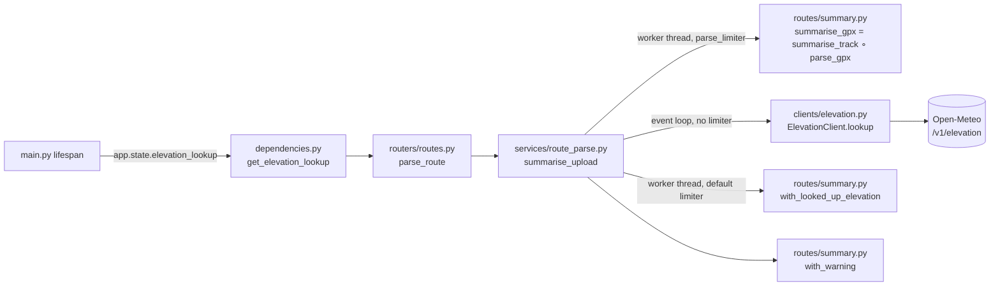

# 0005 — Elevation backfill: parse → lookup → summarise seam, Open-Meteo client, call budget, warning contract

Status: accepted (tech lead, 2026-10-20); Amendment 1 accepted (tech lead, 2026-10-20); revised 2026-11-01 ($0-only fallbacks, manager) · Date: 2026-10-20 · Step: 1.3

## Amendment 1 — 2026-10-20: the quota counts coordinates; lookup spacing joins the smoothing grid
**Revision 2026-11-01 (manager directive).** The app's running cost stays $0/month (CLAUDE.md), so no path in this
ADR may depend on a paid service. What changed: option D (Open-Meteo Standard key) is marked excluded in the
manager-decision table; the Recommendation is now a $0-only escalation (A, then B, then C, with E as an alternative);
§3's escalation option (c), Consequences and Follow-ups no longer offer a paid fallback; the commercial-use follow-up
now states that the $0 rule rules out ads and subscriptions; a new follow-up records two $0 shared-IP ideas that
haven't been evaluated. The Open-Meteo terms and OpenTopoData were re-checked on 2026-11-01, and the Copernicus DEM
open-data source for option C was added to References. §3's grid, the call budget, the retry and the checkpoint
are unchanged.

Trigger: QA's recording run. Changed in place: Context (Open-Meteo), §1, §3, §4 Terms, §5, §7, Interface, Options,
Consequences, How it is tested.

**Finding 1: one coordinate is one call.** The 7th request of 100 coordinates in one minute got HTTP 429 "Minutely
API request limit exceeded" (600 ÷ 100 = 6). The elevation docs, terms and pricing pages (checked 2026-10-20) don't
say how multi-location requests are counted; pricing says "typically, one API call corresponds to one HTTP API
request" and uses fractional weights. Open-Meteo's post "Weather Data for Multiple Locations At Once" (2023-11-03)
gives `weight = nLocations * (nDays / 14) * (nVariables / 10)`: "The number of locations is now a factor". Together
with the 429, **we treat every coordinate as one call**. The terms (2026-10-20) apply limits "per IP address and per
application" and warn that shared-IP hosts "might be rate-limited earlier". Cloud Run egress IPs are shared, so real
headroom is below this table and can't be known. 1.5's forecasts draw on the same quota.

| coordinates per backfill | backfills/minute (600) | backfills/day (10,000) |
| --- | --- | --- |
| 400 (the cap) | 1 | 25 |
| 113 (10 km at 90 m spacing) | 5 | 88 |
| 72 (Tel Hadid at 90 m spacing) | 8 | 138 |

**Finding 2: the starting smoothing over-counts.** QA ran a reference implementation that follows this ADR (scratch,
not app code) on Tel Hadid at 400 points, 20 m and 9.5 m: **181.18 m against 103 m (+76 %)**, where the band is
87.55–118.45. GLO-90 returns whole metres from 3″ (≈ 90 m) cells. The 754 points are about 8.5 m apart, so the
profile is a staircase whose cell-to-cell steps are often 10–15 m, with short excursions (`raw/…-0.json`:
131 → 121 → 131 and 104 → 89 ×5 → 104). Copernicus DEM is a surface model "including buildings, infrastructure and
vegetation", so some of these steps are canopy rather than ground. A 20 m window can't flatten a 40 m excursion,
and T = 9.5 m lets 10–15 m steps through, so each one counts as gain. §3's grid is triggered, as amended there.

**1.3 does now (no manager decision):**
1. New `ParseParams.lookup_spacing_m` (0 = off) sets the lookup point count from horizontal distance (§5). It
   spends fewer coordinates and puts samples near the cell size. It joins the grid (§3).
2. The window range extends to 180 m (two cells). The T range is unchanged (§3).
3. §4 Terms is corrected. No cache and no client pacing (Options considered).
4. Budget, retry and the ≤ 5-call checkpoint are unchanged. The default spacing is 0.0 until the grid result, so
   QA's red tests hold until then (How it is tested lists the pins that move).

**Manager decision before public use (Phase 3; not blocking 1.3).** Every live option is $0/month.

| Option | Cost/month | Effort | Effect |
| --- | --- | --- | --- |
| A. Accept the free limits; watch `elevation_lookup` for `status_code` 429 | $0 | none | over-limit routes come back flagged, never a 500 |
| B. In-process cache keyed by DEM cell | $0 | S, about 1 day, no new dependency | helps only repeat or nearby uploads; lost at scale-to-zero; exact only if Open-Meteo returns the nearest cell (check against the recordings) |
| C. Self-host GLO-90 tiles for the served region in the image | $0 while the image stays in free storage | L, 3–5 days; a GeoTIFF reader is a new dependency and needs an ADR | no quota and no network; regional coverage, Open-Meteo elsewhere; same DEM as Open-Meteo; tiles are free Cloud Optimized GeoTIFFs (AWS open data, no account) |
| D. ~~Open-Meteo paid key (Standard)~~ **Excluded: violates the $0/month rule** (manager, 2026-11-01) | $29 for 1M calls (2023 post) | — | not an option while the $0 rule holds; listed only so it is not proposed again |
| E. OpenTopoData public API | $0 | M: new client, re-record, re-tune; 1 call/s forces sequential batches | counted per request (100 locations, 1,000/day); production terms not stated; no GLO-90 on the public API (nearest: `srtm90m`); its only upgrade path (GPXZ hosting) is paid |

Recommendation (revised 2026-11-01, $0 only): **A now**. If the grid picks a spacing near 90 m, 1.3 already cuts use
3–5× on 6–10 km routes, and a failed lookup only adds a warning. Put the choice on the Phase 3 entry list and decide
it on a week of `elevation_lookup` data. If 429s exceed about 1 % of lookups, escalate in this order:
1. **B, the in-process cell cache.** It costs about a day, adds no dependency and needs no approval. Its value grows
   with traffic, because a busy instance stays warm and keeps its cache. It only saves repeat or nearby routes,
   though, and can't raise the ceiling for distinct ones. Ship it with a cache-hit count on the log line, so the
   next step is decided on data.
2. **C, self-hosted GLO-90 tiles for the served region**, if 429s stay above about 1 % after B. C is the only option
   that removes the quota. It uses the same DEM as Open-Meteo, so §3's tuning should carry over (check against the
   recordings). It also frees the shared quota for 1.5's forecasts, which have no $0 substitute. It needs its own
   ADR and manager approval for the GeoTIFF dependency, and it covers only the tiles that ship in the image. Pick
   Israel first if most users are there. If 429s are well above 1 %, start C's ADR while B is built, because its
   approval takes longest.
3. **E, OpenTopoData's public API**, is a $0 alternative, not a recommendation. Use it only if C is infeasible
   (image size, or the dependency is refused) or for routes outside C's region. Its nominal ceiling is higher
   (1,000 requests of 100 locations a day), but it allows 1 call/s for the whole app. It has no stated production
   terms and no GLO-90, so it needs a re-record and a re-tune. Its only upgrade path is paid.

Plainly: inside C's region, C serves Phase 3 at $0 with no quota. Outside it, no $0 option here guarantees capacity.
A gives about 10,000 coordinates a day, shared with 1.5's forecasts and with other tenants on the egress IP. E adds
a best-effort volunteer service. If Phase 3 draws many users outside the served region, expect some no-elevation
uploads to come back flagged on busy days (a warning, never a 500). That is the cost of the $0 rule. The $0 lever
is to widen C's region as far as free image storage allows. Self-hosting the Open-Meteo server is not an option: it
needs an always-on VM. Paid options (D, a static egress IP) are excluded while the $0 rule holds.

## Context
Step 1.3 (`docs/steps/1.3.md`): when an uploaded GPX has no usable elevation, `POST /v1/routes/parse` looks it
up from Open-Meteo for the simplified points only, recomputes gain/loss, and returns `elevation_source = "lookup"`.
If the lookup fails, the route still comes back, flagged, and never as a 500. The forces:
- **Trigger.** ADR 0004 §2/§3.1 step 8: `has_elevation` is false when *any* de-duplicated point lacks a plausible
  `<ele>` (missing, unparseable, non-finite or outside [−1000, 10000] m). The backfill must cover the implausible
  case as well as the missing one, and must never run for a file with full plausible elevation.
- **Purity (CLAUDE.md, ADR 0004 §1).** Nothing in `app/routes/` does I/O, reads the clock or logs. The roadmap's
  path `app/routes/elevation.py` already holds 1.2's pure smoothing/gain code.
- **Concurrency (ADR 0004 §3.10).** The parse runs in a worker thread under `parse_limiter` (1 slot); Cloud Run has
  `--concurrency=8`, 512 MiB, 1 vCPU, max 1 instance. Network I/O must not hold the parse slot.
- **Simplify needs the high point** (§3.5 forces it), but before the lookup there is no elevation to find it.
- **Checkpoint:** gain within 15 % of the reference for `derived-tel-hadid-no-ele.gpx` (parent's AllTrails
  reference 103 m, so 87.55–118.45 m), and **≤ 5 API calls per route**. The checklist also says batches of ≤ 100
  and "1 retry"; 5 batches plus a retry each would be 10 calls.
- **Contract (ADR 0001, 0004 §2).** All `RouteSummary` fields are required; a new field regenerates
  `api/openapi.json` and `web/src/api/schema.d.ts` (`just gen-api`). Step 1.9 defines
  `Warning: code, severity (info / warn / danger), message` and lists "elevation unavailable" among its warnings,
  and its `ChecklistRequest` carries a `RouteSummary` back to the server.
- **Open-Meteo Elevation API** (docs, checked 2026-10-20): `GET /v1/elevation?latitude=..&longitude=..`,
  comma-separated, "Up to 100 coordinates can be requested at once"; response `{"elevation": [38.0]}` (always an
  array); errors are HTTP 400 `{"error": true, "reason": "..."}`. The data is Copernicus DEM 2021 GLO-90 (90 m).
  Free tier (terms): non-commercial only (no ads, no subscriptions; donations allowed); fewer than 10,000 calls/day,
  5,000/hour and 600/minute, "applied by IP addresses and application", where one coordinate counts as one call
  (Amendment 1); data under CC BY 4.0 with attribution
  ("a link next to any location Open-Meteo data are displayed"), and Copernicus credited. No API key.

## Decision
A pure stage 1 builds the no-elevation `RouteSummary` (≤ 400 points). If `elevation_source == "none"`, an async
edge service looks up those points with an `ElevationClient` on a lifespan-owned `httpx.AsyncClient`, in ≤ 4
concurrent batches of ≤ 100 with **one retry per route**, so there are at most 5 calls. A pure stage 3 then fills in
elevation and recomputes gain/loss on those points. Any failure returns the stage-1 summary with an
`elevation_unavailable` entry in a new required `warnings: list[ApiWarning]` field.

### 1. Seam

- **Stage 1 (pure): `summarise_track(track, filename, params)`.** This is today's body of `summarise_gpx` after
  `parse_gpx`. `summarise_gpx(data, filename, params)` becomes `summarise_track(parse_gpx(data), filename,
  params)`, stays pure, and stays the benchmark target. The one behaviour change: when `has_elevation` is false it
  simplifies to `lookup_point_count(distance_m, params)` points, **≤ 400**, instead of 500 (§5). It never
  calls anything. `elevation_source` is `"file"` or `"none"` and `warnings` is `[]`.
- **Deviation from ADR 0004's follow-up sketch:** `summarise_track` takes no `elevation_source` argument and no
  backfilled `RawTrack`. The lookup covers only the simplified points, so a `RawTrack` with elevation at every
  point never exists. Instead, the stage-1 no-elevation summary *is* the lookup input: its `points` are the
  simplified points with full-resolution `dist_m`, start and end included. It is also the failure answer as it stands.
- **Stage 2 (edge): `app/services/route_parse.py::summarise_upload`.** It orchestrates, logs and owns the clock:
  1. `summary = await anyio.to_thread.run_sync(summarise_gpx, data, filename, params, limiter=limiter)`, the existing
     call moved here unchanged. `RouteParseError` propagates to the router, which maps it to 422 as today.
  2. `summary.elevation_source != "none"` → return it. No lookup, no log line.
  3. Otherwise `result = await elevation.lookup([(p.lat, p.lon) for p in summary.points])` **on the event loop,
     outside `parse_limiter`**, so a slow Open-Meteo never blocks other parses. If `elevation is None` (the
     lifespan did not run), it raises `RuntimeError("elevation lookup is not running (app lifespan not
     started)")`. That is a wiring bug, so a 500 is correct.
  4. Log one line (§7), then: on failure `with_warning(summary, ELEVATION_UNAVAILABLE)`; on success
     `await anyio.to_thread.run_sync(with_looked_up_elevation, summary, result.elevations, params)`, in a worker
     thread on anyio's **default** limiter. The work is bounded (≤ 400 points, ≤ `max_resample_points` samples,
     ≤ about 100 ms for a hostile globe-spanning line) and must not queue behind a 3.0 s hostile parse in the one
     parse slot (S = 3.0 s, H11(d) in `hike-api:1.3`, ADR 0004 item 54).
- **Why a service module, not the router:** the router keeps the HTTP mapping (upload, size, 422). The service can
  be unit-tested with a fake `ElevationLookup` and no `TestClient`. Phase 2 orchestration (forecast, rules) gets
  siblings in `app/services/`.
- **Memory (ADR 0004 §3.10):** during the lookup the request holds the ≈ 100 KB summary, ≤ 4 response bodies of
  ≤ 64 KiB, and the router's `data` (≤ 10 MiB). That last one is the R term the budget already charges to every
  non-parsing request. The §3.10 budget and the queue arithmetic are unchanged. Worst-case added latency is
  §5's 10 s, and it holds no parse slot.

### 2. Trigger
Backfill **iff** stage 1 returns `elevation_source == "none"`, which is exactly `has_elevation == false`: some
de-duplicated point has a missing, unparseable, non-finite, overflowed (> 65,536 characters) or out-of-range `<ele>`
(ADR 0004 §3.1 step 8 and text capture). A file with every `<ele>` plausible is `"file"` and makes 0 calls. No DEM
correction of file elevation (out of scope).

### 3. Which points, and what the fields mean for a looked-up route
Order: **simplify without a high point (stage 1, horizontal RDP to `lookup_point_count` ≤ 400, §5) → look up exactly those points → compute
everything elevation-related on them.** No re-simplification and no densification.

| Field | `elevation_source = "lookup"` |
| --- | --- |
| `points[].elev_m` | the looked-up value for that point, as returned (not smoothed); never null |
| `start.elev_m`, `end.elev_m` | `points[0].elev_m`, `points[-1].elev_m` (simplify always keeps both ends) |
| `min_elev_m`, `max_elev_m` | min/max of the looked-up values, **over `points`**, not over all de-duplicated points as for `"file"` |
| `high_point` | the first index in `points` with the maximum looked-up value (`high_point_index`), so `max(p.elev_m for p in points) == max_elev_m` still holds |
| `gain_m`, `loss_m` | §3.4's method on `(points[].dist_m, elev)`: resample at `resample_step_m` (5 m) over the full-resolution distance, smooth with `lookup_smoothing_window_m`, hysteresis with `lookup_gain_threshold_m` |
| `has_elevation` | `true` |
| `warnings` | `[]` |
| everything else | unchanged from stage 1 (`distance_m`, `dist_m`, `is_loop`, `name`, `point_count_original`, …) |

**Smoothing parameters.** New `ParseParams` fields `lookup_smoothing_window_m`, `lookup_gain_threshold_m` and
`lookup_spacing_m` (Amendment 1). They are kept apart from 1.2's pair so that tuning one never moves the other's
gates. The starting values were 1.2's 20 m and 9.5 m, with spacing off. QA's recorded Tel Hadid run gave 181.18 m
(+76 %), an **over**-count from GLO-90's staircase (Amendment 1), so the grid below runs.
- **Grid (backend, during the build; not committed as code):** spacing ∈ {0 (off), 45, 90, 135} m × window ∈ {0,
  20, 45, 90, 135, 180} m × T ∈ {2.0, 2.5, …, 12.0} m, which is 504 points. Run it on the recordings in
  `api/tests/fixtures/http/elevation/`. Replay is by coordinate (§7), so every spacing replays without re-recording.
  Score each point on all three parents with `<ele>` stripped: e = (gain − ref) / ref for Tel Hadid (103), Modiin
  (198) and Ben Shemen (200). The margin is m = 15 % − max |e|.
- **Pick (deterministic):**
  - A point is feasible if |e_TelHadid| ≤ 15 %.
  - M* is the largest m among feasible points.
  - A point is acceptable if it is feasible and m ≥ max(0, M* − 3 pp). The 3 pp is the accuracy we give up for
    quota.
  - Among acceptable points, choose the **largest spacing** (fewest coordinates; 0 ranks last), then the largest
    m, then the smaller window, then the smaller T.
  - Record the values in `params.py` with a comment pointing to Amendment 1.
- **Backend report:**
  1. **Sanity row:** spacing 0, 20 m, 9.5 m must reproduce QA's 181.18 m for Tel Hadid to ±0.01 m. If it
     doesn't, stop and reconcile with QA.
  2. **Counts:** feasible points, acceptable points, and M*.
  3. **Table:** 24 rows, one per (spacing, window), each at the T with the best m. Columns: spacing, window, T,
     lookup points and calls per parent, gain (m) and signed e for all three parents, and m.
  4. **Pick row:** the same columns, plus the m of each neighbour one grid step away in every dimension.
  QA copies the pick row into `PROGRESS.md`; the checkpoint test gates Tel Hadid only.
- **Forbidden**, as in ADR 0004 §3.4: per-file parameters, loosening the gate, dropping the Tel Hadid gate, and
  values outside the grid without an amendment.
- **Escalation (tech lead → manager, with the table):** no feasible point, or M* < 0 (every feasible point leaves
  Modiin or Ben Shemen outside ±15 %, a sign of overfitting to one file). The options to present: (a) a median
  pre-filter (ADR amendment); (b) a looser gate for looked-up routes (roadmap change); (c) a different elevation
  source (Amendment 1, option C or E; D is excluded under the $0 rule).

### 4. Client
- **Module: `app/clients/elevation.py`** (new package `app/clients/`, for outbound HTTP adapters; 1.5's
  forecast client and later Overpass sit beside it). The roadmap path `app/routes/elevation.py` is rejected because
  `app/routes/` is the pure package, and its `elevation.py` already holds the pure smoothing code. The tech lead
  records this path deviation in the brief.
- **Base URL:** the existing `Settings.open_meteo_base_url` (`HIKE_OPEN_METEO_BASE_URL`, default
  `https://api.open-meteo.com`) plus the path constant `ELEVATION_PATH = "/v1/elevation"`. This meets "Settings:
  elevation base URL". 1.5 reuses the same setting (brief, Out of scope).
- **New setting:** `elevation_timeout_s: float = 5.0`, with `gt=0, le=30`; env `HIKE_ELEVATION_TIMEOUT_S` (ADR 0002
  §8 naming). Batch size, retries and the call budget are `Final` constants in `app/routes/params.py`, **not**
  settings: the checkpoint's budget is a tested invariant, and env overrides would let it drift (the ADR 0004 §1
  rule).
- **Lifetime:** `create_app` sets `app.state.elevation_lookup = None` and passes `lifespan=lifespan` to `FastAPI`.
  On startup `lifespan` opens one `httpx.AsyncClient` from `new_http_client(settings)`: `base_url` =
  `open_meteo_base_url`, `timeout=httpx.Timeout(elevation_timeout_s)`, `follow_redirects=False`, header
  `User-Agent: hike-prep-api/<settings.version>`, no transport retries. It stores
  `ElevationClient(http, timeout_s=...)` on `app.state.elevation_lookup`. On shutdown it resets that to `None`, and
  `async with` closes the client. `get_elevation_lookup(request)` returns `app.state.elevation_lookup` and is the
  override point for tests. Because the attribute starts as `None`, a `TestClient` used without `with` still serves
  files that have elevation, and fails loudly (§1 step 3) only when a lookup is needed.
- **Query:** `latitude` and `longitude` are comma-joined, with no spaces, in point order; each value is
  `f"{v:.5f}"` (`COORD_DECIMALS = 5`, ≈ 1.1 m, far below the 90 m DEM cell). That keeps a 100-point URL at about
  2 KB. Other parameters: none.
- **Per attempt:** `anyio.fail_after(timeout_s)` around send *and* body read. This is a true wall-clock bound; httpx's
  timeouts are per phase and per read. The body is streamed and capped at `MAX_RESPONSE_BYTES = 64 KiB` (100 values
  is about 1 KB); a larger body is `bad_response`.
- **Response validation (`parse_elevations`)** — success only if the status is 200 and the body is a JSON object
  whose `elevation` is a list of exactly `expected` numbers (JSON int or float; not bool, string or null), each
  finite and within [`MIN_PLAUSIBLE_ELEV_M`, `MAX_PLAUSIBLE_ELEV_M`]. `NaN`/`Infinity` tokens and `1e999` are
  failures. Extra keys are ignored, and so is Content-Type. Anything else is `bad_response`.
- **Errors the client turns into a result:** `TimeoutError` (from `fail_after`), `httpx.TimeoutException`,
  `httpx.TransportError`, non-200 status and `bad_response`. **Every other exception propagates.** That includes
  pytest-socket's `SocketBlockedError`/`SocketConnectBlockedError` (`RuntimeError`s), so an accidental live call in a
  test fails loudly instead of degrading to a warning.
- **Terms:** the app is free with no ads or subscriptions, so it is non-commercial use. The free limits count
  **coordinates, not requests** (Amendment 1). A backfill of n points costs n calls, plus ≤ 100 if a batch is
  retried. At the 400-point cap that is 25 backfills a day and one a minute. The limits apply per IP and
  application, and Cloud Run's egress IPs are shared, so real headroom is lower and unknown. An exhausted limit
  returns a 429, which §5 doesn't retry and §6 turns into the warning. The decision for public use is in
  Amendment 1. Attribution is a 1.10/1.11 UX item (Follow-ups).

### 5. Call budget, retry, concurrency, latency
- **Constants** (`app/routes/params.py`): `ELEVATION_BATCH_SIZE = 100`, `ELEVATION_MAX_RETRIES = 1`,
  `ELEVATION_MAX_CALLS = 5`, and `LOOKUP_MAX_POINTS = (ELEVATION_MAX_CALLS − ELEVATION_MAX_RETRIES) ×
  ELEVATION_BATCH_SIZE = 400`.
- **Lookup point count (Amendment 1), pure, in `app/routes/summary.py`:** `lookup_point_count(distance_m, params)`
  is `cap` when `lookup_spacing_m == 0`, and otherwise `min(cap, max(3, ⌈distance_m / lookup_spacing_m⌉ + 1))`,
  where `cap = min(max_points, lookup_max_points)`. Stage 1 simplifies every no-elevation route to that
  many points, or fewer if the track has fewer, so the failure answer and the lookup answer have the same points.
  The count reads only horizontal data, so a file with one bad `<ele>` gets the same points as its no-ele copy.
- **How both hold:** n = `lookup_point_count` ≤ `LOOKUP_MAX_POINTS` = 400, so ≤ 4 batches, and **"1 retry" is one
  retry per lookup (per route), shared by its batches**. So calls ≤ ⌈n/100⌉ + 1 ≤ 5, whatever the grid picks.
  `ParseParams.__post_init__` raises `ValueError` unless `3 ≤ lookup_max_points ≤ LOOKUP_MAX_POINTS` and
  `lookup_spacing_m` is finite and ≥ 0.
  `ElevationClient.lookup` raises `ValueError` for 0 or more than `LOOKUP_MAX_POINTS` coordinates; that is a
  programming error.
- **Retried (once per route):** timeout, `httpx.TransportError` (connect, read, protocol errors) and HTTP 5xx.
  **Not retried:** 429 (Open-Meteo's limits are per minute, hour and day, so an immediate retry only burns budget),
  other 4xx and 3xx (our bug or a moved endpoint), and `bad_response` (deterministic). The retry is immediate, with
  no backoff.
- **Batches run concurrently** in one anyio task group. When a batch fails and the retry token is spent or the
  failure is not retryable, the lookup fails and the group is cancelled. **Calls counts attempts started**,
  including any cancelled in flight, so the bound is on what Open-Meteo may see.
- **Worst-case added latency: 2 × `elevation_timeout_s` = 10 s** (a first round of ≤ T, then one retry of ≤ T),
  plus a thread hop for stage 3. Typical latency is one round trip of about 0.1–0.3 s. No parse slot is held.
  Against Cloud Run's 300 s timeout it adds to ADR 0004's 28 s queue bar, for ≤ 38 s.
- **Partial failure is all-or-nothing:** if any batch fails, nothing is used, and every `elev_m` stays null.
  ADR 0004's "no holes" rule.

### 6. Failure contract
- New model `ApiWarning` in `app/models/warnings.py`. It is 1.9's `Warning` shape; the class is named `ApiWarning`
  because `Warning` shadows a Python builtin. Its fields: `code: WarningCode`, `severity: WarningSeverity`,
  `message: str` (English, for developers and logs). As with `ErrorResponse`, UX maps `code` to copy, and **clients
  treat an unknown `code` as a generic warning**. 1.9 extends `WarningCode`.
- `WarningCode = Literal["elevation_unavailable"]` in 1.3. `WarningSeverity = Literal["info", "warn", "danger"]`.
- The one warning 1.3 emits, `ELEVATION_UNAVAILABLE`, exactly:
  `{"code": "elevation_unavailable", "severity": "warn", "message": "Elevation could not be looked up, so gain,
  loss and the elevation profile are unavailable."}`. The message never carries upstream detail (status, reason);
  that detail goes to the log.
- `RouteSummary` gains **`warnings: list[ApiWarning]`**, required with no default (ADR 0004 §2), as the last field.
  It is `[]` when there is nothing to report.
- On failure the response is the stage-1 summary unchanged plus that warning: `has_elevation = false`,
  `elevation_source = "none"`, `gain_m`/`loss_m`/`min_elev_m`/`max_elev_m`/`high_point` null, every `elev_m` null,
  status 200.
- **Invariant over HTTP:** `elevation_source == "none"` ⇔ `warnings` contains `elevation_unavailable`. The pure
  `summarise_gpx` keeps `"none"` with `[]`, because it never attempts a lookup.
- `points` stays `2..500` in the schema; it is ≤ 400 whenever `elevation_source` is `"none"` or `"lookup"`.
- Contract change: backend runs `just gen-api`. `openapi.json` gains `ApiWarning` and `RouteSummary.warnings`, and
  `schema.d.ts` is regenerated, never edited.

### 7. Testing contract and observability
- **Recorded fixtures** in `api/tests/fixtures/http/elevation/`. QA captures them once, manually, outside pytest:
  - `record.py` is QA's script, not collected. It enumerates **every de-duplicated point** of each AllTrails parent
    (`alltrails-tel-hadid-loop.gpx`, `alltrails-modiin-hills-south-double-loop.gpx`,
    `alltrails-ben-shemen-hertzl-singletrack.gpx`) with `parse_gpx` and `drop_consecutive_duplicates`, and sends
    them through the app's own `split_batches`/`batch_query` to the live endpoint. That is 19 calls in all,
    paced to ≤ 500 coordinates a minute (Amendment 1).
  - `<parent-stem>.json`, one per parent:
    `{"source_fixture", "recorded_at" (UTC ISO 8601), "endpoint", "command" (exact command line), "git_sha",
    "coord_decimals": 5, "docs_checked": "https://open-meteo.com/en/docs/elevation-api", "requests": [{"url",
    "status", "date_header", "raw": "raw/<parent-stem>-<k>.json"}], "points": [{"lat", "lon", "sent",
    "elevation_m"}]}`. Here `lat`/`lon` are the GPX floats, `sent` is the `"lat,lon"` pair as sent, and
    `elevation_m` is the returned value.
  - `raw/<parent-stem>-<k>.json`: each response body, byte for byte.
- **Replay is by coordinate, not by URL.** A test helper builds `{(format_coord(lat), format_coord(lon)):
  elevation_m}` from `points` at load time and installs a respx side effect on `GET {base}/v1/elevation`. The side
  effect splits `latitude`/`longitude` from `request.url.params`, asserts both have equal length and ≤ 100 items,
  looks up every pair, and returns `httpx.Response(200, json={"elevation": [...]})`. An unknown pair raises
  `KeyError`, which the client does not catch, so the test fails loudly. Changes to batching, order, simplification
  or `lookup_max_points` therefore don't break the tests. Only a change to `COORD_DECIMALS` needs a re-record, and
  even then the stored GPX floats re-key the table, about 1 m off.
- A **synthetic** side effect (elevation = any fixed deterministic function of lat/lon) serves synthetic routes
  and fuzzing, where no real data is needed.
- **Log line** (logger `app.elevation`, from `summarise_upload`, exactly one per attempted lookup, none when no
  lookup): message `"elevation_lookup"`, with extra fields `points` (int), `batches` (int), `calls` (int),
  `outcome` (`ok` | `timeout` | `transport_error` | `http_status` | `bad_response`), `status_code` (int | null, the
  last non-200 status) and `duration_ms` (float). Level INFO on `ok`, WARNING otherwise. `JsonFormatter` adds
  `request_id`. The live checkpoint reads `calls` and `outcome` from this line.

## Interface — stub contract
Backend stubs exactly these modules and signatures (bodies `raise NotImplementedError` where QA needs red tests).
```python
# app/routes/params.py — additions
ELEVATION_BATCH_SIZE: Final = 100   # Open-Meteo: "Up to 100 coordinates can be requested at once"
ELEVATION_MAX_RETRIES: Final = 1    # per lookup (per route), shared by its batches
ELEVATION_MAX_CALLS: Final = 5      # roadmap 1.3 checkpoint
LOOKUP_MAX_POINTS: Final = (ELEVATION_MAX_CALLS - ELEVATION_MAX_RETRIES) * ELEVATION_BATCH_SIZE  # 400

@dataclass(frozen=True, slots=True)
class ParseParams:
    ...                                          # 1.2 fields unchanged
    lookup_max_points: int = LOOKUP_MAX_POINTS   # 3..LOOKUP_MAX_POINTS; the budget cap (§5)
    lookup_spacing_m: float = 0.0                # Amendment 1: finite, >= 0; 0 = off; set by the §3 grid
    lookup_smoothing_window_m: float = 20.0      # set by the §3 grid (starting value 1.2's)
    lookup_gain_threshold_m: float = 9.5         # set by the §3 grid; non-negative finite, like the 1.2 pair

# app/models/warnings.py — new
WarningCode = Literal["elevation_unavailable"]
WarningSeverity = Literal["info", "warn", "danger"]

class ApiWarning(BaseModel):
    model_config = ConfigDict(frozen=True, extra="forbid")
    code: WarningCode
    severity: WarningSeverity
    message: Annotated[str, Field(min_length=1)]

ELEVATION_UNAVAILABLE: Final[ApiWarning]  # the exact values in §6

# app/models/route.py — RouteSummary gains, as its last field (required, no default):
    warnings: list[ApiWarning]

# app/routes/summary.py — pure
def summarise_track(
    track: RawTrack, filename: str | None, params: ParseParams = DEFAULT_PARAMS
) -> RouteSummary: ...  # elevation_source "file" | "none"; warnings []; no-elevation → ≤ lookup_point_count points
def lookup_point_count(distance_m: float, params: ParseParams = DEFAULT_PARAMS) -> int: ...  # §5; in 3..min(max_points, lookup_max_points)
def summarise_gpx(
    data: bytes, filename: str | None, params: ParseParams = DEFAULT_PARAMS
) -> RouteSummary: ...  # == summarise_track(parse_gpx(data), filename, params); benchmark target
def with_looked_up_elevation(
    summary: RouteSummary, elevations: Sequence[float], params: ParseParams = DEFAULT_PARAMS
) -> RouteSummary: ...  # §3 table; ValueError if summary.elevation_source != "none",
                        # len(elevations) != len(summary.points), or any value non-finite/implausible
def with_warning(summary: RouteSummary, warning: ApiWarning) -> RouteSummary: ...  # appends; nothing else changes

# app/clients/__init__.py — empty
# app/clients/elevation.py
ELEVATION_PATH: Final = "/v1/elevation"
COORD_DECIMALS: Final = 5
MAX_RESPONSE_BYTES: Final = 64 * 1024
LookupOutcome = Literal["ok", "timeout", "transport_error", "http_status", "bad_response"]

@dataclass(frozen=True, slots=True)
class LookupResult:
    elevations: tuple[float, ...] | None  # None iff outcome != "ok"; else len == len(coords)
    outcome: LookupOutcome
    calls: int                            # attempts started, ≤ ELEVATION_MAX_CALLS
    batches: int
    status_code: int | None               # last non-200 status seen, for the log

class ElevationLookup(Protocol):
    async def lookup(self, coords: Sequence[tuple[float, float]]) -> LookupResult: ...

def format_coord(value: float) -> str: ...                              # f"{value:.5f}"
def split_batches(
    coords: Sequence[tuple[float, float]], size: int = ELEVATION_BATCH_SIZE
) -> list[Sequence[tuple[float, float]]]: ...                           # in order, each ≤ size
def batch_query(batch: Sequence[tuple[float, float]]) -> dict[str, str]: ...  # {"latitude": "..", "longitude": ".."}
def parse_elevations(body: bytes, expected: int) -> tuple[float, ...] | None: ...  # §4 validation; None = bad

class ElevationClient:  # satisfies ElevationLookup
    def __init__(self, http: httpx.AsyncClient, *, timeout_s: float) -> None: ...
    async def lookup(self, coords: Sequence[tuple[float, float]]) -> LookupResult: ...
        # ValueError if not 1 ≤ len(coords) ≤ LOOKUP_MAX_POINTS

def new_http_client(settings: Settings) -> httpx.AsyncClient: ...  # §4 "Lifetime" options

# app/services/__init__.py — empty
# app/services/route_parse.py — logger = logging.getLogger("app.elevation")
async def summarise_upload(
    data: bytes,
    filename: str | None,
    *,
    limiter: anyio.CapacityLimiter,
    elevation: ElevationLookup | None,
    params: ParseParams = DEFAULT_PARAMS,
) -> RouteSummary: ...  # raises RouteParseError (→ 422 in the router) or RuntimeError (no lifespan)

# app/config.py — Settings gains
    elevation_timeout_s: Annotated[float, Field(gt=0, le=30)] = 5.0   # HIKE_ELEVATION_TIMEOUT_S

# app/dependencies.py
def get_elevation_lookup(request: Request) -> ElevationLookup | None: ...

# app/main.py
@asynccontextmanager
async def lifespan(app: FastAPI) -> AsyncIterator[None]: ...
# create_app: app.state.elevation_lookup = None; FastAPI(..., lifespan=lifespan)

# app/routers/routes.py — handler name (operation ID parseRoute) and responses unchanged
async def parse_route(
    file: Annotated[UploadFile, File(description="GPX 1.0/1.1 file, at most 10 MB")],
    limiter: Annotated[anyio.CapacityLimiter, Depends(get_parse_limiter)],
    elevation: Annotated[ElevationLookup | None, Depends(get_elevation_lookup)],
) -> RouteSummary: ...  # read/close/size check as today, then summarise_upload; RouteParseError → ApiError(422)
```
`pyproject.toml`: backend moves `httpx` from the `dev` group to `[project] dependencies`. It is already in
`uv.lock` (≥ 0.28.1), so no new package enters the lock.

## Options considered
- **Lookup inside the pure pipeline (an injected callable)**: rejected. It puts I/O in `app/routes/` and can't
  await from the worker thread.
- **A sync httpx client inside the worker thread**: rejected. It holds the one parse slot for up to 10 s of network
  time, so every parse queues behind Open-Meteo.
- **ADR 0004's sketch (`summarise_track(..., elevation_source=)` over a backfilled `RawTrack`)**: rejected. It
  needs elevation at every de-duplicated point, up to 100k points or 1,000 calls.
- **An intermediate `PreparedTrack` type between the stages**: rejected. The no-elevation `RouteSummary` already
  holds exactly the lookup input, is the failure answer, and keeps the waiting request small.
- **Orchestration in the router**: rejected. It mixes HTTP mapping with the pipeline, and the service is testable
  without `TestClient`.
- **Re-simplifying after the lookup to force the high point**: rejected. It would need elevation at points never
  looked up; the high point among looked-up points is in `points` by construction.
- **Client at `app/routes/elevation.py`, renaming the pure module**: rejected. That is I/O in the pure package, plus
  churn in 1.2's code, tests and ADR references.
- **5 batches of 100 and a retry only when budget is left**: rejected. Every route over 400 points, the common
  case, would never retry.
- **A retry per batch**: rejected. Up to 10 calls breaks the checkpoint.
- **Reading "≤ 5 calls" as excluding retries**: rejected. It is a roadmap reinterpretation, and 400 points cost
  nothing measurable against a 90 m DEM.
- **Sequential batches**: rejected. The worst case is (4 + 1) × 5 s = 25 s against 10 s, and the typical case is
  4× slower.
- **Retrying 429, or a backoff before the retry**: rejected. The limits are per minute, hour and day, so an
  immediate 429 retry only burns budget; backoff adds latency and a knob for blips that one immediate retry
  already covers.
- **httpx transport `retries=1`**: rejected. It covers connect errors only, and its attempts would not appear in
  our call count.
- **Partial results (fill the batches that succeeded)**: rejected. That leaves holes in the profile (ADR 0004 §2).
- **`warning: str | None`, or a warning without `severity`**: rejected. 1.9 defines `{code, severity, message}`, and
  a list allows more than one warning.
- **Batch size, retries and timeout as env settings (all of them)**: rejected. The call budget is a tested
  invariant; only the timeout is operational.
- **A separate `elevation_base_url` setting**: rejected. It is the same host as 1.5's weather, and the brief says to
  reuse it.
- **Reusing 1.2's smoothing fields for lookups**: rejected. Tuning for lookups would move the file-elevation gates.
  **Choosing new values now**: rejected, because there is no GLO-90 data yet.
- **A1: a fixed `lookup_max_points` ∈ {100, 200, 400} as the grid dimension**: rejected. The same count spaces
  points 16–106 m apart on the three 6.4–10.6 km parents and 250 m on a 25 km route, so the tuning wouldn't
  transfer. Below 250 it also rules out the endpoint test "250 points → exactly 3 requests".
- **A1: a median pre-filter in the grid now**: deferred; it stays escalation option (a). Another method fitted on
  three files widens the room for overfitting before the grid shows it is needed.
- **A1: T above 12 m**: rejected. Tel Hadid's reference counts its 11–13 m bumps (ADR 0004 §3.4).
- **A1: client-side pacing of coordinates per minute**, as in `record.py`: rejected. The quota is shared per IP, so
  local counting can't predict a 429, and waiting adds request latency. A 429 already degrades to the warning.
- **URL-keyed cassettes / a VCR library**: rejected. Any change to batching or simplification breaks every
  recording, and the library is a new dependency.
- **Catching every exception in the client**: rejected. It would hide bugs, and it would turn pytest-socket's block
  into a silent warning.

## Consequences
- Easier: the parse slot never waits on the network. `summarise_gpx` and its benchmark are unchanged for files
  with elevation. Lookup tests survive changes to batching and simplification. 1.9 reuses `ApiWarning`. Clients
  get one rule: `"none"` comes with `elevation_unavailable`.
- **No-elevation routes return ≤ 400 points (was 500)**, both from the pure `summarise_gpx` and over HTTP. 1.2
  tests that pin 500 for a no-elevation file change (QA). With `lookup_spacing_m` > 0 they return about
  distance / spacing + 1 points (72 for Tel Hadid at 90 m), so their map line is coarser (a 1.10 UX check).
- For looked-up routes, `min_elev_m`/`max_elev_m`/`high_point` are taken over ≤ 400 horizontally chosen points. A
  summit on a straight stretch can fall between them, so the reported maximum can be a little low. That is accepted
  at 90 m DEM resolution.
- **Harder later:**
  - Raising the call budget, or more than 400 lookup points, is an ADR amendment plus a manager check against the
    free-tier limits.
  - **Free capacity is about 10,000 looked-up coordinates a day (25 to 138 backfills, Amendment 1)**, shared with
    1.5's forecasts and with other tenants on Cloud Run's egress IPs. Other tenants' use on those IPs can't be
    kept out at $0: a static egress IP (Cloud NAT) is paid, so it is excluded under the $0 rule. The $0 answers are
    Amendment 1's options. Public use (Phase 3) needs the manager decision there.
  - The spacing is tuned on 6.4–10.6 km routes. Longer routes extrapolate, and they reach the 400 cap at 400 ×
    spacing.
  - Coastal or sea points that come back non-finite fail the whole lookup (no holes).
  - `RouteSummary.warnings` becomes part of 1.9's request body, so its enum grows under the unknown-code rule.
  - httpx moves into the runtime image, and Starlette's httpx deprecation (pyproject filter) may force a
    migration later.
- Route coordinates now leave our server for Open-Meteo, as weather coordinates will in 1.5. This needs a line in
  the privacy copy before Phase 3.

## How it is tested — tests QA writes
All tests are offline (`--disable-socket --allow-hosts=127.0.0.1`). They use the respx router on
`settings.open_meteo_base_url` (`http://open-meteo.test` in `tests/conftest.py`) and an app run **with its
lifespan** (`with TestClient(create_app(settings)) as c`), unless a row says otherwise.

| Brief test | What it asserts |
| --- | --- |
| no-elevation fixture gets gain within 15 % | `derived-tel-hadid-no-ele.gpx` through the endpoint, using the recorded Tel Hadid table: 200, `elevation_source == "lookup"`, `has_elevation`, 87.55 ≤ `gain_m` ≤ 118.45, `distance_m` within 2 % of 6,400, `warnings == []`, `len(points) == lookup_point_count(distance_m, DEFAULT_PARAMS)`, respx call count ≤ 5 and == ⌈len(points)/100⌉. This is also the "real app wiring" test. Informational: the same for Modiin and Ben Shemen, with `<ele>` stripped in the test; their numbers are reported, not asserted. |
| 250 points → exactly 3 requests | A synthetic 250-point no-`<ele>` route through the endpoint with the synthetic side effect: call count == 3, batch sizes as a multiset {100, 100, 50}, every request has equal-length `latitude`/`longitude` of ≤ 100 values at 5 dp. Plus `split_batches` unit cases: 1, 100, 101, 400. |
| timeout → returned, flagged, no 500 | Every call raises `httpx.ReadTimeout` (and, separately, `ConnectTimeout`): 200, `has_elevation` false, `elevation_source == "none"`, `warnings == [ELEVATION_UNAVAILABLE]` exactly, all `elev_m` null; calls == 2 for a ≤ 100-point route. Wall-clock bound: an `ElevationClient` on `httpx.MockTransport` with an async handler that sleeps longer than `timeout_s` = 0.05 gives outcome `timeout`. |
| file with elevation → 0 requests | Every fixture with `has_elevation: true` in `expected.json`, through the endpoint: call count == 0, `elevation_source == "file"`, no `elevation_lookup` log record. |
| pytest-socket blocks live calls | An `ElevationClient` on a real `httpx.AsyncClient` (base `http://192.0.2.1`, no respx) raises pytest-socket's blocked-socket error from `lookup`; the client does not swallow it into a result. Plus: `pyproject` `addopts` contains `--disable-socket`. |
| implausible elevation → backfilled | The Tel Hadid parent with one `<ele>` set to `99999`, and separately one `<ele>` removed: `elevation_source == "lookup"`, and `gain_m` equals the no-ele fixture's lookup gain exactly (same coordinates, same points). |
| 5xx / malformed / wrong count; retry once | 503 then 200 → success, calls = batches + 1. 503 twice on one batch → flagged, and that batch made exactly 2 calls. 429 → flagged, no retry. Bodies: not JSON, `{}`, wrong count, `null`, `"12"`, `true`, `NaN`, `1e999`, `20000`, over 64 KiB → flagged, no retry. One batch of 3 fails → all `elev_m` null (all-or-nothing). Hypothesis: any failure pattern on a 400-point route keeps calls ≤ 5. |
| endpoint through real wiring | The gain row above. Lifespan: inside `with`, `app.state.elevation_lookup` is an `ElevationClient`; after exit it is `None`. `HIKE_ELEVATION_TIMEOUT_S` is read; 0 and −1 are rejected. |

Also:
- **Contract and pure units:** `with_looked_up_elevation` gives the §3 table's invariants: `max(points.elev) ==
  max_elev_m`, `high_point` in `points`, `start`/`end` equal to `points[0]`/`points[-1]`, `gain − loss == last −
  first` of the smoothed series. It raises `ValueError` on preconditions. `with_warning` changes nothing else.
  `parse_elevations` accepts every recorded raw body and equals the table values. `ParseParams` rejects
  `lookup_max_points` outside 3..400. `ceil(LOOKUP_MAX_POINTS / ELEVATION_BATCH_SIZE) + ELEVATION_MAX_RETRIES <=
  ELEVATION_MAX_CALLS`. Amendment 1: `ParseParams` rejects a negative, NaN or infinite `lookup_spacing_m`.
  `lookup_point_count` cases: spacing 0 gives the cap; tiny distances give 3; exact multiples; the 400 cap;
  `max_points` below the cap. Hypothesis: the result always lies in 3..cap.
- **Amendment 1 pins (QA), which move only if the grid picks `lookup_spacing_m` > 0.** Synthetic `no_ele_route`/
  `line_summary` tracks: use a step ≥ 135 m (the largest grid spacing). Then ⌈(n−1)·step/s⌉ + 1 ≥ n, the spacing
  never binds, and every synthetic pin stays as it is, including the roadmap's endpoint "250 points → exactly 3
  requests" and the Hypothesis "400-point route" (at 3 m it would quietly become one batch). Tests that check the
  cap itself (`test_lookup_max_points_lowers_the_cap…`, `test_the_effective_cap…`) pass `lookup_spacing_m=0`. Pins
  on the recorded fixture or on long tracks become `lookup_point_count(distance_m, DEFAULT_PARAMS)` and
  ⌈n/100⌉ calls:
  - `test_endpoint_lookup.py`: `test_the_no_elevation_fixture_gets_gain_within_15_percent_of_103_m` (== 4 calls,
    batch sizes `[100]*4`), `test_looked_up_values_are_the_recorded_ones_as_returned_not_smoothed` (400 points),
    `test_one_implausible_or_missing_ele_is_backfilled_to_the_same_answer_as_no_ele` (== 4 calls).
  - `test_summary_stages.py`: `test_the_no_elevation_fixture_is_simplified_to_400_points_not_500`,
    `test_a_no_elevation_track_has_at_most_400_points` (3 m steps),
    `test_one_missing_ele_among_many_also_gets_the_400_point_cap` (3 m steps),
    `test_the_section_3_table_for_a_looked_up_tel_hadid` (400 points).
  - `test_service.py`: `test_it_looks_up_exactly_the_stage_one_points_and_fills_them_in` and
    `test_a_successful_lookup_logs_one_info_line_with_the_documented_fields` (`points == 400`).
  - `routes/test_fixtures_acceptance.py::test_no_elevation_fixture_reports_null_not_zero` (400 points);
    `routes/test_long_tracks.py::check` (`expected = 400` and the distinct count).
  - `test_client_functions.py::test_lookup_defaults_are_the_adr_values`: the grid's three values. This pin moves
    whenever the grid changes the window or T, whatever the spacing.
  - Unchanged: `test_client.py`, which uses `LOOKUP_MAX_POINTS` (the budget cap stays 400); `LOOKUP_MAX_POINTS ==
    400`; the 3..400 validation; the globe-spanning line (4 calls); `test_elevation_bounds.py` (3 points).
- **Log:** `caplog` holds exactly one `elevation_lookup` record per lookup, with `calls`, `outcome` and `points`
  as specified.
- **1.2 tests to update (QA):**
  - HTTP tests that upload files without usable elevation now need the lifespan and a respx router: the fuzz
    `over_http` in `test_never_500.py`, `test_text_caps.py`'s overflowed-`<ele>` test, `test_elevation_bounds.py`.
    A shared `elevation_api` fixture with the synthetic side effect is the suggested shape. Their expectations move
    from `"none"` to `"lookup"`, or to `"none"` plus the warning under a failing side effect.
  - Any test pinning 500 points for a no-elevation file changes to 400.
  - Pure-layer tests of `summarise_gpx` keep `"none"`, and gain `warnings == []`.
- **Backend unit tests:** internals beyond these (task-group cancellation, streamed body cap).
- **Live checkpoint (after merge, not CI):** `POST /v1/routes/parse` of `derived-tel-hadid-no-ele.gpx` on the
  deployed API → `elevation_source == "lookup"`, gain 87.55–118.45 m. The `elevation_lookup` log entry for that
  request shows `calls ≤ 5` and `outcome == "ok"`.

## Follow-ups (out of scope)
- **Attribution (1.10/1.11, UX):** CC BY 4.0 needs "a link next to any location Open-Meteo data are displayed",
  plus Copernicus credit. When `elevation_source == "lookup"`, the profile/summary should show "Elevation data:
  Open-Meteo.com (Copernicus DEM GLO-90)" with links. Weather in 1.5 shares the obligation.
- **Live checkpoint log access:** reading the deployed `elevation_lookup` line needs Cloud Logging (console or
  `gcloud logging read`), which is a manager action. The tech lead should add it to the brief's Manager actions.
- **ADR 0002 §8's env list** should gain `HIKE_ELEVATION_TIMEOUT_S` the next time ADR 0002 is touched.
- **ADR 0004 §1 says `RouteSummary` is response-only;** 1.9 makes it a request model too. 1.9's ADR should decide
  whether the server trusts a client-sent summary.
- **Caching lookups** (brief, Out of scope): this is option B in Amendment 1's manager decision.
- **Commercial use (constraint):** if the app ever adds ads or subscriptions, Open-Meteo requires a paid plan
  (terms, re-checked 2026-11-01), which is a manager decision. While the $0/month rule holds, that rules out ads and
  subscriptions in the app. Lifting it reopens this ADR and 1.5's.
- **Shared-IP headroom at $0 (not evaluated):** the terms page (2026-11-01) names shared hosts as hitting the limits
  early and suggests Cloudflare Workers, where limits apply per Cloudflare user. That would give us our own quota
  rather than a share of the egress IP's, but not a higher ceiling. It is a new platform and account, outside the
  stack, so it needs its own ADR and manager approval. The same goes for having clients call Open-Meteo from their
  own IPs, which also changes the contract and the trust model.

## References
- Open-Meteo Elevation API docs (endpoint, ≤ 100 coordinates, response and error shape, Copernicus GLO-90 90 m,
  attribution): https://open-meteo.com/en/docs/elevation-api (checked 2026-10-20)
- Open-Meteo terms (free-tier limits 10,000/day, 5,000/hour, 600/minute; per IP and application; non-commercial
  definition; CC BY 4.0): https://open-meteo.com/en/terms (checked 2026-10-20)
- Open-Meteo pricing (one API call is typically one HTTP request; fractional weights; multi-location counting not
  stated; 300,000/month free; paid plans without prices): https://open-meteo.com/en/pricing (re-checked
  2026-10-20). The terms page was re-checked the same day: limits are per IP and per application, with the
  shared-IP warning. Re-checked 2026-11-01: limits unchanged; commercial use needs a Standard or higher plan; the
  page suggests Cloudflare Workers for shared hosts.
- Open-Meteo, "Weather Data for Multiple Locations At Once" (2023-11-03; weight = nLocations × …):
  https://openmeteo.substack.com/p/weather-data-for-multiple-locations (checked 2026-10-20)
- Open-Meteo, "API Subscriptions for Commercial Use" (2023-06-12; Standard $29/month for 1M calls, Professional
  $99 for 5M): https://openmeteo.substack.com/p/api-subscriptions-for-commercial (checked 2026-10-20)
- Copernicus DEM (a DSM "including buildings, infrastructure and vegetation"; GLO-90 at 3″; free licence):
  https://dataspace.copernicus.eu/explore-data/data-collections/copernicus-contributing-missions/collections-description/COP-DEM
  (checked 2026-10-20)
- OpenTopoData public API (100 locations per request, 1 call/s, 1,000 calls/day): https://www.opentopodata.org/
  (checked 2026-10-20; re-checked 2026-11-01: limits unchanged, no production terms stated, public datasets include
  `srtm90m` but no Copernicus GLO-90, paid GPXZ hosting is the upgrade path)
- Copernicus DEM on AWS open data (GLO-90 as Cloud Optimized GeoTIFFs, bucket `copernicus-dem-90m`, free under
  the Copernicus licence, no AWS account needed): https://registry.opendata.aws/copernicus-dem/ (checked
  2026-11-01)
- Open-Meteo licence (attribution link next to the data; Copernicus licence): https://open-meteo.com/en/licence
  (checked 2026-10-20)
- respx guide (side effects, `call_count`/`calls`, `base_url`, `assert_all_mocked`):
  https://lundberg.github.io/respx/guide/
- Repo: `docs/steps/1.3.md`; `docs/roadmap/phase-1.md` §1.3 and §1.9; ADR 0002 §8; ADR 0004 §1, §2, §3.1,
  §3.4–3.6, §3.10, Follow-ups; `api/app/routes/{summary,simplify,elevation,params}.py`,
  `api/app/routers/routes.py`, `api/app/{main,dependencies,config,logging_config}.py`,
  `api/tests/conftest.py`, `api/tests/fixtures/gpx/expected.json`.
