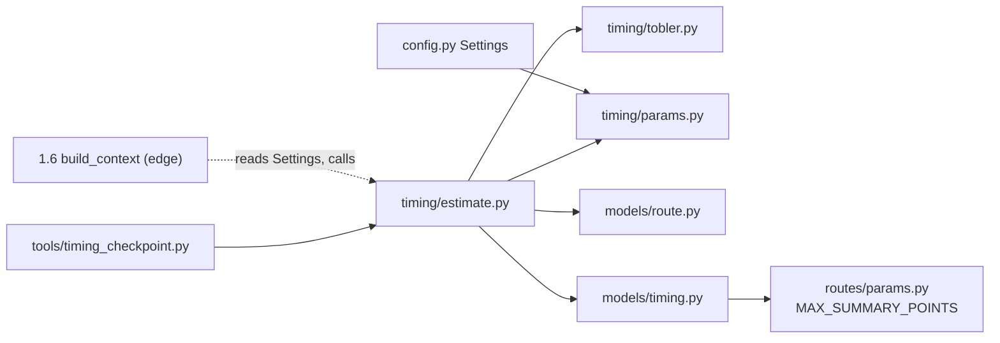

# 0006 — Duration estimator: Tobler per segment, windowed and clamped slope, pace and rest, `Timing` contract

Status: accepted (tech lead, 2026-11-02) · Date: 2026-11-02 · Step: 1.4
Amended 2026-11-02: (1) §2 window clamped to the route's own span [d_0, D], not [0, D]; (2) §2 spike case restated with 70 points (10 m spacing only for 2,400–2,600 m) to stay within `MAX_SUMMARY_POINTS`; (3) §2 bound stated exactly as 0.06 / (6·exp(−3.5·0.55)) ≈ 0.0685515 min/m.

## Context
Step 1.4 (`docs/steps/1.4.md`, `docs/roadmap/phase-1.md` §1.4) needs a pure `estimate(route, start_time, pace_factor,
rest_min_per_hour) → Timing`. 1.5 uses it to pick weather hours, and 1.6 puts it in `TripContext`. The forces:
- **Input.** The input is `RouteSummary.points`: 2..500 simplified points (ADR 0004 §3.5, horizontal RDP). `dist_m` is
  the cumulative 2-D haversine distance along the full-resolution track. It never decreases, and the last value equals
  `distance_m`. `elev_m` is **raw and unsmoothed**: the file value at that point, or the looked-up GLO-90 value
  (ADR 0005 §3). Only the gain is smoothed, and its tuning stays in `app/routes/`.
- **Raw elevation is noisy at the segment scale.** In `alltrails-tel-hadid-loop.gpx` (lines 66–80), 131.13 m drops to
  128.38 m over about 5 m, and 130.12 m drops to 127.28 m over about 6 m: per-segment slopes of about ±50 % on a
  route whose mean grade is about 3 %. Tobler's function is convex in slope, so jitter like this raises the time
  systematically. ±12 % jitter around 0 adds about 30 %. The amount differs from file to file, and one fitted pace
  factor can't absorb that.
- **Elevation is all or nothing.** Every `elev_m` is null when `elevation_source = "none"` (ADR 0004 §2 "no holes",
  ADR 0005 §5). The model's types still allow a partial-null list, and 1.9's `ChecklistRequest` carries a
  client-sent summary.
- **Checkpoint.** One pace factor is fitted as the geometric mean of real ÷ estimated **total** time over 5 hikes, at
  rest 10 min/h. That needs total time to be exactly linear in the pace factor.

## Decision
Time each segment between consecutive points with Tobler's function. Its slope is a **chord over a horizontal window
of at least 100 m centred on the segment, clamped to ±50 %**. Multiply by the pace factor. Add rest in proportion to
moving time, so total time and every ETA scale linearly with the pace factor. A route with any null `elev_m` is
timed as flat. `app/timing/` is pure. The defaults live in `Settings` and are read at the edge.

### 1. Tobler's function (`app/timing/tobler.py`)
- `speed_kmh(s) = 6 · exp(−3.5 · |s + 0.05|)` km/h, where `s` is dimensionless rise over horizontal run
  (0.10 = 10 %). It raises `ValueError` if `s` is not finite. It does **not** clamp; the clamp is applied by the
  estimator (§2).
- The run is horizontal: `dist_m` is 2-D, and Tobler's `dh/dx = tan θ`. Time is horizontal distance ÷ speed, with no
  3-D length correction.
- Segment time at pace 1, in minutes: `t_i = 0.06 · Δd_i / speed_kmh(s_i)`, with Δd in metres.
- Reference values (the QA table, rel 1e-5): `speed_kmh(−0.05) = 6.0` (the maximum); `(0) = 5.03674`;
  `(−0.10) = 5.03674`; `(0.10) = 3.54933`; `(0.20) = (−0.30) = 2.50117`; `(0.30) = 1.76255`;
  `(0.50) = 0.875254`; `(−0.50) = 1.242044`. Flat 5 km at pace 1 takes 300 / 5.036742 = **59.5623 min**.

### 2. Slope: centred chord window, then clamp (`segment_slopes`)
For segment i (points i → i+1), where Δd_i = d_{i+1} − d_i, d_0 = `points[0].dist_m` and D = `points[-1].dist_m`:
1. If Δd_i = 0 (a repeated or co-located point), then s_i = 0.0. The segment adds 0 time, so its value never
   matters.
2. Otherwise: m = (d_i + d_{i+1}) / 2, h = max(`SLOPE_WINDOW_M`, Δd_i) / 2, a = max(d_0, m − h), b = min(D, m + h), and
   **s_i = (E(b) − E(a)) / (b − a)**. Since d_0 ≤ d_i and d_{i+1} ≤ D, b − a ≥ Δd_i > 0, so this never divides by zero.
   - The window is clamped to the route's own span, not to [0, D]. A summary built by our parser starts at d_0 = 0,
     but a client-built one may start at d_0 > 0; clamping to 0 would stretch the chord over a flat phantom before
     the first point.
   - E is the piecewise-linear interpolation of (`dist_m`, `elev_m`). It is only ever evaluated at x in [d_0, D], so
     it never extrapolates. At a repeated distance the **last** point at that distance wins (`bisect_right − 1`), as
     `app/routes/elevation.py::_resample` does.
   - A segment longer than the window gets its own slope. A route shorter than the window gets its end-to-end slope
     on every segment.
3. s_i = max(−`MAX_ABS_SLOPE`, min(`MAX_ABS_SLOPE`, s_i)).

**Values.** `SLOPE_WINDOW_M = 100.0` and `MAX_ABS_SLOPE = 0.5`. Both are `Final` constants and **not** settings, for
the same reason as ADR 0004 §1: env overrides would let what runs drift from what was tested.
- **Why 100 m.** The window has to be long relative to the noise (about ±3 m over 5–10 m segments) and short relative
  to real climbs. Over 100 m, ±3 m becomes about ±4 % slope noise, which costs about +1 % from convexity. A 50 m
  window would cost about +15 %.
- **Why 0.5.** No sustained hiking grade is steeper. Beyond it, the exponential gives vertical rates (152 m/h at
  100 %) far slower than real hikers manage.
- **The bound.** After the clamp, every segment's pace-1 time is at most 0.06 · Δd / speed_kmh(0.5), with
  speed_kmh(0.5) = 6·exp(−3.5·0.55) ≈ 0.875254. The exact per-metre bound is **0.06 / (6·exp(−3.5·0.55)) ≈
  0.0685515 min/m (68.55 min/km)**; the 5-digit 0.06855 is rounded low and must not be used as a test bound. With pace
  and rest applied, `moving_min` ≤ pace · 0.06 / (6·exp(−3.5·0.55)) · D, and `total_min` is at most that
  × (1 + rest / 60).

Because the slope is a chord, a short spike only matters where a window endpoint lands on its ramps. **The brief's
spike case** (as QA built it, 70 points, within `MAX_SUMMARY_POINTS = 500`): a flat 5 km route with points every 10 m
between 2,400 and 2,600 m, every 100 m elsewhere, and one extra point at 2,502 m with elevation 30 m (2 m up, 8 m
down). Only two segments change, [2450, 2460] to s = +0.1875 and [2550, 2560] to s = −0.1875. `moving_min` rises
by **0.1532 min (≈ 9 s)**. QA asserts the increase is ≤ 0.2 min. Without the window and clamp, the 2 m segment's slope
of 15 would give a time of about 10²¹ min.

### 3. Missing elevation
- If **any** point has `elev_m is None`, every s_i = 0 and the route is timed as flat. That covers `"none"` (all
  null) and the partial-null case, which only a client-built summary can produce. The rule reads the data, not the
  `has_elevation` or `elevation_source` flags.
- **Not signalled in `Timing`.** The signal already sits next to it: `route.elevation_source == "none"`, and over HTTP
  `route.warnings` contains `elevation_unavailable` (ADR 0005 §6). 1.6's `TripContext` carries both `route` and
  `timing`.
- **Option for the tech lead (not recommended now):** add `assumed_flat: bool` to `Timing`. That would go beyond the
  roadmap's field list, so it is a roadmap deviation the tech lead would have to record.

### 4. Pace factor, rest, ranges, settings
Let B = Σ t_i at pace 1 (a running prefix sum, C_j = Σ_{i<j} t_i, so B = C_last) and k = pace_factor · (1 + rest / 60).
- `moving_min = pace_factor · B`
- `total_min = B · k`, so rest = rest_min_per_hour × moving hours.
- **Both moving and total time are linear in the pace factor.** `moving_min(1.5) == 1.5 · moving_min(1.0)` holds
  bit for bit. For total time QA uses `rel=1e-12`.
- **`estimate` ranges** (otherwise it raises `ValueError`): `pace_factor` finite and in [0.25, 4.0]; `rest_min_per_hour`
  finite and in [0, 60]. Neither argument has a default in `estimate`.
- **`Settings` fields:**
  - `pace_factor`: env `HIKE_PACE_FACTOR`, default 1.0, constrained `ge=0.25, le=4.0, allow_inf_nan=False`.
  - `rest_min_per_hour`: env `HIKE_REST_MIN_PER_HOUR`, default 10.0, constrained `ge=0, le=60, allow_inf_nan=False`.
  - The bounds and defaults come from `app/timing/params.py`, so the two layers can't disagree.

### 5. ETAs (rest added proportionally)
- `eta_by_point[0] = start_time`.
- For j ≥ 1: `eta_by_point[j] = (start_utc + timedelta(minutes=C_j · k)).astimezone(start_time.tzinfo)`, where
  `start_utc = start_time.astimezone(UTC)`.
- `start = eta_by_point[0]` and `finish = eta_by_point[-1]`. Because C_last · k is the same float as `total_min`,
  `finish − start` equals `total_min` to within timedelta's 1 µs rounding.
- Rest therefore accrues at the same rate as moving time. At rest 10, a point reached after 60 moving minutes
  (pace already applied) has an ETA of start + 70 min.
- **Monotonicity.** ETAs never decrease. They **strictly increase** across every segment with Δd ≥ 1 mm. The fastest
  case is 6 km/h ÷ 0.25 pace = 24 km/h, so 1 mm takes 0.15 ms, well above the 1 µs resolution. Below 1 mm, rounding may
  make two ETAs equal.
- **Zero-distance route.** All Δd = 0, so 0 min, and every ETA equals start.
- The arithmetic is done in UTC so that elapsed time stays exact across a DST change. The result is in
  `start_time`'s own tzinfo. `estimate` never chooses a timezone; that is 1.5's job.

### 6. Inputs, `Timing` model, location
- **Naive `start_time`.** If `start_time.tzinfo is None` or `utcoffset() is None`, `estimate` raises `ValueError`.
- **Decreasing `dist_m`.** If `points` has a decreasing `dist_m`, `estimate` raises `ValueError`. That is a broken
  client-sent summary.
- `route.distance_m` is ignored; the input is `points[-1].dist_m`, which ADR 0004 says is equal to it.
- **Minutes are unrounded floats**, as in ADR 0004 §2. Display rounding belongs to the clients.
- **Where things live.** The model goes in `app/models/timing.py`, matching phase-1.md line 3's `models/`, the place
  1.6's `TripContext` imports from. The logic goes in `app/timing/`: `tobler.py`, `estimate.py` and `params.py`.

### 7. Purity
- `app/timing/` does no I/O and reads no clock, randomness, environment or `Settings`.
- It may import only `math`, `bisect`, `itertools`, `collections.abc`, `typing`, `datetime` (for types and
  arithmetic), `app.models.route`, `app.models.timing` and `app.timing.*`.
- Callers pass in the settings values: 1.6's `build_context` and the checkpoint harness, which uses the defaults in
  `app/timing/params.py`.

### 8. Sanity numbers (pace 1.0, rest 10; for QA's plausibility check, not a gate)
How the expected values below were estimated:
- **Flat time:** the reference distance at 5.03674 km/h.
- **Two-grade approximation:** half the distance climbing the reference gain, half descending it. For a loop at
  grades under 5 %, this lands at or slightly above flat time.
- **Band:** moving time from 0.97 × flat (the ±2 % haversine distance) to 1.20 × flat. A result above the band means
  noise is leaking through §2. If that happens, tell the architect; don't tune.

| Fixture | Flat (min) | Two-grade moving (min) | `moving_min` band | Two-grade total (min) | `total_min` band |
| --- | --- | --- | --- | --- | --- |
| Tel Hadid (6.4 km, 103 m) | 76.24 | 76.7 | 74.0–91.5 | 89.5 | 86.3–106.7 |
| Modiin (8.5 km, 198 m) | 101.26 | 102.6 | 98.2–121.5 | 119.7 | 114.6–141.8 |
| Ben Shemen (10.6 km, 200 m) | 126.27 | 127.4 | 122.5–151.5 | 148.6 | 142.9–176.8 |

`derived-tel-hadid-no-ele.gpx` (flat by §3) must give exactly `moving_min = 0.06 · distance_m / speed_kmh(0)`.

## Interface
```python
# app/timing/params.py — the only home for timing constants; imports nothing from app
SLOPE_WINDOW_M: Final = 100.0           # §2 minimum horizontal chord
MAX_ABS_SLOPE: Final = 0.5              # §2 clamp, rise/run
DEFAULT_PACE_FACTOR: Final = 1.0
DEFAULT_REST_MIN_PER_HOUR: Final = 10.0
MIN_PACE_FACTOR: Final = 0.25
MAX_PACE_FACTOR: Final = 4.0
MAX_REST_MIN_PER_HOUR: Final = 60.0

# app/timing/tobler.py
def speed_kmh(slope: float) -> float: ...   # 6·exp(−3.5·|slope + 0.05|); ValueError if not finite; no clamp

# app/timing/estimate.py
def segment_slopes(points: Sequence[TrackPoint]) -> list[float]: ...
    # len(points) − 1 values per §2/§3, each in [−MAX_ABS_SLOPE, MAX_ABS_SLOPE]; ValueError if dist_m decreases
def estimate(
    route: RouteSummary, start_time: datetime, pace_factor: float, rest_min_per_hour: float
) -> Timing: ...  # §4–§6; ValueError on naive start_time, out-of-range pace/rest, decreasing dist_m

# app/models/timing.py
class Timing(BaseModel):
    model_config = ConfigDict(frozen=True, extra="forbid", allow_inf_nan=False)
    start: AwareDatetime
    finish: AwareDatetime
    moving_min: Annotated[float, Field(ge=0)]
    total_min: Annotated[float, Field(ge=0)]
    eta_by_point: Annotated[list[AwareDatetime], Field(min_length=2, max_length=MAX_SUMMARY_POINTS)]

# app/config.py — Settings gains
    pace_factor: Annotated[float, Field(ge=MIN_PACE_FACTOR, le=MAX_PACE_FACTOR, allow_inf_nan=False)] = DEFAULT_PACE_FACTOR       # HIKE_PACE_FACTOR
    rest_min_per_hour: Annotated[float, Field(ge=0, le=MAX_REST_MIN_PER_HOUR, allow_inf_nan=False)] = DEFAULT_REST_MIN_PER_HOUR  # HIKE_REST_MIN_PER_HOUR
```

No endpoint, no OpenAPI change and no new dependency. `Timing` reaches the OpenAPI schema with 1.10.

## Options considered
- **Per-segment slope with only a clamp**: rejected. Raw ±50 % jitter would cost up to the clamp on every noisy
  segment, which inflates time by a different amount on each file.
- **Reusing `smooth_elevation` (`app/routes/elevation.py`) and sampling it at the points**: rejected. It couples
  timing to the gain tuning (20 m for files, 135 m for lookups), and it adds a resample-and-map-back step.
- **Merging segments into chunks of at least W**: rejected. ETAs inside a chunk would need their own spreading rule.
  The centred chord gives the same smoothing per segment.
- **Window of 50 m or 200 m**: rejected. 50 m leaves about +15 % convexity bias. 200 m flattens real short climbs
  more, for about 0.5 % less bias.
- **Clamp at ±1.0**: rejected. Tobler gives 152 m/h vertical there, so a leftover artefact costs up to 33× flat
  time per metre (5.8× at the chosen 0.5).
- **No clamp (window only)**: rejected. A route shorter than the window, or a DEM step, could still push the speed
  toward 0.
- **Timing from aggregate `gain_m`/`loss_m` (Naismith style)**: rejected. It gives no per-point ETAs, and the roadmap
  says "per segment".
- **Missing elevation → raise or return `None`**: rejected. 1.6 needs a `Timing`, and flat is usable when the route
  already carries the signal.
- **Rest proportional to distance**: rejected. The unit is minutes per walked hour. Spreading it by distance would
  give slow climbs less rest per hour.
- **Rest as discrete stops**: rejected. It turns ETAs into step functions, and the roadmap says "proportionally".
- **Pace scaling moving time only, with rest from unscaled hours**: rejected. Total time would stop being linear in
  the pace factor, which breaks overview.md and the checkpoint fit.
- **Naive `start_time` read as UTC**: rejected. That would be a silent error of hours in 1.5's hour pick.
- **Plain `start_time + timedelta` in a ZoneInfo zone**: rejected. Python's wall-clock arithmetic is 1 h wrong across
  a DST change.
- **Rounded minutes**: rejected. That is the clients' job, and ADR 0004 §2 doesn't round.
- **Defaults on `estimate`'s parameters, or `estimate` reading `Settings`**: rejected. Defaults would bypass the
  settings, and reading `Settings` inside `estimate` breaks purity.
- **Window and clamp as env settings**: rejected, per ADR 0004 §1.
- **`Timing` in `app/timing/`**: rejected. Phase-1 layout keeps models in `models/`, where `TripContext` lives.

## Consequences
- Easier:
  - The checkpoint fit is exact, because est(f) = f · est(1).
  - 1.5 gets an aware ETA for every point and no timezone policy to undo.
  - 1.6 builds `TripContext` from a function with no I/O.
  - The spike and clamp bounds can be stated, so they can be tested.
- Harder later:
  - The 100 m window and the 0.5 clamp are reasoned choices, not fitted ones. If the checkpoint misses ±20 %,
    changing them takes an amendment, judged on the manager's uncommitted hikes. That risks overfitting to 5 files.
  - Climbs shorter than 100 m are averaged into their surroundings, so very spiky terrain (scrambles) is
    under-timed.
  - Routes without elevation are timed flat, so hilly ones are under-timed. The UI has to say so (Follow-ups).
  - Tobler has no fatigue, surface, load or night factor, and the one pace factor absorbs only the mean. Long hikes
    may drift.
  - `Timing` has no warnings field. A timing-specific warning later is a contract change.

## How it is tested
All tests are pure unit tests in `api/tests/timing/`, offline, with no `TestClient`.
- **Tobler:**
  - The §1 table at rel 1e-5.
  - The roadmap orderings: `speed_kmh(0.2) < speed_kmh(0) < speed_kmh(−0.05)` and `speed_kmh(−0.3) < speed_kmh(0)`.
  - Hypothesis over s ∈ [−1, 1]: `speed_kmh(s) ≤ 6.0`, and the speed strictly decreases as |s + 0.05| grows
    (compare pairs with distinct |s + 0.05|).
  - Non-finite s raises `ValueError`.
- **Flat 5 km** (any point spacing; elevation all equal, or all null): `moving_min = 59.5623` (rel 1e-5). At rest 10,
  `total_min = 69.4894`.
- **Pace:**
  - pace 1.5 gives `moving_min` exactly 1.5× pace 1.0's.
  - `total_min` is linear in the pace factor (rel 1e-12) at rest 0, 10 and 60.
- **ETAs:**
  - The first equals start, and the last equals finish.
  - Elapsed time to finish is `total_min` ± 1 µs.
  - A point after 60 moving minutes at rest 10 sits at +70 min.
  - The same instants come back for a `ZoneInfo("Asia/Jerusalem")` start across the DST change and for its UTC
    equivalent. Compare as UTC instants. The tzinfo is preserved.
- **Zero distance:** 0 min, and every ETA equals start.
- **Clamp and window:**
  - The §2 spike case: +0.1532 min (rel 1e-3), and at most 0.2 min.
  - A 100 m route at +80 % gives `moving_min = 0.06·100/0.875254 = 6.8552`. At −80 % it gives `4.8307`.
  - `segment_slopes` is in [−0.5, 0.5].
  - Δd = 0 gives slope 0 and adds 0 time.
  - A repeated distance takes the last point's elevation.
- **Missing elevation:**
  - All null: the same result as an all-equal-elevation copy.
  - One null among values: also flat.
  - The no-ele fixture: §8's exact formula.
- **Invariants** (Hypothesis over generated `RouteSummary`s; Δd ∈ {0} ∪ [0.001, 2000] m; elevations finite or all
  null; starts in years 2000–2100, UTC or fixed offsets):
  - `len(eta_by_point) == len(points)`.
  - ETAs never decrease, and strictly increase where Δd ≥ 1 mm.
  - `total_min ≥ moving_min ≥ 0`.
  - `moving_min ≤ pace · 0.06 / (6·exp(−3.5·0.55)) · D` (the §2 bound, exact form, not the rounded 0.06855).
  - Purity: the same input gives an equal output twice.
- **Preconditions:** naive start; pace 0.2, 4.1, NaN and inf; rest −1, 61 and NaN; decreasing `dist_m`. Each raises
  `ValueError`.
- **Settings:**
  - `HIKE_PACE_FACTOR=1.3` and `HIKE_REST_MIN_PER_HOUR=0` are read.
  - 0, 0.2, 4.1, `nan`, `inf` and −1 are rejected for pace; −1, 61 and `nan` are rejected for rest.
  - The defaults are 1.0 and 10.0.
- **Purity:** an AST test over `app/timing/*.py`:
  - imports only §7's allowlist;
  - never imports `app.config`, `os`, `time`, `random`, `logging` or `httpx`;
  - has no attribute calls named `now`, `utcnow` or `today`.
- **Fixtures:** §8's bands, as an informational test that prints the values. The checkpoint harness is QA's
  `api/tools/timing_checkpoint.py` (brief).

## Follow-ups (out of scope)
- **1.10 UX:** when `route.elevation_source == "none"`, the duration should say it assumes flat terrain.
- **ADR 0002 §8's env list** gains `HIKE_PACE_FACTOR` and `HIKE_REST_MIN_PER_HOUR` the next time it is touched.
- **If the checkpoint fails:** report per-hike errors at window 50/100/200 m and clamp 0.4/0.5/0.6 before any
  amendment. Prefer a fix that improves every hike, not one that fits the 5.
- **1.9 trust:** a client-sent `Timing`/`RouteSummary` should be recomputed server-side, not trusted. `estimate`
  already rejects decreasing `dist_m`.

## References
- Tobler's hiking function: W = 6·e^(−3.5·|dh/dx + 0.05|) km/h, dh/dx = tan θ, maximum at −0.05; Tobler (1993),
  *Three presentations on geographical analysis and modeling*, NCGIA TR 93-1, from Imhof (1950):
  https://en.wikipedia.org/wiki/Tobler%27s_hiking_function (checked 2026-11-02)
- Repo: `docs/steps/1.4.md`; `docs/roadmap/phase-1.md` §1.4, §1.6 and line 3; `docs/roadmap/overview.md` §1.4;
  ADR 0004 §1, §2 and §3.5; ADR 0005 §3, §5 and §6; `api/app/models/route.py`, `api/app/config.py`,
  `api/app/routes/{summary,elevation,params,simplify}.py`; `api/tests/fixtures/gpx/alltrails-tel-hadid-loop.gpx`
  (lines 15–90) and `expected.json`.
