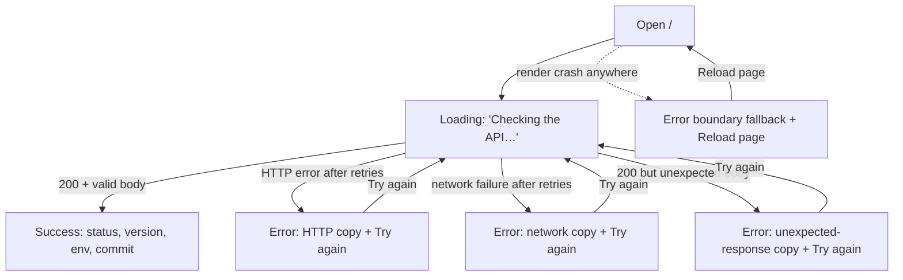

# 0.3 — Home (API status)

Step: `docs/steps/0.3.md` · Route: `/` · Audience: developers (temporary screen)

## 1. Purpose and scope
The first screen of the web app. It proves the app can reach the API by calling `GET /health` and showing the
API's status, version, environment and commit. It is developer-facing and is replaced by real product screens in
Phase 1. This spec also fixes two reusable pieces: the **error-state component** and the **app-level error
boundary fallback**. Unstyled (system defaults): structure, hierarchy, copy and semantics only — no colours,
fonts or spacing.

## 2. Flow


## 3. Layout and hierarchy (360 px first; same order at all widths)
```
<html lang="en">  <title>Hike Prep</title>
┌ header (banner) ─────────────────────────┐
│ h1  Hike Prep                            │
└──────────────────────────────────────────┘
┌ main ────────────────────────────────────┐
│ h2  API status            (tabindex -1)  │
│ [role=status] one-line summary           │  ← always in the DOM, text changes
│ ── success only ──                       │
│ dl  Status       OK                      │
│     Version      0.1.0                   │
│     Environment  development             │
│     Commit       a1b2c3d…                │
│ ── error only ──                         │
│ [error-state, role=alert]                │
│   h3  Couldn't check the API             │
│   p   <message by cause>                 │
│   [ Try again ]                          │
└──────────────────────────────────────────┘
```
Values are shown exactly as returned (long values wrap; no truncation). No navigation, no footer.

## 4. States

| State | Visible content | Screen reader | Focus |
| --- | --- | --- | --- |
| Loading (incl. while TanStack Query retries) | Status line: "Checking the API…". No details list, no error. Plain text, no spinner. | Polite (role=status): "Checking the API…" | Unchanged |
| Success | Status line: "API is online." + details list (Status "OK", Version, Environment, Commit) | Polite: "API is online." | Unchanged |
| Error (any cause) | Status line empty; error-state with title "Couldn't check the API", cause message, button "Try again" | Assertive (role=alert): title + message | Unchanged on first load (user didn't act) |
| Retrying after "Try again" | Back to Loading | Polite: "Checking the API…" | Moves to h2 "API status" (the button it was on unmounts) |

**Error messages — decision: one title, three causes.** It's a diagnostic screen, so saying *what* failed is
the point; the action is the same for all.
- HTTP error (non-2xx): "The API responded with an error (HTTP {code}). Try again in a moment."
- Network failure (fetch rejected, DNS, CORS, offline): "Couldn't connect to the API. Check your connection, or
  that the API is running, then try again."
- Unexpected body (not JSON, or fails the runtime shape check, or `status` ≠ "ok"): "The API sent a response this
  app doesn't understand. Try again; if it keeps happening, the app and API versions may not match."

**Retries.** TanStack Query may retry automatically; the user sees the Loading state throughout and the error
only after the last attempt. Keep total time to the error short (target ≤ 10 s; e.g. 1 retry) — frontend's
call, but the user must never wait silently longer than that. "Try again" is always offered on error; it
refetches immediately (one fresh attempt plus the same automatic retries).

**Error boundary fallback** (unexpected render crash anywhere in the app). Replaces the whole page:
```
┌ main ────────────────────────────────────┐
│ [error-state, role=alert, heading h1]    │
│   h1  Something went wrong               │
│   p   Hike Prep hit an unexpected        │
│       problem. Reload the page to        │
│       continue.                          │
│   [ Reload page ]                        │
└──────────────────────────────────────────┘
```
"Reload page" reloads the current URL. No stack trace, error name or technical detail is shown to the user
(log to console only). Focus moves to the h1 when the fallback renders. `<title>` stays "Hike Prep".

## 5. Error-state component contract
- `title` (required, string) — rendered as a heading; heading level is a prop (default 3; the boundary uses 1)
  so the outline stays correct where it is placed.
- `message` (required, string) — one paragraph: what happened, then what to do.
- `action` (optional) — `{ label: string, onAction: () => void }`, rendered as one native `<button>` whose
  accessible name is exactly `label`. No action → no button.
- Root has `role="alert"`. It renders only its props: no fetching, no retry logic, no icons in 0.3.
- Copy rule for every future use: title says what failed in plain words; message says why (if known) and what
  the user can do; button label is a verb phrase ("Try again", "Reload page").

## 6. Accessibility (WCAG 2.2 AA)
- `<html lang="en">`; document `<title>` "Hike Prep" in every state.
- Landmarks: one `banner` (header) and one `main`. Heading outline: h1 "Hike Prep" → h2 "API status" → h3
  error title. Fallback: single h1.
- Live regions: the status line is a `role="status"` element present from first render (so changes are
  announced); errors use the error-state's `role="alert"`. Never both for the same message.
- Details list is a `<dl>` with `<dt>`/`<dd>` pairs, terms exactly "Status", "Version", "Environment", "Commit".
- Buttons: native `<button>`, names "Try again" / "Reload page"; target ≥ 44 × 44 CSS px (WCAG 2.5.8 is 24 px;
  our principle is 44); visible focus indicator (browser default is acceptable while unstyled).
- Focus: h2 "API status" and the fallback h1 have `tabindex="-1"` for programmatic focus only (not in tab order).
- Motion: none in 0.3. Any loading animation added later must stop under `prefers-reduced-motion: reduce`.
- Contrast: system defaults. Graphic designer note: when styled, error text and status line need ≥ 4.5:1.

## 7. Acceptance criteria
`[RTL]` = Vitest + Testing Library with MSW (test QueryClient with `retry: false`). `[E2E]` = Playwright smoke.
1. [RTL] While `/health` is pending, an element with role `status` contains "Checking the API…", and no
   `alert` and no "Version" term are present.
2. [RTL] With `/health` → 200 `{status:"ok", version:"1.2.3", git_sha:"abc1234", env:"test"}`, the status
   element reads "API is online." and the page shows the terms "Status", "Version", "Environment", "Commit"
   with values "OK", "1.2.3", "test", "abc1234".
3. [RTL] With `/health` → 500, an `alert` contains the heading "Couldn't check the API" and the text
   "The API responded with an error (HTTP 500). Try again in a moment."
4. [RTL] With `/health` → network error, the `alert` contains "Couldn't connect to the API. Check your
   connection, or that the API is running, then try again."
5. [RTL] With `/health` → 200 and a body missing `version` (or `status` ≠ "ok"), the `alert` contains
   "The API sent a response this app doesn't understand." and no "Version" term is shown.
6. [RTL] In every error case a button named "Try again" is present; clicking it after MSW is switched to 200
   shows "API is online." and removes the `alert`.
7. [RTL] After clicking "Try again", focus is on the heading "API status" while the request is pending.
8. [RTL] The page has one `banner`, one `main`, heading level 1 "Hike Prep" and heading level 2 "API status".
9. [RTL] In the success and loading states there is no element with role `alert`.
10. [RTL] When a child of the app-level error boundary throws during render, the page shows an `alert` with
    heading level 1 "Something went wrong", the text "Hike Prep hit an unexpected problem. Reload the page to
    continue.", a button "Reload page", focus is on that heading, and the thrown error's message is not visible.
11. [RTL] The error-state component renders `title` as a heading at the given level, `message` as text, a
    button named by `action.label` that calls `action.onAction` on click, and no button when `action` is absent.
12. [E2E] On all three projects (desktop Chromium, Pixel 7, iPhone 14), loading `/` against the real local API
    shows "API is online." and a Version value equal to the API's `/health` `version`; the document title is
    "Hike Prep".
13. [E2E] `<html>` has `lang="en"`.

## 8. Out of scope
Navigation and other routes; styling, theming, tokens, icons; offline banner, cached last result, PWA (Phase 1);
auto-refresh/polling; showing response time or build date; error reporting/telemetry; a "copy details" action;
localisation beyond English.
